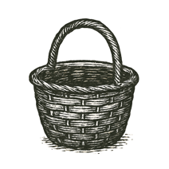

<!-- AI-assisted: revised by Claude in November 2026 to follow Coda III (the Erlkönig's last couplet held open; the book-level question of what becomes of us; overlap with Coda III and Chapter 33 trimmed); Sam's own lines kept; awaiting Sam's pass. -->

EPILOGUE

The Basket We Carry

> Wir sind die Bienen des Unsichtbaren.\
> (We are the bees of the invisible.)\
> --- **Rainer Maria Rilke**[^epilogue-rilke-bees]

Almost nothing in this book stays put. Particles hold together for a while, and so do cells, minds, families, nations and machines. Then they come apart, or turn into something else, and what we called solid turns out to have been a very long pause.

We walk through the world as if it were permanent. We inherit institutions as if they were natural, and treat economies as weather, politics as gravity and culture as geology. Even the self wears that disguise, a stable "I" moving through a stable world. But what we call reality is usually a self-assembly, brief, conditional and maintained at great cost. Physics is an agreement struck between symmetry and its breaks; biology rewrites that agreement as a copying machine that forgets, mutates, adapts and pretends it meant to. A mind is a reality bubble inside an animal that learned to simulate the world well enough to survive it, and then, inevitably, to narrate it. A society is many such bubbles negotiating a shared story until it becomes law, and technology is the same negotiation made rigid. And now, with machines that can model whole worlds, we've started manufacturing reality bubbles on purpose, which is why the last interlude called simulation a sacred act: sacred because it's consequential, not because it's mystical.

Three volumes climbed that ladder, audited it and drafted the requirements for what might come next. I won't summarize them again; Coda III has done that, and you've done the reading. Only one image needs carrying out of them: the snake that has circled the margins since Volume I. For most of history, the ouroboros could only coil. <!-- AI draft, 2026-11-15. -->Volume III set it twisting, and<!-- End AI draft 2026-11-15. --> now, for the first time, it can reach back: what we've learned about reality is starting to rewrite reality's operating conditions, through biology, through systems and through machines that mediate what we see, believe, fear and become. That's the danger, and, as Hölderlin promised at the very start of this book, where the danger is, the saving power grows too. When architecture becomes editable, choosing not to design is still a design choice, one that hands the pen to whoever shows up with the loudest incentives.

What's left is a poem, a question and a plane.

## The Farm

Goethe's ballad has been riding through this book since the end of the first volume: a father galloping through a dark forest with his sick son in his arms, while the Erlking whispers promises to the boy that only the boy can hear. Coda III left them still riding, the father horrified, the child moaning in his arms. You may know how it ends. The father reaches the farm.

> Erreicht den Hof mit Müh' und Not;

He reaches the farm with toil and trouble.[^epilogue-goethe] Goethe's next line tells us what he carries in. I'll leave it unwritten here, not because it isn't true of Goethe's ride, but because it isn't yet true of ours. We haven't reached the farm. Nobody has. The ride is still going on, through the same forest, and what arrives at the gate, a living child, a dead one, an empty saddle or a horse with no rider at all, is still being decided, by how we hold what we're carrying and where we choose to build the farm. If this book has an argument, it's that the farm doesn't have to be at the end of the road. It can be carved out of the forest while we ride.

## What Becomes of Us

And yet, even if we build it, a smaller question waits behind the large one, and it's the question I'd least like to leave the book without asking. Suppose we reach that future: a civilization that senses itself honestly, steers from the inside with a model good enough to match it, keeps its promises and lets its children answer what they inherit. What then becomes of us? Not of humanity: of you, and of me.

The plain answer is the one Chapter 32 gave. Each of us is, among other things, a psychology, a stream of experience running on a brain for eight or so decades of tussle between pleasure and pain. When the brain stops, the stream stops. Every comforting story we tell, of creation and of afterward, may be a way of keeping that stream company while it runs, and when the bubble is no longer supported, it pops. I don't know a way around that, and I've stopped trusting anyone who claims to.

But the ladder of this book suggests that the stream was never the whole of us, and here I want to do with the afterlife what Coda III did with God: keep what the promise was for, and wire it to reality. Religions offered an afterlife as a place. What they were reaching for, I think, is the sense that a life doesn't simply stop mattering when its owner does. That much can be true without anyone's soul relocating.

A person doesn't live in only one domain. We're expressed in all of them, in many directions at once. We're Carbon, the cosmic story, and the atoms that were us will go on being something for an unimaginably long time, though, as the physicist Brian Greene has noted ruefully, not necessarily forever; even the universe's structures may eventually thin into stillness.[^epilogue-greene] Our biology does its work and returns its matter to the soil, and the good it did goes on doing good, which is roughly what the Zoroastrians have said about good deeds for three thousand years.[^epilogue-good-deeds] What a brain saw and made is preserved in its work: the engineering, the code, the tools, the farm, the food bank, the dispensary, the book, each of which goes on bearing fruit after the builder is gone. And then there are the upper rungs, the stories of society, economy, nation, ideology and information, into which every life is woven whether it meant to be or not.

The person, the psychology, is the dimension in which we speak to one another, and it's the one that spreads thinnest. Even during a lifetime, it reaches only so many people before it fades into the crowd, somewhere around the hundred and fifty or so that Robin Dunbar estimated a human can maintain stable relationships with,[^epilogue-dunbar] and after death, it rarely survives two or three generations of remembering. But the other dimensions keep moving, the way a wave keeps travelling long after the stone that started it has settled on the bottom. So perhaps a person is less a point than a wavefunction, or rather several of them, one for each domain, concentrated for a while in one body and spread, thinly but really, across every turtle in the stack, vertically through the domains and horizontally through everyone we've touched. They're entangled, in a loose and metaphorical sense: what we were in one domain shapes what we leave in the others. The concentration ends. The spread doesn't, not all at once.

That's not immortality, and I won't dress it up as one. A wavefunction can be spread so thin that it disappears into noise. What we left behind can be overwritten, distorted, forgotten, or swept up in another storm before anyone has used it. Being part of something larger guarantees nothing about whether the larger thing will hear us. It only means that we were never as alone in our skins as death makes it feel.

## The Plane

My life started with a flicker, the first thing I remember, hazy and small: a frightened boy in the belly of a shuddering Fokker, suspended between two lands. I didn't choose that first crossing. I only survived it, asking for my basket as though it were a treaty with the world, <!-- AI draft, 2026-11-15. -->until a man I didn't yet know as my father walked me down the aisle to see it.<!-- End AI draft 2026-11-15. --> Perhaps that moment shaped every crossing after it: a life lived near fault lines, a mind trained to scan for ruptures, a heart that mistakes motion for safety and has to relearn, over and over, that motion is not direction.

The basket wasn't a symbol then. It was simply mine, a small container of familiar things in a world that had become impossible to read. Only later did I understand that a civilization is a basket too, a fragile container of what we can't afford to lose: stories, tools, laws, songs, medicines, warnings, apologies, maps, and the stubborn hope that the next hand will carry them more wisely than the last. A basket isn't a vault. It has gaps; it bends and frays and needs repair; it can't carry everything, nor should it. Some things must be set down, some composted, some confessed rather than inherited as law. But a basket can carry enough to cross, and enough to begin again.

And now, after all the arrows loosed, the castles raised and fallen, and the monsters faced and sometimes fed, I find myself back in the plane.

Only this time I feel like I *am* the plane.

The flicker of my first light still reflects in the cabin window---or perhaps it is the eye of the storm ahead.

---

> Wer, wenn ich schriee, hörte mich denn aus der Engel Ordnungen?\
> (Who, if I cried out, would hear me among the orders of the angels?)\
> --- **Rilke**, *Duino Elegies* I[^epilogue-rilke-elegy]

[^epilogue-rilke-bees]: Rainer Maria Rilke, letter to Witold Hulewicz, 13 November 1925, later collected in *Briefe aus Muzot 1921–1926*. The [Rilke Society’s bibliography](https://www.rilke.ch/wordpress/wp-content/uploads/Rilke-Bibliographie-Vertonungen_vs2.pdf) identifies the passage as “Die Bienen des Unsichtbaren” and gives the letter’s date. The short English gloss is retained from the manuscript.

[^epilogue-goethe]: Goethe, [“Erlkönig”](https://projekt-gutenberg.org/authors/johann-wolfgang-von-goethe/books/johann-wolfgang-von-goethe-gedichte/chapter/128/), final stanza, penultimate line. The omission that follows is deliberate.

[^epilogue-greene]: Brian Greene, *Until the End of Time: Mind, Matter, and Our Search for Meaning in an Evolving Universe* (Knopf, 2020); see also his [Quantum Physics Support interview](https://www.wired.com/video/watch/tech-support-quantum-physics) (WIRED, 4 August 2026), on the far future. Heat death is a cosmological projection under assumptions about continued expansion and available free energy, not established knowledge of a final event; proton decay remains hypothetical. “Stillness” here is the loss of organized activity, not the assertion that all microscopic motion stops.

[^epilogue-good-deeds]: Compare *Yasna* 12.8–9, the profession of good thoughts, words and deeds, in the [Avesta Zoroastrian Archives](https://www.avesta.org/yasna/yasna.htm). The date of Zarathushtra is disputed; “three thousand years” is an approximate evocation of the tradition’s antiquity. The continuing effects of deeds across this book’s domains are the author’s secular reading, not a summary of the whole Zoroastrian account of the afterlife.

[^epilogue-dunbar]: R. I. M. Dunbar, [“Neocortex size as a constraint on group size in primates”](https://doi.org/10.1016/0047-2484(92)90081-J), *Journal of Human Evolution* 22 (1992): 469–493. The often-quoted 150 is an approximate proposed network scale, not a hard personal limit; see Patrik Lindenfors, Andreas Wartel and Johan Lind, [“‘Dunbar’s number’ deconstructed”](https://pubmed.ncbi.nlm.nih.gov/33947220/), *Biology Letters* 17 (2021): 20210158. Nor is the following generational image a fixed expiry date for a person’s memory.

[^epilogue-rilke-elegy]: Rilke, *Duineser Elegien* (1923), First Elegy, opening question; [German text after the first edition, supplied by the Rilke Society](https://www.rilke.ch/wordpress/wp-content/uploads/Broschuere-Tagung-der-Rilke-Gesellschaft-2021-in-Triest-und-Duino.pdf). The English gloss is retained from the manuscript; it is not attributed here to a published translator.

<!-- Translation provenance, 2026-11-15: German Rilke passages checked; identify the source of the inherited English closing gloss, or deliberately commission/approve a fresh rendering, before final publication clearance. Protected closing wording retained. -->
