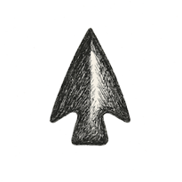

CHAPTER 1

# The First Horizon

*The Monster of Existence*

*PHYSICS*

> "The cosmos is within us. We are made of star-stuff. We are a way for the universe to know itself." --- **Carl Sagan**[^v1-c1-sagan]

That bubble of Fokker memory, lodged somewhere in my hippocampus and amygdala alike, ended as abruptly as it began: like a quantum fluctuation, brief, unexplainable, and gone before anyone could take a measurement. Its context I reconstructed only later, from the particle tracks of my mother's storytelling. But the physics stayed, or so I was promised. The plane (or perhaps several parallel planes, depending on which universe you ask) landed. My oblivious toddler self was tagged, transported, washed, rinsed, repeated.

The next clear frame I remember: I was happily walking and talking around a big house, fully fluent in the idea that these were my parents, the only ones I'd ever had. The world, I thought, had always been this way. Solid. Predictable. Like a classical fable masquerading as a life, Newtonian in its order, and just as uninterested in my confusion as I was in its origin story.

But the feeling that something was fundamentally off stayed with me, like a loose screw in the fuselage of reality. I did not yet have a word for it. Still, I occasionally wondered: do others know what I do not? Is this world a magic trick, with everyone else in on the secret (my parents, the cook, the people in the shops), and I the only moron who sees nothing but shadows?

The thought came back again and again: perhaps I was the only one left out of the plot. Everyone else could see the wires that made the world dance, while I marveled at the puppets. I hadn't yet heard of Plato's cave (at four, they had me at Play-Doh), but I was living in it: sure there were shadows, unsure I would ever see the light behind them.

## The Monster of Existence

I did not know it then, but I was beginning to sense a preschooler's version of what I'll call the monster of existence: the unease underneath all experience, the question waiting at the threshold of every thought. Why is there something rather than nothing?

Philosophers have called this unease *the Nothing*, *das Nichts*, *the absurd*. Usually it's life's answers that ruin your day; this is a question that threatens the whole week.

Reality felt so unreal to our early ancestors that they replaced it with fiction and then promoted the fiction to truth. We drafted creation stories for everything from gods to empires to economies, from the founding of Rome to the minting of Bitcoin. We installed myths like emergency door plugs, sometimes with the bolts missing. Nothing to worry about: just a neat sleight of hand we still go along with, for lack of better instructions (and lack of refunds). Yet even after we commissioned these handiworks of Romulus and Nakamoto, after all the telescopes and particle accelerators, reality still remains, in many ways, unreal.

Sagan said we are a way for the universe to know itself. It's a generous job description, but we are neither the only way nor the first. In a more modest sense, the universe "knows" itself much earlier and much more quietly: interactions can leave one system carrying a trace of another, long before any nervous system shows up to write about it.[^v1-c1-registration] (Chapter Φ called this registration, and was careful not to call it experience.) And what does "we" even mean, when we try to speak from inside pure physics?

Physics walks with us until it can't. We follow the equations until the trail dissolves into mist, and at that edge (what I would have called, as a child, the sandbox wall) we find ourselves staring at an origin story we can't yet write. Stories step in here, not because we are weak, but because the universe forgot to include a user manual in the box. This book is partly my attempt at such a story: not as doctrine, but as resonance, contouring around the blind spots of physics rather than replacing it.

## The View from Inside

It would be very tempting, and very easy, to start a chapter about physics with the story of the Big Bang: a hot, dense early universe; perhaps an earlier burst of inflation; the electroweak symmetry breaking as the Higgs field settled; quarks locking themselves into protons and neutrons; the first light nuclei forged within minutes; light set free after some 380,000 years; stars kindled.[^v1-c1-timeline] The Open before this chapter told a version of it, in the cadence of Genesis.

But told like that, the story quietly places us outside, watching it happen. No such observation deck is available to us. We are the Big Bang, or at least a late and talkative part of it. Every telescope and every detector we own looks at the universe from the inside, and Chapter Φ already showed the awkwardness of that position: the instruments, the investigator and the thing investigated belong to the same unfolding story.

So what can be said about the outside, if anything? Perhaps only this: whatever it was, it must at least have been possible. Φ's ladder of nothings ended there, on the one rung that can't be removed, because even nothing has to be possible in order to be the case.

I'll tell this chapter the way I encountered it. First, the thought that made the most sense to me when I tried to look from nowhere; then what physics, looking from the only place it can, has to say about it. (Einstein didn't find relativity by solving Newton's equations more carefully. Minkowski later gave special relativity its four-dimensional geometry; Grossmann helped Einstein find the curved geometry needed for general relativity.[^v1-c1-einstein] Sometimes the view has to change before the answer can.)

## Alice, Down the Rabbit Hole: The View from Nothing

*The twist, in one line: possibility isn't something the universe had to buy. It's the one thing even nothing couldn't avoid having.*

Alice followed a rabbit with a pocket watch, and the hole dipped so suddenly that she had no moment to think about stopping. I'm going to do the same, on purpose, for a few pages. What follows is not established physics. It's the thought that made the most sense to me when I tried to imagine the view from nowhere, and the rest of this chapter will ask where it meets what physics actually finds, looking from the only place it can.

Start at the bottom of Φ's ladder. Take away the furniture, the air, the fields, space and time, the laws themselves. What remains? Even nothing would need to be possible in order to be the case. The old maxim puts it neatly: *ab esse ad posse*, from being to possibility.[^v1-c1-abesse] We are here; therefore being here is possible. That much is modest. My next step isn't: I take possibility as the starting condition, rather than another object needing manufacture. Try to deny it while making a possible statement and the floor becomes slippery. This doesn't prove that every possibility exists. It tells me where to start digging.

I don't mean what's physically possible, given our laws. I mean what's possibly possible: every consistent arrangement, every relation among arrangements, every arrangement of relations, without limit. Call it possibility space. Nothing in it costs anything. No contractor delivered it and nobody poured it. If the universe has a free lunch, this is it.

Now the second step, and it needs an extra premise. Suppose simple ways of generating a world carry more weight than elaborate ones. A universe specified patch by patch is possible; a short process that repeats itself, then lets a few symmetries break and matter organize, may need a much smaller recipe. I am proposing Occam's razor as a weighting on possibilities. Bayesian inference has an *Occam factor*, too, but that compares models by how well they predict the evidence across their allowed parameters. It does not tell a universe which recipe to cook.[^v1-c1-occam]

The distinction matters for the *Boltzmann brain*: in some cosmological models, a lone brain fluctuating into existence with false memories can outnumber observers produced by a long cosmic history.[^v1-c1-bbrain] But "likely" depends on how you count. A smooth beginning can be simple to describe and rare among possible arrangements; a ready-made brain is complicated to describe, yet in those models cheaper to fluctuate into existence than a whole ordered cosmos. These are different accounts. My wager is that economy of description belongs in the accounting. To make that wager do physics, I would still need a weighting, a way worlds unfold, and a way to count observers within them. Simplicity alone doesn't settle the bill.[^v1-c1-simplicity]

And where we find ourselves is real to us. Once you are yourself a knot of possibilities, tangled up with everything around you, those relations are as solid as anything gets. Nobody had to bring in bulldozers to lay down the energy afterward: that is the conjecture. "Actual," as the philosopher David Lewis argued, works like "here": it means the world we are in.[^v1-c1-lewis] I imagine possibilities acquiring shapes, like waves, reinforcing or cancelling one another, and constraints selecting the patterns we measure. Quantum theory does something precise with interfering *amplitudes*, which are not ordinary probabilities. I haven't derived those amplitudes from bare possibility. The resemblance is an invitation, not yet a bridge.

Could energy differences, and the forces associated with them, arise from such biases? A particle doesn't feel anything; it's influenced. A rubber band offers a physical foothold: there are far more ways for its molecular chains to be tangled than stretched straight. In an ideal-chain model, the tension comes from that difference in available arrangements, rather than a change in the chain's internal energy. At fixed temperature, the outward force needed to hold it stretched is:[^v1-c1-entropic]

$$
f = -T\,\left(\frac{\partial S}{\partial L}\right)_T
$$

This doesn't remove the molecules or their interactions; it shows how a force can emerge at another level of description. Ludwig Boltzmann's formula, carved on his tombstone in Vienna, ties entropy to the number of ways a state can be arranged:

$$
S = k_B \ln W
$$

For a system in thermal equilibrium with a reservoir at temperature $T$, the odds of its individual microscopic states are set by their energy differences:[^v1-c1-boltzmann]

$$
\frac{p_i}{p_j} = e^{-(E_i - E_j)/k_B T}
\qquad\Longleftrightarrow\qquad
E_i - E_j = -k_B T \,\ln\frac{p_i}{p_j}
$$

Read the second form from right to left and it says something remarkable: at a given temperature, an energy difference can be recovered from the logarithm of relative likelihood, multiplied by $-k_B T$. The relation already assumes an equilibrium ensemble and an energy scale; it does not conjure energy from nothing. Quantum physics has a cousin of this idea, in which a system's statistical state defines a dimensionless energy-like operator, the modular Hamiltonian,

$$
K = -\ln \rho ,
$$

and two physicists, Alain Connes and Carlo Rovelli, used it to propose that the flow of time itself comes from a system's statistical state.[^v1-c1-thermaltime] Whether every force is a nudge of this kind is a question physics hasn't settled; gravity, as we'll see, is the hardest case.[^v1-c1-entropicgravity] (Interlude 12 will pull hard on this thread.)

That leaves the oddities, the constants that look tuned and the beginning that looks impossibly tidy. I think of these gaps in our explanation as *confounder holes*, borrowing the word loosely: places where a pattern may be pointing toward something our account leaves out. A phone that pings every morning at exactly seven suggests an alarm. The universe is a harder diagnostic. We don't yet know whether its ordered start demands a deeper cause, follows from a selection rule, or exposes a mistake in how we count possibilities.

None of this is a theory. It has not derived quantitative predictions, let alone a test that distinguishes it from existing physics. It belongs among conjectures, not discoveries. It's a dare: the simplest story I could find for something rather than nothing. The rest of the chapter climbs back out of the hole and lets the physics answer. Curiouser and curiouser.

## Back Through the Fokker

Before she came to fetch me from my grandmother, and before we all boarded that Fokker together, my mother had spent most of a year tracing ghosts.

She was nineteen. She worked at Yale's high-energy physics lab as a scanner, one of the people who sat at projection tables for hours, looking through photographs of particle collisions for the events the physicists wanted. The film came from Brookhaven, which she described to me later simply as "an island," as if that explained why the particles there behaved like castaways.

The photographs came from a bubble chamber:[^v1-c1-bubble] a tank of liquid hydrogen held right at the edge of boiling, so that any charged particle passing through left a trail of tiny bubbles behind it, like a jet's contrail across a clear sky. A magnet bent the trails into curves, and the curve told the physicists a particle's charge and momentum. The neutral particles left no trail at all. You could only infer them from the gaps: a track that ended, and two new ones that sprang out of nothing a little further on, in a shape the scanners called a vee.

That, it seems to me now, is physics from the inside, in its purest form. Nobody has ever seen a particle. We see what one leaves behind in something else: a trace registered in hydrogen, photographed on film, circled by a nineteen-year-old with a pencil, measured by a physicist, argued over by theorists. Every step is one system carrying a mark of another. Even the invisible ones announce themselves by the shape of what's missing, like a basket you can't see from your seat.

She was good at it. She liked to remind us, with just the right amount of pride, that she had the highest efficiency in her group, and a little plaque to prove it. Precision, for her, was never an abstract virtue; it was a target she could hit and pin to the wall. Yet the symmetry of those tracks pleased her beyond the metrics. It gave her free spirit a kind of quiet charge, as if the universe had drawn a circle exactly the way she would have drawn it herself.

I was a toddler then, a long way from that island, in my grandmother's care and blissfully unaware of quarks. She was the one circling. And in the story I've told myself ever since, she was circling the places where nature revealed herself.

## The First Circle: The Birth of Order

Each roll of film unspooled the after-image of an impact: white scratches on dark emulsion, some two-pronged, some three, most of them routine. She'd circle the rare ones, the prize events, the little rebels that refused to fit the templates.

One of the rare ones had a name that would one day seem like a private joke between my parents: the **Ω⁻**, the omega-minus. A few years earlier, Murray Gell-Mann had looked at the bewildering zoo of particles pouring out of accelerators (pions, kaons, sigmas, deltas, each one announced as fundamental and each one a little embarrassing) and seen that they fell into families, neat geometric patterns of eight and of ten. He called the scheme the Eightfold Way; Yuval Ne’eman independently found the same organizing symmetry. One family of ten had a hole in it: a particle no one had seen, whose charge, strangeness and mass the pattern itself dictated. He predicted it, and at Brookhaven a bubble chamber found it, a short track that stopped and handed itself on, decay after decay, in a cascade that closely matched its predicted properties.[^v1-c1-omega] The missing tenth member was real, and so was the symmetry that had demanded it.

Later runs at Brookhaven produced more of them, and more of the film that came with them. If she did circle one, she wouldn't have known it was history. To her it was simply a crisp event, a good day's work, another tick in her efficiency column. In the story I tell, though, it's hers: the first circle, the one where the universe admitted that even its chaos obeys a syntax.

### The Grammar of Quarks

In 1964, Gell-Mann and, independently, George Zweig pushed the patterns a layer deeper. The families made sense if every one of these particles was built from a few smaller pieces, which Gell-Mann called quarks, borrowing the word from a line of James Joyce.[^v1-c1-quarks] A proton is two up quarks and a down; the Ω⁻ is three strange quarks, and that turned out to be a problem worth having.

Three identical quarks in the same state should be forbidden. The Pauli exclusion principle (which, along with electromagnetism, helps keep your hand from passing through a wall) says no two identical fermions can occupy the same quantum state. So physicists gave quarks one more property, a new kind of charge that comes in three varieties, whimsically called colors: red, green and blue. The three strange quarks remain identical particles, but their color states allow the combined quantum state to obey Pauli's rule.[^v1-c1-color] In other words, her particle helped force the invention of color, the charge behind the strong force itself. (Not bad for a scratch on film.)

For a while, quarks were bookkeeping. Then electrons fired at protons at Stanford began bouncing off hard little points inside them, the way Rutherford's alpha particles had once bounced off the atomic nucleus, and the bookkeeping turned out to be real.[^v1-c1-dis] The force holding quarks together is carried by gluons, and the gluon made its own first clear appearance years later as three sprays of particles erupting from a single collision: a three-pronged signature, of all things.[^v1-c1-gluon]

The strong force has a peculiar temperament. Up close, quarks barely notice each other; pull them apart, and the energy stored between them grows, like a rubber band that only bites when stretched. Pull hard enough and the band snaps into new quarks rather than letting any one of them go free. No quark has ever been seen alone.[^v1-c1-asymfree] Confinement was the first social contract of reality: individuality forbidden, cooperation mandatory. It's also where most of the mass in your body comes from. The quarks themselves weigh very little; the bulk of a proton's mass comes from the energy of quark and gluon motion and fields.[^v1-c1-qcdmass]

Underneath all of this sits the idea that turned the particle zoo into a theory: particles are not tiny marbles but ripples in fields that fill all of space. There is one electron field, and every electron in the universe is a ripple in it, which is why every electron has the same intrinsic properties as every other, the fact Chapter Φ left hanging.[^v1-c1-qft]

### Why Symmetry Was Worth Trusting

A symmetry is a change that leaves something unchanged. Rotate a circle and its outline survives; move a well-isolated experiment, and the same relationships should hold. The point is not visual perfection but invariance. This made patterns such as Gell-Mann's worth investigating, and a mathematician most physicists had been slow to honor had shown just how much a symmetry could buy.

Emmy Noether proved, while the world outside her study was tearing itself apart in the First World War, that a continuous symmetry of a system’s action—the quantity governing its equations of motion—comes with a conserved quantity. Laws that don't change from one moment to the next conserve energy. Laws that work the same here as over there conserve momentum. Laws that don't care which way you face conserve angular momentum.[^v1-c1-noether] Conservation isn't an extra rule bolted on; it's the receipt you get for paying with symmetry. Noether did this while Göttingen refused her a proper post because she was a woman. David Hilbert, who had invited her there, reportedly told his colleagues that a university is not a bathhouse.[^v1-c1-hilbert] She lectured for years under his name, and largely without pay.

The receipt has a fine-print clause worth keeping for later. An expanding cosmology generally lacks the time-translation symmetry needed for a single conserved total energy of the universe. Local conservation still holds; the trouble is extending that bookkeeping to the whole changing geometry. (Interlude 12 will collect on that.)

Eugene Wigner added the next layer: a particle, mathematically, is a representation of the symmetries of spacetime itself, and its mass and spin are simply the labels those symmetries allow.[^v1-c1-wigner] An electron isn't a marble rolling through space. Different observers can disagree about its momentum while agreeing on its mass and spin: a choreography with rules it can't improvise away from.

For me, this first circle is the circle of belonging: a sketch of how something stable could arise from raw possibility. Before it, matter was rumor. After it, matter had grammar, rhythm and restraint. In her pencil arcs were ghosts busted: gluons binding quarks, coherence emerging from noise. She may have thought she was hunting particles. In retrospect, she was outlining ontology.

But a successful symmetry is no guarantee of the next one. The universe was already hinting that some of its mirrors were crooked. My mother's second circle would belong to that story.

## The Second Circle: The Fracture of Symmetry

The second circle is a symbolic one, and I'll be honest about why. The anomaly I'd like her to have circled was discovered at Brookhaven by James Cronin and Val Fitch, announced in 1964, the year I began my own journey as an embryo, but they found it with spark chambers, not bubble-chamber film.[^v1-c1-cp] A kaon decay can leave tracks; CP violation requires comparing decay behavior, not spotting one unusually eloquent vee. I don't know whether her particular films included those kaons. The connection I can draw is between her work of finding patterns and an experiment, at the laboratory supplying that film, which had found a pattern refusing to behave.

The heresy had started a few years earlier. Physicists had convinced themselves that nature was perfectly ambidextrous: every process had a mirror-image twin that worked just as well. Then Chien-Shiung Wu showed that cobalt-60 nuclei, lined up in a magnetic field, preferred to spit their electrons in one direction.[^v1-c1-wu] Parity, the mirror symmetry, was broken. The mirror lied.

Still, there was hope in the bookkeeping. If you flipped the mirror *and* swapped every particle for its antiparticle, said the theorists, the equations still balanced. That was CP symmetry, a kind of moral patch on the universe's crookedness, until Cronin and Fitch's kaons quietly violated even that. A tiny, statistically undeniable preference. The cosmic coin came up heads just a few too many times.

### A Universe with a Slight Limp

CP violation is physics admitting that its mirror has a hairline crack. In the Standard Model’s quark sector, it comes from a single complex phase in the matrix that describes how quarks of one kind turn into another, which Makoto Kobayashi and Toshihide Maskawa showed needs at least three families of quarks to exist.[^v1-c1-ckm] Philosophically, it's the permission slip for asymmetry itself. It tells us that the universe, like any living thing, limps a little. Its gait through time is not a perfect march but a slightly drunken stagger, and that stumble may be part of why matter survived (as for stress and boredom, I make no scientific claim).

Matter and antimatter can meet, bow politely, and annihilate in a flash of light. Yet there was a surplus: today there are roughly six ordinary-matter baryons for every ten billion background photons.[^v1-c1-asymmetry] To generate that surplus from a matter–antimatter-symmetric beginning, the familiar mechanisms need CP violation among other ingredients. Without some account of the excess, the stars, the planets, the carbon with opinions are all unpaid invoices.

Honesty compels a footnote to the poetry. The known quark-sector CP violation is insufficient to explain the whole imbalance; theorists are still hunting for the rest, perhaps among neutrinos, perhaps in some heavier field not yet cornered. The philosophical temptation is irresistible, even if the physics is unfinished: a slight departure from balance may have made room for everything that now has an opinion about balance.

### Broken on Purpose

The most consequential broken symmetry of all wasn't a crack but a choice, or what looks like one. At the enormous temperatures of the early universe, the electroweak theory describes electromagnetism and the weak interaction (the one behind certain radioactive decays) through an unbroken symmetry. As the universe cooled, a field that fills all of space, the Higgs field, settled into a state that didn't respect that symmetry, the way a pencil balanced on its tip must eventually fall in some particular direction.[^v1-c1-higgs] The single force split in two. The carriers of the weak force became heavy and short-ranged; the photon stayed massless and free to cross the universe.

Through their coupling to the Higgs field, electrons and quarks acquire mass. That means inertia, not friction: the field doesn't act as cosmic treacle, slowing particles down. The Higgs mechanism gives these particles mass without supplying most of the mass of a proton; the strong interaction does that. The Higgs boson was finally caught at CERN in 2012, almost half a century after the mechanism was proposed. Without that mechanism, atoms as we know them would not exist.

Symmetry breaking, then, needn't be a flaw in the code. It can be the act of writing itself: the equations allow several equivalent arrangements; the state takes one. For a storyteller, there's a whole world in that difference. Every life (mine, yours, hers) depends on prior distinctions that refused to cancel out.

As in my real life, her first symbolic gesture created my physics; her second nurtured it. She left that work to come get me. Somewhere between that film and that Fokker, the universe's favor toward matter had compounded through her, into me.

## The Weave of Reality

If the circles on her film were physics from the inside at the smallest scales, the sky offered the same discipline at the largest. Nobody has stood outside the universe either. We read it from traces that arrive here: starlight, radio hiss, the faint shiver of space itself.

It's tempting to picture the cosmos as a finished tapestry, a wall hanging stretched across infinity with our little drama stitched in somewhere near a corner. That picture is too tidy. The universe isn't a cloth woven once. It's a weave, ongoing and self-made, its pattern coming not from a loom standing outside it but from the recursive dance of its own threads.

In the old Newtonian picture, space and time were a pre-built stage, an invisible absolute grid where matter moved, like actors arriving after the set had been built. The twentieth century quietly burned the set. Einstein showed that space and time are one fabric, spacetime, and that it bends wherever there is mass and energy. The stage can move too, and responds to the actors; geometry and matter are coupled, though they are not the same thing. Mass tells spacetime how to curve, and spacetime tells mass how to move.[^v1-c1-gr]

A famous early test came from the inside, of course. In 1919, during a total eclipse, Arthur Eddington (the same Eddington who would later name the arrow of time) photographed stars near the darkened Sun and found them nudged from their usual positions: their light had bent around the Sun's mass on its way to the photographic plate.[^v1-c1-eclipse] A century later, the LIGO detectors caught a gravitational wave from two black holes merging more than a billion light-years away. It stretched and squeezed four-kilometer arms of the detector by a minute fraction of the width of a proton.[^v1-c1-ligo] Spacetime itself, registering in an instrument.

Our observations give us no outside of this weave to look back from, and perhaps there was no "before" for it to start in. Chapter Φ already climbed that ladder (north of the North Pole, and all that), so I'll only add what physics adds: the weave is remarkably consistent. Gravity doesn't get moody from galaxy to galaxy. The speed of light is not a local custom. The electron doesn't renegotiate its charge when it changes postal codes. That sameness is what lets a telescope in Chile and a detector on Long Island describe the same universe.

Gravity also sharpens the question of the cheap beginning. For a gas in a box, neglecting gravity, spreading out evenly is the probable state. With gravity in play, matter can clump into stars, galaxies and eventually high-entropy black holes. The early smooth distribution represents low gravitational entropy, even though its hot matter and radiation were close to thermal equilibrium.[^v1-c1-gravent] A smooth beginning may be a short description without being a typical arrangement: those two ways of counting refuse to become one just because I would like them to. Whether gravity itself can emerge as a statistical effect is a question several physicists take seriously and nobody has settled.

## The Cheap Engine

Across billions of light-years, the universe displays an astonishing sameness. The cosmic microwave background, the afterglow of the early universe, makes the point: after accounting for our motion and foreground radiation, its primordial temperature variations are about one part in 100,000. In a plain Big Bang story, that's strange. Regions on opposite sides of the sky are too far apart ever to have exchanged a signal, even at the speed of light, yet they reached the same temperature, as if they'd compared notes behind our backs. That's the horizon problem. Its cousins are the flatness problem (why is space so close to geometrically flat?) and the relic problem (where are the exotic heavy leftovers that early theories predicted?). The universe looks as though someone ironed and decluttered it before the curtain rose.

The inflationary hypothesis, developed by Alan Guth, Andrei Linde, Andreas Albrecht, Paul Steinhardt and others, was both radical and almost embarrassingly simple: for a tiny sliver of a second, space expanded exponentially, driven by a field stuck briefly in a high-energy state.[^v1-c1-inflation] A tiny patch that *had* been in contact with itself got stretched to cosmic size, wrinkles and all ironed out. Inflation doesn't make anything outrun light; it makes space itself grow so fast that yesterday's neighbors become strangers who still share the same childhood conditioning. One short burst of space on cheap steroids solves the horizon problem, flattens the curvature and dilutes the relics.

This is what I mean by a cheap route: a compact mechanism producing an enormous expanse. The economical description is real; the leap from that economy to a weighting on all possible worlds is still mine. Inflation uses fields, energy and dynamics. It doesn't yet explain why those ingredients were available. Even a free lunch has a kitchen.

Ironing everything flat would be boring, though, and fortunately quantum mechanics never quite shuts up. During inflation, tiny quantum jitters in the field were stretched along with space into slightly denser and slightly emptier regions. The denser spots pulled in more matter, gravity amplified the differences, and over billions of years galaxies, clusters and the whole cosmic web condensed out of an almost featureless froth. Inflation is generous: within these models it gives you nearly uniform conditions and just enough imperfection to build stars, planets and the occasional teenager.

In many versions, inflation never stops everywhere at once. It flickers off in one region while raging on in others, and each region where it ends becomes a bubble with its own hot beginning: a multiverse, possibly with different constants in different bubbles. That's speculation, and it inherits the measure problem: in an infinity of bubbles it's hard to say what's "typical." The measured primordial fluctuations fit many inflationary models, but don't uniquely establish inflation. Searches for primordial gravitational waves offer another test; their predicted strength varies widely, and the 2025 Particle Data Group review reports upper limits rather than a detection.[^v1-c1-inflationcritics] It's a beautiful answer still waiting for its confirming circle.

### Constants and Tightropes

<!-- AI draft: author-approved selective restoration, 2026-10-23. -->
Martin Rees chose six especially consequential numbers for *Just Six Numbers*. One is $Q$, the strength of the primordial irregularities that seeded cosmic structure, of order one part in 100,000. In models he studied with Max Tegmark, much weaker seeds make it difficult for gas to cool and form stars; much stronger ones produce dense galaxies where passing stars can disrupt planetary orbits. The acceptable range depends on what else changes with it.[^v1-c1-rees]

Before I congratulate the universe on its precision engineering, there is a selection effect to account for: only a world that supports observers can receive a review. That still leaves the question of why these values. To call them improbable, we need to know what could vary, what must vary together, and how to weight the alternatives. We do not yet have an agreed cosmic lottery.
<!-- End AI draft. -->

## Ghosts in the Gaps

Some of the universe's most important particles behave the way the neutral ones did on her film: you know them only by what goes missing.

In 1930, certain radioactive decays seemed to lose energy, as if the books didn't balance. Wolfgang Pauli rescued the bookkeeping by proposing an invisible particle that carried the missing amount away, apologizing in a famous letter that began "Dear radioactive ladies and gentlemen."[^v1-c1-pauli] It took a quarter of a century to catch one; the neutrino interacts so weakly that tens of billions of them from the Sun pass through your fingertip every second without touching anything. Much later, neutrinos turned out to change identity as they travel, which means they must have mass, a fact the Standard Model hadn't allowed for.[^v1-c1-neutrino] The ghost in the gaps was also a crack in the model.

## Spooky Correlations

One more inside view, perhaps the strangest. In the same year the Ω⁻ turned up, John Bell, a physicist at CERN, found a way to test whether quantum correlations could be explained by local hidden instructions. Two entangled particles, sent far apart, can share correlations no such local model can reproduce, provided the experimenters' measurement choices are independent of those instructions.[^v1-c1-bell] Experiments, refined over decades, have confirmed violations of Bell's inequalities: the correlations are real, and they can't be used to send a message faster than light. Einstein had called the apparent connection "spooky action at a distance." The spookiness survived; the usable telegraph didn't.

For the possibility view, this is among the most suggestive results in physics. An entangled pair has a joint state that cannot be reduced to an independent state for each member. I hear a suggestion that relations belong deeper in our account than self-contained things. Bell's result doesn't choose that ontology for us; it makes the old separateness harder to keep.

## The Quantum Loom

All of this leaves physics holding two magnificent theories that refuse to marry. The Standard Model describes the particles and three of the forces through quantum fields, where uncertainty is the rule. General relativity describes gravity as geometry, smooth and certain. Each works superbly in its own domain, and together they break down exactly where both matter most: at the beginning of the universe and at the center of a black hole. Marrying them has been the longest courtship in science, and it hasn't produced an heir.

The suitors are worth meeting briefly, because each one is a different guess about what the weave is made of:

- **String theory** replaces point particles with tiny vibrating strings whose different notes appear as different particles, gravity included. It's elegant but extravagant: extra dimensions, and, in some landscape estimates, something like $10^{500}$ possible vacuum configurations, a landscape of candidate universes. The theorists call that a landscape; the rest of us call it feature creep.[^v1-c1-strings]
- **Loop quantum gravity** keeps the four dimensions and quantizes space itself into a network of tiny loops, so that areas and volumes come in discrete chunks. Some symmetry-reduced models of loop quantum cosmology replace the Big Bang singularity with a bounce from an earlier contracting universe. It's general relativity learning to speak quantum, with a thick accent.[^v1-c1-lqg]
- **Causal sets, triangulations and graphs** build spacetime out of discrete relations. Causal set theory treats spacetime as a vast set of events linked only by "this could influence that," with the slogan "order plus number equals geometry." Another proposal, quantum graphity, starts from a network of fully connected points that cools, like water freezing, into the low-dimensional space we live in.[^v1-c1-graphs]
- **Spacetime from entanglement.** In some theories with holographic duals, removing the entanglement between two regions literally pulls the space between them apart. Geometry, in these models, is stitched together by quantum correlations.[^v1-c1-entspace]

None of them weaves the whole cloth yet. They disagree about the thread, but several pursue a possibility I find irresistible: spacetime may not be the floor, but something derived. Relations and quantum correlations have precise roles in some of these models. My broader possibility space does not yet have one.

Through that lens, the cosmos looks less like a machine than like an algorithm trying to verify itself, each layer of description arising from the need to stay consistent with the last. The cosmos is open source, but the compiler never stops running.

## Carbon and Company

The early universe was a poor chemist. In its first few minutes it made hydrogen, helium and a pinch of lithium, and then it got too cool and too thin to make anything else. Everything heavier, every atom of carbon in every living thing, had to wait for the stars.

Carbon had to squeeze through a narrow doorway. Inside a star, two helium nuclei can form beryllium-8 only for a fleeting instant, and a third helium nucleus must arrive before it falls apart. To account for the carbon we actually observe, Fred Hoyle argued that carbon must have an excited state that makes this three-way meeting far likelier. Experimenters found the resonance close to where he predicted.[^v1-c1-hoyle] The story is often retold as "we exist, therefore carbon must." The historical argument was about carbon's abundance; the anthropic moral came later. (Hoyle had another famous moment: in a 1949 radio broadcast, he'd coined "Big Bang" for a theory he opposed. The name outlived his alternative.[^v1-c1-bigbangname])

I like to imagine that one of those carbon atoms was me, or at least one of my potential selves: that the quark-and-gluon soup cooled into protons and neutrons, assembled into hydrogen, fused into helium, and after a couple of stellar lifetimes became the carbon that would eventually call itself *me*.[^v1-c1-b2fh] Forged in a stellar furnace, shed into space by a dying star, cooled into dust, and folded, after an improbable sequence of gravitational coincidences, into a planet that could ponder its own chemistry.

Along the way I had traveling companions. Maggie, the magnesium atom, was cooked in the hearts of massive stars, and would one day settle at the center of every chlorophyll molecule and hold life's energy currency together. Alex, the aluminum atom, had a radioactive cousin whose decay helped heat and melt the young asteroids of our solar system, so his family's first job was keeping planets warm; his own would be shedding heat from circuits.[^v1-c1-al26] And Silicon, my quiet twin, sat directly beneath me in the periodic table, with the same four hands for bonding, condensed from the same dust but fated for a different destiny: to conduct not thought but computation.

We are all born from the same stellar sermon. Some of us go on to think, others to compute, and a few, apparently, to narrate.

## The Hiss

Like all unpleasant creatures, I arrived with a hiss.

<!-- AI-assisted revision: preserve the author's temporal coincidence at its supported, same-year precision. -->
In the year I was conceived, Arno Penzias and Robert Wilson began the measurements that would expose the universe's infancy. The two radio astronomers in New Jersey were only trying to measure radio signals cleanly, but their instruments kept hissing. They first scooped the pigeon crap; then they scooped Robert Dicke.[^v1-c1-cmb]
<!-- End AI-assisted revision. -->

That same year, I got scooped too: not from nothing to something this time, but from material to alive. I packed up physics and moved into biology. My mother's real circles were still a couple of years ahead of her, but the circle that mattered most had already been drawn around a single cell. Its story belongs to the next chapter.

One rhyme before I go. Just as the protons and neutrons in my atoms had been reduced to up and down quarks, my biological blueprint was being reduced to four letters (A, T, C and G) and its working parts to twenty amino acids. Physics and biology had each, in the same generation, found that their whole bewildering variety was spelled with a very small alphabet.

## Turmoil in the Old Circles

After I left physics, the hiss kept talking, and what it said turned the old picture of the universe upside down.

It was the afterglow of the beginning, the light set free when the universe first turned transparent, stretched by expansion into a faint microwave glow at a few degrees above absolute zero. George Gamow's collaborators Ralph Alpher and Robert Herman had predicted something like it decades earlier, and almost everyone had forgotten.[^v1-c1-alpher] Its discovery settled a long argument: there really had been a hot, dense beginning, and the universe was not an eternal steady state. The theory Hoyle had named the "Big Bang" kept the name and won. The man who'd predicted the carbon in our bodies lost the argument about where that carbon's universe came from.

Then the hiss got sharper. A generation later, the COBE satellite found that it was not perfectly smooth after all: there were ripples in it, warmer and cooler spots differing by about one part in 100,000, patterns consistent with the seeds that inflationary models predict and gravity could grow into galaxies.[^v1-c1-cobe] A decade after that, the WMAP satellite mapped those ripples across the whole sky in detail, and a later mission, Planck, mapped them more precisely still. Reading the pattern of the ripples, cosmologists could read the universe's age, its shape and what it's made of.[^v1-c1-wmap]

And that's where the upheaval came. Within the standard cosmological model, the census said that ordinary matter—every atom of every star, every planet, every person—makes up only about 5 percent of the cosmic energy budget. Roughly another quarter is dark matter, inferred through gravity but not yet identified as a particle. The remaining two-thirds or so is attributed to dark energy, the name for what drives the accelerating expansion and whose physical nature remains unknown.[^v1-c1-darkenergy] The most precise portrait of the universe ever made from the inside turned out to be, mostly, a portrait of what we can't see. Even the pieces we measure don't quite fit: early- and late-universe estimates of the expansion rate disagree, and DESI's 2025 results, combined with other data, give model- and dataset-dependent hints that dark energy may evolve.[^v1-c1-tension]

My rabbit hole leaves me with a question about the same hiss. Its smoothness points to a remarkably ordered beginning: a short description, a low-entropy state, and still no agreed reason those should have met. The dark universe opens an even larger hole in the account. Galaxy motions, gravitational lensing and cosmic expansion demand explanation; the best-fitting model assigns most of its budget to ingredients we cannot yet identify. The monster of existence turned out to be mostly made of darkness, and we found that out by listening very carefully to a hiss.

## To Carbon and Silicon

At a smaller scale, I (the universe that was now my body) started ballooning: from a single cell to trillions by the time I emerged from that literal cocoon. The carbon atom that had been, metaphorically, my physics entered through my mother's breakfast and became a tiny bead in one of those cells.

If the universe learned to repeat itself, what would it take for matter to repeat itself into memory? Perhaps every atom is already practicing, an electron clouding around its nucleus like a thought trying to remember itself. Someday, repetition will grow circuitry; the reflection will learn to hold its own shape.

Somewhere in that mirror, sand began to dream of permanence.

<!-- SOURCE NOTES: stable native Markdown IDs; evidence and access levels recorded in the Chapter 1 adoption audit and restoration follow-up, 2026-10-23. -->

[^v1-c1-sagan]: Carl Sagan, *Cosmos* (1980), as quoted in Kate Howells, [“We’re made of starstuff. What does that mean?”](https://www.planetary.org/articles/were-made-of-starstuff-what-does-that-mean), The Planetary Society, 9 November 2025. Capitalization follows this chapter.

[^v1-c1-registration]: W. H. Zurek, [“Decoherence, einselection, and the quantum origins of the classical”](https://arxiv.org/abs/quant-ph/0105127), *Reviews of Modern Physics* 75 (2003): 715–775, on environmental correlations and stable records. “Registration” here does not imply consciousness or a record that must last indefinitely.

[^v1-c1-timeline]: Particle Data Group, [“Inflation”](https://pdg.lbl.gov/2025/reviews/rpp2025-rev-inflation.pdf), §§23.1–23.2 (2025), and [“Higgs Boson”](https://pdg.lbl.gov/2025/reviews/rpp2025-rev-higgs-boson.pdf), §§11.1–11.2; Planck Collaboration, [“Planck 2018 results. VI. Cosmological parameters”](https://arxiv.org/abs/1807.06209), *Astronomy & Astrophysics* 641 (2020): A6. Inflation and proposed earlier force-unification stages do not have the evidentiary status of the hot thermal history.

[^v1-c1-einstein]: For the chronology and Grossmann’s mathematical role, see Tilman Sauer, [“‘Before Everything was Completely Clear, We Had a Few Arguments.’—Emmy Noether, David Hilbert and Felix Klein”](https://doi.org/10.1007/s44007-025-00166-w), *La Matematica* 4 (2025): 674–701, §2; and Galina Weinstein, [“Max Born, Albert Einstein and Hermann Minkowski’s Space-Time Formalism of Special Relativity”](https://arxiv.org/abs/1210.6929) (2012). Einstein’s special relativity dates to 1905, Minkowski’s spacetime presentation to 1908, and the Einstein–Grossmann collaboration to 1912–1913.

[^v1-c1-abesse]: [“Modal Logic,”](https://plato.stanford.edu/entries/logic-modal/) *Stanford Encyclopedia of Philosophy*, §§2 and 7, on modal systems and reflexive accessibility. The implication $p\to\Diamond p$ holds in suitable systems, including those with axiom T; it is not a theorem of every modal logic. It does not establish that all consistent possibilities are instantiated.

[^v1-c1-occam]: David J. C. MacKay, [*Information Theory, Inference, and Learning Algorithms*](https://sites.stat.columbia.edu/gelman/bayescomputation/mackay.pdf) (Cambridge University Press, 2003), ch. 28, especially pp. 344–348 and eq. 28.7. The Bayesian evidence averages predictions over parameter priors; an Occam factor can arise even with equal prior probabilities for the competing models. A cosmological simplicity weighting is a further hypothesis.

[^v1-c1-bbrain]: Sean M. Carroll, [“Why Boltzmann Brains Are Bad”](https://arxiv.org/abs/1702.00850) (2017). The problem depends on cosmological dynamics, fluctuations and how observers are counted; it is not a consequence of “chance” alone.

[^v1-c1-simplicity]: Jürgen Schmidhuber, [“Algorithmic Theories of Everything”](https://people.idsia.ch/~juergen/toesv2/), version 2 (2000), especially §6; Markus P. Müller, [“Law without law: from observer states to physics via algorithmic information theory”](https://arxiv.org/html/1712.01826v5), *Quantum* 4 (2020): 301, especially §§2–4 and 8. These offer explicit, differing algorithmic frameworks, not an established measure on all logically possible worlds. Description length, thermodynamic multiplicity and observer typicality are separate choices.

[^v1-c1-lewis]: David Lewis, [“Anselm and Actuality”](https://www.andrewmbailey.com/dkl/Anselm_and_Actuality.pdf), *Noûs* 4 (1970): 175–188, especially pp. 184–185. The indexical account of “actual” is Lewis’s philosophical position, not a physical result or a derivation of the author’s conjecture.

[^v1-c1-entropic]: Gunnar Jeschke, [*Statistical Thermodynamics*, §7.2, “Entropic Elasticity”](https://chem.libretexts.org/Bookshelves/Physical_and_Theoretical_Chemistry_Textbook_Maps/Statistical_Thermodynamics_%28Jeschke%29/07%3A_Macromolecules/7.02%3A_Entropic_Elasticity). For an ideal chain whose internal energy is independent of extension, $F=U-TS$. This chapter’s $f=\partial F/\partial L=-T(\partial S/\partial L)_T$ is the outward holding force; the inward restoring force has the opposite sign. Real rubber also has energetic contributions.

[^v1-c1-boltzmann]: David Tong, [*Statistical Physics*, ch. 1](https://www.damtp.cam.ac.uk/user/tong/statphys/one.pdf), §§1.2.1, 1.2.5 and 1.3: entropy, the Vienna tombstone and the canonical ensemble. The ratio shown is for individual microstates in a canonical distribution at temperature $T$; probabilities of grouped energy levels also include their degeneracies.

[^v1-c1-thermaltime]: Alain Connes and Carlo Rovelli, [“Von Neumann algebra automorphisms and time-thermodynamics relation in general covariant quantum theories”](https://arxiv.org/abs/gr-qc/9406019), *Classical and Quantum Gravity* 11 (1994): 2899–2917. In the density-matrix setting, $K=-\ln\rho$ is defined on the support of $\rho$; for a Gibbs state, $K=H/(k_B T)+\ln Z$. Modular flow motivates their thermal-time hypothesis; it is not a demonstrated origin of physical time.

[^v1-c1-entropicgravity]: Ted Jacobson, [“Thermodynamics of Spacetime: The Einstein Equation of State”](https://arxiv.org/abs/gr-qc/9504004), *Physical Review Letters* 75 (1995): 1260–1263; Erik Verlinde, [“On the Origin of Gravity and the Laws of Newton”](https://arxiv.org/abs/1001.0785), *Journal of High Energy Physics* (2011), article 029. Their assumptions and proposals differ; neither establishes that every interaction arises from bare possibility.

[^v1-c1-bubble]: Brookhaven National Laboratory, [*The Bulletin Board*, 25 February 1964](https://www.bnl.gov/bnlweb/pubaf/bulletin/files/1964/19640225.pdf), pp. 1–2, describes the 80-inch hydrogen bubble chamber, particle tracks and scanning of photographs. The Yale employment, age, plaque and family recollections are the author’s; the particular experiment his mother worked on has not been identified.

[^v1-c1-omega]: V. E. Barnes et al., [“Observation of a Hyperon with Strangeness Minus Three”](https://doi.org/10.1103/PhysRevLett.12.204), *Physical Review Letters* 12 (1964): 204–206; Brookhaven’s [contemporary account](https://www.bnl.gov/bnlweb/pubaf/bulletin/files/1964/19640225.pdf), pp. 1–2. The Ω⁻ completed the baryon decuplet anticipated through the symmetry work of Gell-Mann and, independently, Ne’eman. Its possible appearance in the mother’s later films remains explicitly conjectural.

[^v1-c1-quarks]: Murray Gell-Mann, “A Schematic Model of Baryons and Mesons” (1964), and George Zweig’s independent 1964 CERN proposals; see David Gross’s [2004 Nobel lecture](https://www.nobelprize.org/uploads/2024/10/gross-lecture-1.pdf), historical discussion of the Eightfold Way and quarks, and the PDG [“Quark Model”](https://pdg.lbl.gov/2025/reviews/rpp2025-rev-quark-model.pdf). Gell-Mann borrowed “quark” from James Joyce’s *Finnegans Wake*.

[^v1-c1-color]: Particle Data Group, [“Quark Model”](https://pdg.lbl.gov/2025/reviews/rpp2025-rev-quark-model.pdf) (2025), discussion of color and baryon wavefunctions. The color part supplies the antisymmetry needed by the total state of the ground-state Ω⁻. Different color states do not turn identical strange quarks into different particle species.

[^v1-c1-dis]: SLAC, [“Milestones”](https://ahro.slac.stanford.edu/resources/slac-history/milestones), 1968 entry; Jerome I. Friedman, [1990 Nobel lecture](https://www.nobelprize.org/prizes/physics/1990/friedman/lecture/), on the SLAC–MIT deep-inelastic scattering experiments. Pointlike constituents were inferred through scattering, not directly photographed.

[^v1-c1-gluon]: DESY, [“40 years of gluon”](https://www.desy.de/news/backgrounders/40_years_of_gluon/DESYinform05-11-engl_Web_eng.html/?printversion=1), and Paul Söding, [“On the discovery of the gluon”](https://bib-pubdb1.desy.de/record/92607/files/EPJH35.pdf) (2010). Three-jet evidence emerged at PETRA in 1979 through TASSO, JADE, MARK-J and PLUTO.

[^v1-c1-asymfree]: Royal Swedish Academy of Sciences, [scientific background to the 2004 Nobel Prize in Physics](https://www.nobelprize.org/uploads/2018/06/advanced-physicsprize2004.pdf), on asymptotic freedom and QCD. At large separations, the approximately linear confining potential means increasing stored energy, not an indefinitely increasing force. This is not the entropy-driven rubber-band mechanism discussed earlier.

[^v1-c1-qcdmass]: Chris Quigg, [“Origins of Mass”](https://arxiv.org/abs/0704.2232) (2007); S. Dürr et al., [“Ab Initio Determination of Light Hadron Masses”](https://arxiv.org/abs/0906.3599), *Science* 322 (2008): 1224–1227. Most proton mass comes from QCD dynamics, rather than the small masses of its quarks; “binding energy” alone can misleadingly suggest a simple negative mass defect.

[^v1-c1-qft]: David Tong, [*Quantum Field Theory*](https://www.damtp.cam.ac.uk/user/tong/qft.htm), §§2 and 4, on quantized free fields and the Dirac field. Electrons share intrinsic particle properties; they need not occupy the same state or have the same momentum.

[^v1-c1-noether]: Emmy Noether, [“Invariante Variationsprobleme”](https://arxiv.org/abs/physics/0503066) (1918), Theorems I and II, English translation by M. A. Tavel (1971); Tong, [*Quantum Field Theory*](https://www.damtp.cam.ac.uk/user/tong/qft.htm), §1.3.1. The theorem concerns continuous symmetries of the action. Local conservation in general relativity does not guarantee a globally conserved total energy for an expanding universe.

[^v1-c1-hilbert]: American Physical Society, [*APS News*, March 2013](https://print.aps.org/pdf/2013-03.pdf), “This Month in Physics History,” on Noether’s Göttingen years, reports Hilbert’s bathhouse remark. See also Tilman Sauer’s [2025 archival study](https://doi.org/10.1007/s44007-025-00166-w). “Reportedly” distinguishes the familiar recollection from a contemporaneous verbatim transcript.

[^v1-c1-wigner]: Eugene Wigner, [“On Unitary Representations of the Inhomogeneous Lorentz Group”](https://www.math.utoronto.ca/mgualt/courses/25-QM/docs/Wigner-1939.pdf), *Annals of Mathematics* 40 (1939): 149–204. For the massive-particle case used here, irreducible Poincaré representations are classified by mass and spin; momenta and spin components can transform between observers.

[^v1-c1-cp]: J. H. Christenson, J. W. Cronin, V. L. Fitch and R. Turlay, [“Evidence for the 2π Decay of the K₂⁰ Meson”](https://doi.org/10.1103/PhysRevLett.13.138), *Physical Review Letters* 13 (1964): 138–140; Brookhaven’s [experiment history](https://www.bnl.gov/bnlweb/history/nobel/1980.php). The experiment used a spark-chamber spectrometer. A bubble-chamber photograph alone would not establish CP violation.

[^v1-c1-wu]: C. S. Wu et al., [“Experimental Test of Parity Conservation in Beta Decay”](https://doi.org/10.1103/PhysRev.105.1413), *Physical Review* 105 (1957): 1413–1415, reporting the directional asymmetry of beta emission from polarized cobalt-60.

[^v1-c1-ckm]: Particle Data Group, [“CP Violation in the Quark Sector”](https://pdg.lbl.gov/2025/reviews/rpp2025-rev-cp-violation.pdf) (2025), opening sections. Kobayashi and Maskawa’s three-generation explanation dates to 1973. The single CKM phase accounts for Standard Model quark-sector CP violation, not every possible source of CP violation.

[^v1-c1-asymmetry]: Planck Collaboration, [“Cosmological parameters”](https://arxiv.org/abs/1807.06209) (2020), baryon density; A. Riotto and M. Trodden, [“Recent Progress in Baryogenesis”](https://arxiv.org/abs/hep-ph/9901362) (1999), Sakharov conditions; PDG [“CP Violation”](https://pdg.lbl.gov/2025/reviews/rpp2025-rev-cp-violation.pdf), on the insufficient Standard Model quark contribution. The roughly $6\times10^{-10}$ figure is a baryon-to-photon ratio, not a direct count of annihilated pairs.

[^v1-c1-higgs]: Particle Data Group, [“Higgs Boson”](https://pdg.lbl.gov/2025/reviews/rpp2025-rev-higgs-boson.pdf) (2025), §§11.1–11.2; CERN, [“What is the Higgs boson?”](https://home.cern/science/physics/higgs-boson/what/). Mass generated through Higgs coupling is inertia, not a frictional slowing. ATLAS and CMS announced the boson’s discovery in July 2012.

[^v1-c1-gr]: Sean M. Carroll, [*Lecture Notes on General Relativity*, §8](https://ned.ipac.caltech.edu/level5/March01/Carroll3/Carroll8.html), on dynamical cosmological geometry. The matter–curvature sentence adapts John Archibald Wheeler’s familiar summary. Matter and spacetime geometry are coupled in general relativity, not identical substances.

[^v1-c1-eclipse]: F. W. Dyson, A. S. Eddington and C. Davidson, [“A Determination of the Deflection of Light by the Sun’s Gravitational Field”](https://doi.org/10.1098/rsta.1920.0009), *Philosophical Transactions of the Royal Society A* 220 (1920): 291–333, reporting the 1919 expeditions to Príncipe and Sobral. This was not relativity’s first successful comparison with observation: Einstein had already explained Mercury’s anomalous perihelion advance.

[^v1-c1-ligo]: B. P. Abbott et al., [“Observation of Gravitational Waves from a Binary Black Hole Merger”](https://arxiv.org/abs/1602.03837), *Physical Review Letters* 116 (2016): 061102; LIGO, [discovery announcement](https://www.ligo.caltech.edu/LA/news/ligo20160211), 11 February 2016. GW150914 was recorded on 14 September 2015, with peak strain of order $10^{-21}$.

[^v1-c1-gravent]: Roger Penrose, *The Emperor’s New Mind* (1989), ch. 7, on gravitational entropy; Sean M. Carroll and Jennifer Chen, [“Does Inflation Provide Natural Initial Conditions for the Universe?”](https://arxiv.org/abs/gr-qc/0505037), *General Relativity and Gravitation* 37 (2005): 1671–1674. Their proposed resolution is not established. Gravitational entropy is subtle: thermal uniformity of matter does not make the complete gravitating universe a maximum-entropy state.

[^v1-c1-inflation]: Alan H. Guth, [“Inflationary universe: A possible solution to the horizon and flatness problems”](https://doi.org/10.1103/PhysRevD.23.347), *Physical Review D* 23 (1981): 347–356; PDG, [“Inflation”](https://pdg.lbl.gov/2025/reviews/rpp2025-rev-inflation.pdf), §§23.1–23.2. Starobinsky’s 1980 model and subsequent models by Linde and by Albrecht and Steinhardt are distinct foundational contributions. Guth’s original version had an unsuccessful exit mechanism; later models changed it.

[^v1-c1-inflationcritics]: Particle Data Group, [“Inflation”](https://pdg.lbl.gov/2025/reviews/rpp2025-rev-inflation.pdf) (2025), observational constraints; Alan H. Guth, [“Eternal inflation and its implications”](https://arxiv.org/abs/hep-th/0702178), *Journal of Physics A* 40 (2007): 6811–6826, on eternal inflation and its measure problem. Primordial tensor amplitudes depend on the model; a nondetection at one sensitivity does not rule out inflation as a class.

[^v1-c1-rees]: Martin Rees, *Just Six Numbers* (1999), on six selected quantities shaping cosmic structure, rather than an exhaustive list of fundamental constants. For $Q$, see Max Tegmark and Martin J. Rees, [“Why Is the Cosmic Microwave Background Fluctuation Level $10^{-5}$?”](https://arxiv.org/html/astro-ph/9709058v2), *Astrophysical Journal* 499 (1998): 526–532, §§1, 3–5. Their star-formation and orbital-disruption arguments depend on model assumptions; §5 shows why varying parameters together changes anthropic bounds.

[^v1-c1-pauli]: Wolfgang Pauli, [letter of 4 December 1930](https://cds.cern.ch/record/264021/), CERN Pauli Archive, opening “Liebe Radioaktive Damen und Herren.” The English salutation is the customary translation. The proposal addressed missing beta-decay energy and angular momentum.

[^v1-c1-neutrino]: Royal Swedish Academy of Sciences, [scientific background to the 2015 Nobel Prize in Physics](https://www.nobelprize.org/uploads/2017/09/advanced-physicsprize2015.pdf), on the 1956 detection and Super-Kamiokande/SNO oscillation evidence; John N. Bahcall, [“How the Sun Shines”](https://www.nobelprize.org/prizes/themes/how-the-sun-shines/), on solar neutrinos. Oscillations require differences of squared neutrino masses and thus at least two nonzero masses, extending the original minimal Standard Model.

[^v1-c1-bell]: John S. Bell, [“On the Einstein Podolsky Rosen Paradox”](https://doi.org/10.1103/PhysicsPhysiqueFizika.1.195), *Physics* 1 (1964): 195–200; Royal Swedish Academy of Sciences, [scientific background to the 2022 Nobel Prize in Physics](https://www.nobelprize.org/uploads/2026/05/advanced-physicsprize-2022-5.pdf). Bell tests constrain local hidden-variable accounts under assumptions including independence of measurement settings. They neither supply faster-than-light messaging nor rule out every hidden-variable interpretation.

[^v1-c1-strings]: Michael R. Douglas, [“The statistics of string/M theory vacua”](https://arxiv.org/html/hep-th/0303194), *Journal of High Energy Physics* (2003), article 046, on counting candidate vacua and the vacuum-selection problem; Raphael Bousso, [“TASI Lectures on the Cosmological Constant”](https://arxiv.org/abs/0708.4231) (2007), §6.4, preprint p. 28, gives the illustrative flux-counting example. The often-quoted $10^{500}$ is an illustrative landscape scale, not an experimentally established count of universes or merely a count of geometric foldings.

[^v1-c1-lqg]: Carlo Rovelli and Lee Smolin, [“Discreteness of area and volume in quantum gravity”](https://arxiv.org/abs/gr-qc/9411005) (1995); Abhay Ashtekar, Tomasz Pawlowski and Parampreet Singh, [“Quantum Nature of the Big Bang”](https://arxiv.org/abs/gr-qc/0604013), *Physical Review Letters* 96 (2006): 141301. The bounce result cited is for a homogeneous, isotropic model with a massless scalar field; it is not an established history of our universe or a generic conclusion of all loop quantum gravity.

[^v1-c1-graphs]: Luca Bombelli et al., [“Space-time as a causal set”](https://doi.org/10.1103/PhysRevLett.59.521), *Physical Review Letters* 59 (1987): 521–524; Tomasz Konopka, Fotini Markopoulou and Lee Smolin, [“Quantum Graphity”](https://arxiv.org/abs/hep-th/0611197) (2006); J. Ambjørn, J. Jurkiewicz and R. Loll, [“Emergence of a 4D World from Causal Quantum Gravity”](https://arxiv.org/abs/hep-th/0404156) (2004). These are different proposals for microscopic structure and emergent geometry.

[^v1-c1-entspace]: Mark Van Raamsdonk, [“Building up spacetime with quantum entanglement”](https://arxiv.org/abs/1005.3035), *General Relativity and Gravitation* 42 (2010): 2323–2329; Shinsei Ryu and Tadashi Takayanagi, [“Holographic Derivation of Entanglement Entropy from AdS/CFT”](https://arxiv.org/abs/hep-th/0603001) (2006). These connections apply in specific holographic settings; they do not identify unrestricted philosophical possibility with quantum entanglement.

[^v1-c1-hoyle]: Helge Kragh, [“An Anthropic Myth: Fred Hoyle’s Carbon-12 Resonance Level”](https://doi.org/10.1007/s00407-010-0068-8), *Archive for History of Exact Sciences* 64 (2010): 721–751; author preprint [“When is a prediction anthropic?”](https://philsci-archive.pitt.edu/5332/1/3alphaphil.pdf). Kragh distinguishes Hoyle’s 1953 abundance argument from later anthropic retellings. For the resonance physics, see T. A. Lähde et al., [“An update on fine-tunings in the triple-alpha process”](https://arxiv.org/abs/1906.00607) (2020).

[^v1-c1-bigbangname]: Helge Kragh, [“What’s in a Name: History and Meanings of the Term ‘Big Bang’”](https://arxiv.org/abs/1301.0219) (2013), on Hoyle’s 1949 BBC broadcast and later accounts of the phrase. The label’s origin is secure; a deliberately mocking intention is not assumed here.

[^v1-c1-b2fh]: E. Margaret Burbidge, Geoffrey R. Burbidge, William A. Fowler and Fred Hoyle, [“Synthesis of the Elements in Stars”](https://doi.org/10.1103/RevModPhys.29.547), *Reviews of Modern Physics* 29 (1957): 547–650. Carbon enrichment includes material shed by lower- and intermediate-mass stars as well as massive-star contributions; a particular bodily atom’s itinerary is a literary reconstruction.

[^v1-c1-al26]: NASA Astrobiology, [“Meteorite yields clues about the distribution of aluminium-26 in the early solar nebula”](https://astrobiology.nasa.gov/news/meteorite-yields-clues-about-the-distribution-of-aluminium-26-in-the-early-solar-nebula/) (2024), on radioactive heating of early planetesimals. For magnesium–ATP coordination, see Larsen et al. (1998), [structure and original abstract, PDB 1A5U](https://www.rcsb.org/structure/1A5U); for chlorophyll, Richard Willstätter’s [1915 Nobel lecture](https://www.nobelprize.org/uploads/2018/06/willstatter-lecture.pdf). The named atoms and their individual careers are personifications.

[^v1-c1-cmb]: A. A. Penzias and R. W. Wilson, [“A Measurement of Excess Antenna Temperature at 4080 Mc/s”](https://articles.adsabs.harvard.edu/pdf/1965ApJ...142..419P), *Astrophysical Journal* 142 (1965): 419–421; R. H. Dicke et al., [“Cosmic Black-Body Radiation”](https://articles.adsabs.harvard.edu/pdf/1965ApJ...142..414D), pp. 414–419. The reported observations ran from July 1964 to April 1965; the papers appeared in 1965. The narrative connects the start of those observations with the author’s conception in the same calendar year, 1964, without claiming the same spring or day.

[^v1-c1-alpher]: Ralph A. Alpher and Robert Herman, [“Evolution of the Universe”](https://doi.org/10.1038/162774b0), *Nature* 162 (1948): 774–775; Royal Swedish Academy of Sciences, [scientific background to the 2006 Nobel Prize in Physics](https://www.nobelprize.org/uploads/2018/06/advanced-physicsprize2006.pdf), historical introduction. Their relic-radiation estimate was about 5 K. Herman was Gamow’s collaborator, not his student.

[^v1-c1-cobe]: G. F. Smoot et al., “Structure in the COBE Differential Microwave Radiometer First-Year Maps,” *Astrophysical Journal Letters* 396 (1992): L1–L5; NASA LAMBDA, [COBE overview](https://lambda.gsfc.nasa.gov/product/cobe/) and [DMR maps](https://lambda.gsfc.nasa.gov/product/cobe/dmr_image.html). The tiny primordial anisotropies are distinct from the much larger dipole due to our motion.

[^v1-c1-wmap]: C. L. Bennett et al., [“Nine-Year Wilkinson Microwave Anisotropy Probe (WMAP) Observations: Final Maps and Results”](https://arxiv.org/abs/1212.5225), *Astrophysical Journal Supplement* 208 (2013): 20; Planck Collaboration, [“Planck 2018 results. VI. Cosmological parameters”](https://arxiv.org/abs/1807.06209), *Astronomy & Astrophysics* 641 (2020): A6. Ages, densities and curvature are inferred through cosmological model fits.

[^v1-c1-darkenergy]: Planck Collaboration, [“Cosmological parameters”](https://arxiv.org/abs/1807.06209) (2020), base ΛCDM results: approximately 5% baryonic matter, 26% dark matter and 69% dark energy. These are model-dependent energy-density fractions. The accelerating expansion was established through the supernova work recognized by the [2011 Nobel Prize in Physics](https://www.nobelprize.org/prizes/physics/2011/summary/).

[^v1-c1-tension]: Adam G. Riess et al., [“A Comprehensive Measurement of the Local Value of the Hubble Constant…”](https://arxiv.org/abs/2112.04510), *Astrophysical Journal Letters* 934 (2022): L7; DESI Collaboration, M. Abdul Karim et al., [“DESI DR2 Results II: Measurements of Baryon Acoustic Oscillations and Cosmological Constraints”](https://arxiv.org/abs/2503.14738) (2025), abstract and dark-energy constraints. DESI BAO alone is consistent with ΛCDM; the reported preference for evolving dark energy depends on the model and combined CMB/supernova datasets.
