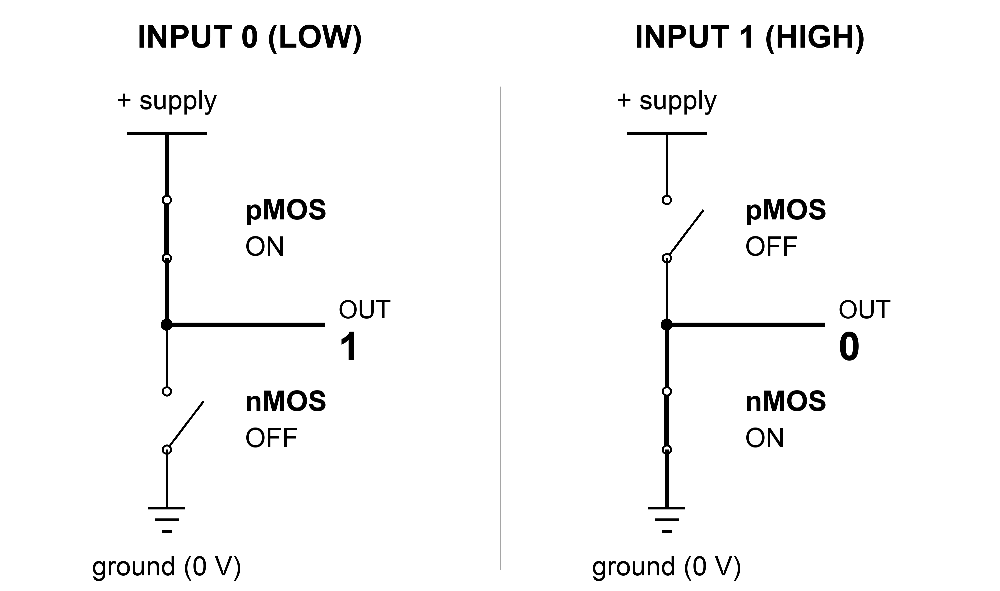

INTERLUDE 1

# Solid State Sparks

*The Birth of Computing*

*MATERIAL*

<!-- AI-assisted: restructured from Sam's earlier draft; Sam's own lines kept wherever they survived; awaiting Sam's pass -->

My mother's hand once circled a faint track on photographic film: the ghost of a particle that had wandered, left its signature, and vanished. At almost the same time, in an adjacent building on the same campus, my father's hands drew loops of another kind, the tight spirals of a highway interchange. Her lines described what matter was doing. His lines planned what people would do with it once it settled down and was poured as gravel and sand.

Between their two lines, one on film and one on vellum, the whole spectrum of making was quietly rehearsed. One tried to see how matter is carved; the other, to show how we carve matter. Both trusted the same trick: do something simple, over and over, until pattern hardens into order.

<!-- AI-assisted factual alignment, 2026-10-23 -->
My father's blueprints were lattices of motion: grids through which cars and cargo would flow, each junction a question, each loop a recurring argument with traffic. Underneath those neat lines lay sand, crushed quartz, silicon dioxide: the same stuff that covers beaches, fills concrete, and later, almost as an afterthought, became the base material of thought.[^v1-i1-material]

What he built in sand for cars, later generations (including my own) would build in the same sand for electrons. Highways and microchips: two geometries of flow, both born from silicon, both children of the same patient geology.

<!-- AI-assisted factual alignment, 2026-10-23 -->
If cosmic inflation was nature's way of stretching quantum ripples into the seeds of galaxies, then silicon lattices were humanity's way of stretching atomic regularity into computation. In both cases, repetition did the heavy lifting. We just changed what was allowed to repeat.

## Repetition as Creation

Repetition has always been the universe's favorite party trick. In physics, it manufactures stability. In life, it generates form. In thought, it turns signal into understanding.

The first miracle of the cosmos was not complexity but consistency: a handful of physical rules run on an infinite loop. The same equations kept being applied to new situations, like a cosmic bureaucrat stamping "Approved" on one region of spacetime after another, until whatever we choose to call reality on a given weekend could scaffold itself.

<!-- AI-assisted factual alignment, 2026-10-23 -->
And I suspect something else happens when a pattern holds long enough: under the right conditions, it can gather more pattern around it. A seed crystal grows a crystal; a habit grows a life.

<!-- AI-assisted factual alignment, 2026-10-23 -->
The grammar carries downward. When atoms settle into orderly arrays instead of a random scrum, they begin to sing in unison. Their quantum states overlap, forming collective harmonies (bands, gaps, currents) that no single atom could manage on its own. The universe repeats itself across scales: inflationary ripples seed later galaxy clusters, and the atomic lattice becomes the microchip, each a higher order folded out of a simpler one below.

This is where solid-state physics enters the story, not as a digression from cosmology but as its local accent. The principles that governed the early universe (symmetry, fluctuation, stability) also govern the tiny universes we cook in clean rooms. A silicon wafer is a miniature cosmos: cooled, flattened, and stretched just enough to hold a second kind of expansion, the expansion of logic.

<!-- AI-assisted factual alignment, 2026-10-23 -->
In Chapter 1, I proposed that repetition in possibility space could give us reality: a universe where laws behaved themselves long enough for galaxies and Fokker flights to happen. Here, in the Silicon mirror, we try the trick in reverse, starting from that settled physics and lining it up in careful rows to create new possibilities: circuits, computers, networks, AI, AR, XR, digital twins, and other acronyms that sound like future tense. If physics was the first draft of "something from nothing," the silicon story is our attempt at "more from something."

## The Physics of the Possible

Before circuits and code, there was only matter: quiet, mostly, and not taking calls. Yet even "inert" matter has a restlessness. Every atom jitters in its quantum cage. Condensed matter physics studies what happens when a great many of them stop jittering independently and agree on a dance.

<!-- AI-assisted factual alignment, 2026-10-23 -->
Chapter 1 left possibilities confined into shapes: an electron held by its atom can't take just any energy, only the particular values its confinement allows, like a string tied at both ends that can only sing certain notes. Now bring trillions of atoms together in a crystal, each one repeating the last. The single notes of each atom smear into broad ranges of allowed energy, called bands, separated by ranges with no allowed bulk electron states in the ideal crystal, called gaps. Felix Bloch showed in his 1928 work that an electron in a perfectly periodic lattice can be described by a wave carrying the lattice's repeating pattern, as if the entire crystal were its home address.[^v1-i1-bloch]

At this level, symmetry is both freedom and confinement. It decides what an electron may do and what it will never do. In a disordered solid, electrons scatter like voices in a noisy bar. In a crystal, they form a choir. You're either playing with the Beatles or with the Stones; nobody performs in the gap between the bands.

<!-- AI-assisted factual alignment, 2026-10-23 -->
Which bands are full, and how big the gaps are, determine a material's whole personality.[^v1-i1-wilson] In conductors like copper, a band is only partly filled, so electrons have empty seats to move into at the slightest push: think of Leonard Bernstein mid-symphony, everyone playing at once, and somehow the lights stay on. In insulators like quartz, the bands are full and the gap above them is wide, so few electrons can carry current: more Glenn Gould, precise, contained, and not about to start improvising. And in semiconductors like silicon, heat or a sufficiently energetic photon can lift an electron across the smaller gap. Electric fields then steer the available carriers. That's Mozart at the keyboard, playing between order and mischief.

So the lattice does for the electron what Chapter 1's confinement did for possibility: it turns an open range into a structured set of allowed and forbidden states. And that structured set becomes, in turn, a new possibility space for something else to form in. It was in silicon's in-between region, neither conductor nor insulator but bribable, that humanity found the switch, and with it the seed of logic.

## Controlled Imperfection

Repetition gives you order; controlled imperfection gives you meaning.

<!-- AI-assisted factual alignment, 2026-10-23 -->
Silicon's lattice makes the trick possible. Each atom has four valence electrons and shares them in bonds with four neighbors, arranged tetrahedrally. Pure silicon already conducts a little at room temperature. But replace a tiny fraction of its atoms with something else and its conductivity changes enormously. Engineers call this doping: the deliberate insertion of asymmetry, the art of making perfection misbehave on command. Add phosphorus, with five valence electrons, and you sneak in an easily freed fifth electron (n-type silicon). Add boron, with only three, and you create holes, places where an electron could be but isn't, which move through the crystal like bubbles through water (p-type).[^v1-i1-doping] Add morons to the design committee, and you get a bloated roadmap and a chip that ships late.

The most important discovery in this field came, appropriately, from a flaw. At Bell Labs in 1940, Russell Ohl was studying a rod of silicon that happened to have a crack in it. When he shone a light on it, a voltage appeared. The crack, it turned out, marked a boundary where the impurities on one side differed from those on the other: a natural p-type region meeting an n-type one.[^v1-i1-ohl] He had stumbled onto the p–n junction, and incidentally onto the first silicon solar cell.

<!-- AI-assisted factual alignment, 2026-10-23 -->
At that junction, the rules of flow acquire conditions. Electrons and holes diffuse across the boundary and recombine, leaving a thin no-man's-land of exposed, fixed dopant charges. Their electric field resists further diffusion. Apply voltage one way and the barrier falls; reverse it and the barrier rises, letting only a small leakage current through until breakdown.[^v1-i1-junction] Voltage stops being a gentle suggestion and becomes an actual decision. It's a one-way door, and one-way doors are where logic begins.

<!-- AI-assisted factual alignment, 2026-10-23 -->
Chapter 1's broken mirror gave us a clue to how matter could outnumber antimatter; the full accounting is still missing. Silicon's usefulness began with a crack in a rod. Imperfection, it seems, is the house style.

## Stubborn People and a Paper Clip

If physics gave us the structure, it took a few stubborn people to give it a job description. One of them, John Bardeen, born and educated in Madison, Wisconsin, became the only person ever to win the Nobel Prize in Physics twice.[^v1-i1-bardeen]

By the time I walked the halls of the University of Wisconsin–Madison's electrical engineering department, where Bardeen had earned his first two degrees, he had long departed. I had no idea I was sharing a department with history. As far as I knew, "Bardeen" was just another one of those whose work made my homework longer. The only thing I would have envied him for was that he didn't have to take Professor Arthur Tiedemann's electronics class back then.

<!-- AI-assisted factual alignment, 2026-10-23 -->
Grading at Madison in my day was already Ebenezer Scrooge's wet dream, and Tiedemann wouldn't even hand out partial credit. In his tutelage, electronics needed to run at scale, forever, and without an error. I was one of those students who would start the solution but eventually get tired of punching the calculator keys step after step, always doubting a little my ability to punch in the digits right. I would rather write the trailing steps of an ideal diode equation in words or pseudo-answers.[^v1-i1-diode] But with that slight clerical laziness, "then everything is wrong," and you get a big fat zero. No wonder I now draft requirements and algorithms, and don't solve for numbers.

I quickly moved to digital electronics; now at least I knew true from false. And ultimately to software: no closed solutions anymore. Find an error, fix it, iterate. Oh, and don't forget to rinse first, always: refactor and code review. But those are later moves, for future interludes. First, we need to lay down the heavy stones.

### The No-Partial-Credit Principle

<!-- AI-assisted factual alignment, 2026-10-23 -->
For all my complaining, Tiedemann was right about one thing: some layers of reality are brutally unforgiving.

<!-- AI-assisted factual alignment, 2026-10-23 -->
Semiconductors can be like that. Miss a critical current or voltage limit and the device doesn't "sort of" work. It fails. An airliner doesn't stay "mostly in the sky"; a bank ledger doesn't tolerate "roughly correct" balances.

So that no-partial-credit ethic stuck with me. To this day, whenever I design or critique a system, I find myself asking: if this fails by 5%, who eats 100% of the consequences?

<!-- AI-assisted factual alignment, 2026-10-23 -->
The useful surprise is that digital circuits get their exact answers by allowing physical slack. A zero or one occupies a range of voltages, not one sacred value. Noise margins leave room for disturbances; each gate restores a clean enough signal for the next.[^v1-i1-noise] Even silicon gets partial credit, provided the error stays inside the allowance. The unforgiving outcome needs a forgiving mechanism.

Over time, though, I also learned a quieter counter-truth: life itself is mostly partial credit, a long, collaborative exercise in mutual leniency. We rarely get the right answer, but we often get close enough, and then agree to call that truth. Civilization, too, is partial credit: a society of approximations, stable not because it is perfect but because it is forgiving.

Good systems live in the tension between those two poles: ruthless in the layers where failure is lethal, forgiving everywhere else. But not too forgiving, lest you drown in what software people now call technical debt (unpaid compromises, with interest).

### The Alchemy of Choice

Semiconductors, when you strip away the mystique, are rocks we have tricked into making decisions.

<!-- AI-assisted factual alignment, 2026-10-23 -->
At the quantum level, electrons don't care about our intentions. They move according to wave equations and probabilities, not product roadmaps. But once we carve channels in silicon, add carefully chosen impurities and apply electric fields, that randomness can be steered. A transistor is the steering mechanism: a microscopic "if, then." In one common arrangement: if the control voltage is high enough, let current flow; if not, hold the line. Every if, then and else in modern computing is ultimately some variation of that one move, a gate deciding whether a crowd of electrons goes or stays put. In that sense, the transistor is more than a component; it's a philosophical object: determinism on the inside, choice on the outside.

The first one was not elegant. Just before Christmas in 1947, at Bell Labs, Bardeen and Walter Brattain pressed two gold contacts, a hair's breadth apart, onto a slab of germanium, with a spring fashioned from a paper clip holding the arrangement in place, and watched a tiny signal come out bigger than it went in.[^v1-i1-transistor] William Shockley, their group's leader and not a man who enjoyed being scooped by his own team, soon designed a sturdier version built from layered n-type and p-type material: an n–p–n or p–n–p sandwich in which a small current at the middle controls a much larger one passing through. It's leverage in elemental form. The three of them shared the Nobel Prize, and Bardeen, unlike the transistor, went on to do it again.

<!-- AI-assisted factual alignment, 2026-10-23 -->
The transistor inside nearly every chip today is a later cousin, the metal-oxide-semiconductor field-effect transistor, or MOSFET, developed at Bell Labs in 1959 by Mohamed Atalla and Dawon Kahng.[^v1-i1-mosfet] Instead of a current controlling a current, it uses a voltage on a gate, insulated, in the classic design, by a whisker-thin layer of glass (silicon dioxide again, my father's sand making a cameo), to open or close a channel beneath it. That's the if-then in its purest form. The insulated gate takes very little steady current. Pair complementary MOS transistors into CMOS logic, and an idle gate ideally has no conducting path straight through from supply to ground. Switching still costs energy, and real devices leak; billions of them have made cooling an industry, not an afterthought.[^v1-i1-cmos]

Put a few transistors together and you get logic gates (AND, OR, NOT), the toddler vocabulary of machines. With enough of them, you get adders, multiplexers, and eventually a processor that can play chess badly or optimize ad delivery frighteningly well.

<!-- AI-assisted worked example and original illustration, 2026-10-23 -->
Take NOT, the gate that disagrees for a living. In a CMOS inverter, two transistors share one input voltage. The upper one, pMOS, can connect the output to the positive supply; the lower one, nMOS, can connect it to ground, our zero-volt reference.

When the input is low (0), pMOS conducts and nMOS is off, so the output rises high (1). A high input reverses their roles and pulls the output low (0). The output is taken between them. Once the voltages settle, we get NOT: 0 becomes 1, and 1 becomes 0.[^v1-i1-inverter]

{width=95% fig-alt="Left: low input turns pMOS on and nMOS off, connecting the output to the positive supply: 1. Right: high input reverses the switches, connecting the output to ground: 0."}

Nothing inside has learned to disagree. We assigned meaning to voltage ranges, then arranged matter so that one range reliably produces the other. A gate's output can control the next gate; the logical result arrives already in a physical form another circuit can use.

### Teaching Sand to Remember

<!-- AI-assisted factual alignment, 2026-10-23 -->
Combinational logic has no memory: its output follows its present inputs. To compute anything worth computing, a machine also needs to hold onto a result, and the trick for that is gloriously circular. Wire two inverting gates so that each one's output feeds the other's input, and they lock each other into one of two stable states: one says yes because the other says no, and vice versa. That bistable loop is the core of a memory cell: with circuitry to control when it changes, it becomes a latch or a clocked flip-flop. It holds a single bit while the power stays on.[^v1-i1-flipflop] It's a tiny argument that never ends, and that's exactly what makes it memory.

Then, at IBM, Robert Dennard found a cheaper way: one transistor and one tiny capacitor per bit, storing a 1 as a little puddle of charge.[^v1-i1-dram] The puddle leaks, so the chip has to reread and rewrite every bit many times a second to keep it from fading. Forgetting is the default; remembering is something the machine must keep choosing to do. Most of the working memory in the world still works this way.

With gates that decide and cells that remember, silicon had everything it needed to hold both kinds of content a computer would ever need: the data it works on, and the instructions telling it what to do with that data. That both could sit side by side in the same rows of memory turns out to be one of the deepest ideas in this book, and the next interlude will take it up.

What neurons pull off with ions and synapses, silicon does with carriers and junctions: slower to appear in history, faster once it gets going, and almost offensively patient.

But single transistors, heroics aside, weren't enough. If electrons were going to think together at scale, the structure itself had to grow up. We needed a way to make the silicon carry more of the burden.

Enter the quiet witchcraft of growing and etching order.

## Growing Thought

### Ordered Growth

Epitaxy is a word that sounds like a skin condition but is really gardening for atoms.

<!-- AI-assisted factual alignment, 2026-10-23 -->
You start with a polished wafer, a disc of silicon whose atoms are already holding hands in a neat crystal lattice. Then you encourage crystalline material to grow on top, taking its orientation from the lattice underneath. The aim is continuity; defects have their own ambitions. In its most exquisite form, molecular beam epitaxy, developed at Bell Labs by Alfred Cho and John Arthur, beams of atoms are fired through an ultra-high vacuum onto a heated crystal, and the new material grows almost one atomic layer at a time.[^v1-i1-mbe]

We don't so much build structures as coax them into existence. The silicon copies its own pattern upward, like a brick wall deciding to keep going because the bricks below looked confident.

In my undergraduate devices course, this was the bit that blew my mind. We had taken the grand, indifferent laws of thermodynamics and turned them into a kind of precision agriculture: "Please grow up, but only in this orientation, with this purity, and don't embarrass us in the lab report." We were farming universes on dinner-plate wafers.

And just as I was starting to admire the Zen of it all, the process promptly got weird.

### The Mask and the Mirror

Right after epitaxy's calm, photolithography arrives like a practical joke designed by very tidy goblins.

<!-- AI-assisted factual alignment, 2026-10-23 -->
In one familiar version, you coat the wafer with a light-sensitive film and project ultraviolet light through a quartz-and-chrome mask bearing the circuit pattern. You develop the image like a photograph: exposure changes the film's solubility, letting selected regions wash away. Etching can then remove the exposed material beneath, whether silicon, oxide or another layer; afterward, you strip the remaining film.[^v1-i1-fabrication] Then you do it all again for the next layer, and the next, and the next. Repeat until you question your major. Cover, expose, etch, clean; protect, reveal, destroy, preserve. It's less like fabrication than a liturgy.

<!-- AI-assisted factual alignment, 2026-10-23 -->
What struck me most was that chip-making uses both kinds of making at once. Epitaxy is additive: it grows material where you want it, the gardener's way. Lithography sets the pattern; an etching step makes the sculptor's cuts, removing what the mask leaves exposed. A chip is what happens when a gardener and a sculptor take turns on the same piece of stone, a few dozen times over.

To me, this was also the most literal metaphor for cognitive load I had ever seen. The chip is too intricate to work on directly (our minds can't hold its final complexity in one piece), so we invent indirection. We don't draw the chip. We draw the masks. The masks stand between us and the final object like a row of translators: thought, layout, mask, light, etch, device.

In the textbooks of early AI, there's a classic puzzle about a monkey, a box and some bananas hanging just out of reach.[^v1-i1-monkey] The smart monkey doesn't leap; it moves the box. In chip fabrication, the mask is the box: the extra object we introduce so we can solve a problem that was impossible in its original form.

The cosmos, if Alice was right in Chapter 1, pulled a version of the same trick. A monkey could, in principle, keep jumping until one freakish leap out of billions happened to reach the bananas; that's the Boltzmann-brain route, a lucky fluctuation for everything. Moving the box is one step more complicated than jumping, but it saves billions of jumps. Inflation was the universe's box: a single cheap, slightly more structured step that produced, in one stroke, the uniformity and the sheer numbers that blind luck would have needed an absurd number of tries to stumble on. (The monkey still had to peel the banana, and the universe still needed its symmetry breakings; one box doesn't do everything.) The universe didn't plan, of course. But from the inside, the cheapest route always looks a little like planning, which is just Occam's chisel caught in the act.

Here, the abstraction is made of glass and chrome, but we do the same trick everywhere. Language stands between thought and speech, code between logic and metal, protocols between intent and action. When a problem is too hard to attack head-on, we invent a layer in the middle and talk to that instead.

## One Piece of Stone

If epitaxy taught us how to grow clean crystal, and photolithography how to scratch patterns into it, the next miracle was making all those patterns work together without tying ourselves in wires.

<!-- AI-assisted factual alignment, 2026-10-23 -->
By the late 1950s, the transistor was no longer the problem; the spaghetti between transistors was. Engineers had built good little switches and were drowning in their legs and solder. Jack Kilby at Texas Instruments and Robert Noyce at Fairchild Semiconductor, working separately, arrived at an idea that seemed almost stupidly obvious once someone had it: make the circuit's components together on one piece of semiconductor, then connect them without assembling a miniature wire jungle.[^v1-i1-ic] Kilby's first version still had its parts joined by fine gold wires floating above the chip. Noyce's version, built on Jean Hoerni's planar process at Fairchild, protected the silicon under a flat layer of its own oxide and laid the wiring on top as thin strips of evaporated metal, and the metal was aluminum. Alex had found his first job.

<!-- AI-assisted factual alignment, 2026-10-23 -->
The result changed what a circuit was. Geometry became a manufacturable description of function, working with the materials, doping and electrical conditions. Each transistor became something like a cell in a tissue, and each connection something like a synapse (a comparison the brain chapters will test, and partly break).

<!-- AI-assisted factual alignment, 2026-10-23 -->
Once a small circuit block reliably did its job, we could combine copies into larger ones without solving its electron physics all over again. The parts still had to meet at agreed voltages and times; abstraction had acquired terminals.

Once we could grow crystal and carve it with light, history hit fast-forward. Each generation of the process made smaller features possible, which made more transistors feasible, which made new architectures worth imagining. The masks got finer; the circuits got denser; the abstractions stacked higher. How fast that would go, and who dared to predict it, belongs to a later interlude.

## Bob, Through the Looking-Glass: Informational Gravity

*The twist, in one line: patterns that can remember themselves bend the future toward more pattern, the way mass bends space toward more mass.*

This is speculation, so I'll mark the edges clearly. John Wheeler, late in his career, proposed that physics might ultimately be made of information, a slogan he called "it from bit."[^v1-i1-wheeler] I want to take a smaller, stranger step, and stay inside the possibility view from Chapter 1.

<!-- AI-assisted factual alignment, 2026-10-23 -->
Where gravity can overcome pressure and expansion, a small density excess draws in more matter and deepens the attraction. Something similar seems to happen with pattern. A seed crystal in a supersaturated solution offers arriving material a structure to join. A powered flip-flop keeps correcting small disturbances through feedback. A DNA strand templates a copy when enzymes, building blocks and energy are available.[^v1-i1-pattern-mechanisms] These are different accomplishments: growth, persistence, replication. What interests me is whether a retained arrangement can become a constraint on what happens next, recruiting its surroundings into carrying the arrangement further.

<!-- AI-assisted factual alignment, 2026-10-23 -->
Call that proposed tendency *informational gravity*: not a new force of nature, but the way order might bend the odds around whatever can remember. My wager is that, where a pattern can recruit a continuing supply of material or energy, preserving an arrangement can help make another instance of it more likely. Memory becomes something the future can build on. A crystal left without feedstock does not grow by remembering harder. And Landauer's limit on erasure tells us that throwing information away has physical consequences under specified conditions; it does not prove that retaining information makes it spread.[^v1-i1-landauer] That further step is the one I want to investigate.

<!-- AI-assisted factual alignment, 2026-10-23 -->
If that's right, it would explain something that otherwise looks like a series of lucky accidents: the recurring passage from retained structure to further structure, across crystals, genes, brains and chips. Each finds a different way to make the past matter to what comes next. I can't prove it, and physics doesn't require it. But it's the story the looking-glass shows me, and the rest of Volume I will keep checking whether the reflection holds.

<!-- AI-assisted closing consolidation, approved by the author and adopted 2026-10-23 -->
## The Sand That Dreamed

My father drew channels in sand so cars and trucks could find their way. I later traced channels in refined sand so electrons could. Now our circuits trace channels in behavior (recommendation paths, workflow paths, social feeds) so thoughts and attention can. The same element keeps finding new work: bound in stone and glass, purified into wafers, patterned into chips, helping hold the physical states we read as model weights. If matter has a secret wish, maybe it's this: start as dust under someone's shoes, end as the thing deciding which book they read next.

Silicon's memory arrived late. Biology had been keeping records for billions of years, faithfully though never perfectly. It, too, has its version of doping: tiny copying errors that keep the pattern from freezing. A lineage without new variation has fewer ways to meet a changing world; a chip with too many defects has no career at all. And the professor laughs.

A few years after the first integrated circuits flickered to life, I was ready to be conceived. The planet had learned to carve logic into matter. It was about to let matter carve logic into me.

The next frontier wasn't electrons; it was encoding: how a physical state becomes a signal, how signals become patterns, how patterns become stories, and at what point the stories start insisting they are someone. Before the algorithm, there was the axon. Long before any circuit could calculate, living cells were sensing, responding and carrying traces of what had happened to them.

Not long after those first chips started counting for other people, a cell would start counting for me. And then, with time and a lot of practice, it would call itself “I.”

---

> ***Maggie:** The universe began as possibility, and settled into rules.*
>
> ***Alex:** The sand began as rules, and opened into possibility.*
>
> ***Maggie:** A crack in the mirror let matter stay.*
>
> ***Alex:** A crack in the rod let current choose.*
>
> ***Both:** Whatever can remember itself, gathers.*

<!-- SOURCE NOTES: aligned 2026-10-23; evidence scopes and remaining author decisions are recorded in work/volume-1-drafting/interlude-01-adoption-2026-10-23/. The inverter addition and finishing pass are recorded in work/volume-1-drafting/interlude-01-finish-2026-10-23/. -->

[^v1-i1-material]: The sand/wafer connection is a material lineage, not a claim that quartz already behaves like a semiconductor. Quartz is silicon dioxide; chipmaking requires reduction, purification and crystal growth to obtain electronic-grade silicon. See Intel, [*From Sand to Silicon: The Making of a Chip*](https://download.intel.com/newsroom/kits/chipmaking/pdfs/Sand-to-Silicon_45nm-Version.pdf) (2009), opening stages, “Sand,” “Melted Silicon” and “Monocrystalline Silicon Ingot.”

[^v1-i1-bloch]: Felix Bloch, [“Über die Quantenmechanik der Elektronen in Kristallgittern”](https://doi.org/10.1007/BF01339455), *Zeitschrift für Physik* 52 (1929): 555–600; received 10 August 1928. The date in the prose refers to the work, rather than the journal issue. A Bloch state combines a plane-wave factor with a lattice-periodic factor; it need not behave like a free electron. See also MIT, [*Electrical, Optical, and Magnetic Properties of Materials*, lecture 9](https://ocw.mit.edu/courses/3-23-electrical-optical-and-magnetic-properties-of-materials-fall-2007/49728ee6fbac8503c94b5a9aab74242c_lec9.pdf) (2007), Bloch theorem and band formation. Defects and surfaces can introduce states within the ideal bulk gap.

[^v1-i1-wilson]: Alan H. Wilson, [“The Theory of Electronic Semi-Conductors”](https://doi.org/10.1098/rspa.1931.0162), *Proceedings of the Royal Society A* 133 (1931): 458–491. For the band-filling account used here, see MIT, [*Solid State Physics*, part I](https://web.mit.edu/6.732/www/new_part1.pdf), chapters 1–2. The musical comparison concerns available states and charge transport, not a literal absence of motion in an insulator.

[^v1-i1-doping]: Jesús del Alamo, MIT 6.012, [lecture 2, “Semiconductor Physics (I)”](https://web.mit.edu/6.012/www/SP07-L2.pdf) (2007), silicon bonding, intrinsic carriers, donors and acceptors. Four nearest neighbors in silicon's diamond lattice form a tetrahedral arrangement. Phosphorus donors and boron acceptors alter carrier populations; undoped silicon is not completely nonconducting.

[^v1-i1-ohl]: Ohl's light-sensitive silicon junction dates to February 1940; the Computer History Museum's [“Discovery of the P-N Junction”](https://www.computerhistory.org/siliconengine/discovery-of-the-p-n-junction/) recounts the impurity boundary and photovoltaic response. His [U.S. Patent 2,402,662, “Light-sensitive electric device”](https://patents.google.com/patent/US2402662A/en), was **filed** 27 May 1941 and **granted** 25 June 1946. A crack was the visible clue; the different doping on its sides supplied the electrical junction.

[^v1-i1-junction]: Del Alamo, MIT 6.012, [lecture 5, “P-N Junction Electrostatics”](https://web.mit.edu/6.012/www/SP07-L5.pdf) (2007), depletion-region charges and built-in potential. “Cancel” would obscure the mechanism: mobile electrons and holes recombine while fixed ionized dopants remain. Rectification is approximate; reverse leakage and breakdown matter.

[^v1-i1-bardeen]: University of Illinois, [John Bardeen memorial biography](https://physics.illinois.edu/people/Memorials/bardeen): Madison birth and Wisconsin electrical-engineering degrees, B.S. 1928 and M.S. 1929. The Nobel Foundation records his Physics prizes in [1956](https://www.nobelprize.org/prizes/physics/1956/summary/) and [1972](https://www.nobelprize.org/prizes/physics/1972/summary/), and identifies him as the [only double Physics laureate](https://www.nobelprize.org/prizes/physics/facts-on-the-nobel-prize-in-physics/). The Tiedemann episode is the author's recollection.

[^v1-i1-diode]: In the ideal diffusion model, $I=I_S\left(e^{qV/(k_BT)}-1\right)$: current $I$, reverse saturation current $I_S$, junction voltage $V$, elementary charge $q$, absolute temperature $T$ and Boltzmann constant $k_B$. See del Alamo, MIT 6.012, [lecture 14](https://web.mit.edu/6.012/www/SP07-L14.pdf) (2007), pp. 13–16. This is a model with a range of validity, not an exact law for every diode; recombination, series resistance, high injection and breakdown require further treatment.

[^v1-i1-noise]: MIT 6.004, [“The Digital Abstraction,” section 1](https://ocw.mit.edu/courses/6-004-computation-structures-spring-2017/pages/c2/c2s1/) (2017), voltage thresholds, noise margins and restoring behavior. Valid output ranges sit inside the corresponding accepted input ranges, providing tolerance for bounded disturbances between gates. Correct timing and other operating limits are still required.

[^v1-i1-transistor]: John Bardeen and Walter H. Brattain, [“The Transistor, a Semi-Conductor Triode”](https://doi.org/10.1103/PhysRev.74.230), *Physical Review* 74 (1948): 230–231. The Computer History Museum's [1947 milestone](https://www.computerhistory.org/siliconengine/invention-of-the-point-contact-transistor/) distinguishes successful amplification on 16 December from the demonstration to lab officials on 23 December. The paper-clip assembly is visible in the annotated Bell Labs photograph reproduced in UCSB, [*Semiconductor Device Processing*, introductory lecture](https://courses.ece.ucsb.edu/ECE220/220A_F08Hu/lect1.pdf), slide 10; that slide's 1948 caption is not the discovery date. For the junction model, William Shockley, [“The Theory of p-n Junctions in Semiconductors and p-n Junction Transistors”](https://doi.org/10.1002/j.1538-7305.1949.tb03645.x), *Bell System Technical Journal* 28 (1949): 435–489.

[^v1-i1-mosfet]: The Computer History Museum's [“Metal Oxide Semiconductor (MOS) Transistor Demonstrated”](https://www.computerhistory.org/siliconengine/metal-oxide-semiconductor-mos-transistor-demonstrated/) dates Atalla and Kahng's successful device to 1959 and its presentation to 1960. Its oxide-insulated gate overcame the surface-state obstacle to field control. The classic silicon-dioxide gate dielectric is described here; later devices also use other insulating materials.

[^v1-i1-cmos]: MIT 6.004, [“CMOS Technology,” section 1](https://ocw.mit.edu/courses/6-004-computation-structures-spring-2017/pages/c3/c3s1/), and del Alamo, MIT 6.012, [lecture 13](https://web.mit.edu/6.012/www/SP07-L13.pdf) (2007), pp. 13–16. Low steady gate current alone does not make a circuit low-power. Complementary pull-up/pull-down networks suppress ideal static supply current; charging capacitances during switching and real-device leakage still dissipate power.

[^v1-i1-inverter]: Chris Terman, MIT 6.004, [“3.1 Annotated Slides”](https://ocw.mit.edu/courses/6-004-computation-structures-spring-2017/pages/c3/c3s1/) (Spring 2017), CMOS inverter and propagation-delay discussions. The book's original diagram uses ideal switches in settled states; it omits switching delay, transient current and leakage.

[^v1-i1-flipflop]: W. H. Eccles and F. W. Jordan, [British Patent GB148582A, “Improvements in ionic relays”](https://patents.google.com/patent/GB148582A/en), filed 21 June 1918, published 5 August 1920: mutually coupled thermionic devices retain either state. For the distinction between a bistable feedback loop, gated latch and clocked register, see MIT 6.004, [“Sequential Logic,” section 1](https://ocw.mit.edu/courses/6-004-computation-structures-spring-2017/pages/c5/c5s1/). Terminology varies historically; two bare cross-coupled inverters are not by themselves a complete clocked flip-flop.

[^v1-i1-dram]: Robert H. Dennard, [U.S. Patent 3,387,286, “Field-effect transistor memory”](https://patents.google.com/patent/US3387286A/en), filed 14 July 1967, granted 4 June 1968, abstract and description of the single-transistor/single-capacitor cell. Stored charge leaks and must be restored; the patent also discusses alternative embodiments, so not every figure depicts the familiar one-transistor cell.

[^v1-i1-mbe]: A. Y. Cho and J. R. Arthur, [“Molecular beam epitaxy”](https://doi.org/10.1016/0079-6786(75)90005-9), *Progress in Solid State Chemistry* 10 (1975): **157–191**. See also Cho's [oral history with David Brock](https://archive.computerhistory.org/resources/access/text/2015/06/102702406-05-01-acc.pdf), Computer History Museum, 18 May 2010, pp. 24–25, on collaboration with Arthur, molecular beams and growth control. Epitaxy means crystallographic orientation inherited from a substrate; it does not promise a defect-free continuation or universal layer-by-layer growth.

[^v1-i1-fabrication]: Intel, [*From Sand to Silicon*](https://download.intel.com/newsroom/kits/chipmaking/pdfs/Sand-to-Silicon_45nm-Version.pdf) (2009), photoresist, exposure, washing and etching stages; ASML, [“6 crucial steps in semiconductor manufacturing”](https://www.asml.com/en/company/stories/2021/semiconductor-manufacturing-process-steps), lithography and etching. Positive and negative resists respond differently. Lithography patterns resist; subsequent etching, deposition or implantation uses that pattern. The transmission-mask example is not a description of reflective EUV optics.

[^v1-i1-monkey]: John McCarthy, “Situations, Actions, and Causal Laws,” Stanford Artificial Intelligence Project Memo 2 (1963), listed in his [author bibliography](https://www-formal.stanford.edu/jmc/sitcalc1/node22.html). For an explicit worked formulation, see Gerardo I. Simari, Diego R. García and Gabriel R. Filocamo, [“A General Approach to the Implementation of Action Theories”](https://www.cs.ox.ac.uk/people/gerardo.simari/personal/publications/Simari-Garcia-FilocamoWICC2003.pdf) (2003), section 3. Variants use a chair or box. The inflation comparison that follows is the author's conjectural analogy, not a result of AI planning or a probability calculation over universes.

[^v1-i1-ic]: Kilby's first working circuit, tested 12 September 1958, used germanium and external connecting wires; see the Computer History Museum's [artifact record](https://www.computerhistory.org/revolution/digital-logic/12/276/1413). Robert Noyce's [U.S. Patent 2,981,877, “Semiconductor device-and-lead structure”](https://patents.google.com/patent/US2981877A/en), filed 30 July 1959, granted 25 April 1961, describes oxide insulation and metal leads, including aluminum. Jean Hoerni's [planar-process patent, U.S. 3,025,589](https://patents.google.com/patent/US3025589A/en), was filed 1 May 1959 and granted 20 March 1962. The components and interconnects form an integrated structure; they are not all carved from one homogeneous material.

[^v1-i1-wheeler]: John Archibald Wheeler, “Information, Physics, Quantum: The Search for Links,” in *Proceedings of the 3rd International Symposium on Foundations of Quantum Mechanics in the Light of New Technology* (1989), pp. 354–368. The available [later reprint](https://scienceplusplus.org/visions/assets/Wheeler1989.pdf), section 19.2, sets out “it from bit”; its pagination differs from the proceedings. Wheeler offered a participatory, information-centered foundational program. The proposed tendency called “informational gravity” here is the author's, not Wheeler's result or an additional physical force.

[^v1-i1-pattern-mechanisms]: For the distinct mechanisms: MIT Chemistry, [“Growing Quality Crystals”](https://chemistry.mit.edu/facilities-and-centers/x-ray-diffraction-facility/growing-quality-crystals/), “Saturation and Supersaturation” and “Nucleation”; MIT 6.004, [“Sequential Logic”](https://ocw.mit.edu/courses/6-004-computation-structures-spring-2017/pages/c5/c5s1/), powered feedback; Bruce Alberts et al., [“DNA Replication Mechanisms”](https://www.ncbi.nlm.nih.gov/books/NBK26850/), *Molecular Biology of the Cell*, 4th ed. (2002), template-directed polymerization. These support the individual examples, not a common law that stable patterns inevitably spread.

[^v1-i1-landauer]: Rolf Landauer, [“Irreversibility and Heat Generation in the Computing Process”](https://doi.org/10.1147/rd.53.0183), *IBM Journal of Research and Development* 5 (1961): 183–191; Charles H. Bennett, [“Notes on Landauer's Principle, Reversible Computation, and Maxwell's Demon”](https://arxiv.org/abs/physics/0210005), *Studies in History and Philosophy of Modern Physics* 34 (2003): 501–510. For ideal reset of an initially unknown, equally probable binary memory coupled to a thermal reservoir at temperature $T$, the familiar lower bound on average heat delivered to the reservoir is $Q\geq k_BT\ln 2$. Known or correlated bits and other physical arrangements require their information and entropy balances to be specified. This is not a universal cost of every act of forgetting, a claim that storage is free, or a proof that memory promotes growth.
