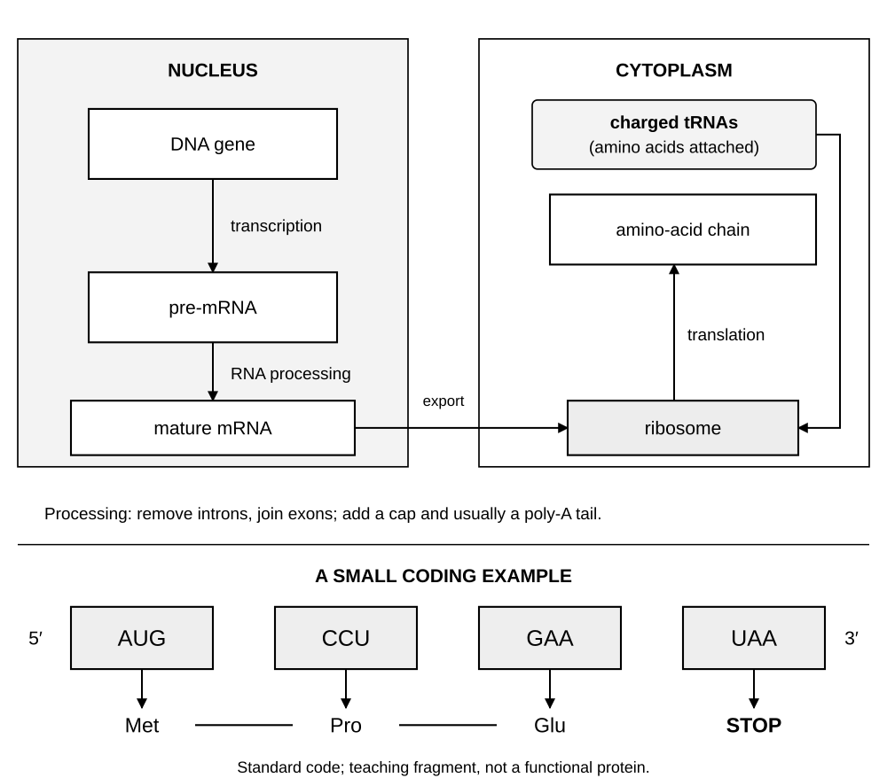

CHAPTER 2

# The Inheritance of Life

*The Monster of Becoming*

*BIOLOGY*

<!-- AI-assisted: restructured from Sam's earlier draft; Sam's own lines kept wherever they survived; awaiting Sam's pass -->
<!-- AI-assisted editorial adoption, 2026-10-23: author-approved recoveries, scientific and chronological repairs, and source-note verification. New substantive passages are marked below. -->

> "We are going to die, and that makes us the lucky ones. Most people are never going to die because they are never going to be born." --- **Richard Dawkins**, *Unweaving the Rainbow*[^v1-c2-dawkins]

Life before birth is a funny thing. It has all the drama of existence without any of the consent. No contracts were signed, no questions were asked, no plans were handed out. Chemistry simply woke up one day and decided it was her turn to walk and talk.

My story, like yours, began twice. First, in the womb of the woman I, in poetic irony, first called mother: my maternal grandmother. Not in her womb exactly, but inside the fetus she carried then, my actual mother. And then once more, eighteen years later, when that fetus decided to make yet another person.

Somewhere in that first womb, my maternal copy of DNA won its first small lottery. Inside my unborn mother, the cells that would become her eggs were already forming, and already shuffling her own parents' chromosomes into new combinations, beginning the long preparation of the egg that would someday contribute half of me.[^v1-c2-oocyte] In poetic irony, that Matryoshka doll of wombs was the belly of the same woman I was leaving, albeit briefly, as I boarded that plane two decades later.

### Blueprints and Background Radiation

While that microscopic rehearsal was underway, a few other people were trying to make sense of heredity's new religion.

Around the time my maternal DNA was being shuffled inside my unborn mother, heredity was gathering its future investigators. In 1947, James Watson was finishing his Chicago degree and turning from birds to genes. Francis Crick, at thirty-one, was crossing the same border from physics into biology. And Rosalind Franklin, newly arrived in Paris, was teaching X-rays to draw lattices, the same orderly repetitions the last interlude grew transistors from.[^v1-c2-trio] Together they were about to turn the invisible ladder inside every cell into a new creation myth.

When Franklin and her student Raymond Gosling's **Photo 51** finally developed, it became (though no one called it that) the cosmic background radiation of biology: a blurred X-shaped pattern that proved life, too, had geometry.[^v1-c2-photo51] If the WMAP map was the universe's ultrasound, Photo 51 was life's. One spoke in microwaves, the other in X-rays. Both joined in chorus: *Let there be light*, in staggered frequencies, of course.

### Commandments, Corrections, and Circles

Soon came the Central Dogma, as if biology, jealous of theology, needed commandments. In the familiar telling, DNA begat RNA begat protein, and it was good. Crick's actual prohibition was narrower: sequence information, once translated into protein, could not be copied back into nucleic acid. The one-way procession most of us remember was the Sunday-school version.[^v1-c2-dogma]

Around the time I became biology, Howard Temin took a scalpel to that scripture with his provirus hypothesis: the proposal that some RNA viruses scribble their code backward into DNA. A few years later, he and Satoshi Mizutani, and independently David Baltimore, found the enzyme that does it, reverse transcriptase.[^v1-c2-temin] The familiar procession could turn around. Temin's discovery was the biological equivalent of finding graffiti on Mount Sinai: *"Sometimes I rewrite myself."* It was also biology's cracked silicon rod: just as a crack in Russell Ohl's sample revealed the junction that made electronics possible, a crack in the one-way account revealed a route by which outsiders could enter life's archive. Crick's actual Dogma survived; our tidy picture did not. And biology, restless deity that it is, nodded approvingly. While Temin was challenging the received account of inheritance, I was waiting for my own molecular paperwork to be filed.

Back in that conception year, around the time Brookhaven physicists announced the Ω⁻, my father's cells were conducting their own particle experiments, flinging chromosomes around with admirable enthusiasm. One of them (let's call it a statistically unlikely hero) survived the tournament of meiosis, carrying the other half of me. It waited, suspended in probability, until my mother's earlier lottery ticket finally met it.

That spring, I was conceived, while Temin was presenting his heresy to the world. Soon afterward, two radio astronomers in New Jersey were investigating a persistent hiss, an inquiry that would include evicting pigeons and cleaning their antenna. The universe had left a signal; the pigeons had left something less publishable.[^v1-c2-chronology] I didn't turn out to be a retrovirus, but I was in good company.

My mother, pencil in hand, might have circled the projected image of the universe two years later, but the true circle was drawn that instant: my own Photo 51, my private cosmic background, a fertilized zygote spinning in its own small sea.

### Another Symmetry Breaks

That summer, Cronin and Fitch announced that symmetry could fail even among perfect particles. I had already begun to lose mine in the weeks after conception. First came polarity: a top and a bottom decided themselves. Then front from back, left from right, like tiny political parties staking territory on a spherical planet. The instructions came not from above but from morphogen gradients, slow chemical breezes nudging where head should end and tail should begin.

My left and right were decided by something almost absurdly physical. Somewhere in my first weeks, a patch of tiny hair-like cilia began to spin, with a consistent handedness and a tilt that gave their spinning a direction. Together they pushed the fluid around them gently leftward, and that faint current told me which side my heart should lean toward.[^v1-c2-nodal] The mirror that Chien-Shiung Wu broke in physics broke again in me, at the scale of a few cells, in the usual development of a human body. The rhyme is mine; the embryo was not taking instructions from the weak nuclear force.

Somewhere in that molecular weather, Maggie turned up again.

She didn't knock. Magnesium never does. She simply attached herself to an adenosine triphosphate molecule, muttering, "Don't mind me, I just hold your entire metabolism together." And she did, the quiet union worker of life, stabilizing every spark I would ever spend. I like to think she winked, knowing she'd be back for the long haul.

## What Is Life?

In the last interlude, we watched atoms in lattices learn to switch and to remember. Physics built the stage; biology asked how the actors wrote themselves into the play. The physicist Erwin Schrödinger asked it outright, in a little book called *What Is Life?*, and guessed that the material of heredity must be an "aperiodic crystal": a lattice whose repeating units vary just enough to carry a message.[^v1-c2-schrodinger] It was a remarkable guess, made years before anyone had seen DNA's shape. A crystal repeats; a gene repeats with variations, and the variations are the meaning.

<!-- AI draft, 2026-11-13. -->
There is a reason a molecule can carry a message at all, and it is stranger than it looks. Along a strand of DNA the backbone is the same at every step, sugar and phosphate, sugar and phosphate, whatever letter hangs off it. Chemistry does not dictate one order of the letters: the same backbone accepts an enormous range of sequences. If the bonding dictated the message, the strand would say the same thing forever, like salt.[^v1-c2-polanyi] A message needs a place where physics has no opinion. Chapter 1 said the laws stay cheap by declining to say which way things break. DNA is a molecule built around that silence: a sameness to hold the message, and a row of breaks that chemistry doesn't choose, so that something else can. Interlude 1 did it with a crystal and a few stray atoms. Life got there first.
<!-- End AI draft 2026-11-13. -->

Life doesn't break the laws of physics; it surfs them. It rides gradients, milks asymmetries, borrows energy on credit, and pays it back in entropy. Where equilibrium would end the performance, life thrives on the margin between order and chaos, the narrow slope where equilibrium can be delayed just long enough to mean something.

The cell is not a thing but a process, a constant storm of molecules, flows, charges and catalysts. Each second it pushes itself uphill, temporarily, by borrowing free energy from the world around it. It keeps its own small corner orderly through a flow of free energy, releasing heat and waste while the combined entropy of cell and surroundings increases. The ledger allows local order; it charges for maintaining it. (Computers, as the last interlude noted, face a related thermodynamic bill when they irreversibly erase information.)[^v1-c2-entropy]

<!-- AI draft, 2026-11-13. -->
Where does the credit come from? Mostly from the difference in temperature between the Sun and the night sky. The Earth takes in sunlight and sends out heat, and the energy in and out very nearly balance; if they didn't, we'd cook. What differs is the count. Sunlight arrives as relatively few energetic photons, made at about 5,800 kelvin, and leaves as a crowd of feeble ones, radiated at a planet's chilly temperature. For every photon in, about twenty go out:

$$
\frac{N_{\text{out}}}{N_{\text{in}}} \;\approx\; \frac{T_{\text{Sun}}}{T_{\text{Earth}}} \;\approx\; 20
$$

Twenty ways to carry the energy where there was one: that is entropy exported, and most of the biosphere (and every hurricane, for that matter) runs on the difference.[^v1-c2-photons] Chapter 1 said the stretching of space wound the clock, and left a hot star in a cold sky. This is where the winding gets spent.

<!-- AI-assisted diagram, 2026-11-15: solar energy balance and photon-number/entropy distinction. -->
{#fig-c2-sunlight-entropy width=95%}

Physics has a small model of the bargain. Heat a shallow pan of oil gently from below, and the warmth just seeps upward. Heat it harder, and at a threshold the fluid organizes itself into a honeycomb of rolling cells, which carry the heat up faster than the still fluid could.[^v1-c2-benard] Order appeared because it got rid of the difference more quickly. Ilya Prigogine called such things dissipative structures. A candle flame is one, and so is a whirlpool. Life is the only kind that keeps a recipe for itself. The Open put it better than I can: entropy wasn't defeated. It was fed.
<!-- End AI draft 2026-11-13. -->

If transistors are frozen logic, life is unstable computation: self-modifying code that refuses to stop running. Carbon atoms don't keep diaries, but DNA does, a long apology written by entropy's unruly child.

To be alive is not to possess energy but to invest it. We spend order to buy time. Maggie, ever the accountant, keeps the ledger in ATP and NADH. When the balance tips too far, metabolism closes the books and we call it death. The miracle isn't that life burns fuel; it's that it convinces the universe to extend credit.

## From Nothing to Becoming

What I was doing in miniature, Earth once did at scale. My membranes replayed the planet's earliest chemistry: proton gradients, pumped across thin walls, the very trick Nick Lane and Michael Russell argue life learned in the rocks of alkaline vents, re-enacted in my mitochondria. Each mitochondrion was an immigrant, a captured bacterium turned citizen. I was already a federation.

If existence was the monster of Chapter 1 (why is there something rather than nothing?), then life is the monster of this chapter: why is there becoming rather than stillness? Why did some patch of chemistry learn to struggle, replicate and change? (Half of the answer is already in hand. With a gradient like that pouring through a planet, stillness was never on offer. The question is why the becoming learned to remember.)

Across vast reaches of the possibility space I can imagine, there is no life. No breath, no hunger, no triumph, no suffering: just the silent play of law and chance across barren patterns. And even among the patches where something exists, where physics builds stable structures, most may never cross the threshold into biology. Whether life is a rare lottery win or a common outcome wherever the conditions allow, nobody yet knows; we have exactly one example, and we're it.

### The Ancient Crossing

For a long time we imagined, as Charles Darwin did in a letter to a friend, a "warm little pond" with ammonia and phosphoric salts, light, heat and electricity, where life might have stirred.[^v1-c2-pond] In the 1950s, Stanley Miller and Harold Urey sent sparks through a flask of simple gases and got amino acids, and for a generation lightning over a primordial soup was the textbook picture.[^v1-c2-miller] The experiment made ingredients, not life; how Earth assembled the rest remains an open question.

One prominent hypothesis, and the one this book favors, puts the start in the deep: alkaline hydrothermal vents at the seam of ocean and crust, where warm alkaline fluid seeped into an acidic sea and energy had no choice but to flow.[^v1-c2-lane] Inside those vents, thin mineral walls of iron, nickel and sulfur separated the two waters, and the difference in acidity across them made a natural proton gradient: a battery, running for free. The planet's first circuit boards, you might say, were made of rock, and Interlude 1's silicon would have recognized them. In this proposed beginning, simple organic molecules formed inside those mazes of tiny pores, reacted, broke apart and formed again, and something like the ancestor of our metabolism began to turn.

The pores could have done a second job. Simulations show that temperature differences, acting with convection in suitable pores, can concentrate dissolved molecules, nucleotides included, far beyond their surrounding concentrations, making possible nurseries for longer molecules.[^v1-c2-thermophoresis] In one version of this story, an "RNA world" could have taken shape there: a stage when RNA carried both information and some of the catalytic work now largely divided between DNA and proteins. Jack of all trades, master of none. Later, DNA took over the archive and proteins took over the work, and RNA settled into its present role as the messenger and the reader. Its old glory survives at the heart of every cell: the peptide-bond-making center of the ribosome, the machine that builds our proteins, is RNA; proteins help build the surrounding machinery.[^v1-c2-ribozyme]

The vents have rivals. Some researchers favor warm pools on land, where repeated wetting and drying can stitch molecules into long chains, and some chemistry works best with ultraviolet sunlight, which the deep sea lacks.[^v1-c2-rivals] The two pictures may not be exclusive: energy may have first flowed in the deep, and some of the information may have been assembled near the surface. The vents offer an especially suggestive explanation for the ancient use of ion gradients across membranes to power ATP production. Proton gradients still drive my mitochondria, as if they carried a piece of the vent inside them. Mine certainly did.

### A Biological Anthropic Patch

Just as physics tells us we see a universe tuned for observers because only such a universe can host them, biology tells us that life arose where conditions permitted it, and nowhere else. Life needed structure, energy, flow, and the stability to sustain them long enough for complexity to accumulate. Our planet's early oceans were not a universal cradle. They were a patch: a biological anthropic patch. I picture it as a cheap match in chemical possibility space, able to support self-sustaining cycles long enough for life to take hold. Our presence proves that some route worked; calling that route the cheapest is my conjecture, not a measurement of all the roads untaken.

<!-- AI draft, 2026-11-13. -->
Chapter 1's rule gives the conjecture something to be wrong about. Occam wherever possible, Anthropic only where forced: if that holds one floor up, life shouldn't have begun with a chemical miracle. It should have begun with chemistry the planet was already doing, done a little faster. There is a hint that it did. One candidate for the most ancient way cells take carbon from the world joins hydrogen to carbon dioxide, the reaction the vents run for nothing, and the enzymes that manage it still hold small clusters of iron, nickel and sulfur at their working hearts, like chips of the old chimney carried along.[^v1-c2-acetyl] There is a second hint in the calendar. Life shows up in the rocks within the first billion years of there being oceans to live in, perhaps much sooner, which is what a cheap route would look like. I hold that one loosely, for an anthropic reason of its own: creatures able to check the date needed billions of years to evolve, so they were always going to find that life on their planet began early.[^v1-c2-early] The seat does some choosing here, too.
<!-- End AI draft 2026-11-13. -->

### From Vent to Cell

In the vent hypothesis, a span measured in countless cycles of flow and reaction eventually brought greater autonomy. Lipid membranes took over the job of mineral walls. Cells could carry their own small battery and their own instructions, detach from the vent, and survive beyond the rock that gave them birth. Much evolution separates any first replicator from the last universal common ancestor, LUCA: the ancestral population from which all living cellular lineages descend. One influential reconstruction pictures LUCA as heat-loving and hydrogen-dependent, with much of a vent dweller's chemistry; its habitat and exact capabilities remain debated.[^v1-c2-luca] LUCA was already an heir, not the opening sentence of life.

Somewhere in that earlier crossing, chemistry on Earth had produced a pattern that could copy itself: a structure that encoded its own persistence, a cycle that not only repeated but accumulated variations, and so opened the door to evolution. It was fragile. It was contingent. It may have been rare. But it was enough. Chance had found coherence; possibility had crossed into pattern, and the pattern had begun to sustain itself. That's exactly when our second archer loosed her arrow.

Seen through another lens, life is information that learned to persist by folding itself into chemistry. DNA is not merely matter with meaning; it is meaning with mass. In that sense, biology is physics' first memo to itself: a reminder that energy can remember.

<!-- AI draft, 2026-11-13. -->
## Possibility, One Floor Up

Chapter 1 left me with four questions to put to any new floor: what is possible, what is cheap, where is the sameness, and where is the break. Interlude 1 ran them on a crystal. Here they are run on life, and one of the answers is new.

*What is possible?* Dawkins's line at the head of this chapter is a statement about a possibility space, and it can be given numbers. A modest protein is a chain of a hundred amino acids, each chosen from twenty. The number of different chains is

$$
20^{100} \;\approx\; 10^{130},
$$

against some $10^{80}$ atoms in the visible universe. Every protein that has ever existed, in every creature that has ever lived, is a vanishing speck in that library, and the library of genomes is larger beyond comparison: counting the possible ones of human length takes a number nearly two billion digits long.[^v1-c2-library] Biology's possibility space isn't stretched across the sky. It is stretched across arrangements, and life explores it with the two things it has in bulk, which are numbers and time.

*What is cheap?* Copying. *This, again* is the shortest recipe there is, and a thing that carries its own copying instructions pays for the recipe once. (Interlude 1 suspected that copies gather copies. Here the suspicion grows legs.) The recipe is short in the other sense, too. My genome takes up less room than a film on my phone, and it helped build some thirty trillion cells. Chapter 1 said recipes are charged by their length and never by their cooking time, so the cheapest observers are grown. An embryo is that sentence performed.[^v1-c2-copying-wager]

*Where is the sameness?* In the parts. Four letters, twenty amino acids, one code and one energy currency, shared by a bacterium and a blue whale. Interchangeable parts are what make heredity digital, and digital is what lets it last. A photocopy of a photocopy gets worse every time; a copied letter is either right or wrong, and wrong can be caught. Copying fidelity can set a limit. In Manfred Eigen's simplest model, a favored sequence of $L$ letters, copied with an error rate of $\mu$ per letter, retains its advantage only if

$$
L \;\lesssim\; \frac{1}{\mu},
$$

give or take a factor for how much better the right version fares than its misprints.[^v1-c2-eigen] Past that, mistakes pile up faster than selection can clear them, and the message melts. Many RNA viruses that copy carelessly, with an error every ten thousand letters or so, have genomes about ten thousand letters long. My cells proofread and repair down to about one in a billion and can afford three billion. How much inherited detail can persist depends on how well it is copied and repaired.

<!-- AI-assisted diagram, 2026-11-15: illustrative favored-sequence model, not a universal genome-size bound. -->
{#fig-c2-copying-fidelity width=90%}

*Where is the break?* Everywhere, and this is what separates biology from physics. Life's molecules come in mirror-image forms, and chemistry in an otherwise unhanded setting makes both hands in equal numbers. Life builds its proteins from the left-handed amino acids and its DNA from the right-handed sugars, almost without exception.[^v1-c2-chirality] The genetic code could have been otherwise, and is nearly the same in everything alive. Neither is in the laws. They are choices made once and inherited by everyone since. Francis Crick called the code a frozen accident, and Murray Gell-Mann (the quarks' godfather, from Chapter 1) borrowed the phrase for every choice of the kind.[^v1-c2-frozen] Chapter 1 split the cost of a world into a recipe and an address. In physics the recipe does nearly all the talking. In biology the address has taken over: an organism is a few rules of chemistry plus four billion years of which way things happened to go. That is why biology has to be a historical science, and why a giraffe's nerve, which Alice will come to, takes the scenic route. You can't reroute an address.

Then the new answer. In Chapter 1 the weighting of possibilities was a head count nobody had to carry out: short recipes simply turn up in more places. Life carries out the count. A pattern that copies itself well becomes more common in the plainest sense, and the next round of copying starts from wherever the last one left off. Possibility space has acquired a memory.

With single-letter mutations, the search moves locally: each generation tries arrangements next door to one that already works, and every stop along a surviving lineage has to be alive. John Maynard Smith compared it to the game of turning WORD into GENE one letter at a time, where each step must itself be a word: WORE, GORE, GONE.[^v1-c2-proteinspace] The game is playable because the library is kinder than it looks. Many different spellings fold into the same shape and do the same job, so a lineage can wander sideways through equivalent versions until it finds itself standing beside something new.[^v1-c2-neutral] Evolution is a walk through possibility space, one neighbor at a time, that keeps a record of where it has been.

So the method survives its first trip upstairs, with one amendment. On the ground floor, cheap and common were the same thing. Up here, common has to be earned, by copying.
<!-- End AI draft 2026-11-13. -->

## Alice, Down the Rabbit Hole: Biology's Spacetime

*The twist, in one line: an organism is a ripple raised by DNA and its regulation in the living world, the way a particle is a ripple in a field; most of the organism is the world it ripples through; and the tree of life is the shape that world's broken symmetries left behind.*

Chapter 1 said a particle isn't a marble but a ripple in a field that fills all of space. I want to try the same move one floor up, and see how far it holds.

Start with biology's own spacetime. Physics stretched space; biology stretches number and time. Its "space" is the sheer count of living things, along with the room and the resources the planet offers them; its "time" is four billion years of generations. Through that medium, DNA, with its epigenetic markings and the cellular machinery that decides what gets read, sets up ripples. The same sequence can participate in a liver cell or a neuron because its transcriptional company differs. The medium helps decide what the writing can do. A cell is one ripple. An organism is a ripple of ripples. A forest, a coral reef, a gut full of microbes is the medium itself, rippling.

<!-- AI draft, 2026-11-13. -->
Interlude 1 gave me a sharper word than ripple. An electron moving through silicon is never met bare. The crystal responds to it, and what travels is the electron together with that response, heavier or lighter than the textbook electron and behaving by the crystal's rules. Physicists call the bundle a dressed particle: the response comes with what we measure.[^v1-c2-dressed] I think a genome is never met bare, either. It travels in a halo of its own expression: transcripts, proteins, membranes, a body, a burrow. The halo is what we see and give a name to. Strip it away, and what's left is a chemical that does nothing at all.
<!-- End AI draft 2026-11-13. -->

On this view, the organism is mostly environment. The written part is small and closely maintained; nearly everything else (skin, gut, senses, much of the brain, the sea that land animals still carry in their blood) belongs to the medium the ripple moves through. The skin isn't the boundary between biology and the world; there may not be a clean boundary anywhere. And like a particle, an organism is the form a ripple takes when it shows up at our scale. Molecular biology is biology's particle physics; ecology is its general relativity, the large-scale view that's illuminating in its own way; and a rabbit running, a bird flying, a boy talking, a policeman earning a living, is biology at human scale, the way Newton's physics is physics at human scale.

That last example shows something else. The policeman is still a ripple of DNA, but what he's doing is something the ripple never evolved for. Biologists call that kind of repurposing *exaptation*: a feature that arose for one job and got recruited for another, as feathers preceded powered flight, serving other functions, with insulation and display among the candidates.[^v1-c2-exaptation] Carl Sagan's line from Chapter 1, that we are a way for the universe to know itself, reads to me as cosmic exaptation. The universe only had to be the way the anthropic principle requires (long-lived stars, enough carbon, stable orbits) for life to be possible. That life then began knowing things is a side effect, a feather recruited for flight.

<!-- AI draft, 2026-11-13. Replaces the paragraph that called mass extinctions symmetry breakings; the earlier version is in 01-chapter-relocations.md. -->
The breaks rhyme too. Chapter 1's cosmos began as a sameness and grew a family tree by breaking it. As the universe cooled, the electroweak force split into electromagnetism and the weak force, and if the grand unifiers are right, the strong force had peeled away from that pair earlier still. Each split changed what could happen next, and everything since has lived downstream of it. The tree of life grew the same way. The main text met its first breaks, one hand for the amino acids and one code for everybody. Every fork since is the same event in smaller print.

Take a sexually reproducing species. It is a sameness held in place by exchange: its members keep trading genes, and the trading keeps them aligned, the way neighboring atoms in a magnet keep one another pointing the same way. Put a mountain range or a strait between two halves of it, and the trading stops. Each half evolves on its own, and the two may become unable to breed with each other. Nothing in chemistry preferred either side. A physicist has a name for regions that each settled the question their own way, which is domains, and for the seams between them, which is domain walls. Biologists have walked those seams. Where two forms of a toad or a grasshopper meet, there is often a strip a few miles wide in which the hybrids do poorly, and the equations used to describe the strip are, near enough, the physicist's equations for a wall between two magnetic domains.[^v1-c2-hybrid] The only diagram Darwin put in the *Origin* is a picture of forks. I read each fork as a frozen accident, and the trunk as the sameness that was there before any of them.

Physicists are careful to say that a broken symmetry is hidden, not destroyed. The laws go on treating every direction alike; only the state has picked one. Warm a magnet enough, and the choice melts. Life's first break behaves the same way. Chemistry never acquired a preference between the two hands, and it reasserts itself as soon as the upkeep stops. After an organism dies, its left-handed amino acids start flipping, one by one, toward the even mixture chemistry would have made in the first place. The flipping is steady enough that old shells are dated by how far it has gone. It doesn't even wait for death. In the enamel and dentin of a tooth and in the lens of an eye, where some proteins remain for a lifetime with little or no replacement, it begins while we are alive, and a forensic scientist can estimate a stranger's age from it.[^v1-c2-racemization] So life is the cold phase, the ordered one, and it is kept ordered by work. Death is the symmetry coming back.

It is tempting to call the mass extinctions breaks as well. They aren't. A break chooses between equals. An extinction chooses nothing and removes nearly everything. Its cosmic twin is the great annihilation of Chapter 1, when matter met antimatter and about one particle in a billion was left over to make every star. In the two-stroke, the frozen accidents are the chisel's choices, and the extinctions are the hammer. The universe is built from leftovers. So are we, the grandchildren of whatever was small and furry and out of the way.
<!-- End AI draft 2026-11-13. -->

And the fine-tuning shows up again. Looking back, the universe looks smooth; looking at evolution's results, organisms look exquisitely fitted to their worlds, nearly perfect for what they've achieved. In both cases, survivors look designed because the misfits are gone. But biology keeps its scars where we can see them. The recurrent laryngeal nerve, which runs from the brain to the larynx, takes a detour down into the chest and loops around a major artery before climbing back up. In a giraffe, that detour is several meters long. Our fish ancestors had no necks, so the route was short; as necks stretched, evolution kept stretching the nerve rather than rerouting it.[^v1-c2-nerve] A designer would have rerouted it. Occam's chisel, in my version, had to work on the inherited body. Starting with a clean sheet was not on offer.

None of this is entirely new, and the company is good. Schrödinger's aperiodic crystal anticipated the written side. Richard Dawkins's *The Extended Phenotype* argued that a gene's effects reach far beyond the body, into a beaver's dam or a spider's web, very much like a ripple spreading through its medium.[^v1-c2-extended] C. H. Waddington pictured development as a ball rolling down a landscape of valleys, and Sewall Wright pictured evolution climbing peaks on a landscape of fitness, both of them curved surfaces that steer motion the way curved spacetime steers a planet.[^v1-c2-landscapes] And there's a school of thought, developmental systems theory, that insists the environment is a co-author of every organism, not just a backdrop.[^v1-c2-dst] Niche construction, the study of how organisms remake the conditions that then select them (a beaver's descendants inherit the pond along with the genes), has turned that co-authorship into something biologists measure and argue over.[^v1-c2-niche] My ripple takes that seriously; it separates writing from medium as a way to look, then watches how relentlessly they write back into one another.

This is a rabbit hole, not a theory. It predicts nothing biologists don't already know, and some of its analogies will break under pressure. But the pattern it shows, the same moves appearing one floor up from where we first met them, is going to keep turning up in this book, in brains, economies and nations. When a later chapter hears physics echoing, it will be the same echo.

## Training and Inference

Somewhere between the hiss of the universe and the hustle of mitochondria, my cells began to move, crawling past one another to their appointed places, and motion, it turns out, is life's favorite synonym for becoming. Movement led to pattern, and pattern, eventually, to personality.

### The Cheap Search

Life, once it learns to copy itself, can't help but tinker. It's like a graduate student with infinite lab time and no sense of budget.

<!-- AI-assisted addition: plain selection mechanism and bounds of the author's gradient-descent analogy, approved 2026-10-23. -->

Offspring vary. Some differences are inherited, and some affect how many descendants an organism leaves in a particular environment. Across generations, variants associated with greater reproductive success can become more common. That is natural selection. Chance also changes which variants persist, especially in small populations; survival alone is not the score.

Evolution is a cheapskate engineer. It doesn't design; it duplicates, tweaks, and hopes. When something works, it's copied shamelessly; when it fails, entropy quietly tidies up. What we call progress is often just persistence that didn't get caught. In evolution, error is intelligence by another name, a test run remembered in flesh. Long before loss functions or backpropagation, life was doing something I would compare to stochastic gradient descent, except with worse documentation. Progress, it turns out, is just failure with version control.

The terrain is fitness in a particular environment: uphill toward reproductive success, or downhill if we write the problem as a cost. There is no computed gradient or permanent destination. Mutation and recombination supply variations; selection and drift alter their representation; the environment, including other evolving organisms, keeps moving the hills. Local improvement is possible without a guaranteed march toward complexity or new species. This is nature's first great trick: a search not for perfection, but for enoughness.

In machine-learning terms, those four billion years were the training run, distributed across populations. What accumulated was an inheritance filtered through reproduction, not a lesson remembered by each failed organism. My parents' cells brought together one provisional result of that history. My nine months in the womb were something like inference: inherited resources meeting a particular cellular and maternal environment, building a body. I was the result taking shape, not the input waiting to be processed. And unlike a frozen model, development kept responding, regulating and changing. Evolution hadn't stopped because I had an appointment.

<!-- AI-assisted addition: Vanchurin et al. framework, presented as a proposal rather than settled mechanism. -->

Vitaly Vanchurin and colleagues take the learning comparison beyond a figure of speech. Their proposed framework treats evolution as learning across levels and timescales: relatively durable genetic information, more responsive phenotypes, and changing environments. It admits conflicting demands and many locally workable solutions rather than one perfect organism. The useful suggestion here is that life can preserve slow-won information while letting its faster processes experiment.[^v1-c2-learning]

My embryo, my small arrow, came with an inheritance already filtered and extensively tested by nature's engine. Apparently, with all my flaws, I too was good enough from a biological perspective.

### From Numbers to Complexity

Now it was time for my own cosmic explosion: the binary explosion, from one cell to two, to four, to eight. If you have the path and a gradient, you just roll. In those first few divisions, the early cells still had broad developmental possibilities, before their futures narrowed into distinct lineages.[^v1-c2-cleavage] That baseline redundancy made the canvas vast: cells with largely the same genome, acquiring different positions, signals and futures.

As my cells doubled and redoubled like an overzealous investment fund, I felt the first tingle of what cosmologists would call inflation. In nine months I would reach human scale, but for now I was all expansion and asymmetry, a universe learning to fold. We'd seen this story before; it's biology's first trick. I was on my way to becoming a rudimentary colony of cells. Someone needed to rescue me from that fate; somehow, I needed to go back in time to save myself from becoming a mere growing blob of humanity.

That's when Marty Fruitfly buzzed in to rescue me. He was tiny, with veined, glassy wings (geneticists have been studying the pattern of those veins for a century), but he was piloting a vehicle that felt as significant as a DeLorean. He called it the Drosophilian DMC-12, a time machine built not of stainless steel but of genetic code and a hundred years of scientific inquiry.

"It's how we travel through deep time," he explained, adjusting his tiny flight goggles. "By meticulously watching the simple patterns in my species, scientists learned to read the universal script of development." He was here, he said, on behalf of Evo-Devo, something about checking whether my Hox genes were arranged correctly before the Cambrian paperwork went through. (The Hox genes, which lay out a body from head to tail, were first found in flies, and the same family does the same job in us.[^v1-c2-hox]) His machine didn't move through calendar time; it traversed the developmental pathways, the real timeline of life. By studying the fruit fly's simple instructions, he was helping humanity rewind the evolutionary clock and see how complex forms arose from simple beginnings.

I thanked him, or thought I did (communication was mostly chemical at that stage), and he zipped off, muttering about deadlines and *Drosophila melanogaster*. He would later take credit for most of developmental biology.

By the third week, I was no longer a polite sphere but an ambitious topology: folding, differentiating, arguing. My little cosmos had become a gastrulating embryo, folding in on itself like slow-motion origami, its cells sorting themselves into the layers that would become skin and nerves, muscle and blood, gut and liver. Some volunteered for the glamour of neurons; others were condemned to the slow labor of the liver. The developmental biologist Lewis Wolpert once said that it is not birth, marriage or death but gastrulation that is truly the most important time in your life.[^v1-c2-wolpert] Symmetry breaking had become destiny. I was no longer physics in waiting; I was biology in rehearsal, a self-assembling argument that matter was never content merely to exist.

Every embryo is a tiny collective, running on chemical signals and hope, and mine was no exception. The choreography was ancient. Wnt messengers drew invisible borders, Hedgehog molecules gossiped across tissues, and Notch mediated disputes between neighboring cells through direct contact, like a cellular switchboard. (Hedgehog was named for the spiky look of fly larvae missing it; one of its human versions, with a geneticist's sense of humor, is called Sonic hedgehog.[^v1-c2-shh]) These were the same old characters who had staged the drama of body plans since the Cambrian: the union reps of multicellularity.

Beneath all this precision lay a quiet anxiety, life's refusal to trust chance alone. It rehearses, repeats and checksums its own creation, because one misplaced letter can turn a sonnet into static. To exist is to edit. Maggie was in the editing booth, too: DNA polymerases typically use magnesium ions at their working heart, positioning the chemical partners so another letter can join the growing strand.[^v1-c2-polymerase] "Keep copying," she said, "but remember who checks your spelling." Every spark of metabolism, and every copied letter, comes with a bill in entropy.

## The Molecular Weave

If the cheap search is life's engine, the genome is its thread: the braid of information that makes, unmakes and remakes the living world. But this thread is no pristine script. It's a palimpsest, written, overwritten, edited and corrupted across billions of years of struggle. The story of the genome is a story of conflict, of cooperation under siege, of information adapting not only to its environment but to the predations of other information.

Genes encode proteins and functional RNAs; regulatory sequences, cellular signals and epigenetic markings help determine when, where and how much gets made. Regulation is as vital as code. The genome isn't a dictionary of parts; it's a living script for building and running an organism.

<!-- AI-assisted addition: author-approved molecular-biology explanation, 2026-10-23. -->

Consider what “read a gene” actually costs the cell. Its DNA strands run in opposite chemical directions, labeled 5′ and 3′. For a particular gene, one strand serves as the template. RNA polymerase, recruited with the help of other proteins at a promoter, travels along that template and builds a complementary RNA strand in the 5′-to-3′ direction. RNA uses U, uracil, where DNA uses T. The other DNA strand, conventionally called the coding strand for that gene, therefore resembles the RNA sequence, with T in place of U. There is no reader outside this arrangement. Molecules recognize and react with other molecules.[^v1-c2-transcription]

In a human protein-coding gene, that first RNA is usually unfinished business. A molecular assembly called the spliceosome removes introns and joins the retained exons. A protective cap is added at one end, and most such messages acquire a poly-A tail at the other; these features help with stability, export and translation. Alternative splicing can assemble different messages from the same gene. An exon is a piece retained in the RNA, not necessarily a piece translated into protein: mature messages also contain untranslated regions that help govern their use.[^v1-c2-rna-processing] The editing department is doing more than shortening the memo.

Once a mature messenger RNA reaches the cytoplasm, a ribosome can translate its coding sequence into a chain of amino acids. The ribosome is itself an assembly of RNA and proteins, with ribosomal RNA at the catalytic heart of peptide-bond formation. Transfer RNAs, or tRNAs, supply the adapters: each bears an anticodon that can pair with a codon in the message and carries an amino acid attached by a matching aminoacyl-tRNA synthetase. Charging the right tRNA with the right amino acid is a crucial part of the translation. A well-read adapter carrying the wrong cargo would be a remarkably efficient mistake.[^v1-c2-ribosome]

{#fig-v1-c2-gene-expression width=90% fig-alt="A schematic human protein-coding pathway: DNA to pre-mRNA through transcription; RNA processing removes introns and joins exons, with a cap and tail added; mature mRNA leaves the nucleus and is translated by ribosomes with charged tRNAs. An illustrative coding segment reads 5-prime AUG CCU GAA UAA 3-prime, producing Met–Pro–Glu and then termination. This is a teaching fragment, not a real protein."}

The message is read in three-letter units. In the standard code, sixty-one codons specify the twenty usual amino acids; three signal termination. AUG usually establishes the start and reading frame while supplying methionine. An AUG encountered later simply supplies another methionine. At a stop codon, release factors help free the chain. In the figure's deliberately tiny example, AUG–CCU–GAA–UAA gives methionine–proline–glutamate, then stops. Insert one letter into the coding region and the grouping downstream can change; substitute one letter and the effect may be anything from no amino-acid change to an early stop. The position and context matter.[^v1-c2-codon-reading]

The chain must then acquire a working shape, often with help from chaperones; some proteins need cutting, chemical modification or delivery to a particular cellular address. Other genes make functional RNAs that never become proteins at all. The machinery that reads the genome is partly made from its products, and is also inherited from an already living cell. There is no naked DNA standing in a void, willing an organism into existence.

This gives regulation its force. Two cells can carry largely the same genome and make very different things because different genes are accessible, different regulators are present, and their signals and histories differ. Transcription, splicing, translation and the lifetimes of RNAs and proteins all offer points of control.[^v1-c2-gene-regulation] My cells didn't need separate encyclopedias to become liver and skin. They needed different reading habits, sustained by chemistry.

<!-- End molecular-biology addition. -->

And from life's earliest moments, that script has been under attack. Viruses are mobile fragments of genetic code that hijack a cell's machinery to copy themselves. Plasmids, especially in bacteria, are portable packets of genes, sometimes helpful, sometimes spreading antibiotic resistance from one microbe to the next. Transposons, the so-called jumping genes, copy or move themselves around the genome, reshuffling the deck of heredity from the inside.

Temin's reverse transcriptase was the smoking gun: RNA could rewrite DNA. The one-way diagram of heredity needed another arrow. Mount Sinai was acquiring a whiteboard. Frank Ryan later called it *virolution*, the idea that much of evolution's innovation was viral plagiarism gone right, and James Shapiro's *natural genetic engineering* recast the genome not as a static book but as a living wiki, open to edits from within and without.[^v1-c2-shapiro] Cells rearrange their own DNA during development (the immune system shuffles gene segments to make its millions of different antibodies), tune genes on and off with small regulatory RNAs, and mark them with chemical tags that change their activity without changing their letters. These are different operations: changing sequence, changing its reading, or marking it for later use. An immune cell's rearrangements do not normally enter the eggs or sperm, and an epigenetic response is not automatically inherited across generations. Still, this is far more active than a book waiting for typos. Life isn't only acted upon; it acts upon its own code.

The numbers are startling. Nearly half of the human genome is made of mobile elements and their remains, and about 8 percent consists of the fossils of ancient retroviruses that once infected our ancestors and stayed.[^v1-c2-te] Some of those trespassers turned into essential workers. Viral-derived proteins called syncytins help the human placenta build its fused layer of cells, part of the barrier across which a mother feeds her child. An ancient viral talent for cell fusion had found another line of work.[^v1-c2-syncytin] For nine months I was nourished across a wall built with a virus's gene. The backward route Temin uncovered ran straight through my own beginning.

Life, it turned out, evolves not by divine design but by open-source collaboration, with the occasional catastrophic merge conflict.

### Dark Matter and Dark Energy

For decades, most of the genome was dismissed as junk: the debris of evolution's cheap search. The truth is messier. Some of it really does seem to be useless, the fossil record of ancient conflicts, duplications and errors. But much of it does quiet work: switches that turn genes up or down, sequences that shape how the DNA folds, and RNAs that fine-tune which proteins get made. (How much is "much" is still argued about. A big project in 2012 claimed that 80 percent of the genome showed biochemical activity of a kind the project counted as function, and other researchers pushed back hard, pointing out that an onion's genome is about five times larger than ours, which is difficult to explain if all that activity means essential biological work.)[^v1-c2-encode]

Chapter 1 ended on a universe that is mostly dark, and the genome turns out to be mostly dark too. This is another metaphor, not another kind of invisible matter. Some of the genome's dark part acts like dark matter: easy to overlook, but holding things in place, stabilizing structure and regulation the way invisible mass holds galaxies together. And some acts like dark energy: a restless pressure that keeps expanding the genome and pushing it to change, as transposons copy themselves into new places and occasionally land somewhere useful. Transposon proliferation can enlarge genomes enormously without a corresponding increase in protein-coding genes; whole-genome duplications enlarge them by another route. The genome, like the cosmos, is held together by what we can't easily see and pushed apart by what we can't easily explain.

## Explosions and Extinctions

There have been moments when evolution's cheap search hit a jackpot, when groundwork laid over long ages met new conditions and produced an explosion of complexity. Life first had to change the planet itself. Cyanobacteria, the first organisms to split water with sunlight, slowly filled the air with oxygen, a poison to many oxygen-sensitive organisms and, eventually, a resource on which animal life would overwhelmingly depend.

Then, a little over half a billion years ago, came the Cambrian explosion. Changing oxygen conditions, inherited developmental toolkits like the Hox genes, and new ecological interactions are among the proposed ingredients, and in a geological blink life's forms diversified wildly: shells, claws, eyes, spines, predators and prey, burrowers and swimmers, and increasingly elaborate animal ecosystems.[^v1-c2-cambrian] If cosmic inflation was the cheap engine that smoothed the universe, the Cambrian was biology's: a simple engine meeting open space to fill.

<!-- AI draft, 2026-11-13. -->
It was also Chapter 1's two-stroke: a sameness spread wide, and then struck. The sameness was the toolkit. Take the mouse's version of the gene that tells a fly where to build an eye, switch it on in a fly's leg, and an eye grows there: a fly's eye, built to the fly's own plan.[^v1-c2-deephomology] Animals as different as Marty and me share much of our body-building toolkit. What differs is when and where each one is switched on. The recipe stayed nearly the same. The addresses multiplied.
<!-- End AI draft 2026-11-13. -->

### Repeating Motifs

Despite its randomness, evolution finds some solutions again and again. Eyes have evolved independently dozens of times. Wings, echolocation and venom all arose separately in different lineages. Convergence shows the constraints that shape biology: the deep regularities of physics and chemistry, the shared machinery inherited from common ancestors, and the similar problems that similar environments pose. Stephen Jay Gould argued that if you replayed the tape of life, you'd get a wildly different story; Simon Conway Morris answered that the rules of the game make some outcomes nearly inevitable.[^v1-c2-convergence] Convergence is Conway Morris's best evidence, and a reminder that biology, like a crystal, has a grammar its variations must obey.

### Where Numbers Stop Smoothing

Evolution's cheap search has its limits, though. Unlike inflation's clean expansion, it creates as much mess as marvel. The usual estimate is that more than 99 percent of all species that ever lived are extinct. At least five times, catastrophes wiped out much of life at once: the worst, at the end of the Permian, took most species in the sea, and the most famous, the asteroid that ended the non-avian dinosaurs, opened the world to a group of small, furry survivors who happened to be our ancestors.[^v1-c2-extinctions] An extinction isn't a symmetry break, though it can look like one. The breaks are the frozen accidents, which choose a direction. An extinction chooses nothing; it clears the room, and the survivors inherit it.

Look closely, and the more biology differs from physics, the more it echoes it, like a pattern that keeps reappearing at different scales of a fractal. The vanished lineages recall branches of possibility that never become our world; failed experiments recall conceivable universes with nobody to notice; individuals that perish without a trace recall unstable particles decaying without leaving a recorded track. The cosmic parent works almost instantly. Its living child works slowly, breathing, and keeps the receipts in fossils.

Evolution's cheapness is both its strength and its cruelty. It doesn't plan. It doesn't care. It keeps trying, and what works may persist, for a while.

The human enterprise takes this beyond biology. Looking back, I can see a similar cheap search in my own life: choices made not from a grand plan but from many small tries, careers and studies and relationships, some surviving, some fading, some recombining into new patterns. We like to imagine ourselves as planners and rational actors. More often, we're participants in a cheap search at human scale, with selection applied by chance, by society or by ourselves. And like eyes and wings, we often converge on the same solutions to our problems.

## The Monster of Biology

Every embryo rehearses evolution's oldest fear: collapse. Cells that escape the controls on growth can become tumors; fail to divide where they must, and development can collapse. Somewhere between overdrive and inertia lies viability.

Out in the world, evolution faced the same peril. The Cambrian boom gave way to an arms race that has never ended: speed against armor, toxin against tolerance, cunning against camouflage. Survival became the art of temporary advantage. Nature, generous but easily bored, introduced deadlines. Each extinction reset the board; each innovation was a patch note in the changelog of life. *Version 3.4: now with eyes and anxiety.*

The lesson was cruel and elegant: persistence required both competition and collapse. For much of life to go on, other life had to end, eaten, outcompeted, or simply outlived. Death was no occasional bug outside the system; turnover was woven into its operation. That is biology's monster, and it's waiting for me at the end of this chapter.

## The Covenant of Symbiosis

But the treaties had begun long before those wars. Evolution had already found ways for cooperation to scale.

Mitochondria were the first great immigrants: oxygen-breathing bacteria that traded their independence for a cushy corner office inside a larger cell, bringing with them the ability to burn fuel with oxygen, a far richer source of energy than anything their hosts could manage alone. The idea was championed against stiff resistance by Lynn Margulis, who published her first paper on it under her married name, Lynn Sagan, a surname she shared with her former husband, Carl, whose line opened Chapter 1.[^v1-c2-margulis] Later, chloroplasts joined the corporate merger, bringing in solar capital. Even now, your gut hosts tens of trillions of microbes, roughly as many as the cells of your own body, a boardroom of stakeholders negotiating your every meal.[^v1-c2-microbiome]

Symbiosis wasn't charity; it was the invention of leverage. Every partnership became an economy of energy and information, a proto-society of cells learning that being useful beats being eaten.

<!-- AI draft, 2026-11-13. -->
It may also have been the invention of headroom. Nick Lane and William Martin have argued that bacterial genome expansion runs into a power budget: respiratory energy is made at the cell membrane, and a bigger cell has relatively less membrane to go around. A cell with thousands of mitochondria carries its power stations inside, as many as it needs, and in their comparison with a scaled-up bacterium has something like two hundred thousand times more energy to spend per gene.[^v1-c2-energy] The figure is disputed. The pattern is harder to dispute: in four billion years, only the cells with tenants have built a body with organs.
<!-- End AI draft 2026-11-13. -->

### The Puzzle of Many

Then came the strangest treaty of all: multicellularity. Why should cells give up their autonomy? A single cell can divide on its own, free of neighbors and obligations. A cell in a body has tied its fate to the whole, and must coordinate, specialize, and sometimes sacrifice itself. And yet multicellularity evolved not once but at least two dozen times across the tree of life, in plants, fungi, animals, algae and even slime molds.[^v1-c2-multicell]

Each time, the solution needed new layers of regulation: signals passed between cells to coordinate growth and division, adhesion proteins to make cells stick together into tissues, and programmed cell death, the willingness of some cells to die for the good of the whole, which may be biology's first social contract. Specialization followed: some cells became structural, some feeders, some defenders, some reproductive specialists. Cells built tissues, tissues built organs, organs built organisms, and organisms stitched themselves into ecosystems (coral reefs built by colonies of tiny animals, forest roots exchanging resources with fungal partners), collective baskets nested within baskets.

<!-- AI draft, 2026-11-13. -->
John Maynard Smith and Eörs Szathmáry noticed that many of life's largest steps share this shape: things that once copied themselves alone come to copy only as parts of something larger. Genes joined into chromosomes, bacteria into complex cells, cells into bodies, bodies into colonies.[^v1-c2-transitions] It is Φ's trick with the roads, performed in flesh. Gather enough relations among the old individuals, and the relations become the new individual.
<!-- End AI draft 2026-11-13. -->

The price was fragility. Specialized cells can't survive alone if the whole fails, and every cooperative system invites cheaters. Cancer is the oldest betrayal: a cell that stops honoring the contract and goes back to dividing for itself. Complexity raised the stakes: fewer independent players, more dependencies, greater potential, and greater risk.

## Keeping the Living Conditions Alive

<!-- AI-assisted addition: author-approved recovery of homeostasis, 2026-10-23. -->

Building a body is only the opening expense. It must keep the conditions under which its parts can work: temperature, acidity, salt, water, fuel. **Homeostasis** is that continuous maintenance of a livable range. The body looks steady because so much inside it refuses to sit still.

The familiar example is our thermostat. Temperature sensors in the body and circuits centered on the hypothalamus coordinate responses: too hot, and skin blood vessels widen and sweat can carry heat away; too cold, and vessels narrow while shivering makes more heat. As the disturbance shrinks, the response eases. This is negative feedback, a correction that reduces the deviation that called it into action. Fever can shift the defended temperature upward; the thermostat has changed its instructions, which is why you can shiver while getting hotter.[^v1-c2-homeostasis] Biology has invented a heating bill payable in goosebumps.

The same need for continuity runs down into the cell. Enzyme pathways regulate supply; membranes maintain useful differences; repair machinery protects DNA from damage. These are different mechanisms serving related necessities. Over generations, selection can preserve motifs that keep working; within a lifetime, regulation keeps their working conditions available. Neither means refusing all change. A child must grow while keeping its blood chemistry within bounds.

At the planetary scale, this becomes the question behind **Gaia**: can interactions among life, air, water and rock help maintain habitable conditions? Models such as Daisyworld show how stabilizing feedback can emerge without anyone steering. They do not prove that Earth has an organism's thermostat, or that its feedbacks always protect us.[^v1-c2-gaia] The lesson worth carrying forward is less comforting and more useful: stability has working parts. Lose enough of them, and a familiar condition can become a historical one.

## The Continuity of Becoming

By the time I had eyelids, evolution had run this playbook for four billion years.

My development wasn't a literal replay of evolution (that old idea, that embryos climb their family tree stage by stage, was wrong in its strong form), but it rhymed with Earth's own becoming at every step: chemistry to cell, cell to body, body to something that would eventually notice it was a body. When my neural tube closed, it was an ode to the first creatures that folded their sensors into a head. When my heart began to beat, its rhythm ran on ion channels whose ancestors were already opening and closing in bacteria. When my DNA divided, it rehearsed a ritual refined by endless death and selection: the economy of life paying its bills through me.

I could almost hear the laughter of the universe: the cheap, generous joke that keeps getting retold in new bodies.

## Leaving the Womb

Nine months after that spring, the training run's latest inference was ready to ship.

*Veni, vidi, flevi.* I came, I saw, and I immediately started crying.

I left biology the way everyone enters it: abruptly, and without being consulted. My cells, of course, went on being biology for the rest of my life, copying and repairing and quietly arguing among themselves. But the domain I had lived inside, where the story had followed the making of a body, ended at the moment I was pushed out into the light. (Humans would later learn to repair life and even to rewrite it, through medicine and genetic editing; those crafts belong to later parts of this book.) What came next began with an act of perception, and it belongs to the next chapter.

## The Upheaval

And after I left biology, an upheaval rose in what I had left behind.

I remember none of it. I was an infant, busy with milk and light and the slow work of learning that hands belong to the person attached to them. But it was the first thing the world did after I arrived, and I've come to think of it as biology's answer to the question this chapter asked: why becoming rather than stillness, and at what price?

The same species that once crawled from the sea had begun turning its own tide red. Across the dry plains, tanks ground forward, replaying evolution's oldest argument: who gets to occupy the next cell of territory. Iron met iron; carbon burned carbon. The same chemistry that made me blink had turned outward to burn. Biology's endless metabolism simply changed costumes: instead of enzymes, engines; instead of cytokines, ideologies. The monster of becoming had found a new host. Maggie was silent that day. Even she had no formula for mercy.

Much of life had always lived at the cost of other life. The antelope feeds the lion; the wheat feeds the farmer; a body's immune cells kill invading microbes to keep it whole. Predators don't hate their prey, and evolution doesn't mourn its losses; it simply keeps the survivors. War is that ancient accounting turned inward, by choice, with tools: one part of a species deciding that another part must stop, and organizing the stopping with all the cooperation, specialization and planning that four billion years had built. It was as if life, deprived of purpose, had folded its genius for replication into destruction, a kind of evolutionary reflux. What had learned to divide could not yet learn to share. Cooperation was still in its trial-and-error phase, confined to creeds and commands, and it couldn't yet extend to our entire species.

Richard Dawkins's line at the head of this chapter says that we who die are the lucky ones, because most possible people are never born at all. In the months after I arrived, a great many of the lucky ones were made to spend their luck early.

I had taken my first breath with no premonition of biology's rage. The world inhaled with me, and a few months later, exhaled fire.

<!-- SOURCE NOTES: aligned 2026-10-23; evidence scope and access limits recorded in the Chapter 2 adoption dossier. -->

[^v1-c2-dawkins]: Richard Dawkins, *Unweaving the Rainbow* (1998), chapter 1, “The Anaesthetic of Familiarity,” opening paragraph. The epigraph reproduces its first two sentences; an [academic teaching excerpt](https://home.iitk.ac.in/~dasgupta/teaching/EPSC/DawkinsPinker.pdf) preserves the wording.

[^v1-c2-oocyte]: Mary Herbert et al., [“Oocyte development, meiosis and aneuploidy”](https://doi.org/10.1016/j.semcdb.2015.10.005), *Seminars in Cell & Developmental Biology* 45 (2015): 68–76, discussion of fetal recombination and meiotic arrest. Human oocytes begin meiosis and recombination before birth, then arrest; maturation and the final chromosome segregations occur much later. The prenatal scene begins the preparation of an eventual egg, not a completed haploid gamete.

[^v1-c2-trio]: Watson's [Nobel autobiography](https://www.nobelprize.org/prizes/medicine/1962/watson/biographical/) records his Chicago B.Sc. in 1947 and early interest in birds; Cambridge's [Crick memorial](https://www.cam.ac.uk/news/francis-crick-1916-2004) dates his move to biological research to 1947. King's College London's [2008 report](https://www.kcl.ac.uk/archive/publications/report-docs/report2008.pdf), p. 16, places Franklin's move to Paris in 1947. These public milestones are approximate companions to the family chronology, not evidence for the date of a particular oocyte's recombination.

[^v1-c2-photo51]: Rosalind E. Franklin and Raymond G. Gosling, [“Molecular Configuration in Sodium Thymonucleate”](https://doi.org/10.1038/171740a0), *Nature* 171 (1953): 740–741. Their B-form diffraction photograph, Photo 51, was taken in May 1952; see the [King's College London account](https://www.kcl.ac.uk/people/rosalind-franklin). The cosmological comparison is the author's, not a claim that diffraction photographs and microwave sky maps measure the same phenomenon.

[^v1-c2-dogma]: Francis Crick, “On Protein Synthesis,” *Symposia of the Society for Experimental Biology* 12 (1958): 138–163; and [“Central Dogma of Molecular Biology”](https://doi.org/10.1038/227561a0), *Nature* 227 (1970): 561–563, especially the distinction between general, special and prohibited transfers. The dogma concerns the transfer of sequence information out of protein; RNA-to-DNA transfer does not violate it. [Text of the 1970 paper](https://cs.brynmawr.edu/Courses/cs380/fall2012/CrickCentralDogma1970.pdf).

[^v1-c2-temin]: Howard M. Temin, [Nobel lecture](https://www.nobelprize.org/uploads/2018/06/temin-lecture.pdf), “The DNA Provirus Hypothesis,” 12 December 1975, recounts presenting the proposal in spring 1964. The enzyme evidence came in 1970: H. M. Temin and S. Mizutani, [“RNA-dependent DNA polymerase in virions of Rous sarcoma virus”](https://doi.org/10.1038/2261211a0), *Nature* 226: 1211–1213; independently, David Baltimore, [“RNA-dependent DNA polymerase in virions of RNA tumour viruses”](https://doi.org/10.1038/2261209a0), pp. 1209–1211. Proposal, demonstration and later recognition are distinct milestones.

[^v1-c2-chronology]: For the Ω⁻ announcement, see Brookhaven's [25 February 1964 bulletin](https://www.bnl.gov/bnlweb/pubaf/bulletin/files/1964/19640225.pdf), pp. 1–2. A. A. Penzias and R. W. Wilson, [“A Measurement of Excess Antenna Temperature at 4080 Mc/s”](https://articles.adsabs.harvard.edu/pdf/1965ApJ...142..419P), *Astrophysical Journal* 142 (1965): 419–421, reports observations from July 1964 to April 1965. J. H. Christenson, J. W. Cronin, V. L. Fitch and R. Turlay, [“Evidence for the 2π Decay of the K₂⁰ Meson”](https://doi.org/10.1103/PhysRevLett.13.138), *Physical Review Letters* 13 (1964): 138–140, appeared that summer. These links preserve the conception-year conjunction without assigning all the events to the same spring or week.

[^v1-c2-nodal]: Shigenori Nonaka et al., [“Randomization of Left–Right Asymmetry due to Loss of Nodal Cilia Generating Leftward Flow of Extraembryonic Fluid in Mice Lacking KIF3B Motor Protein”](https://pubmed.ncbi.nlm.nih.gov/9865700/), *Cell* 95 (1998): 829–837. This experiment established the mechanism in mice; human laterality disorders associated with motile-cilia defects support its relevance to us. Directional flow depends on the cilia's geometry and coordinated rotation, not handedness alone. The comparison with broken parity in physics is literary, not an established causal connection.

[^v1-c2-schrodinger]: Erwin Schrödinger, *What Is Life? The Physical Aspect of the Living Cell* (1944), chapters 1 and 5, on the “aperiodic crystal”; based on his 1943 Dublin lectures. [Text](https://herba.msu.ru/shipunov/school/univ_110/papers/schroedinger1944_what_is_life.pdf). “Aperiodic” concerns a non-repeating arrangement capable of carrying information, not a claim that DNA is an ordinary mineral lattice.

[^v1-c2-entropy]: Schrödinger, *What Is Life?*, chapter 6 and its note on free energy, explains the maintenance of living order through exchange with the surroundings. For irreversible information erasure, Rolf Landauer, [“Irreversibility and Heat Generation in the Computing Process”](https://doi.org/10.1147/rd.53.0183), *IBM Journal of Research and Development* 5 (1961): 183–191. The comparison does not make all computation intrinsically dissipative by the same amount or identify biological order with a single information measure.

[^v1-c2-pond]: Charles Darwin to Joseph Dalton Hooker, 1 February 1871, [letter 7471, Darwin Correspondence Project](https://www.darwinproject.ac.uk/view/letters/DCP-LETT-7471). Darwin's “warm little pond” was a conjecture in private correspondence, not an experimental finding.

[^v1-c2-miller]: Stanley L. Miller, [“A Production of Amino Acids under Possible Primitive Earth Conditions”](https://doi.org/10.1126/science.117.3046.528), *Science* 117 (1953): 528–529. The experiment used electrical discharge through a specified reducing gas mixture; it demonstrated abiotic synthesis of organic compounds, not the creation of life or proof of the early atmosphere's composition.

[^v1-c2-lane]: Nick Lane and William F. Martin, [“The Origin of Membrane Bioenergetics”](https://doi.org/10.1016/j.cell.2012.11.050), *Cell* 151 (2012): 1406–1416, especially the proposed transition from natural proton gradients across mineral walls to cellular ion pumping. [Author-hosted paper](https://www.molevol.hhu.de/fileadmin/redaktion/Fakultaeten/Mathematisch-Naturwissenschaftliche_Fakultaet/Biologie/Institute/Molekulare_Evolution/Dokumente/Lane_and_Martin_2012_Cell.pdf). Their account develops Michael Russell's alkaline-vent hypothesis; it remains an origins model. Some organisms use sodium gradients, and not all ATP production is chemiosmotic.

[^v1-c2-thermophoresis]: Philipp Baaske et al., [“Extreme accumulation of nucleotides in simulated hydrothermal pore systems”](https://doi.org/10.1073/pnas.0609592104), *PNAS* 104 (2007): 9346–9351. The modeled combination of thermal convection and thermophoresis concentrates molecules under specified pore conditions. This supports a possible concentrating mechanism, not a reconstruction of the actual birthplace of life.

[^v1-c2-ribozyme]: Thomas Cech and Sidney Altman received the [1989 chemistry Nobel](https://www.nobelprize.org/prizes/chemistry/1989/summary/) for catalytic RNA. Poul Nissen et al., [“The Structural Basis of Ribosome Activity in Peptide Bond Synthesis”](https://doi.org/10.1126/science.289.5481.920), *Science* 289 (2000): 920–930, identifies the RNA catalytic center. The whole ribosome also contains proteins. Walter Gilbert, [“Origin of life: The RNA world”](https://doi.org/10.1038/319618a0), *Nature* 319 (1986): 618, names the hypothesis; no complete ancestral RNA-only organism has been demonstrated.

[^v1-c2-rivals]: Bruce Damer and David Deamer, [“The Hot Spring Hypothesis for an Origin of Life”](https://doi.org/10.1089/ast.2019.2045), *Astrobiology* 20 (2020): 429–452, on wet–dry cycling in terrestrial pools; Bhavesh H. Patel et al., [“Common origins of RNA, protein and lipid precursors in a cyanosulfidic protometabolism”](https://doi.org/10.1038/nchem.2202), *Nature Chemistry* 7 (2015): 301–307, on ultraviolet-dependent prebiotic chemistry. A combined surface/deep-sea history remains a possibility, not a demonstrated reconciliation.

[^v1-c2-luca]: Madeline C. Weiss et al., [“The physiology and habitat of the last universal common ancestor”](https://doi.org/10.1038/nmicrobiol.2016.116), *Nature Microbiology* 1 (2016): 16116, reconstructs an anaerobic, hydrogen-dependent, thermophilic LUCA. Compare Edmund R. R. Moody et al., [“The nature of the last universal common ancestor and its impact on the early Earth system”](https://doi.org/10.1038/s41559-024-02461-1), *Nature Ecology & Evolution* 8 (2024): 1654–1666, on an already complex ancestor within an ecosystem. Ancestral reconstruction depends on assumptions about gene histories and is not direct observation of first life.

[^v1-c2-exaptation]: Stephen Jay Gould and Elisabeth S. Vrba, [“Exaptation—a Missing Term in the Science of Form”](https://doi.org/10.1017/S0094837300004310), *Paleobiology* 8 (1982): 4–15. A feature may be co-opted from a previous function or from a trait not originally selected for its present use. The ancestral functions of feathers remain a research question; the policeman and cosmic-exaptation extensions are the author's analogies.

[^v1-c2-nerve]: The recurrent laryngeal nerve's inherited route was demonstrated in the giraffe dissection in *Inside Nature's Giants* (Channel 4, 2009), with anatomist Joy Reidenberg and Richard Dawkins. See also Dawkins, *The Greatest Show on Earth* (2009), chapter 11, “History Written All Over Us.” Its history constrains development; this does not prove that evolution could never produce any alternative route.

[^v1-c2-extended]: Richard Dawkins, *The Extended Phenotype* (1982), especially the discussion of animal artifacts and effects beyond an organism's body. For the explicit extension to other organisms, see the scholarly account [“Extended phenotype in evolutionary medicine”](https://academic.oup.com/emph/article/2019/1/48/5376518). The ripple metaphor here is the author's extension, not Dawkins's physical model.

[^v1-c2-landscapes]: C. H. Waddington, [*The Strategy of the Genes*](https://www.routledge.com/The-Strategy-of-the-Genes/Waddington/p/book/9781138017313) (1957), on developmental landscapes and canalization; Sewall Wright, [“The Roles of Mutation, Inbreeding, Crossbreeding and Selection in Evolution”](https://www.pe.ska.life.tsukuba.ac.jp/~toque/POPGEN/pdfs/Wright1932.pdf), *Proceedings of the Sixth International Congress of Genetics* 1 (1932): 356–366, on adaptive landscapes. Developmental trajectories and population fitness landscapes describe different processes; neither is literal spacetime curvature.

[^v1-c2-dst]: Susan Oyama, [*The Ontogeny of Information: Developmental Systems and Evolution*](https://www.dukeupress.edu/the-ontogeny-of-information) (1985; revised edition 2000); Susan Oyama, Paul E. Griffiths and Russell D. Gray, eds., [*Cycles of Contingency*](https://mitpress.mit.edu/9780262650632/cycles-of-contingency/) (2001). Developmental systems theory treats genes, cellular structures and ecological resources as interacting contributors. The author's temporary separation of “writing” from “medium” is a viewing device, not an assertion of DNA's developmental independence.

[^v1-c2-learning]: Vitaly Vanchurin, Yuri I. Wolf, Mikhail I. Katsnelson and Eugene V. Koonin, [“Toward a theory of evolution as multilevel learning”](https://doi.org/10.1073/pnas.2120037119), *PNAS* 119 (2022): e2120037119; [open manuscript](https://arxiv.org/abs/2110.14602), especially principles E3–E6 on hierarchy, local optima, diversity and genotype–phenotype separation. This is a proposed theoretical framework. Its optimization analogy neither makes all biological evolution literal gradient descent nor establishes the chapter's cosmological parallels as mechanisms.

[^v1-c2-cleavage]: For cleavage, compaction and early lineage allocation, see [“The physiological and pathological mechanisms of early embryonic development”](https://pmc.ncbi.nlm.nih.gov/articles/PMC11197659/), sections on preimplantation development. Broad early developmental potential does not mean every cell at every cleavage stage can independently form an entire organism. For human gastrulation in the third week, Richard C. V. Tyser et al., [“Single-cell transcriptomic characterization of a gastrulating human embryo”](https://doi.org/10.1038/s41586-021-04158-y), *Nature* 600 (2021): 285–289, analyzes a specimen estimated at 16–19 days after fertilization.

[^v1-c2-hox]: Edward B. Lewis, [“A gene complex controlling segmentation in Drosophila”](https://doi.org/10.1038/276565a0), *Nature* 276 (1978): 565–570; Christiane Nüsslein-Volhard and Eric Wieschaus, [“Mutations affecting segment number and polarity in Drosophila”](https://doi.org/10.1038/287795a0), *Nature* 287 (1980): 795–801. For comparison across animals, Sean B. Carroll, [“Hox genes and the evolution of diverse body plans”](https://pubmed.ncbi.nlm.nih.gov/8577843/), *Philosophical Transactions of the Royal Society B* 349 (1995): 313–319. Conserved patterning genes do not make human development a replay of fly development.

[^v1-c2-wolpert]: The famous formulation appears in J. M. W. Slack, *From Egg to Embryo* (1983), opening paragraph, attributing the insight to Lewis Wolpert. Its history is reconstructed from texts, archives and recollection in [“‘Not birth, marriage or death, but gastrulation’: the life of a quotation in biology”](https://www.cambridge.org/core/journals/british-journal-for-the-history-of-science/article/not-birth-marriage-or-death-but-gastrulation-the-life-of-a-quotation-in-biology/277AA3AE743772CB4335A98836564E48), *British Journal for the History of Science* (2022), sections “Specialists and dignitaries in conversation” and “Embellished in print.” The earliest recalled conversation was in 1979; 1986 is not a secure origin date.

[^v1-c2-shh]: R. D. Riddle, R. L. Johnson, E. Laufer and C. Tabin, [“Sonic hedgehog mediates the polarizing activity of the ZPA”](https://pubmed.ncbi.nlm.nih.gov/8269518/), *Cell* 75 (1993): 1401–1416. Hedgehog signaling can act across a tissue; Notch usually requires contact between neighboring cells. These pathways are not all freely diffusing morphogens.

[^v1-c2-polymerase]: Thomas A. Steitz, [“A mechanism for all polymerases”](https://pubmed.ncbi.nlm.nih.gov/9440683/), *Nature* 391 (1998): 231–232. The classic two-metal-ion account explains nucleotide addition, commonly with magnesium. Catalytic metal occupancy can vary during a reaction; the image of a permanent pair in every copying enzyme is too literal. Catalysis and proofreading are also distinct functions.

[^v1-c2-transcription]: Bruce Alberts et al., [*Molecular Biology of the Cell*, “From DNA to RNA”](https://www.ncbi.nlm.nih.gov/books/NBK26887/) (4th ed., 2002), RNA-polymerase and transcription discussion; NHGRI, [“Transcription”](https://www.genome.gov/genetics-glossary/Transcription). Template and coding strands are defined relative to the gene being transcribed; RNA grows 5′ to 3′.

[^v1-c2-rna-processing]: Philip A. Sharp, [“Split Genes and RNA Splicing”](https://www.nobelprize.org/uploads/2018/06/sharp-lecture.pdf), Nobel lecture (1993); Qun Pan et al., [“Deep surveying of alternative splicing complexity in the human transcriptome by high-throughput sequencing”](https://doi.org/10.1038/ng.259), *Nature Genetics* 40 (2008): 1413–1415; Alberts et al., “From DNA to RNA,” above, RNA-processing sections. Exons are retained in mature RNA and may contain untranslated regions; most human protein-coding messages receive a cap and poly-A tail, with exceptions.

[^v1-c2-ribosome]: Poul Nissen et al., [“The Structural Basis of Ribosome Activity in Peptide Bond Synthesis”](https://doi.org/10.1126/science.289.5481.920), *Science* 289 (2000): 920–930; Royal Swedish Academy of Sciences, [“Structure and function of the ribosome”](https://www.nobelprize.org/uploads/2018/06/advanced-chemistryprize2009.pdf) (2009); NHGRI, [“Transfer RNA”](https://www.genome.gov/genetics-glossary/Transfer-RNA-tRNA). Ribosomal RNA forms the catalytic core; aminoacyl-tRNA synthetases attach amino acids to their corresponding tRNAs.

[^v1-c2-codon-reading]: NHGRI, [“Codon”](https://www.genome.gov/genetics-glossary/Codon), and NCBI, [“The Genetic Codes”](https://www.ncbi.nlm.nih.gov/Taxonomy/Utils/wprintgc.cgi), standard code. Alberts et al., [“From RNA to Protein”](https://www.ncbi.nlm.nih.gov/books/NBK26829/), treats initiation, elongation, release and protein folding. The figure’s AUG–CCU–GAA–UAA sequence is an original teaching fragment, not an actual gene or functional protein. RNA processing and untranslated regions are schematized.

[^v1-c2-gene-regulation]: NHGRI, [“Gene Regulation”](https://www.genome.gov/genetics-glossary/Gene-Regulation); Alberts et al., *Molecular Biology of the Cell* (4th ed., 2002), gene-expression control and RNA-processing discussions. The cell-type contrast concerns differential use of a largely shared genome, not a claim that every cell retains an identical genome.

[^v1-c2-shapiro]: Frank Ryan, *Virolution* (2009); James A. Shapiro, [*Evolution: A View from the 21st Century*](https://shapiro.bsd.uchicago.edu/evolution21.shtml) (2011), especially the molecular mechanisms of genome restructuring. Shapiro's [“Letting Escherichia coli Teach Me About Genome Engineering”](https://pmc.ncbi.nlm.nih.gov/articles/PMC2787414/), *Genetics* 183 (2009): 1205–1214, gives a research-based account. These authors' broader interpretations are not a consensus replacement for selection, drift or population genetics. DNA rearrangement, RNA regulation and epigenetic marking are different mechanisms with different routes, or barriers, to inheritance.

[^v1-c2-te]: International Human Genome Sequencing Consortium, [“Initial sequencing and analysis of the human genome”](https://doi.org/10.1038/35057062), *Nature* 409 (2001): 860–921, especially the interspersed-repeat analysis. The familiar approximate fractions are about 45% recognizable transposable-element-derived sequence and about 8% endogenous-retrovirus-related sequence; the latter is included within the former. These are historical annotation-based estimates, not fractions that can be added together or exact totals of all ancient mobile DNA.

[^v1-c2-syncytin]: Sha Mi et al., [“Syncytin is a captive retroviral envelope protein involved in human placental morphogenesis”](https://pubmed.ncbi.nlm.nih.gov/10693809/), *Nature* 403 (2000): 785–789, describes syncytin-1. S. Blaise et al., [“Genomewide screening for fusogenic human endogenous retrovirus envelopes identifies syncytin 2, a gene conserved on primate evolution”](https://doi.org/10.1073/pnas.2132646100), *PNAS* 100 (2003): 13013–13018. Syncytins contribute to placental cell fusion; a functioning placenta requires many other genes and processes.

[^v1-c2-encode]: ENCODE Project Consortium, [“An integrated encyclopedia of DNA elements in the human genome”](https://doi.org/10.1038/nature11247), *Nature* 489 (2012): 57–74; Dan Graur et al., [“On the Immortality of Television Sets: ‘Function’ in the Human Genome According to the Evolution-Free Gospel of ENCODE”](https://doi.org/10.1093/gbe/evt028), *Genome Biology and Evolution* 5 (2013): 578–590. Detectable biochemical activity does not by itself show an evolutionarily maintained function. The onion comparison is T. Ryan Gregory's “onion test” (2007); the genome's dark-matter/dark-energy analogy is the author's, not a physical identification.

[^v1-c2-cambrian]: Douglas H. Erwin et al., [“The Cambrian Conundrum: Early Divergence and Later Ecological Success in the Early History of Animals”](https://doi.org/10.1126/science.1206375), *Science* 334 (2011): 1091–1097; Erwin and James W. Valentine, *The Cambrian Explosion: The Construction of Animal Biodiversity* (2013). Environmental, developmental and ecological explanations interact and remain debated. Complex Ediacaran communities preceded the Cambrian; the event was neither the first multicellularity nor the sudden invention of all its genetic tools.

[^v1-c2-convergence]: Stephen Jay Gould, *Wonderful Life* (1989), on historical contingency; Simon Conway Morris, [*Life's Solution: Inevitable Humans in a Lonely Universe*](https://doi.org/10.1017/CBO9780511535499) (2003), on convergence. L. von Salvini-Plawen and Ernst Mayr, “On the Evolution of Photoreceptors and Eyes,” *Evolutionary Biology* 10 (1977): 207–263, supplies the classic estimate of many independent eye origins. Counts depend on what level of eye complexity is counted; shared ancient molecular components coexist with repeated assembly of organs.

[^v1-c2-extinctions]: Steven M. Stanley, [“Estimates of the magnitudes of major marine mass extinctions in earth history”](https://pmc.ncbi.nlm.nih.gov/articles/PMC5081622/), *PNAS* 113 (2016): E6325–E6334, revises end-Permian marine species loss to roughly 81%, below some older estimates. Peter Schulte et al., [“The Chicxulub Asteroid Impact and Mass Extinction at the Cretaceous–Paleogene Boundary”](https://pubmed.ncbi.nlm.nih.gov/20203042/), *Science* 327 (2010): 1214–1218. Birds survived; “dinosaurs” here excludes them. The [Smithsonian's public account](https://www.si.edu/newsdesk/releases/smithsonians-national-museum-natural-history-opens-new-exhibition-hall-butterflies-plants-p) uses the familiar 99% estimate; lifetime totals are not a complete fossil census.

[^v1-c2-margulis]: Lynn Sagan (later Lynn Margulis), [“On the origin of mitosing cells”](https://pubmed.ncbi.nlm.nih.gov/11541392/), *Journal of Theoretical Biology* 14 (1967): 225–274. The bacterial origins of mitochondria and chloroplasts are strongly supported; not every proposed component of the original paper's endosymbiotic account was confirmed. Lynn and Carl Sagan were different people; their earlier marriage explains the shared name.

[^v1-c2-microbiome]: Ron Sender, Shai Fuchs and Ron Milo, [“Revised Estimates for the Number of Human and Bacteria Cells in the Body”](https://doi.org/10.1371/journal.pbio.1002533), *PLOS Biology* 14 (2016): e1002533. Their reference-adult estimate is about 38 trillion bacteria and 30 trillion human cells. The ratio varies among bodies and conditions; it is not a fixed individual count, and the estimate concerns bacteria rather than every kind of microbe.

[^v1-c2-multicell]: Richard K. Grosberg and Richard R. Strathmann, [“The Evolution of Multicellularity: A Minor Major Transition?”](https://doi.org/10.1146/annurev.ecolsys.36.102403.114735), *Annual Review of Ecology, Evolution, and Systematics* 38 (2007): 621–654. Multiple origins include both clonal development and aggregation; origins of complex bodies with many specialized cell types are much fewer. The contracts and treaties are metaphors for evolved coordination, not conscious agreements among cells.

[^v1-c2-homeostasis]: George E. Billman, [“Homeostasis: The Underappreciated and Far Too Often Ignored Central Organizing Principle of Physiology”](https://pmc.ncbi.nlm.nih.gov/articles/PMC7076167/), *Frontiers in Physiology* 11 (2020): 200, especially “Feedback Regulation.” Shaun F. Morrison and Kazuhiro Nakamura, [“Central Mechanisms for Thermoregulation”](https://pubmed.ncbi.nlm.nih.gov/30256726/), *Annual Review of Physiology* 81 (2019): 285–308, discusses thermoeffectors and fever. The thermostat is a useful simplification of distributed, interacting control circuits; regulation maintains workable ranges rather than one immutable temperature.

[^v1-c2-gaia]: Andrew J. Watson and James E. Lovelock, [“Biological homeostasis of the global environment: the parable of Daisyworld”](https://www.jameslovelock.org/biological-homeostasis-of-the-global-environment-the-parable-of-daisyworld/), *Tellus B* 35 (1983): 284–289, especially the introduction and model assumptions. Their intentionally simplified world demonstrates a possible feedback property, not that the real Earth universally regulates conditions for human benefit.

<!-- Source verification updated 2026-11-15: work/volume-1-drafting/chapter-02-fable-adoption-2026-11-15/reference-audit.json. The historical draft/source markers are retained; current verification and its limits are recorded in that audit. -->

<!-- NEW SOURCE NOTES, AI draft 2026-11-13; given from memory, to be verified before print. -->

[^v1-c2-polanyi]: Michael Polanyi, [“Life’s Irreducible Structure”](https://pubmed.ncbi.nlm.nih.gov/5651890/), *Science* 160 (1968): 1308–1312, on sequence as a constraint not specified by the general bonding rules. “Physics has no opinion” means that those rules do not uniquely dictate a message, not that all sequences have equal energies or escape physics. Base pairing and stacking are sequence-dependent: John SantaLucia Jr., [“A unified view of polymer, dumbbell, and oligonucleotide DNA nearest-neighbor thermodynamics”](https://doi.org/10.1073/pnas.95.4.1460), *PNAS* 95 (1998): 1460–1465.

[^v1-c2-photons]: Charles H. Lineweaver and Chas A. Egan, [“Life, gravity and the second law of thermodynamics”](https://www.mso.anu.edu.au/~charley/papers/LineweaverEgan2008v2.pdf), *Physics of Life Reviews* 5 (2008): 225–242, equations 6–7 and their discussion; see also Roger Penrose, *The Emperor’s New Mind* (1989), ch. 7. For a thermal spectrum the mean photon energy is proportional to temperature. Comparing absorbed sunlight near 5,800 K with outgoing thermal radiation near an effective 255 K gives roughly twenty photons out per photon absorbed, at approximate energy balance; reflected sunlight is excluded. “Twenty ways” pictures the redistribution, not an exact count of microstates. The Earth can temporarily retain energy, as it does while warming. Geothermal and chemical gradients supply a smaller, separate budget.

[^v1-c2-benard]: Bénard’s thin-layer experiments date to 1900; Lord Rayleigh’s [1916 analysis](https://fig.if.usp.br/~marchett/fluidos/convection_rayleigh-1916.pdf), *Philosophical Magazine* 32: 529–546, treats buoyancy-driven convection. A free surface can add surface-tension-driven flow (Bénard–Marangoni convection); the pattern depends on the boundaries and fluid. Ilya Prigogine received the [1977 Nobel Prize in Chemistry](https://www.nobelprize.org/prizes/chemistry/1977/summary/) for nonequilibrium thermodynamics, particularly dissipative structures. G. Nicolis and I. Prigogine, *Self-Organization in Nonequilibrium Systems* (1977), develops the framework. The recipe claim is the author’s gloss; neither the example nor a faster heat flux proves a universal principle selecting life.

[^v1-c2-acetyl]: William Martin and Michael J. Russell, [“On the origin of biochemistry at an alkaline hydrothermal vent”](https://pmc.ncbi.nlm.nih.gov/articles/PMC2442388/), *Philosophical Transactions of the Royal Society B* 362 (2007): 1887–1925, on the acetyl-CoA (Wood–Ljungdahl) pathway, hydrogen-dependent carbon fixation and iron–nickel–sulfur catalysts. Its proposed antiquity and the mineral-to-enzyme continuity are hypotheses, not a demonstrated genealogy. Thermodynamic favorability also does not remove the need for suitable catalysts and concentrations.

[^v1-c2-early]: Charles H. Lineweaver and Tamara M. Davis, “Does the Rapid Appearance of Life on Earth Suggest that Life Is Common in the Universe?”, *Astrobiology* 2 (2002): 293–304; David S. Spiegel and Edwin L. Turner, [“Bayesian analysis of the astrobiological implications of life’s early emergence on Earth”](https://arxiv.org/abs/1107.3835), *PNAS* 109 (2012): 395–400. The latter shows why the inference depends on observer selection and prior assumptions. Widely accepted evidence of life by about 3.5 billion years ago and evidence suggesting liquid water by about 4.3–4.4 billion years ago leave a broad interval; older life claims could shorten it. Neither date identifies the first habitable day or the first organism. Our presence does not establish that all observers require the same evolutionary delay.

[^v1-c2-library]: Dawkins makes the possible-people point in the passage following the epigraph. For about 3.1 billion letters, $4^{3.1\times10^{9}}=10^{1.866\ldots\times10^{9}}$: nearly two billion decimal digits, counting all strings, not just viable genomes. Similarly, $20^{100}=10^{130.103\ldots}$. The $10^{80}$ atoms figure is an order-of-magnitude comparison for the observable universe. Daniel C. Dennett calls the genome library the “Library of Mendel” in *Darwin’s Dangerous Idea* (1995), ch. 5. Raw two-bit encoding of a haploid genome takes roughly 0.8 gigabytes; sequencing files and the cellular information needed to interpret DNA are separate matters.

[^v1-c2-eigen]: Manfred Eigen, [“Selforganization of matter and the evolution of biological macromolecules”](https://pubmed.ncbi.nlm.nih.gov/4942363/), *Naturwissenschaften* 58 (1971): 465–523; his [“Error catastrophe and antiviral strategy”](https://pmc.ncbi.nlm.nih.gov/articles/PMC129678/) (2002) revisits the mechanism. In a simple favored-sequence model, neglecting back mutation, faithful-copy probability is $Q=(1-\mu)^L$. A reproductive advantage $\sigma$ survives copying losses when $\sigma Q>1$, giving $L<\ln\sigma/[-\ln(1-\mu)]\approx\ln\sigma/\mu$. This is not a universal genome-size ceiling: fitness landscapes, recombination and neutral variation matter. For RNA-virus rates and their measurement units, see Rafael Sanjuán et al., [“Viral Mutation Rates”](https://doi.org/10.1128/JVI.00694-10), *Journal of Virology* 84 (2010): 9733–9748. The one-in-a-billion cellular figure includes proofreading and repair; see [“DNA Replication Mechanisms”](https://www.ncbi.nlm.nih.gov/books/NBK26850/). Three billion is the approximate haploid human sequence length, not a deduction from Eigen’s formula.

[^v1-c2-chirality]: Glycine is achiral, and D-amino acids occur in bacterial cell walls and elsewhere. F. C. Frank, [“On spontaneous asymmetric synthesis”](https://pubmed.ncbi.nlm.nih.gov/13105666/), *Biochimica et Biophysica Acta* 11 (1953): 459–463, models amplification of an initial imbalance. The equal-hands picture assumes an otherwise achiral environment; chiral catalysts and substrates can favor one hand. The weak interaction introduces tiny parity-violating energy differences, whose role in biological homochirality remains unsettled. The historical origin of life’s preference is still open.

[^v1-c2-frozen]: F. H. C. Crick, [“The origin of the genetic code”](https://pubmed.ncbi.nlm.nih.gov/4887876/), *Journal of Molecular Biology* 38 (1968): 367–379; Murray Gell-Mann, *The Quark and the Jaguar* (1994), and his [“What is complexity?”](https://www.its.caltech.edu/~matilde/GellMannComplexity.pdf), on frozen accidents. Mitochondria and some organisms use variant codes. “Choices made once” compresses a history that could include selection, gradual code evolution and early exchange, not a demonstrated single neutral lottery. That biology is “mostly address” is the author’s framing, not a calculated proportion.

[^v1-c2-proteinspace]: John Maynard Smith, [“Natural Selection and the Concept of a Protein Space”](https://doi.org/10.1038/225563a0), *Nature* 225 (1970): 563–564. WORD → WORE → GORE → GONE → GENE changes one letter at each step. It illustrates local mutational access, not a rule forbidding larger evolutionary moves: recombination, duplication, rearrangement and horizontal transfer change what counts as an accessible neighbor. Stuart Kauffman develops the “adjacent possible” in *Investigations* (2000).

[^v1-c2-neutral]: Peter Schuster, Walter Fontana, Peter F. Stadler and Ivo L. Hofacker, [“From sequences to shapes and back: a case study in RNA secondary structures”](https://pubmed.ncbi.nlm.nih.gov/7517565/), *Proceedings of the Royal Society B* 255 (1994): 279–284; Andreas Wagner, *Arrival of the Fittest* (2014). Different sequences can share a fold or retain a function, opening connected neutral routes in suitable sequence landscapes. The cited study models RNA secondary structure; it does not establish that every protein or function has a traversable neutral network.

[^v1-c2-dressed]: Neil W. Ashcroft and N. David Mermin, *Solid State Physics* (1976), ch. 17, explains Landau’s quasiparticle picture. Band effective mass already arises for an electron in a periodic potential; additional many-body interactions dress its behavior further. An electron accompanied by lattice distortion is a polaron. Such effective descriptions have regimes of validity; “dressed” does not mean that every electronic state is a stable little object. The genome–expression comparison is the author’s analogy, not an equivalence of biological and quantum dynamics.

[^v1-c2-niche]: F. John Odling-Smee, Kevin N. Laland and Marcus W. Feldman, *Niche Construction: The Neglected Process in Evolution* (2003); see Laland, Matthews and Feldman’s [“An introduction to niche construction theory”](https://pmc.ncbi.nlm.nih.gov/articles/PMC4922671/) (2016). For the dispute about its theoretical implications, see Kevin Laland et al. and Gregory A. Wray et al., [“Does evolutionary theory need a rethink?”](https://www.nature.com/articles/514161a), *Nature* 514 (2014): 161–164. Organisms changing selection conditions is an empirical foothold; the broader field/ripple interpretation remains this book’s.

[^v1-c2-hybrid]: N. H. Barton, [“The dynamics of hybrid zones”](https://doi.org/10.1038/hdy.1979.87), *Heredity* 43 (1979): 341–359, especially pp. 342–345; N. H. Barton and G. M. Hewitt, “Analysis of hybrid zones,” *Annual Review of Ecology and Systematics* 16 (1985): 113–148. In a one-locus model with constant dispersal and symmetric disadvantage to heterozygotes, $\partial_t p=D\partial_{xx}p+s p(1-p)(2p-1)$. Setting $u=2p-1$ gives $\partial_t u=D\partial_{xx}u+(s/2)(u-u^3)$, the familiar scalar double-well reaction–diffusion form, with a tanh-shaped interface. This is a genuine mathematical bridge, not a claim that all magnetic walls or species follow one equation. Hybrid zones can also move, and not all arise from hybrid disadvantage. Reading speciation as symmetry breaking is the author’s extension; biological alternatives need not be equally fit, and a Higgs field’s gauge-equivalent orientations are not distinct historical choices.

[^v1-c2-racemization]: Jeffrey L. Bada, [“Amino acid racemization dating of fossil bones”](https://doi.org/10.1146/annurev.ea.13.050185.001325), *Annual Review of Earth and Planetary Sciences* 13 (1985): 241–268; P. M. Helfman and J. L. Bada, [“Aspartic acid racemisation in dentine as a measure of ageing”](https://doi.org/10.1038/262279b0), *Nature* 262 (1976): 279–281. For the lens, a separate source is P. J. van den Oetelaar and H. J. Hoenders, [“Racemization of aspartyl residues in proteins from normal and cataractous human lenses”](https://pubmed.ncbi.nlm.nih.gov/2924808/), *Experimental Eye Research* 48 (1989): 209–214. Rates depend on temperature, preservation and molecular context; age estimates require calibration. Racemization already occurs in living tissues, and residues in proteins need not reach a simple 50:50 mixture. “Death is the symmetry coming back” is the author’s reading of lost maintenance, not a literal equilibrium phase transition or a claim that every dead organism rapidly racemizes.

[^v1-c2-deephomology]: Georg Halder, Patrick Callaerts and Walter J. Gehring, [“Induction of ectopic eyes by targeted expression of the eyeless gene in Drosophila”](https://pubmed.ncbi.nlm.nih.gov/7892602/), *Science* 267 (1995): 1788–1792, including the mouse Pax6 experiment; Callaerts, Halder and Gehring, [“PAX-6 in Development and Evolution”](https://web.stanford.edu/class/cs379c/archive/2012/suggested_reading_list/supplements/documents/CallaertsetalARN-97.pdf), *Annual Review of Neuroscience* 20 (1997): 483–532. Neil Shubin, Cliff Tabin and Sean Carroll, “Deep homology and the origins of evolutionary novelty,” *Nature* 457 (2009): 818–823, develops the broader distinction. Shared regulators do not imply one ancestral eye of the same form, nor that regulatory timing is the only evolutionary difference. The host tissue supplies the downstream machinery.

[^v1-c2-energy]: Nick Lane and William Martin, [“The energetics of genome complexity”](https://nick-lane.net/wp-content/uploads/2016/12/Lane-Martin-Nature-hypothesis.pdf), *Nature* 467 (2010): 929–934, especially their scaling calculation. The roughly 200,000-fold figure compares a eukaryotic arrangement with a bacterium hypothetically enlarged to comparable size; it is not a universal measured ratio between ordinary cells. Michael Lynch and Georgi K. Marinov, [“The bioenergetic costs of a gene”](https://pmc.ncbi.nlm.nih.gov/articles/PMC4697398/), *PNAS* 112 (2015): 15690–15695, challenges the proposed energetic barrier. Bacteria can have extensive internal membranes and form multicellular structures. Complex bodies with differentiated organs are known among eukaryotes; this association alone does not settle why that evolutionary transition happened.

[^v1-c2-transitions]: John Maynard Smith and Eörs Szathmáry, *The Major Transitions in Evolution* (1995); Eörs Szathmáry and John Maynard Smith, [“The major evolutionary transitions”](https://doi.org/10.1038/374227a0), *Nature* 374 (1995): 227–232. Integration of formerly independent replicators recurs across many transitions, but their list also includes the genetic code, sex and language. The link to Chapter Φ’s line graph is the author’s proposal; a graph transformation alone does not supply coordinated reproduction, conflict control or a new evolutionary individual.

[^v1-c2-copying-wager]: The claim about grown observers carries Chapter 1’s conjecture into biology. A short generative rule can describe a developmental process, given its starting cell and environment; that does not make an identical finished organism shorter to describe merely because it grew. Algorithmic description length also does not count the energy, time or inherited cellular machinery needed to execute the recipe. Those distinctions leave the proposed preference for coherent, continuing generative worlds to be argued, rather than deriving it from embryology alone.
