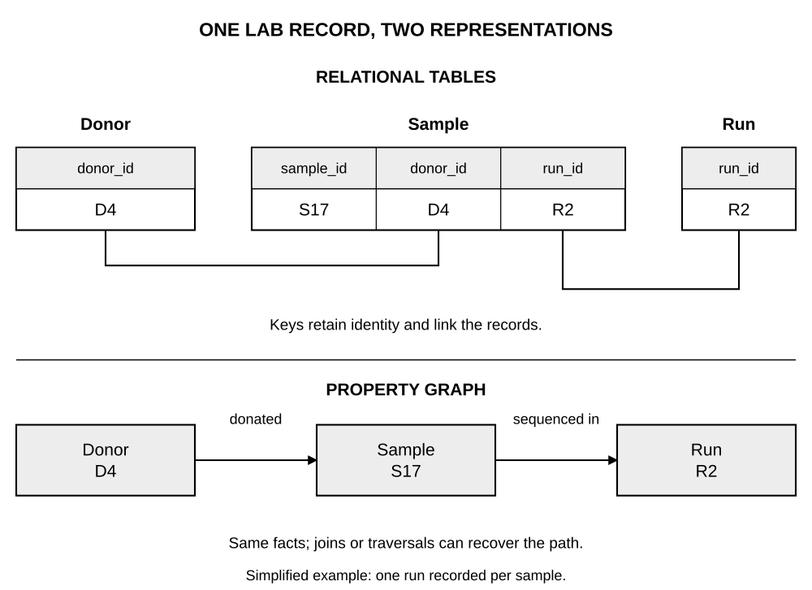

INTERLUDE 2

# Data Fundamentals

*The Language of Reality*

*DATA*

<!-- AI-assisted: restructured from Sam's earlier draft; Sam's own lines kept wherever they survived; awaiting Sam's pass -->

<!-- AI-assisted revision: author-approved Stage 2 factual repairs and teaching additions, 2026-10-23; preserved source prose where unchanged. -->

[[NOTE: In the selfish-gene view of biology, data would be a rough Silicon equivalent for data. Dawkin's memes can then be algorithms. ]]

I didn't have much to do as an embryo. No classes, no inbox, no forms to fill out. But I was already a prolific data professional: replicating, storing and debugging at cellular scale. Every split of a cell was a write operation; every strand of DNA, a backup job that never missed its window. My hardware was wet, but my uptime was impeccable.

My nuclear codebase arrived in two sets, one from each parent, each about three billion letters long, written in an alphabet of four: A, T, C and G.[^v1-i2-genome] But a sequence alone couldn't build me. I also inherited an egg's living machinery, including mitochondria with their own small genome, and the environment in which all this would run. The documentation, unfortunately, was missing.

So I did what every new hire does with undocumented code: I started reading it. The molecular machinery from the last chapter looks, from this side of the mirror, suspiciously like a workflow.

First, find the right file. My nuclear code was split across 23 pairs of volumes, the chromosomes. Only a small fraction of their sequence, roughly 1–2 percent, specifies the amino-acid sequences of proteins, spread across some twenty thousand genes.[^v1-i2-coding] The rest includes switches, structural regions, functional RNAs, old viral graffiti and a great deal whose significance remains unsettled. Finding a string is one problem; deciding when to use it is another.

Second, make a working copy. For a protein-coding gene, RNA polymerase makes a preliminary RNA transcript, like an intern photocopying a memo, because nobody lets you take the original out of the vault. In my cells that copy gets processed: introns are removed and exons spliced together.[^v1-i2-splicing] Different splice choices can give one gene several products. Reuse was a biological best practice long before it was a software one.

Third, read it in the right frame. The ribosome reads the message three letters at a time. In the standard genetic code, sixty-one of the sixty-four codons specify amino acids; three signal a stop. AUG usually starts translation and also specifies methionine.[^v1-i2-code] Shift the frame by a single letter and the words downstream change, like reading a file from the wrong byte. Several codons can specify the same amino acid, so some substitutions leave the protein sequence unchanged. That redundancy is useful, but it doesn't reconstruct the original text as a digital error-correcting code can.

Fourth, ship the product. Some proteins are nouns, the structural ones like collagen and keratin that hold me together. Others are verbs, the enzymes that make things happen. The archive supplied sequences; folding, chemistry and the cell's existing machinery made them useful. I had arrived at a very old workplace.

And through all of it, quality control. DNA copying combines careful base selection, proofreading and repair; together these can reduce errors to roughly one in a billion copied bases, sometimes lower.[^v1-i2-fidelity] The resemblance to debugging is excellent. The cell's actual tools are chemical recognition and repair, not little checksums stamped on the chromosomes.

One more thing about that archive struck me, much later. I was using the same sequence in two different ways. During gene expression, some of it was transcribed and its messages used to make proteins. During replication, it was copied for new cells without translating what it encoded. The same text, as instructions and as plain data. Keep that in mind; it comes back at the end of this interlude.

## The Memory of Matter

Around the same time, in cleanrooms across California and New York, another kind of embryo was forming. That April, the month I was conceived, IBM announced its System/360, a family of computers designed so that programs could move from smaller machines to larger ones without being rewritten, one of the most consequential product launches in the history of computing.[^v1-i2-360] Its memory was still made of tiny magnetized rings of ferrite threaded on wires, each a miniature halo of yes and no. But in the labs, semiconductor memory was stepping onto the stage, and within a few years the magnet's loop would make way for the electron's lattice that Interlude 1 built.

The parallel is irresistible in hindsight. My parents' genetic sequences were being read in a new body; computer engineers were finding new ways to preserve and read electronic states. Neither was inventing memory from nothing. Both were making persistence do more work.

The stretch of biology, we saw, was not in the widening of space but in the deepening of time: in replication, variation and remembrance. Where physics expanded outward, biology expanded inward, building libraries instead of galaxies. Every living cell became an archive. Atomic stability, crystalline repetition, genetic replication: a genealogy of persistence, even though a crystal doesn't keep a family history.

### An Algebra Between Two Worlds

The person who gave communication its mathematics had also studied heredity. Claude Shannon, whose switching circuits appeared in Interlude Φ, completed a doctoral dissertation on the algebra of population genetics in 1940.[^v1-i2-shannonphd] In 1948 he published “A Mathematical Theory of Communication,” measuring information in bits and establishing limits on compression and reliable transmission.[^v1-i2-shannon] Five years later came the double helix. The two histories were approaching one another from opposite doors.

Nature had been processing data long before either door opened. In *E. coli*, strong expression of the lactose-digesting machinery generally needs two conditions: lactose available and the preferred sugar, glucose, scarce. A lactose derivative relieves repression, while low glucose favors an activating signal. This is the *lac operon*, a group of genes under shared control: an approximate AND gate with chemical concentrations where a computer would prefer clean zeros and ones.[^v1-i2-lac] And a swimming *E. coli* bacterium can compare recent conditions with present ones, extending its runs when things improve and reorienting through tumbles.[^v1-i2-chemotaxis] Memory, comparison and action, without a brain anywhere in sight.

### Passing the Baton

That year, I was dividing; machines were retaining. My nucleotides twined into blueprints; their circuits etched into wafers. Two experiments in memory, one biological and one technological, both playing by the same law of existence: information must persist to evolve.

Maggie, my molecular chaperone through biology, lingered at the edge of this new domain. She watched me copy another genome-length data packet, then looked up from her beaker. "You've carried the code long enough," she said. "He's been waiting."

From the glare of the lab lights stepped Alex, all polished aluminum and wry restraint. He twirled a tiny wafer between his fingers, examining the microscopic grids where electrons would soon stand guard over bits. "You've done well," he said. "Carbon made memory soft. Silicon will make it sharp. Somebody has to remember the things you forget on purpose."

And just like that, the torch passed, from chemistry to circuitry, from the wet archive to the dry one. In less than a human lifetime, data would go on to map not only us, but our entire lives and habitats. Calling data bare or heartless is like calling the air we breathe meaningless. Data is what lets our digital worlds breathe at all, just as DNA lets biological life persist.

## Why Data Comes First

Your body is biology's Ship of Theseus, renewing many of its parts while retaining others for decades. DNA supplies inherited instructions; chemical marks on DNA and its associated proteins help regulate their use. Those epigenetic marks resemble metadata, although they participate in the machinery rather than merely describing it. Sequence, cellular state and surroundings together produce the organism.

<!-- AI-assisted teaching addition: measurements and sequence-data provenance. -->

Sequencing that DNA produces a second archive: measurements of the first. A FASTQ file holds short or long sequence reads and a quality estimate for each called base. A common score is $Q=-10\log_{10}p$, where $p$ is the estimated probability that the letter was called incorrectly: Q30 means about one chance in a thousand, if the estimate is well calibrated.[^v1-i2-fastq] The file is saying both “A” and “how sure I am that it was A.” A spreadsheet should occasionally show such manners.

Many workflows align those reads to a reference genome, storing where they fit and how convincingly in SAM or its compressed binary counterpart, BAM. Variant calling then infers differences from the reference. Repeated coverage, uncertainty and sample records make sequencing data much larger than a bare string of genomic letters. With RNA sequencing, the reads instead help estimate which transcripts were present, how abundant they were and which splice junctions were used.[^v1-i2-sequence-analysis] We are measuring a cell's activity, with all the sampling and inference that implies. DNA doesn't arrive in a file; evidence about DNA does.

And now, in our own time, data feeds our algorithms, trains our neural nets and personalizes our devices, curating our feeds and sometimes anticipating our desires before we know we have them. It maps the spread of pandemics, routes supply chains, and finds new particles at CERN. It also lets misinformation metastasize, privacy erode and biases calcify into systems. The same mirror that shows us ourselves can quietly learn our weaknesses and sell them wholesale.

So to understand computing, or the minds we're now building out of it, we have to start with data: not just as a technical term but as the raw material of everything that follows. How do we represent it? How do we measure it, store it, arrange it, and get it to mean what we think it means, rather than whatever our favorite optimization function happens to reward this quarter? These questions are the bedrock of every interlude still to come.

## The Shape of Data

### Bits: Teaching Matter to Say "Maybe"

Once we taught matter to remember, we had to decide what it should remember.

Physics gave us states. Engineering turned those states into symbols: distinguishable voltage ranges, magnetic orientations, changes in reflected light. Two reliable alternatives were enough to start a civilization. We called them bits.

A bit is the smallest possible shrug of the universe: yes or no, 0 or 1, up or down. It doesn't know what it's talking about (a cat, a mortgage, a planetary orbit); it just volunteers to distinguish this from that. Bytes are small mobs of bits that agree to show up together. Strings, integers, images, genomes, contracts: peel away their dignity, and they're all bits standing in formation.

Alex loved this part. "Carbon needed four letters and a billion years to get going," he said, tapping a wafer. "Silicon can do quite a lot with two." Maggie rolled her ionic eyes but didn't disagree. DNA is a four-symbol code written in biochemistry; computers use a two-symbol code written in charge and voltage. Both are clever ways of asking the universe the same favor: please hold this distinction for a while.

Representation, the art of choosing which distinctions matter, is where data quietly becomes philosophy. Every representation keeps some differences and throws others away. A photograph of a face stores brightness but not warmth; a medical record stores a diagnosis but not the way the patient described the pain. Chapter Φ called this what the mirror leaves out, and it's where every later problem with data begins.

### Shannon's Bargain: Information as Surprise

Bits became truly interesting when Claude Shannon wandered in, politely ruined everyone's intuition, and left us with a new creed: information is surprise.

Shannon's trick was simple and rude. He didn't ask what a message meant. He asked how uncertain its arrival had been. A fair coin flip carries one bit of surprise; an outcome already certain under our model carries none. Shannon measured a source's average surprise with its entropy:[^v1-i2-entropy]

$$
H = -\sum_i p_i \log_2 p_i
$$

The formula has the same form as Gibbs's entropy in statistical mechanics, with different units. When all the physical microstates are equally likely, Gibbs's expression reduces to Boltzmann's $S=k_B\ln W$, the formula from Chapter 1. Shannon's probabilities concern messages; the thermodynamic probabilities concern physical states. The shared mathematics does not turn a surprising email into a calorimeter.

Meaning, awkwardly, doesn't show up in Shannon's equations. Random noise can have high entropy while telling us nothing useful about the message someone meant to send. Reliable communication concerns what the received signal lets us recover about that message. A breakup text and a rocket launch code can carry the same statistical surprise. Shannon built the skeleton; we keep trying to hang our emotional wardrobe on it.

The bargain he offered was this: treat messages as uncertain events, and you can measure them, compress them, protect them from noise, and send them across oceans without ever understanding what they're about. Humanity, never one to resist an abstraction that hides its ignorance, accepted immediately.

The protection part deserves a moment. Shannon showed that, below a channel's capacity and under his model's conditions, suitable coding can make transmission errors arbitrarily rare as the code length grows. Added redundancy helps a decoder distinguish messages that noise would otherwise confuse. Cells face a related problem through different machinery. In 1974 John Hopfield showed how energy-consuming checking steps can improve biochemical discrimination; in 1982 he published a network model of associative memory that helped shape modern AI.[^v1-i2-hopfield] Biological proofreading, digital error correction and recovering a memory from a partial cue are related ambitions with distinct mechanisms.

### Compression: What Can We Leave Out?

Once you can measure surprise, you can ask which repetitions need paying for twice. **Lossless compression** changes the representation while preserving every symbol. **Lossy compression** deliberately gives up distinctions. The difference matters rather more for a genome than for the sky behind a holiday photograph.

Take `AAAAAACCCC`, ten letters. Agree that each digit gives the count of the letter following it, and `6A4C` restores the original exactly. That is a tiny example of run-length encoding. But `ACACACACAC` becomes `1A1C1A1C1A1C1A1C1A1C`, twice as long under the same scheme. The pattern has to suit the code, and the decoder needs to know the scheme. Compression is not a compulsory discount.

Now keep only the counts: six As, four Cs. You can no longer distinguish `AAAAAACCCC` from `ACACACACAA`. The tally is shorter and may answer a question about composition perfectly. Ask about order and it has destroyed the evidence. This is useful forgetting, provided you chose the question before burning the paperwork.

ZIP aims at exact recovery. A lossy image codec can discard detail according to a chosen quality criterion. Encryption ordinarily preserves the information in a reversible transformation; lose the key and you have an access problem, not successful compression. No lossless scheme can shorten every possible input. Under a fair, independent coin model, most long sequences offer little compressible structure, although particular outcomes can: a million heads are improbable, but easy to describe.

The *Kolmogorov complexity* of a string is the length of its shortest generating program on a specified universal computing system.[^v1-i2-kolmogorov] “Print a million digits of pi” can be a short recipe, even if executing it takes work. The shortest recipe is generally not computable, and description length is different from runtime or physical probability. No theorem here says that the shortest genome, or the shortest universe, must win.

In March 1964, just before my own data began its next cellular engagement, Ray Solomonoff published the first part of a theory of inductive inference: predict what comes next by combining computable explanations, giving shorter descriptions greater prior weight.[^v1-i2-solomonoff] It is a powerful ideal for learning from sequences, with an uncomputable general solution. It gives the preference for economical explanations a precise setting; whether nature itself favors cheaper routes is the further question Alice is asking.

The genome offers a different sort of economy. Anthony Zador's *genomic bottleneck* describes how inherited information constrains a brain without specifying each of its connections individually.[^v1-i2-zador] Rules unfold through cells, surroundings and experience. Every embryo is a recipe being made in a kitchen it also helps rebuild.

A trained model can likewise capture regularities in a parameter file smaller than its training corpus, but it is not a ZIP file of that corpus. It may discard details, retain general patterns, and memorize particular passages all at once; researchers have extracted verbatim training text from language models.[^v1-i2-memorization] What survives depends on the objective, the examples and the training. Maggie called the biological economy ATP efficiency. Alex called the digital version disk quotas. Neither had yet persuaded me that taste was included.

## Memory Outside the Skull

For most of our history, data lived in fragile wetware. We called it memory and trusted it far more than it deserved. It slept, it distorted, it invented uncles who never existed.

Then we started moving memory outside the skull. Clay tablets, knotted strings, papyrus and ledgers were each an external hard drive with terrible latency and excellent durability. Civilization was, in large part, a project to stop forgetting the grain. The time-lapse goes something like this: clay said "don't lose the taxes," parchment and print said "don't lose the ideas," magnetic tape and disks said "don't lose the bits," and solid-state memory says "don't lose anything; we'll sort it out later."

The machines arrived by way of a census. To count the American population of 1890, Herman Hollerith built tabulating machines that read holes punched in cards, and his business became one of the companies combined into IBM's predecessor.[^v1-i2-hollerith] Punched cards gave way to magnetic tape and to the ferrite cores of the System/360 era. In 1956, IBM introduced the RAMAC's disk storage: fifty spinning platters, each about two feet across, holding five million characters in a cabinet the size of two refrigerators.[^v1-i2-ramac] Those were characters in its own encoding, not five million modern bytes. (Disk drives will get a more personal visit later in this book; I spent part of my working life inside them.)

Underneath the hardware sits a physical bill, but we should read its line items. Landauer's bound concerns logically irreversible erasure: resetting an unknown, unbiased bit in the usual idealized thermal setting dissipates at least $k_BT\ln 2$ of heat in the reversible limit.[^v1-i2-landauer] It is not a meter charging every stored bit forever. DRAM needs refresh; flash and disks retain information without that continuous refreshing. Real data centers pay for movement, computation, cooling and much else besides. Remembering has costs, and forgetting has a particularly interesting lower bound.

At some point, storage stopped being only about the past. Once we could keep instructions as well as records (code, models, simulations), our media stopped recording only what was and started enabling what could be reconstructed. A clay tablet couldn't simulate weather. A disk drive couldn't learn your face. A data center can run a thousand copies of a climate model, a trading bot, and a dry run of the virtual world you'll be living in next, if you ever find yourself hanging out in the cloud like an information-mall rat.

The road to AI didn't begin with thinking. It began with persistence: first we remembered, then we refined, then we automated the refinement. Somewhere between the second step and the third, storage quietly became infrastructure for minds.

## Structures: How We Arrange Our Ignorance

Raw bits are fine for physics, but humans like relationships. Very early, we realized that what matters isn't just values but how they hang together. A list of numbers is data. A list of what belongs to whom is bookkeeping. A list of who owes whom what is politics.

Computer science turned this into a small zoo of data structures: arrays, trees, graphs, hash tables, and their more baroque cousins. Under the hood they're just addresses and bits. In practice, they're opinions about how the world should be queried.

Databases formalized those opinions. A **database** is the organized collection; a **database management system**, or DBMS, is the software that stores it, answers queries and manages changes, permissions and concurrent users. The early systems often used hierarchies, filing cabinets nested inside filing cabinets. Apollo's parts-tracking needs helped produce IBM's IMS, a hierarchical system.[^v1-i2-ims] Then, in 1970, Edgar Codd proposed a relational model: represent facts in relations, usually pictured as tables, and let users specify what they wanted independently of how the machine stored it.[^v1-i2-codd] SQL became the best-known language for asking those questions. Oracle commercialized SQL in 1979, ahead of IBM's commercial SQL offerings. The oracle, for once, had read the paperwork.

<!-- AI-assisted teaching addition: database models and a worked data-provenance example. -->

Suppose a lab has donors, samples and sequencing runs. Each donor gets a unique **primary key**, such as D4. A sample record carries its own key, S17, and a **foreign key**, D4, pointing to the donor. Keep the donor's details once in the Donor table, rather than copying them into every sample. This separation is part of **normalization**: it reduces the chance that five copies of one fact become five conflicting facts. A **join** reconnects the tables when you ask which samples came from that donor.

A declared foreign-key constraint can reject a sample whose donor doesn't exist in the database. An **index** provides a shortcut to matching records, at the cost of storage and maintenance when records change. And a **transaction** groups changes so that, for example, registering a sample and recording its initial custody event either both commit or neither does.[^v1-i2-dbms] Atomicity, consistency, isolation and durability give us the acronym **ACID**. Isolation governs what concurrent operations can see of one another; durability means a committed change is meant to survive a crash. Here consistency means preserving declared rules; it cannot certify that someone labeled the actual tube correctly. Databases have standards, but no sense of smell.

{#fig-v1-i2-data-models width=90% fig-alt="Three tables show donor D4, sample S17 referencing D4 and R2, and sequencing run R2. Below, a graph represents the same facts: donor D4 donated sample S17, which was sequenced in run R2. Keys and graph edges both retain the relationships."}

The tables aren't a cage that large data eventually outgrows. **NoSQL** gathers several alternative models useful for different questions. A **key–value** store retrieves a value directly by its key, useful for a session or cache. A **document** store groups fields and nested records, perhaps an experiment whose instruments produce different metadata. A **wide-column** store organizes sparse, keyed records for access patterns such as large event histories. Flexible structure still needs rules: otherwise “temperature” can mean Celsius in one document and Fahrenheit in the next, and both will retrieve beautifully.[^v1-i2-nosql]

A **graph database** makes nodes, typed relationships and their properties directly queryable.[^v1-i2-graph] Our sample becomes a node joined to its donor and sequencing run. “Which donors' samples passed through this suspect run?” becomes a traversal along those edges. A relational database can answer it too, through joins. The useful difference is how naturally and efficiently a representation serves the questions, not whether only one kind of database understands relationships. Φ's nodes and edges have acquired a job.

There is another choice once data lives on several machines. During a network partition, disconnected replicas cannot guarantee both that every request to a functioning replica receives a successful response and that every read behaves as though it came from one immediately up-to-date copy. This is the core of **CAP**, with a precise meaning of consistency called linearizability.[^v1-i2-cap] A service may delay or reject some operations to preserve that guarantee, or permit responses that later need reconciliation. The trade-off belongs to distributed operation, not to the NoSQL label; different products and configurations make different choices. It will become more concrete when the machines meet the network.

Once you can store structured data and ask questions of it, you've built more than an archive. You've built an oracle with a limited vocabulary (sometimes literally named Oracle). You phrase your curiosity as a query; the system answers from what was recorded. Its silences include everything nobody thought to put in a column.

## From Bits to Belief

By now our poor bits are doing a lot of work, and it's tempting to promote them. We start talking about data, information, knowledge and sometimes even wisdom, as if we were running a spiritual retreat for spreadsheets. Russell Ackoff distinguished these levels, including understanding between knowledge and wisdom; the familiar pyramid is a useful organizing image, not a scientific law.[^v1-i2-dikw]

Roughly speaking, “38.9” is a recorded value. “38.9 °C, body temperature measured in an emergency room” supplies context. Knowledge draws on evidence and experience to interpret that measurement and decide what else must be checked. Wisdom includes knowing when the number isn't enough. These are working distinctions; multiplying the data doesn't automatically promote it through the ranks.

Shannon's question cuts across that ladder: how much uncertainty is reduced, and how reliably can a message be recovered? Biology asks which distinctions an organism can use to stay alive. Brains, and increasingly models, turn streams of data into representations they reuse. Whether those representations warrant belief takes us back to epistemology, where Φ began.

Maggie put it less politely: "Knowledge is just compression that kept not getting you killed."

## When Data Learned to Learn

For most of history, data was scarce and expensive. You carved it, inked it or memorized it at great cost. Then storage got cheap, networks got fast, and boredom got broadband.

Suddenly every click, purchase, message, selfie and GPS trace became a potential log entry; every sensor, from satellites to smartwatches, tattled on the world; and every institution decided that storage was cheap and paranoia was cheaper. We recorded more of reality, though never evenly. Years later, working with genomes and training data myself, I learned what that means in practice: the data grows faster than any machine you're given to process it, and half the art is deciding what not to compute.

You can't hand-write rules for every variation in a face or every way someone can phrase a sentence. Machine learning lets examples shape a model's behavior, an approach already being pursued in the 1950s.[^v1-i2-ml-history] The later abundance of data and computation greatly enlarged its reach. More relevant data can improve prediction; duplicate errors, poor coverage and the wrong objective can enlarge the mistake instead.

### How a Machine Learns

The recipe is worth knowing, because nearly everything in the later interludes builds on it.

Start with examples. **Supervised learning** pairs inputs with targets: a scan and a diagnosis, or a transaction and a later fraud finding. A label may come from a person, an instrument or a subsequent outcome; it is evidence, not infallibility. **Self-supervised learning** obtains targets from the data itself. In next-token training, the later text supplies the answer to what follows the earlier text. Other methods learn patterns without a supplied target, or learn actions through rewards. These are different ways of arranging the lesson.

Text must first be represented. A **tokenizer** splits it into units, often words or word fragments, sometimes individual characters or bytes.[^v1-i2-tokens] Each token gets an identifier. The identifier is an address, not a quantity: token 200 isn't twice the meaning of token 100. A neural language model looks up a learned vector, an **embedding**, for each token and transforms these vectors in context. Images, sequences and laboratory measurements need their own representations. In every case the choice determines which distinctions the learner receives.

Before learning, separate training, validation and test data. Training adjusts the model. Validation helps choose its settings and when to stop. The test estimates performance on withheld examples after those choices are made. But three folders aren't enough. If samples from the same donor appear on both sides of a split meant to test performance on new donors, the model may recognize the donor rather than learn the intended biology. Repeated documents and records from the future can leak answers in similar ways. Even a normalization calculated using the test set lets the exam influence the lesson.[^v1-i2-evaluation] Our sample's donor key has become an experimental safeguard.

Not all learned models are neural networks; some are trees or relatively simple equations. A neural network combines adjustable weights and biases with transformations called **activation functions**. A layer forms weighted combinations of its inputs, then transforms them. Nonlinear transformations let stacked layers represent relationships that one linear mapping cannot; without them, the stack collapses to one weighted mapping with a bias. **Deep learning** learns intermediate representations through several such layers, rather than requiring a person to hand-design every useful feature.[^v1-i2-deep-learning] Depth is a capacity, not a guarantee of understanding.

For each example the network produces a prediction, and a **loss function** assigns a penalty. In a next-token example, a common loss is $L=-\ln p$, where $p$ is the probability assigned to the token that actually follows. Assign it 0.8 and the penalty is about 0.22; assign it 0.2 and the penalty rises to about 1.61. Being confidently wrong is expensive. This is an arrangement one occasionally wishes to extend to public life.

**Backpropagation** applies the chain rule of calculus through the network, calculating how a small change in each parameter would change the loss.[^v1-i2-backprop] An optimizer uses these gradients to update the parameters; the **learning rate** controls the step size. In basic gradient descent the step points downhill on the loss landscape. Training usually estimates that direction from small batches, so the walk is noisy. Repeat across the dataset, each full pass an **epoch**, and useful predictions may emerge. Backpropagation computes sensitivities; it does not discover a moral allocation of blame among the knobs. The bacterium's biased wandering gives us an image of local improvement, but it is not taking these derivatives.

The great danger is **overfitting**: fitting the training examples, including their accidents, so closely that performance on new cases suffers. More representative data can help, as can constraints on model complexity, carefully chosen augmentation, and stopping when validation performance deteriorates. The test must remain withheld. And a good test score only covers what that test represents; another hospital, language or period may expose failures the original evaluation never asked about.

Once trained, a model uses its parameters on new inputs: **inference**. Its parameters usually remain fixed during a particular inference run, while its temporary internal state changes with the input and context. Later adaptation is possible. Chapter 2 borrowed the training/inference distinction for evolution and development, but the embryo wasn't a frozen model processing “me” as input: I was the developing result, made through continual regulation and interaction. Biology supplies the provocation, not the software specification.

A model, in this light, can be compressed behavior: learned regularities that let it respond to situations we didn't explicitly program. Whether any particular model deserves the word *mind* requires more than its file size. The people who build and interrogate these systems acquired a now-familiar job title, data scientist, a blend of statistician, programmer and domain detective, which a business magazine declared the sexiest job of the century.[^v1-i2-datascientist] (I've worn that hat, though I'd quibble with the magazine.)

### Bias, Loss, and the Moral Geometry of Compression

All of this would be charming if the world were fair. It isn't.

The datasets we feed our systems are skewed by history, power and convenience. The structures we choose (which columns exist, which relationships count) encode our assumptions. The compressions we train (which errors we tolerate, which we punish) embed our priorities. Compress for profit, and you forget the people who don't generate it. Compress for majority patterns, and you erase the margins. Compress for speed, and you lose nuance. Every system that learns from data inherits not only our patterns but our blind spots.

Lossy representation and learning can discard detail; lossless coding need not. Which errors a model is trained to tolerate is therefore a choice we make, not a sacrifice demanded by Shannon. The loss function makes that choice mathematical without making it morally settled.

Alex liked to say, “There is no neutral index and no neutral loss function.” Maggie declined to offer natural selection as an ethics committee. It keeps what reproduces, including arrangements nobody should be obliged to call fair.

## Bob, Through the Looking-Glass: The Same Text, Read Twice

*The twist, in one line: life discovered, billions of years before we did, that the same text can be both data and instructions, and enough data, read the right way, can become a world for whatever lives inside it.*

Go back to the embryo's office job. The genetic code looks suspiciously well organized. Several codons specify the same amino acid, and some neighboring codons specify chemically similar ones, buffering certain errors. Francis Crick's “frozen accident” proposed that an early code became hard to change because later changes would disrupt many proteins at once.[^v1-i2-frozen] An instruction set with rather more at stake than backward compatibility.

Stephen Freeland and Laurence Hurst found the standard code exceptionally resistant to errors among the randomized alternatives in their test.[^v1-i2-freeland] But which alternatives are allowed, how likely each error is and what counts as damage all affect the verdict. A mixture of historical constraint and selection is plausible; neither near-perfection nor “most typos do no harm” follows. The genome has had billions of years to acquire dependencies. So has the trouble with changing it.

Now the stranger part. In work developed in the late 1940s and published in 1951, John von Neumann described a route to machine self-reproduction. A constructor uses a description to build a machine; a copier duplicates the description; a controller arranges for the copy to accompany the new machine.[^v1-i2-vonneumann] The crucial move is using the description twice, once for construction and once for copying. This was a sufficient architecture in his model, not a proof that every replicator must work that way. Still, the biological resemblance is remarkable: DNA is copied, while selected sequences are transcribed into RNAs, some translated into proteins by machinery already present. The description never builds alone. My embryo's office was staffed before I reported for duty.

Stored-program computers use another version of the double reading: bit patterns can serve as data or as executable instructions according to how the machine treats them. The arrangement isn't identical to a cell's, but the interpretive problem survives the crossing. A sequence's effects depend on the machinery that reads it.

The looking-glass goes one step further. Konrad Zuse proposed a computational universe; John Wheeler explored “it from bit”; Nick Bostrom developed a simulation argument; David Chalmers argues that virtual objects can be real digital objects rather than mere illusions.[^v1-i2-itfrombit] These are different proposals, not four signatures on the same conclusion. Even physics has found a surprising connection between information and geometry: black-hole entropy scales with horizon area, and holographic proposals extend that clue under specific conditions.[^v1-i2-bekenstein] None of it establishes that our world is somebody's software.

I suspect something closer to home: data, arranged with enough useful relations and coupled to a process that learns from it, can become a world the process navigates from within. There is a small, concrete foothold. A model trained only on sequences of Othello moves acquired an internal representation of board state; intervening on that representation changed its predictions.[^v1-i2-world-model] The board had not been supplied as a picture. Something about the world generating the data had become useful inside the learner.

That is a representation of a world. Whether there is anything it feels like to inhabit one is the further leap, and I want to leave that leap visible rather than quietly smuggle consciousness in with the data. Could enough such relations support an inside for which they constitute reality? Interlude 1 grew a universe of logic out of silicon's lattice; here another layer rides on it, a possibility space within a possibility space. I don't yet know what would turn “a model has a world-model” into “a world is present to it.”

I do know the question is uncomfortably close to home. Light, pressure and the body's own signals become the felt world of a brain: pain, touch, color and the “I” that seems to be having them. The next chapter begins there, with a specimen whose documentation has not improved.

Version 1.0 of data had learned to remember. Version 2.0 was about to learn to think.

> ***Maggie:** Genes remembered how to build us.*
>
> ***Alex:** Data remembers what we did.*
>
> ***Maggie:** Memes taught us how to behave.*
>
> ***Alex:** Algorithms will teach machines how to behave.*
>
> ***Both:** Every memory, given time, becomes an instruction.*

<!-- SOURCE NOTES: aligned 2026-10-23; evidence scope and access limits recorded in the Interlude 2 adoption dossier. -->

[^v1-i2-genome]: Sergey Nurk et al., [“The complete sequence of a human genome”](https://doi.org/10.1126/science.abj6987), *Science* 376 (2022): 44–53. The CHM13 reference spans about 3.055 billion base pairs. A reference assembly is not an individual’s complete diploid genome, and a genomic sequence is not sufficient by itself to generate an organism.

[^v1-i2-coding]: International Human Genome Sequencing Consortium, [“Finishing the euchromatic sequence of the human genome”](https://doi.org/10.1038/nature03001), *Nature* 431 (2004): 931–945; Nurk et al. (2022), cited above. Protein-coding gene counts depend on annotation and have been revised since the initial genome draft. Only roughly 1–2 percent of genomic sequence directly encodes amino-acid sequences; noncoding does not mean uniformly nonfunctional.

[^v1-i2-splicing]: Philip A. Sharp, [“Split Genes and RNA Splicing”](https://www.nobelprize.org/uploads/2018/06/sharp-lecture.pdf), Nobel lecture (1993); Qun Pan et al., [“Deep surveying of alternative splicing complexity in the human transcriptome by high-throughput sequencing”](https://doi.org/10.1038/ng.259), *Nature Genetics* 40 (2008): 1413–1415. Splicing concerns RNA processing, not cutting the corresponding introns from genomic DNA.

[^v1-i2-code]: National Human Genome Research Institute, [“Codon”](https://www.genome.gov/genetics-glossary/Codon) and [“Transfer RNA”](https://www.genome.gov/genetics-glossary/Transfer-RNA-tRNA); NCBI, [“The Genetic Codes”](https://www.ncbi.nlm.nih.gov/Taxonomy/Utils/wprintgc.cgi), standard code, table 1. The standard code has 61 amino-acid codons and three stops; mitochondrial and other variant codes require separate treatment.

[^v1-i2-fidelity]: Thomas A. Kunkel, [“DNA Replication Fidelity”](https://doi.org/10.1074/jbc.R400006200), *Journal of Biological Chemistry* 279 (2004): 16895–16898. Fidelity combines nucleotide selection, proofreading and mismatch repair; rates depend on organism, polymerase and conditions. A final error rate around one per billion copied bases is an order-of-magnitude guide, not a universal constant.

[^v1-i2-360]: IBM, [“The IBM System/360”](https://www.ibm.com/history/system-360). Announced on 7 April 1964, System/360 offered a compatible family across performance levels. Its main memory used magnetic cores; semiconductor memory’s later adoption is a separate transition. The coincidence with conception is the author’s family chronology.

[^v1-i2-shannonphd]: Claude E. Shannon, [“An Algebra for Theoretical Genetics”](https://dspace.mit.edu/entities/publication/9921edcd-1518-47c2-bc86-fa9005ca21b6), Ph.D. dissertation, MIT (1940). His switching-circuit work preceded this dissertation, so genetics was not the beginning of his research career.

[^v1-i2-shannon]: Claude E. Shannon, [“A Mathematical Theory of Communication”](https://people.math.harvard.edu/~ctm/home/text/others/shannon/entropy/entropy.pdf), *Bell System Technical Journal* 27 (1948): 379–423, 623–656. See the opening distinction between engineering and semantic questions, the entropy discussion and the coding theorems. Shannon credited John Tukey with “bit.”

[^v1-i2-lac]: François Jacob and Jacques Monod, [“Genetic regulatory mechanisms in the synthesis of proteins”](https://doi.org/10.1016/S0022-2836(61)80072-7), *Journal of Molecular Biology* 3 (1961): 318–356. For the later-established combination of repression and glucose-sensitive activation, see Geoffrey M. Cooper, [*The Cell: A Molecular Approach*, “Transcription in Prokaryotes”](https://www.ncbi.nlm.nih.gov/books/NBK9850/) (2nd ed., 2000), lac-operon discussion. The AND-gate comparison describes strong expression approximately, not a perfectly digital switch.

[^v1-i2-chemotaxis]: Robert M. Macnab and D. E. Koshland Jr., [“The gradient-sensing mechanism in bacterial chemotaxis”](https://doi.org/10.1073/pnas.69.9.2509), *PNAS* 69 (1972): 2509–2512; Howard C. Berg and Douglas A. Brown, [“Chemotaxis in Escherichia coli analysed by three-dimensional tracking”](https://doi.org/10.1038/239500a0), *Nature* 239 (1972): 500–504. Temporal comparison biases runs and tumbles; it is not backpropagation or exact gradient calculation.

[^v1-i2-fastq]: NCBI Sequence Read Archive, [“File Format Guide”](https://www.ncbi.nlm.nih.gov/sra/docs/submitformats/), FASTQ and SAM/BAM sections; Peter J. A. Cock et al., [“The Sanger FASTQ file format for sequences with quality scores, and the Solexa/Illumina FASTQ variants”](https://doi.org/10.1093/nar/gkp1137), *Nucleic Acids Research* 38 (2010): 1767–1771. The Phred score is $Q=-10\log_{10}P(\mathrm{error})$; see Oxford’s [sequence-file teaching example](https://www.chg.ox.ac.uk/bioinformatics/training/msc_gm/2024/live/bioinformatics_pipelines_for_NGS_data/Inspecting_the_fastqs/). A quality score is an estimate, not a warranty.

[^v1-i2-sequence-analysis]: EMBL–EBI, [“NGS, raw read pre-processing, quality control, and read mapping”](https://www.ebi.ac.uk/training/materials/genome-bioinformatics-materials/raw-read-preprocessing-qc-read-mapping/); Pan et al. (2008), above, for sequencing-based analysis of splicing. SAM/BAM preserve reads and alignment information; RNA abundance and splicing estimates require further analysis, with reference and sampling limitations.

[^v1-i2-entropy]: Shannon (1948), “Choice, Uncertainty and Entropy.” The statistical-mechanical comparison is the Gibbs form $S=-k_B\sum_i p_i\ln p_i$; equal probabilities over $W$ microstates give Boltzmann’s $S=k_B\ln W$. Shannon entropy is a property of a probability model; semantic usefulness does not follow from high entropy.

[^v1-i2-hopfield]: J. J. Hopfield, [“Kinetic Proofreading: A New Mechanism for Reducing Errors in Biosynthetic Processes Requiring High Specificity”](https://doi.org/10.1073/pnas.71.10.4135), *PNAS* 71 (1974): 4135–4139; [“Neural networks and physical systems with emergent collective computational abilities”](https://doi.org/10.1073/pnas.79.8.2554), *PNAS* 79 (1982): 2554–2558. Biochemical discrimination, communication coding and associative recall are distinct mechanisms.

[^v1-i2-kolmogorov]: A. N. Kolmogorov, “Three approaches to the quantitative definition of information,” *Problems of Information Transmission* 1 (1965): 1–7; Ray J. Solomonoff (1964), below. For the precise shortest-program definition and noncomputability, see Paul M. B. Vitányi, [“How incomputable is Kolmogorov complexity?”](https://arxiv.org/abs/2002.07674), *Entropy* 22 (2020): 408. Choice of universal machine affects description length by an additive constant; the statement is not a law selecting physically realized universes.

[^v1-i2-solomonoff]: Ray J. Solomonoff, [“A Formal Theory of Inductive Inference, Part I”](https://raysolomonoff.com/publications/1964pt1.pdf), *Information and Control* 7 (March 1964): 1–22; Part II, 7 (June 1964): 224–254. His [publication list](https://raysolomonoff.com/publications/pubs.html) records earlier reports in 1960. The 1964 coincidence is a publication milestone, not the first conception of the idea.

[^v1-i2-zador]: Anthony M. Zador, [“A critique of pure learning and what artificial neural networks can learn from animal brains”](https://doi.org/10.1038/s41467-019-11786-6), *Nature Communications* 10 (2019): 3770; [author-repository copy](https://repository.cshl.edu/id/eprint/38307/1/2019.Zador.ArtificialNeuralNetworks.pdf). The genomic bottleneck limits direct specification and motivates inherited developmental rules, alongside environmental and activity-dependent development.

[^v1-i2-memorization]: Nicholas Carlini et al., [“Extracting Training Data from Large Language Models”](https://arxiv.org/abs/2012.07805), *30th USENIX Security Symposium* (2021): 2633–2650. Demonstrated extraction of verbatim training examples counters the claim that training necessarily forgets all its source sentences.

[^v1-i2-hollerith]: IBM, [“The punched card tabulator”](https://www.ibm.com/history/punched-card-tabulator). Hollerith’s system served the 1890 U.S. census; his firm became part of Computing-Tabulating-Recording in 1911, which took the IBM name in 1924.

[^v1-i2-ramac]: IBM, [“RAMAC”](https://www.ibm.com/history/ramac); American Society of Mechanical Engineers, [“IBM 350 RAMAC Disk File”](https://www.asme.org/about-asme/engineering-history/landmarks/90-ibm-350-ramac-disk-file). The 1956 system held five million characters on fifty 24-inch disks. Its character encoding should not be silently equated with modern eight-bit bytes.

[^v1-i2-landauer]: Rolf Landauer, [“Irreversibility and Heat Generation in the Computing Process”](https://doi.org/10.1147/rd.53.0183), *IBM Journal of Research and Development* 5 (1961): 183–191; Charles H. Bennett, [“Notes on Landauer’s Principle, Reversible Computation, and Maxwell’s Demon”](https://arxiv.org/abs/physics/0210005), *Studies in History and Philosophy of Modern Physics* 34 (2003): 501–510. The usual $k_BT\ln 2$ bound specifies an initially unknown, equally probable binary memory and a thermal reservoir. Known or correlated bits require the full entropy balance.

[^v1-i2-ims]: IBM, [“Information Management Systems”](https://www.ibm.com/history/information-management-system), especially “An urgent request to track parts.” Development involved IBM, North American Aviation/Rockwell and Caterpillar; the commercial announcement came in 1968. IMS combined hierarchical data management with transaction processing.

[^v1-i2-codd]: E. F. Codd, [“A Relational Model of Data for Large Shared Data Banks”](https://research.ibm.com/publications/a-relational-model-of-data-for-large-shared-data-banks), *Communications of the ACM* 13 (1970): 377–387. For SQL’s IBM origins and Oracle’s 1979 commercial implementation, see Oracle’s [“History of SQL”](https://docs.oracle.com/en/database/oracle/oracle-database/21/sqlrf/History-of-SQL.html). A relational model, the SQL language and a particular product are distinct.

[^v1-i2-dbms]: PostgreSQL documentation, [“Foreign Keys”](https://www.postgresql.org/docs/18/tutorial-fk.html), [“Transactions”](https://www.postgresql.org/docs/18/tutorial-transactions.html), [“Indexes: Introduction”](https://www.postgresql.org/docs/18/indexes-intro.html), and [“Constraints”](https://www.postgresql.org/docs/18/ddl-constraints.html). The donor–sample–run example and figure are original teaching constructions. Declared integrity and successful transactions cannot establish the truth of the observations entered.

[^v1-i2-nosql]: MongoDB, [“Data Modeling”](https://www.mongodb.com/docs/manual/data-modeling/), for flexible documents and access-oriented schema design; Fay Chang et al., [“Bigtable: A Distributed Storage System for Structured Data”](https://research.google/pubs/bigtable-a-distributed-storage-system-for-structured-data/), *OSDI* (2006): 205–218, for a sparse, distributed wide-column model. NoSQL is an umbrella, not a promise of absent schema or weak consistency.

[^v1-i2-graph]: Neo4j, [“What is a graph database?”](https://neo4j.com/docs/getting-started/graph-database/) and [“Graph database concepts”](https://neo4j.com/docs/getting-started/appendix/graphdb-concepts/). The passage uses a property-graph model: nodes and typed relationships can carry properties. The same facts can also be represented relationally.

[^v1-i2-cap]: Seth Gilbert and Nancy Lynch, [“Brewer’s Conjecture and the Feasibility of Consistent, Available, Partition-Tolerant Web Services”](https://www.comp.nus.edu.sg/~gilbert/pubs/BrewersConjecture-SigAct.pdf), *ACM SIGACT News* 33, no. 2 (2002): 51–59. In the theorem’s model, availability concerns every request to a non-failing node, and consistency means atomic/linearizable behavior. This is different from the integrity meaning of consistency in ACID.

[^v1-i2-dikw]: Russell L. Ackoff, “From Data to Wisdom,” *Journal of Applied Systems Analysis* 16 (1989): 3–9; see the [teaching excerpt from *Ackoff’s Best*](https://faculty.ung.edu/kmelton/Documents/DataWisdom.pdf) (Wiley, 1999), pp. 170–172. Ackoff includes understanding as a distinct level. The temperature example is the author’s illustration, not Ackoff’s definition or clinical advice.

[^v1-i2-ml-history]: Arthur L. Samuel, [“Some Studies in Machine Learning Using the Game of Checkers”](https://doi.org/10.1147/rd.33.0210), *IBM Journal of Research and Development* 3 (1959): 210–229. Machine learning predates the web-data boom; that boom enlarged its scale rather than initiating the field.

[^v1-i2-tokens]: Rico Sennrich, Barry Haddow and Alexandra Birch, [“Neural Machine Translation of Rare Words with Subword Units”](https://aclanthology.org/P16-1162/), *ACL* (2016): 1715–1725. This work adapts byte-pair encoding for subword translation. Tokenization varies by model and language; a fixed English words-per-token ratio is not a definition.

[^v1-i2-evaluation]: scikit-learn, [“Common pitfalls and recommended practices”](https://scikit-learn.org/stable/common_pitfalls.html), especially data leakage, and [“Cross-validation: evaluating estimator performance”](https://scikit-learn.org/stable/modules/cross_validation.html), including grouped observations and time-dependent data. The appropriate split follows the intended generalization claim. The lab/donor example is original.

[^v1-i2-deep-learning]: Yann LeCun, Yoshua Bengio and Geoffrey Hinton, [“Deep learning”](https://doi.org/10.1038/nature14539), *Nature* 521 (2015): 436–444, especially the opening account of representation learning and multilayer networks. Composing linear maps yields a linear map; nonlinear transformations are essential to the expressive gain described here.

[^v1-i2-backprop]: David E. Rumelhart, Geoffrey E. Hinton and Ronald J. Williams, [“Learning representations by back-propagating errors”](https://doi.org/10.1038/323533a0), *Nature* 323 (1986): 533–536. Backpropagation computes derivatives; an optimization rule uses them to change parameters. The natural-log loss example is an original calculation for an observed target with predicted probability $p$.

[^v1-i2-datascientist]: Thomas H. Davenport and D. J. Patil, [“Data Scientist: The Sexiest Job of the 21st Century”](https://hbr.org/2012/10/data-scientist-the-sexiest-job-of-the-21st-century), *Harvard Business Review* (October 2012).

[^v1-i2-frozen]: F. H. C. Crick, [“The origin of the genetic code”](https://doi.org/10.1016/0022-2836(68)90392-6), *Journal of Molecular Biology* 38 (1968): 367–379. The frozen-accident account concerns historical fixation and the consequences of changing an established code; it is not a proof of arbitrary origin or permanent immutability.

[^v1-i2-freeland]: Stephen J. Freeland and Laurence D. Hurst, [“The Genetic Code Is One in a Million”](https://doi.org/10.1007/PL00006381), *Journal of Molecular Evolution* 47 (1998): 238–248. The comparison is conditional on a randomized code ensemble and an error-cost model. For competing origin mechanisms and sensitivity to those assumptions, see Eugene V. Koonin and Artem S. Novozhilov, [“Origin and evolution of the genetic code: the universal enigma”](https://pmc.ncbi.nlm.nih.gov/articles/PMC3293468/), *IUBMB Life* 61 (2009): 99–111.

[^v1-i2-vonneumann]: John von Neumann, [“The General and Logical Theory of Automata”](https://www.cs.jhu.edu/~basu/Papers/VonNeumann1951.pdf), in L. A. Jeffress, ed., *Cerebral Mechanisms in Behavior* (Wiley, 1951): 1–41, self-reproduction discussion; later developed in *Theory of Self-Reproducing Automata*, edited by Arthur W. Burks (1966). The constructor/copier/controller account is a sufficient theoretical construction. Biological inheritance requires existing cellular machinery and is not identical to his model.

[^v1-i2-itfrombit]: Konrad Zuse, *Rechnender Raum* (1969; [English translation, *Calculating Space*](https://philpapers.org/archive/ZUSRR.pdf), MIT Technical Translation AZT-70-164-GEMIT, 1970); John Archibald Wheeler, [“Information, Physics, Quantum: The Search for Links”](https://scienceplusplus.org/visions/assets/Wheeler1989.pdf) (1989), pp. 354–368 in the original proceedings; Nick Bostrom, [“Are You Living in a Computer Simulation?”](https://simulation-argument.com/simulation.pdf), *Philosophical Quarterly* 53 (2003): 243–255; David J. Chalmers, *Reality+: Virtual Worlds and the Problems of Philosophy* (2022), [author’s account of the reality question](https://rintintin.colorado.edu/~vancecd/phil150w/reality.pdf). These positions differ; the proposed world-within-data extension here is the author’s.

[^v1-i2-bekenstein]: Jacob D. Bekenstein, [“Black Holes and Entropy”](https://doi.org/10.1103/PhysRevD.7.2333), *Physical Review D* 7 (1973): 2333–2346; Raphael Bousso, [“The Holographic Principle”](https://arxiv.org/abs/hep-th/0203101), *Reviews of Modern Physics* 74 (2002): 825–874. Black-hole area entropy, Bekenstein’s later energy–radius bound and covariant entropy bounds are related but distinct. None establishes that an arbitrary spatial volume is literally a computer memory with a universally applicable surface-bit limit.

[^v1-i2-world-model]: Kenneth Li et al., [“Emergent World Representations: Exploring a Sequence Model Trained on a Synthetic Task”](https://arxiv.org/abs/2210.13382), *ICLR* (2023). In the Othello task, probes found board-state representations and interventions affected model output. This is evidence of task-relevant internal modeling, not of subjective experience or an inhabited world.
