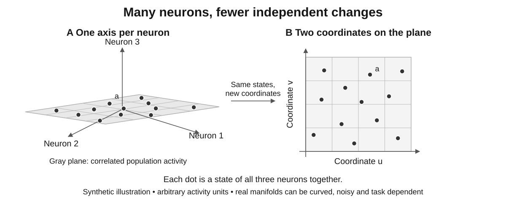

CHAPTER 3

# The Promethean Bargain

*The Brain as Creation's Engine*

*BRAIN*

<!-- AI-assisted: restructured from Sam's earlier draft and new vignettes; Sam's own lines kept wherever they survived; awaiting Sam's pass -->
<!-- AI-assisted: targeted scientific repairs and approved additions by Codex, 23 October 2026; personal scenes and jokes retained from the author-approved incoming draft. -->

> "Every act of perception is to some degree an act of creation, and every act of memory is to some degree an act of imagination." --- **Gerald M. Edelman**, quoted by Oliver Sacks[^v1-c3-sacks]

That first breath wasn't just air; it was information. Warm, cold, bright, dim. Every molecule was a messenger rushing in to report that the universe existed. Long before language or memory (and even before a "me" could emerge), the brain began its apprenticeship in sensation.

I didn't yet *think*, in any sense I could now put into words; I registered. From light to retina to cortex, and a pattern began to form. Initially it's always a ghost of an image, a rehearsal for seeing. My brain had already been wiring and responding before birth; this is where the world at large, and thus I, enter its domain in the story, not where it first switches on.

In the year I was born, David Hubel and Torsten Wiesel published another piece of the miracle they were watching unfold in kittens. They had already found visual-cortex neurons that prefer lines at particular angles, and shown how depriving one eye early in life could leave its cortical representation profoundly impaired. Now they showed that making the two eyes look in different directions disrupted the development of cells that normally respond to both.[^v1-c3-hubel] Their lab and my crib were exploring the same predicament: perception needs a world to practice on, and some of its lessons have deadlines.

Even the retina, before the cortex gets a vote, doesn't simply report light. Many of its cells compare a small spot with the ring around it and respond strongly to contrast: brighter than its neighbors, or darker.[^v1-c3-kuffler] From its very first look, the brain was riding the delta.

## The Experimental Years

Then I started crawling. By all accounts, the crawling was not accompanied by a hiss, which was good for me. But it wasn't all well and good, either. My mother said I was always reaching for her crystal, and she had to keep pace with me. Every crawler (boys perhaps more so) reaches an age in sensory-motor development when picking things up, throwing them, and seeing how far they go and what happens to them becomes a calling. Brain and hand had already started their long Promethean partnership.

She would, of course, put me in the crib so she could do the chores around the house. Somehow I figured out how to open the crib door. I got out and raced for a crystal ashtray in the living room. Before she could reach me, I raised the ashtray and slammed it on the floor. It broke into a million pieces, with baby me and my mother as the only spectators of this marvelous achievement in science. I had taken one thing and expanded it into hundreds, all in one smash. I had known it could be done, but I'd been kept, ironically, from the very world I was now bestowing this great gift upon. My mother said I looked up at her proudly with a vigorous laugh: *Look what I did.* Perhaps I was demanding a Nobel Prize for discovering that many parts are bigger than one part.

She didn't know what to say. It was a monumental feat for an infant, breaking physics as we knew it, or at least as he knew it. He'd had the theory in his notebook for a while (the developing brain, among many other things, had become a notebook) and was dying to test it, and when he finally got his chance, a rigorous regime of experimental physics confirmed the prediction in spectacular fashion. Somewhere, Einstein felt palpitations again, this time in his grave.

Luckily, I was done with these smashing urges when I started walking (at least for several years, until they came back and never left). My mother said I was hesitant to walk. Perhaps the little evolutionary biologist in that baby brain saw no advantage in it: food normally arrived while lying down. And when I finally did walk, I didn't walk; I ran, with the same laugh. *Look what I did.* Perhaps the biologist reasoned that if one must suffer bipedalism, running is at least the more survivable option. The truth is probably the same fear of falling: running got me to the other end of the room before falling could catch up.

So, let's take inventory. Senses: tested. Houdini mechanics: tested. Motor function: tested. Brain-hand cooperation: tested. Mathematics: tested, with flying colors (and other flying debris). Ambulation: tested, belated and cursorial. But that's any animal. The next step was becoming a true primate. Ah, that old monkey-and-bananas problem. Could I?

Like any good evolutionary trait, this one had to wait until well after I'd been shipped to my grandparents' place. My grandmother tells me that before my mother came to pick me up, my cousin, a year older than me and recently graduated from toddler to, well, professional terror (Grannie said "preschooler," but that's a temporary assignment), came to visit. One key finding was that human brains engage in socialization: he and I mingled. And, momentarily, I looked up to him as a production-ready, curated training dataset, or what the uninitiated call a role model (minus the role, and minus the model).

He showed off that he could jump, from a step or two, whatever it was. Then he pointed at me: my turn. Smaller and much more timid than him, the brain in me still wasn't going to pass up a healthy training run on something called "jump." I looked down at the floor to gauge the height. Then I walked back inside and reappeared with a cushion from the living room, placed it on the concrete, climbed back up, and jumped, landing successfully on the cushion. The monkey had moved the box.

Of course, once an experiment succeeds, why not use the same setup for at least one validation run? I fine-tuned the cushion's position, climbed back up, and just as I was about to jump, my cousin pushed me forward, hard. I overshot the cushion's trajectory and landed headfirst on the concrete. Grannie said I had a big bump on my head for many, many days. Peer review can be brutal.

Monkey-and-bananas problem: solved, and suffered. Social interaction: also checked, with deep regret.

A couple of months later, when I came back to my parents, I came back with a strange habit: finding tea cosies and wearing them on my head. Luckily, being her mother's daughter, my mother had kept the tea habit, while I had acquired the wearable edition. That meant I could keep my habit with the lone tea cosy that lived at my parents' place, which now doubled as the evening teapot's warmer and my daytime headgear. My sharp-witted mother knew the danger (and my obsession), and kept the teapot, tea cosy intact, at the dead center of a round table, beyond my sub-three-year-old reach.

I formulated a workaround: if I pulled the tablecloth, the tea cosy would move dynamically toward me. It worked perfectly, in a purely theoretical sense. Along with the cosy, the entire payload (teapot and freshly boiled tea) arrived as well. By the time my mother executed her emergency response, the damage was done. I carried a burn on my thigh for quite a while.

Promethean bargain: gifted.

## What the Experiments Were Wiring

Behind every one of those experiments, something less visible was happening. A reach, a smash, a jump or a burn could alter the connections through which the next attempt would run. To see what changes, follow one signal.

A typical cortical neuron receives inputs along branching dendrites. Excitatory inputs tend to promote firing; inhibitory ones oppose or constrain it. Their timing and location matter: a dendritic branch can do substantial local computation before the cell produces an output. If the integrated activity brings the axon's trigger zone to threshold, voltage-sensitive ion channels generate an action potential. Its amplitude is approximately all-or-none; what a population conveys depends on which cells fire, when, and how often. Sodium and potassium currents carry the spike down the axon; pumps maintain the ion gradients that make this repeatable.[^v1-c3-signaling]

At a chemical synapse, the arriving spike opens calcium channels. Calcium entering the terminal triggers vesicles to release neurotransmitter across the gap. Receptors on the receiving cell translate that chemical event back into electrical or biochemical change. The synapse's strength is how much influence the sender has, not how loudly it shouts. And the wiring loops: cortical neurons receive feedback from other regions and their own local circuits, including inhibitory cells that help keep excitation from becoming a self-congratulatory riot.

{#fig-v1-c3-neural-learning width=100% fig-alt="Three panels show a neuron integrating inputs into spikes, glutamate release and AMPA/NMDA receptors at a synapse, and two excitatory neurons coupled to an inhibitory feedback neuron. NMDA calcium entry links coincident activity to plasticity."}

Donald Hebb proposed a consequential rule in 1949: when one neuron repeatedly helps make another fire, the connection between them strengthens.[^v1-c3-hebb] *Cells that fire together wire together* is the later shorthand. It describes one family of learning rules; timing, inhibition and chemical context decide what mere togetherness leaves out.

Maggie was there for this part, as she would be for so much of what came later. At a common type of glutamate receptor, called NMDA, a magnesium ion can sit in the channel like a cork. Glutamate arriving from the sending neuron is not enough: at the receiving cell's usual resting voltage, magnesium largely blocks the current. Nearby AMPA receptors can still pass a signal, helping depolarize the membrane. With sufficient depolarization, the magnesium block eases; glutamate, together with the co-agonist glycine or D-serine, can now open a useful route for calcium to enter.[^v1-c3-nmda]

The receptor and the membrane together detect a coincidence: *this input arrived while this cell was sufficiently active*. Calcium then engages machinery that can strengthen the synapse, including changing its complement of AMPA receptors. Other patterns can weaken it. Maggie doesn't write the whole rulebook; she checks an important condition at the door. This is one molecular foothold for Hebbian learning, not a claim that every memory passes through the same gate. Somewhere among the circuits that learned about ashtrays, cushions and tablecloths, that distinction mattered.

An artificial neural network preserves an audacious abstraction of this arrangement: inputs exert adjustable influence, a unit transforms their combined effect, and networks learn by changing those influences. A biological neuron, with active dendrites, spikes, changing receptors and chemical modulators, does considerably more than a weighted sum. Artificial networks can also have feedback and internal state. The useful resemblance is computation through learned connections; the implementation and the learning machinery need not be the same.[^v1-c3-ann]

## The Credible Accident

Looking back, my arrival had all the elegance of a software patch applied in midair. After nine months of aquatic training, I emerged blinking, uncredentialed and wholly unprepared: a neural network fresh from the factory with absolutely no documentation. The only "warranty," if you could call it that, was that the system would attempt to configure itself using whatever data happened to be lying around (crystal ashtrays included).

Brains are like that. They're credible accidents: unlikely, self-repairing computation engines built by molecules that couldn't spell "purpose" if you spotted them the consonants. Evolution didn't design the brain the way we design machines; it stumbled toward it like a drunk discovering geometry, occasionally hitting on brilliant structures, occasionally walking straight into trees.

Yet here we are, descendants of that long, clumsy chain of improvisations, carrying around three pounds of warm, damp, bioelectrical equipment that we treat with the same confidence we reserve for well-tested operating systems. We type, argue, plan, philosophize and develop opinions on sourdough hydration, completely unaware that the thing producing these thoughts is governed by rules written in the biochemical equivalent of duct tape.

The early brain (mine, yours, everyone's) begins with a kind of primordial bootloader: a set of reflexes and developmental heuristics honed over hundreds of millions of years. But unlike the transistorized machines of the interludes, which sit politely and wait for instructions, biology does not believe in waiting. The brain launches itself immediately, like a newborn startup with no users, no market research and no exit strategy. And then it learns.

Neurons fire, connect and prune with what would look, on a chip-design slide, like reckless enthusiasm. In many regions, a young child's brain produces a surplus of connections and later prunes it; activity helps shape which connections survive, alongside developmental and cellular mechanisms.[^v1-c3-pruning] No semiconductor fab would approve anything with this much randomness. But biology thrives in precisely the regime where electronics panic: noisy signals, partial data and unstable feedback loops. The brain is not a deterministic device but a rolling negotiation between memory, mood, body and environment, a credible accident that stays credible only because it keeps revising the minutes.

A brain is what happens when matter accidentally becomes curious.

### The Carpenter's Toolbox

By the time Hubel and Wiesel were teasing meaning out of a cat's visual cortex, evolution had long since finished the trick the cat was performing: turning raw sensation into a world of boundaries, lines, motion, hunger and hope. Hundreds of millions of years of evolutionary carpentry had given us the tools for thinking long before we learned to name them.

The toolbox itself is simple to list. About 86 billion neurons carry the spikes and form the long-range wiring, joined by synapses on the order of a hundred trillion.[^v1-c3-count] Glia, once dismissed as packing material, turn out to be support staff with opinions: they recycle neurotransmitters, tune signals and quietly influence learning. Regions and networks specialize, but the mind is what happens when they gossip constantly.

Most of the human cerebral cortex is neocortex, a six-layered sheet crumpled and folded like a city built in a hurry. It works with thalamic, striatal, hippocampal, cerebellar and brainstem circuits in overlapping loops of perception, memory, regulation and action. These are coevolved arrangements, not a rational new tenant perched on an unchanged reptilian basement. Evolution duplicates, repurposes and loses structures; it does not keep every receipt.

Every corner of it is a conversation between wiring and history. A cell in the visual cortex becomes an orientation detector partly because evolution discovered that the world has edges, and partly, as Hubel and Wiesel's kittens showed, because experience has to arrive on time to finish the job. No single part plays the whole score. The brain is a federation, local councils negotiating a shared illusion of unity. When we speak of "the mind," we are simply flattering a coalition.

### The Brain's Cosmic Inflation

Somewhere along our lineage, the brain began to expand as if the cosmos had misplaced a rule. From the australopithecines to us, brain volume roughly tripled. A large head, a birth canal and the mother's metabolic capacity impose interacting constraints; the old story that the pelvis alone forced us out unfinished is too tidy.[^v1-c3-volume] Human infancy, long and helpless, leaves an extraordinary amount of development to the outside world.

How did evolution afford it? Chapter 1's universe didn't build its uniformity piece by piece; it found a cheap engine. The monkey didn't keep jumping; it moved the box. The brain seems to have had several boxes, none of them exclusive. Vernon Mountcastle proposed that recurring cortical circuitry might perform a common kind of operation across very different tasks. Repetition is real; one identical column running one universal algorithm remains a hypothesis. Cortical areas and species vary, sometimes sharply, in their cellular organization.[^v1-c3-mountcastle] Human-specific NOTCH2NL genes offer another clue: experiments show effects on neural progenitor proliferation and differentiation, suggesting a contribution to cortical expansion.[^v1-c3-notch2nl] Cooking may have helped finance a hungrier brain by making food easier to process; how much, and when, remains debated.[^v1-c3-wrangham] A long childhood let the world do some of the wiring. And culture let brains offload what they couldn't hold.

That repetition matters for more than economy. With roughly 20,000 protein-coding genes and 86 billion neurons, the genome is not a connection-by-connection parts list; Interlude 2 called this the genomic bottleneck. Gene regulation, cellular interactions, molecular guidance and activity help build what no such list specifies. Reusable developmental rules compress well. Interlude 1's lattice is a useful mirror here, provided we don't mistake cortex for a crystal: its circuits are heterogeneous, continually altered, and chemically modulated by messengers including dopamine and serotonin. Repetition supplies a scaffold on which differences can become useful.

### Improvised Architecture

The organization looks deliberate, but development still hides surprises. In 2026, researchers reported two parallel progenitor populations contributing to the developing brain: anterior neural ectoderm giving rise to forebrain and midbrain, and posterior neural ectoderm to hindbrain. Their mouse lineage tracing and human stem-cell experiments led them to propose a composite developmental origin for the brain.[^v1-c3-twoorgans] That is a striking challenge to a simple one-origin account. It is not direct evidence that evolution once pushed two independent, functioning brains together.

The resulting divisions do not divide neatly into jobs. Amygdalar circuits participate in learning what matters, including rewards as well as threats. The thalamus helps regulate communication rather than merely forwarding mail. Cerebellar circuitry participates in movement and in cognitive networks. A region can be indispensable to a task without owning it; the same task recruits several regions, and the same region serves several tasks.[^v1-c3-networks]

Evolution never said, "Let there be a mind." It only said, "This works better than dying."

And yet, from these stitched-together subroutines, something staggering emerges: the power to generate a reality rather than merely endure one. The brain does not wait for the world to instruct it. It predicts, hallucinates and corrects. Vision is mostly guesswork guided by photons. Memory is half reconstruction, half rumor. Emotion is a metabolic weather report with ambitions of poetry. Attention is the fragile agreement among competing circuits on what matters right now.

Meaning is not received; it is manufactured. The brain doesn't merely survive the world. It builds internal worlds to survive by.

<!-- AI draft, 2026-11-14. -->
## Possibility, Brought Indoors

Chapter 1 left me four questions to put to any new floor: what is possible, what is cheap, where is the sameness, and where is the break. Interlude 1 ran them on a crystal and Chapter 2 on life. Here they are run on a brain, and the answers arrive with a change of character that the rungs above this one will inherit.

*What is possible?* Chapter 2 counted a modest protein's library at $20^{100}$, about $10^{130}$. A connectome embarrasses that arithmetic. Give each of a hundred trillion fixed synaptic sites only two states, present or absent, and the number of nominal wirings is

$$
2^{10^{14}},
$$

a number whose decimal expansion runs to some thirty trillion digits.[^v1-c3-wirings] Chapter 2's library needed a hundred and thirty. The honest conclusion isn't that a brain is unimaginably capable. It's that the count has stopped saying anything. Almost none of those wirings can be grown from an embryo, and almost none would keep a body alive through an afternoon.

The useful count is of *states* rather than wirings: which cells are active together, now. And there the answer runs the other way. Record hundreds of neurons in motor cortex during a constrained reaching task, and much of the population's activity can lie near a thin sheet inside the enormous space available to it. Neuroscientists call this a neural manifold; a handful of coordinates can capture much of the recorded variation while an arm reaches.[^v1-c3-manifold] That is Interlude 1's lesson in a warmer medium. A free electron has a continuum of kinetic energies; a crystal's lattice reorganizes the available energies into bands with gaps between them. A cortex's neurons admit an enormous count of firing combinations, while wiring, inputs and the task can concentrate activity near a manifold, leaving much of that space unvisited. Possibility is still the free floor. Structure is still what makes a floor worth standing on.

<!-- AI-assisted figure addition, 2026-11-15: original illustrative neural-manifold schematic; synthetic activity, not experimental data. -->
{#fig-v1-c3-neural-manifold width=100% fig-alt="Left: three axes, one for each neuron's change in firing rate, contain a gray plane and a cloud of synthetic population states. Right: the same states plotted with two coordinates on that plane. Each point represents all three neurons together. The figure illustrates correlated activity, not a claim that unvisited states are forbidden."}

*What is cheap?* Reuse, twice over, and the second kind is why this floor exists at all.

The first kind is spatial, and the chapter has already met it: much the same local circuitry, tiled across a six-layered sheet, with the caution that Mountcastle's identical column running one universal algorithm remains a hypothesis. Repetition is cheap, as it was for the universe and for the cell.

The second kind is temporal. For evolution to try an inherited variation, it has to build with it. A brain that wants to try something new only has to activate a different combination of what it already has. Much of the hardware is the same at breakfast and at midnight; what differs is which parts of it are talking to which. That is why a brain explores at the speed of milliseconds while evolution explores at the speed of generations, and why a modest number of cells can hold an unreasonable number of thoughts.

The recipe, meanwhile, stayed short, exactly as Chapter 1 insisted it must. One haploid copy of my genome is some three billion letters, under a billion bytes. Naming a single partner for a single synapse, chosen among a hundred billion neurons, takes about thirty-seven bits; a hundred trillion synapses named one at a time would need something like

$$
10^{14} \times 5 \text{ bytes} \;=\; 5\times10^{14} \text{ bytes},
$$

roughly six orders of magnitude more than the genome holds.[^v1-c3-bottleneck] Interlude 2 called this the genomic bottleneck. In Chapter 1's vocabulary it's the split between recipe and address, arriving at a new extreme: the recipe has to include growth rules, and the addresses cannot all be written out in it one by one. They are written by chemistry, by activity, and by whatever the world happens to be doing while the rules are still running.

One more cheap thing, which this chapter named in its opening pages and then walked past. The retina doesn't merely report light; much of its traffic reports contrast. An eye has something like a hundred million photoreceptors and about a million axons leaving it, a squeeze of about a hundred to one. Much of the scene travels through that neck as differences, rather than as a point-for-point copy. Riding the delta isn't a flourish of the retina's. It's an economical way to carry a world, and the chapter keeps rediscovering it at every level above.

*Where is the sameness?* In the parts, as it was in Chapter 2. Different kinds of cell, reusing a common all-or-none mechanism: the mechanism Hodgkin and Huxley worked out in a squid's axon, sodium rushing in and potassium following it out, is the one running down mine, though my neurons carry more kinds of channel than the squid's. In the usual spike-train description, the message lives in which cell fired and when: digital in the event, analog in its timing.[^v1-c3-spike-code] Above that, the neocortical sheet follows a six-layer plan, whether the patch beneath your hand is finding edges or holding the end of this sentence.

*Where is the break?* Three of them, and the first is the one that settles what kind of floor this is.

A patch of cortex does not know what it is for. In studies beginning in the late 1980s, Mriganka Sur and his colleagues rerouted the visual input of newborn ferrets into the part of the thalamus that normally serves hearing. Auditory cortex then developed visual responses, including cells tuned to orientation and a rough map of visual space.[^v1-c3-rewiring] The sheet is the sameness; what a patch becomes is partly decided at its door, by what turns up there. Chapter 2 found that biology is mostly address and very little recipe. A cortex pushes that as far as it will go: the recipe builds a reusable, already biased sheet and then declines to settle all its later meanings.

The second break is the deadline. The chapter opened with Hubel and Wiesel, whose kittens showed that some of perception's lessons expire. Close one eye in the wrong weeks and the cortex that eye should have had does not come back later on request.[^v1-c3-critical] Crick called the genetic code a frozen accident, and Chapter 2 borrowed the phrase for every choice of that kind: not written in the laws, made once, inherited by everyone afterward. A critical period is a frozen accident with its timescale collapsed. Biology freezes its accidents across generations; a brain freezes them across a childhood, and you then spend a life downstream of a few months you cannot remember.

The third is that no two of these breaks land the same way. From one recipe and one sheet, a roughly bilateral body grows an asymmetric brain, with language usually favoring one side, and every individual history writes a different set of addresses onto still-adaptable tissue. Chapter 2 said that is why biology has to be a historical science. The same sentence, with a shorter clock, is why psychology has to be one.

Then the new answer, and it is the point of the rung.

Chapter 2's new answer was that life carries out the head count. A pattern that copies well becomes more common in the plainest sense, so possibility space acquires a memory. A brain adds one thing to that, and it is not a bigger search. It is carrying out part of the count *in advance*.

Evolution's search has to be the thing it tries. Every experiment is an organism, every hypothesis is a body, and a refuted hypothesis can be a death. A brain can run the trial without being it. The toddler at the top of that step had two futures available and tested one of them inside his head: he looked down, judged the drop, went back indoors and returned with a cushion. Nothing fell and nothing broke. An experiment that could have cost a skull cost a little neural activity instead. When his cousin shoved him, the world ran the other branch for him, and the lump lasted days.

So the floor above biology isn't a wider possibility space. It's a cheaper way of visiting one: a model of the world, built inside the world, which can be wrong without anyone having to die of it.

That model is also where the new realm comes from, and it needs one condition to be worth anything. A model earns its keep only if the world is allowed to correct it, so the thing fastening this floor to the one below is the error. Loosen that outside correction and the machinery doesn't stop; it carries on generating a world, which is roughly what a dream is, and Alice will take that further. The inner realm is as real as the floors beneath it, in the sense of being made of the same stuff and obeying the same laws. What makes it *about* anything is that it keeps losing arguments with the outside.

Chapter 1 also asked me to watch for its two-stroke, a cheap sameness spread wide and then struck. Here the sameness is the sheet, tiled and still adaptable, and the strike is experience, arriving on a schedule and deciding what each patch will spend its life doing. The chisel, this time, is a childhood.

And something else changes on this floor, which is worth naming here because every rung above it is brains in groups. The first floor expanded in space. The second expanded in number and in time. This one expands in connections and in reuse, so it is still a stretched substrate like its predecessors. But, on the reading I am trying here, it is the first floor whose states are *about* something. A galaxy is not about anything. A genome is about its surroundings only in the weak sense of having been shaped by them. A brain's state can be right or wrong, which is a property nothing below it has.

I don't think that requires new physics. One demanding sense of weak emergence says the higher description follows from the lower one, but only by running the process or a simulation. Strong emergence says something at the higher level is not deducible even in principle from the lower one.[^v1-c3-emergence] I have treated everything in this book so far as weakly emergent, and I expect a brain is too. What's new is not the metaphysics but the futility of the lower description. Nobody is going to predict this sentence from the quantum state of my skull, and not because physics quits; the variables carrying the action are simply several floors up from the ones physics is written in.

Once states can be about things, they can also be shared, and that is where this ladder stops being a stack of substrates. A price, a border, a corporation, a creed: none of these is an expansion of a medium. They are agreements, containers that hold their shape because enough brains model them the same way. Chapter 2's niches were built by bodies, which is why a beaver's pond outlasts the beaver. The things built from here on are built by models, which is why the rungs above this one will behave less like crystals and more like stories, and why one of them can collapse in an afternoon if enough people stop believing it.

So the method survives a second trip upstairs, with one more amendment. On the ground floor, cheap and common were the same thing. In biology, common had to be earned by copying. Up here, a thing can become common without ever once having happened.
<!-- End AI draft 2026-11-14. -->

## Alice, Down the Rabbit Hole: The Hard Problem Is the Easy One

*The twist, in one line: once a brain is complex enough and coupled closely enough to its surroundings, feeling is simply what that coupling is like from inside; the truly hard problem is how evolution built anything that complex.*

In 1995 the philosopher David Chalmers split the study of consciousness in two. The "easy problems" are explaining how the brain discriminates, integrates, attends and reports. The "hard problem" is explaining why any of that should feel like something at all.[^v1-c3-chalmers] I've always suspected he had them backward. Daniel Dennett also resisted the framing: he argued that the hard problem is largely an artifact of how we pose the question, and that the real work lies in the "easy" ones.[^v1-c3-dennett] Chalmers later distinguished the *meta-problem*: why we judge consciousness to pose this difficulty. That doesn't mean he abandoned the hard problem. Illusionists such as Keith Frankish make the more radical proposal that the judgment itself needs explaining.[^v1-c3-meta]

My version runs on two ingredients.

The first is complexity: a brain with enough possible states to hold, inside itself, a model of the larger world it sits in, a possibility space nested within a bigger one. But a headcount cannot be the explanation. The cerebellum contains most of the brain's neurons, yet rare people born without it can be awake, communicative and conscious, despite substantial developmental and motor difficulties.[^v1-c3-cerebellum] It does participate in loops with the cortex; it isn't a disconnected calculator. What matters must include how cells are organized and interact, which points toward my second ingredient.

The second is constant comparison with an environment. From the brain's point of view there are three environments: the world outside; the body's inner world, which the physiologist Claude Bernard called the *milieu intérieur*, the chemistry the brain must keep in balance; and the brain's own other parts. Sensing isn't the passive receipt of a stimulus. It's a longer dance of predicting, comparing and correcting, a continuous coupling between the brain and its environments. That coupling is the ripple Chapter 2 found between DNA and the biosphere, one floor up. And feeling, I suspect, is what that ripple is like from inside.

A quale, the redness of red, the sting of a burn on a toddler's thigh, would then be something like a standing wave of the brain against itself and against what it has just sensed. Not a literal wave: I mean a pattern that persists through changing activity, long enough to be a coherent experience. Dehaene's global neuronal workspace offers one nearby, testable picture: recurrent activity amplifies a representation and makes it widely available, sometimes with a late cortical 'ignition' a few hundred milliseconds after a stimulus.[^v1-c3-dehaene] That timing is an experimental signature in particular tasks, not a universal clock for feeling. Other intellectual relatives differ among themselves: Stephen Grossberg's resonances, Gerald Edelman's reentrant signaling, Douglas Hofstadter's self-referential loops, and Antonio Damasio's and Anil Seth's emphasis on bodily regulation.[^v1-c3-kin] They give this conjecture company, not a certificate.

Time is the brain's extra dimension here. It doesn't only stretch across neurons; it cycles through them, reusing the same cells in different patterns from one moment to the next, which multiplies what a modest number of neurons can do. And the cortex's cheap repetition may be what keeps those cycles orderly. I am borrowing the possibility of structured dynamics from those earlier mirrors: Chapter 1's bounded possibilities, Interlude 1's bands and gaps. Repetition alone guarantees neither orderly activity nor experience; the connections and their dynamics have to do the work.

Dreams give this proposal an everyday test case. During sleep, responsiveness to the outside world changes; in ordinary REM dreaming, some executive and reality-monitoring processes are reduced, yet the brain can build an experience the dreamer takes for a world. Dreaming also occurs outside REM.[^v1-c3-dreams] The outside hasn't vanished, and the body certainly hasn't. Experience can persist while its coupling to external events is greatly altered. J. Allan Hobson described dreaming in terms of an internally generated virtual reality; Erik Hoel has proposed that its strangeness helps prevent overfitting, rather as unusual training examples can help a machine generalize.[^v1-c3-hoel] That proposed function remains a hypothesis.

The machines offer a useful comparison. Trained image-recognition networks can develop feature hierarchies, from local edges toward more complex patterns. Google's DeepDream repeatedly adjusted an input image to amplify features that a trained network detected, producing what looked like machine hallucinations.[^v1-c3-cnn] Its intermediate representations do some of the box's job: they make features reusable. That tells us something about learned representations and nothing, by itself, about whether the machine has an experience.

So the inversion is this: why it feels like something may have a short answer, once you see feeling as the inside of a coupling between a complex model and its environments. How evolution built a brain complex enough for that coupling is the long, hard part. The unresolved test is whether this account can distinguish coupling that feels from the abundant, sophisticated coupling that appears unconscious. Until it can, 'the inside' names the proposed answer without yet explaining why there is one. None of this is proven, and the ingredients may not be complete. But it's the view from inside that Chapter Φ started with, turned on the brain itself.

## Livewired

Every brain is a cartographer. Sensory signals arrive as spikes and voltages, but what you experience are maps: of edges and colors, of touch and posture, of threat and safety. Over time, these maps stop being mere reflections and become proposals about what the world probably is.

None of this is finished at birth. A newborn's wiring is a draft atlas: rough coastlines, blank interiors, a few pre-printed landmarks (faces, voices, pain, sweetness). Experience doesn't merely decorate the atlas; it redraws it. Synapses strengthen, weaken or vanish; dendrites branch or retract; axons get wrapped in myelin to speed the routes we use most.

We call this plasticity, but the word sounds gentler, and more finished, than it is. The neuroscientist David Eagleman prefers *livewired*: the brain isn't plastic in the sense of a material molded once and then set, but a network that keeps rewiring itself for as long as it lives.[^v1-c3-eagleman] It changes on several clocks at once. Neurons fire in milliseconds; synapses strengthen or weaken over seconds to hours; new connections sprout and old ones are cut over days to weeks; myelin keeps being laid down over years. In the terms of this book's rabbit holes, the brain's possibility space isn't a fixed landscape that thoughts roll across. The landscape reshapes itself while it's being used, quickly in some places and slowly in others.

That's evolution's quiet superpower. Instead of shipping a finished product, biology ships a device that can keep editing its own circuit diagram while running. That's why a child can go from random flailing to walking, reading and sarcasm in a single decade.

But the gift comes with a receipt. Because the wiring is path-dependent, whatever we repeat becomes easier to repeat: skill, prejudice, coping strategy, addiction, worldview. The same mechanism that refines a violinist's bow control lets a phobia harden or a conspiracy theory burrow in. Livewiring can stabilize a familiar response whether or not the belief behind it is true. Each brain becomes a personal compromise, a history of bets on which patterns were worth keeping.

### Learning as Internal Evolution

Under the hood, learning can look like evolution turned inward. Gerald Edelman's neural Darwinism describes selection among neuronal groups and their responses, rather than literal reproduction of little organisms inside the skull.[^v1-c3-darwinism] It is a theoretical lens, not the name of a single universal learning mechanism. Synaptic change gives the analogy physical purchase, but coincidence alone cannot tell a circuit whether an outcome was worth repeating.

Over years, this becomes what we call skill. A pianist's fingers, a carpenter's eye, a surgeon's hand, a coder's debugging instinct: all are compressed experience, millions of trial-and-error episodes folded into fast, mostly unconscious routines. Expertise is simply what happens when livewiring amortizes the cost of being wrong.

### When the World Marks the Exam

Hebb's rule can help associate a cue with an action. It cannot, by itself, distinguish a useful association from an enthusiastically repeated mistake. Consequences bring another kind of signal. In classic experiments, many dopamine neurons responded when a reward was better than expected. After learning, their response shifted toward the cue predicting it; an expected reward that failed to arrive produced a dip in activity. The signal tracked a *reward prediction error*, not simply pleasure.[^v1-c3-reward]

That difference matters. A fully expected reward may still be pleasant while teaching little that is new. An unexpected outcome creates reason to revise. Dopamine can modulate plasticity, but different cells and circuits carry different signals; there is no single chemical schoolmaster assigning the brain its final grade. Habits, useful skills and addictions can all recruit learning machinery. Being well trained is no guarantee of being well advised.

The family resemblance to machine learning is valuable: connections change, errors matter, and later behavior can improve. The brain, however, has no established equivalent of one global loss function being differentiated backward through all its circuits. Biological learning combines local plasticity, neuromodulation and many feedback loops. The metaphor should make us curious about the machinery, not persuade us that we have already opened it.

### Remembering Is Several Jobs

Keeping a phone number available for a moment, remembering where you heard it, and knowing how to dial are different accomplishments. Working memory keeps information usable through changing neural activity and short-lived states. The hippocampus and neighboring medial temporal structures are crucial for forming many new memories of events and relationships; skills and habits depend on partly different circuits. Patients with profound amnesia can improve at certain tasks without remembering the practice.[^v1-c3-memory] The hand can learn while the autobiographer fails to file the report.

An episode is not stored as a miniature film in one anatomical cupboard. Features are represented across networks; retrieval reassembles them, with opportunities for both recognition and revision. Repeated encounters also leave *schemas*: structures that help us fit a new event into what we already know. Experiments in rats show that an established schema can dramatically speed the consolidation of new, related information.[^v1-c3-schemas]

Stories make a culturally elaborate use of that economy. A plot supplies a small arrangement of causes, intentions and consequences into which many events can fit. Calling it compression is an analogy, but a useful one: preserve a gist, discard detail, reconstruct when needed. It also exposes the bill. A familiar story can organize an experience before we have properly examined it. We remember the pattern we expected, and reality is left appealing the minutes.

### Prediction: The Brain's Signature Algorithm

All this rewiring has a purpose: to make better guesses.

The brain is not a camera; it's a prediction engine. At every moment it is quietly asking, *given my current model of the world, what should I be sensing next?* It compares that guess with the incoming data and uses the error as a teaching signal. In one influential account, higher levels of the cortex send predictions down, and lower levels send back up mainly what the prediction got wrong.[^v1-c3-predictive] The retina's center-surround comparison is a useful earlier echo, though spatial contrast is not itself proof of predictive coding throughout the brain. If the prediction is good, the model stays; if not, something has to give. Perception becomes, in Anil Seth's phrase, a controlled hallucination, one that reality is allowed to edit.[^v1-c3-seth]

That's as true for survival as for creativity. Catching a ball, reading a face and crossing a street all require timing predictions just ahead of the world. Writing a sentence, composing a melody and designing a circuit all require predictions that deviate just enough from habit to be interesting, but not so far that they collapse into noise. The same machinery that learns to reduce surprise also learns, occasionally, to seek it.

### Culture: The External Hard Drive

Livewiring doesn't stop at the skull. Once brains got good at storing patterns, they invented a cheat: store them outside. Tools, gestures, stories, writing, diagrams and code are all ways for one nervous system to dump part of its wiring into the world so another can pick it up without repeating the entire history. Culture is what happens when livewired brains start sharing their edits. <!-- AI draft, 2026-11-14. -->It is also the first of the containers this chapter's possibility section predicted: a shape held in common not by one particular medium but by brains agreeing to model it the same way.<!-- End AI draft 2026-11-14. -->

Humanity's real brain upgrade may not have been a bigger cortex at all, but external memory. A recipe, a theorem, a myth, a circuit diagram, a Git repository: each is fossilized learning, rewiring made portable. Your neurons don't just learn from your own errors; they learn from centuries of other people's errors compressed into one sentence, one tool, one law or one line of code. (Interlude 2 followed that memory outside the skull; Chapter 4 will follow what it does to a person.)

## The Weather Inside

The toddler who pulled the tablecloth felt the burn before he understood it. That feeling arrived in a fraction of a second, and it carried a verdict: *bad, stop, never again*. Feelings and emotions belong to this chapter for that reason. They are among the brain's fastest work, evaluations of what's happening to the body and what to do about it, delivered before any story about them can be told.

Much of that work starts inside. Interoception, the brain's sensing of the body from within (heartbeat, breath, gut, temperature, the chemistry of the blood), runs constantly beneath awareness, and contributes to an ancient regulatory task: keeping the inner environment within the bounds life allows. Antonio Damasio argued that feelings grew out of exactly that job, as the felt face of homeostasis, and that emotional signals he called somatic markers steer decisions long before reasoning weighs in.[^v1-c3-damasio] More recently, Lisa Feldman Barrett and Anil Seth have developed accounts in which emotion and feeling depend on the brain's *predictions* about the body: fear is the brain's best guess that the racing heart, the tight stomach and the shadow by the path add up to danger.[^v1-c3-barrett]

That fits the rabbit hole neatly. If feeling is the ripple between the brain and its environments, emotions are the ripples between the brain and its innermost environment, the body it is trying to keep alive. They're also invitations: a feeling proposes an action (flee, freeze, reach, cry for your mother) and the rest of the brain decides whether to accept. My mother's emergency response that day was emotion at full speed, a body reading danger and moving before thought had finished its sentence.

Here I am following emotion's bodily weather; the next chapter follows how feeling enters temperament, identity and life among other people. The processes overlap. A moral emotion can arrive in a flash, and a bodily state can linger all day.

## The Maker's Brain

The mind did not evolve alone. It evolved with a co-conspirator: a five-digit experiment dangling from the ends of primate arms, attached to a nervous system that had no idea it was signing up for a career in fabrication. If the brain is the architect of human intelligence, the hand is its first and most stubborn collaborator. (The toddler with the ashtray, the cushion and the tablecloth was already deep in that partnership.)

Long before anyone argued about consciousness, our ancestors were knapping stone, flint against flint, coaxing edges out of rock; the oldest known stone tools are more than three million years old.[^v1-c3-tools] Skilled knapping can involve anticipating a fracture, comparing the result with an intended form and adjusting the next blow. Imagine, act, observe, update: a learning loop running on wet hardware. A stone preserves the result much better than it preserves how explicitly its maker imagined it. As stone tools grew more refined, so did the brain's control of fine movement and long sequences of action. Brain scans of modern volunteers learning to knap show the work recruiting regions also involved in language and planning.[^v1-c3-stout] Hands forced minds to become predictive; minds forced hands to reach further. Evolution is often described as tinkering, but in our lineage it looked suspiciously like prototyping.

Hands may have helped language find its way; gesture-first accounts of language are hypotheses, not an ancestral recording we can play back. We can test the hand's contribution now. In one experiment, people explaining a mathematics problem remembered more of a separate list when they gestured than when they kept their hands still.[^v1-c3-gesture] Movement can lighten the cognitive load. The hand sketches an idea so the rest of the brain has less to carry.

Every tool is a piece of thought that managed to escape the skull. A stone blade is frozen cutting. A spear is stored reaching. A pot is remembered containment. A written symbol is remembered attention, preserved long after the original mind has dissolved. Tools store procedures in matter, offload repetition, and free the brain for new problems, because yesterday's problems now live in wood, bone, metal and silicon. Once your ancestors leave you a toolbox, you're a fool if you insist on starting every fire by rubbing your forehead. AI is simply the latest contractor on a very old project.

Once hands and tools found each other, a loop snapped into place: better hands made better tools, better tools demanded better reasoning, better reasoning invented better tools, and brains grew up inside the reshaped world and rewired to match it. Human cognition is less a fixed trait than the product of a species that keeps redesigning the habitat that keeps redesigning the species. We are both the designers and the designed, and often not entirely sure which side of the drafting table we're on.

Tool use also smuggled in intention. A hand grabbing a branch is an action. A hand reshaping stone into a blade is a plan. A hand passing that blade to another is culture. Sophisticated toolmaking can require imagining a future state and steering toward it; networks for prediction and control that help test "if I throw this rock, will it hit?" now spend their days running "what if I quit my job and move to Lisbon?" Not all progress is unambiguously progress.

Fast-forward a few hundred millennia. The stone is now a semiconductor wafer, the campfire a power grid. Modern engineering is prediction written in steel, concrete, code and procedure. A bridge is a forecast about forces and time; a vaccine, a forecast about immune systems and epidemics; a spacecraft, a forecast about physics, politics and budgets all holding up long enough to reach orbit. No single mind designs any of it. Big systems are distributed cognition, many partial models held in many heads, embedded in tools and checklists and stitched together by habit and bureaucracy. When they succeed, we call it progress. When they fail, we call a commission.

That is the maker's bargain. Fire confessed that we wanted mastery over nature; agriculture, mastery over time; writing, that our memory wasn't enough; machines, that our muscles weren't enough; computers, that our raw abstraction isn't enough. AI is the bluntest confession yet: we are trying to bottle pattern-finding itself. You get leverage over reality, and in exchange you accept that your creations will act in ways no individual creator can fully foresee. Planes fly because thousands of competent approximations align just long enough. They also sometimes fall because a few of them were wrong in exactly the same way.

## Consciousness in the Moment

For all its evolutionary kludges, the brain hides one phenomenon that still keeps philosophers employed: it doesn't just process information; it feels like something to be that processing. A star fuses. A liver detoxifies. A brain experiences.

The intuitive picture, a unified 'I' directing everything from a private control room, has no matching anatomical headquarters. Networks for sensory processing, memory, bodily regulation and action overlap and interact. It's less a symphony than a set of improv troupes sharing a stage: a plan meets a learned threat, while the motor system starts doing what it practiced last week anyway. Some theories describe consciousness as a momentary settlement, a version of events available widely enough to guide flexible action. Daniel Dennett's Multiple Drafts model instead emphasizes many parallel interpretations without a final inner theater where they all appear.[^v1-c3-drafts] Freud overshot on the details, but he was directionally right: a lot of serious work happens offstage.

The science has several serious accounts of that settlement. Global workspace theories, from Bernard Baars to Dehaene, treat consciousness as information that wins a competition for broadcast and becomes available to many systems at once. Predictive-processing views see conscious perception as the brain's best bets, continuously corrected. Higher-order and self-model theories say experience arises when a system models its own states (not just "there is a tree" but "I am seeing a tree"). And integrated information theory tries to measure how unified a system's internal cause-and-effect structure is.[^v1-c3-theories] None of them settles why any of it should feel like something; Alice has offered her answer. They disagree about what is necessary: widespread availability, a representation of one's own state, or a particular intrinsic causal organization. Those are competing explanations, not different names for the same mechanism. A large adversarial comparison published in 2025 challenged specific predictions of both global neuronal workspace theory and integrated information theory.[^v1-c3-consciousness-test] Even the laboratories have not reached a final settlement.

Attention often feels like a spotlight, though attention, conscious experience and voluntary control are distinguishable processes. Items in the beam are vivid, reportable and, for a few seconds if you're lucky, under voluntary control; everything else runs in the dark, shaping behavior without a speech bubble. You steer just enough of the ship to believe you're captaining the whole fleet.

And "now" is not an instant; it includes integration over different timescales, from a brief sensory event to a phrase or melody. William James discussed this felt duration as the *specious present*, borrowing the term from E. R. Clay.[^v1-c3-james] You never experience raw reality. You experience the recent past, active predictions about the near future and a cleaned-up version of the present, blended into one continuous feeling. That's why music works, why speech is intelligible, and why a small delay in a video call makes reality feel wrong. Consciousness is less a live feed than a slightly delayed highlight reel.

One of its most important tricks is meta-awareness: *I don't know. I might be wrong. I'm biased here.* Those thoughts rely on circuits monitoring other circuits and sometimes vetoing them. In engineering terms, consciousness comes with a built-in, semi-reliable debugger. Optimization alone will happily drive off a cliff if the reward signal points that way. Conscious minds can at least hesitate.

We are now building systems that can model the world, model us and generate convincing narratives without needing a first-person point of view, or at least without our being able to tell whether they have one. The interlude that follows holds up that mirror.

## The Forecast Engine

If consciousness is the improv show, prefrontal networks help the troupe hold a plan while everyone else has already started acting. They work with memory, sensory, striatal and other systems; rehearsing a future draws heavily on hippocampal machinery also involved in remembering a past. Nor did foresight wait for us. Western scrub-jays, for example, have cached food in ways that anticipate where it will be needed later.[^v1-c3-foresight] Humans elaborate that capacity into imagined careers, institutions and catastrophes. This is either genius or pathology, depending on the day.

Together, these circuits support delaying impulses, simulating actions, predicting consequences and choosing among counterfactuals. Survival was no longer only about faster reflexes or sharper claws; it was about mental time travel. Should we hunt now or tomorrow? Settle here or move on? Trust this stranger? What happens if the fire goes out? The future had become a technology of its own, modeled internally before being risked externally. This is the true Promethean spark: not fire, not tools, not language, but simulation.

This forecasting network is no rational oracle. Its forecasts depend on bodily needs and emotional priorities as well as reasoning. It can integrate memory, perception, social cues, rules, past mistakes and imagined outcomes and produce a prediction that changes behavior before reality forces the issue. That's why people build shelters before storms, save for retirement, launch satellites and write books about possible futures. It's also why we worry, catastrophize, procrastinate, rehearse conversations with people who aren't there, and slowly drift toward the suspicion that life has a plot. Being able to imagine the future means being unable to escape it.

Every tool in human history is a fossil of this forecasting, and every disaster is too. Somewhere along the way, our tools stopped behaving like obedient extensions of the body. A spear flies where you throw it; a pot cracks when you drop it. But a microchip doesn't feel like sand performing logic, and a spacecraft in orbit doesn't feel like anything evolution prepared us for. Our tools became smarter than our instincts. Complex systems don't fail like simple objects; they fail like ecosystems, through small misalignments that no single mind can hold, twist or lift. The more we master nature, the more fluent we become in success and the more illiterate in fragility.

The forecast engine built those systems in the first place: the bridges, the satellites, the machines that would carry people above the sky. It is the ancestor of every spreadsheet, spacecraft and constitution we've ever made. And the forecasts are only as good as the brains, and the meetings, that make them.

## Leaving the Old World

I left the Old World the way most young minds leave their origins: with more momentum than clarity. The early years, that foggy continent of childhood, misfiled ambitions and adults making decisions on your behalf, had followed me right up to the airport gate. Then, in a single flight number, the trajectory bent.

My mother had crossed this same ocean nineteen years earlier, through the tattered skirts of Hurricane Faith.[^v1-c3-faith] She landed in America soaked in aviation turbulence and theological irony: a storm named Faith delivering her into the New World while leaving me behind with my grandparents, a parameter-efficient fine-tuning to a new mother. For her, it was an escape into possibility. For me, it was a prologue I wouldn't understand until much later.

Now it was my turn.

I boarded a night flight to JFK (a stormy one, because evidently our family's emigrations come bundled with weather metaphors), and from New York a morning hop to Milwaukee. The sky over Lake Michigan was a gray so Midwestern it felt Protestant. As luck would have it, I found myself in a beer can in Brew City.

I had chosen engineering as a compromise among all the futures I couldn't yet afford to pursue: neuroscience, molecular biology, artificial intelligence, physics. Engineering felt like Switzerland, neutral ground until I figured out who I wanted to be.

Beer or no beer, in Milwaukee something subtle shifted. For the first time, my psychology was in the driver's seat. Not duty, not culture, not religion, not inherited expectations: just a mind, wanting to become a person. I moved from brain to psychology.

Only one thing remained: the same sky had to test its new passenger.

## The Upheaval: The Day the Sky Broke Its Promise

I had just come back from class, trudged up through the dorm's lobby and stepped into the common lounge. The TV was on. Nobody was changing the channel.

The plume was already replaying, that catastrophic white bifurcation looping endlessly in the room's blue glow. Challenger had broken apart seventy-three seconds after launch, and seven people were gone.

"Her whole class was watching the launch," my roommate said, worried. He didn't need to say who. Christa McAuliffe, the schoolteacher chosen to be the first teacher in space, had been meant to teach lessons from orbit, and her students were among the millions of schoolchildren watching live.[^v1-c3-mcauliffe]

For a child whose earliest ambitions were narrated in lines like "you'll grow up and build rockets," and whose brain had been wiring itself alongside the rise of the space shuttle, the tool humanity was aiming at the same skies that had tossed our own flights around, this wasn't just news. It was a rupture in the contract between wonder and the world.

I didn't yet have the vocabulary for any of it: organizational drift, design margins, cold-weather brittleness, what the sociologist Diane Vaughan would later call the normalization of deviance.[^v1-c3-vaughan] I didn't know yet that on the night before the launch, engineers at the company that built the boosters had warned, in a long teleconference, that the cold could stiffen the rubber O-rings sealing the joints, and that their own managers had overruled them.[^v1-c3-rogers] The forecast engine had worked. The forecast had been made, and said aloud. The meeting decided otherwise.

But I recognized something deeper: the mind's greatest creation had collided with the limits of the minds that built it.

Engineering classes would later dissect the O-ring failure with charts and diagrams, sealing the tragedy into a tidy cautionary tale. That day, it wasn't tidy. It was the first time science, ambition and mortality braided into a single thought: brilliance is not immunity, dreams can fail catastrophically, and the very tools the brain builds can exceed its grasp.

Strangely, that recognition didn't diminish my sense of possibility. It reframed it. The next frontier, it told me, wasn't rockets. It was understanding the minds that built them.

## Into Psychology's Labyrinth

The plume eventually stopped looping on the TV, but not in my head. Milwaukee had given me independence; psychology would reveal its cost.

But before the brain reappears as a person, with behavior, motives and stories, it catches sight of itself in a silicon mirror. In that mirror, computer architecture, we stare so long that, like Narcissus, we forget where the reflection ends and we begin.

<!-- Source notes aligned and evidence limits recorded in the Chapter 3 adoption dossier, 23 October 2026. -->

[^v1-c3-sacks]: Gerald M. Edelman, quoted in Oliver Sacks, *Musicophilia: Tales of Music and the Brain* (Knopf, 2007), chapter 11, “In Living Stereo: Why We Have Two Ears,” p. 148. Sacks explicitly attributes both halves of the sentence to Edelman. [Text of the cited edition](https://bpb-us-w2.wpmucdn.com/portfolio.newschool.edu/dist/2/14941/files/2017/06/musicophilia-26piysz.pdf).

[^v1-c3-hubel]: David H. Hubel and Torsten N. Wiesel, “Receptive fields of single neurones in the cat’s striate cortex,” *Journal of Physiology* 148 (1959): 574–591, [doi:10.1113/jphysiol.1959.sp006308](https://doi.org/10.1113/jphysiol.1959.sp006308); Wiesel and Hubel, “Single-cell responses in striate cortex of kittens deprived of vision in one eye,” *Journal of Neurophysiology* 26 (1963): 1003–1017, [doi:10.1152/jn.1963.26.6.1003](https://doi.org/10.1152/jn.1963.26.6.1003); Hubel and Wiesel, “Binocular interaction in striate cortex of kittens reared with artificial squint,” *Journal of Neurophysiology* 28 (1965): 1041–1059, [doi:10.1152/jn.1965.28.6.1041](https://doi.org/10.1152/jn.1965.28.6.1041). The year-of-birth conjunction is with the third paper, published in November 1965; orientation selectivity and monocular deprivation were earlier results.

[^v1-c3-kuffler]: Stephen W. Kuffler, “Discharge patterns and functional organization of mammalian retina,” *Journal of Neurophysiology* 16 (1953): 37–68, [doi:10.1152/jn.1953.16.1.37](https://doi.org/10.1152/jn.1953.16.1.37). Center-surround receptive fields describe spatial antagonism, not a claim that every retinal cell transmits only differences.

[^v1-c3-signaling]: Alan L. Hodgkin and Andrew F. Huxley, “A quantitative description of membrane current and its application to conduction and excitation in nerve,” *Journal of Physiology* 117 (1952): 500–544, [doi:10.1113/jphysiol.1952.sp004764](https://doi.org/10.1113/jphysiol.1952.sp004764); Michael London and Michael Häusser, “Dendritic computation,” *Annual Review of Neuroscience* 28 (2005): 503–532, [doi:10.1146/annurev.neuro.28.061604.135703](https://doi.org/10.1146/annurev.neuro.28.061604.135703); Thomas C. Südhof, [“A Molecular Machine for Neurotransmitter Release,” Nobel Lecture](https://www.nobelprize.org/uploads/2018/06/sudhof-lecture.pdf), 7 December 2013. The schematic depicts a common cortical arrangement and a glutamatergic chemical synapse, not all neuronal or synaptic types.

[^v1-c3-hebb]: Donald O. Hebb, *The Organization of Behavior: A Neuropsychological Theory* (Wiley, 1949), p. 62. His postulate concerns a cell repeatedly participating in another cell’s firing. “Cells that fire together wire together” is a later shorthand, not a quotation from Hebb.

[^v1-c3-nmda]: L. Nowak et al., “Magnesium gates glutamate-activated channels in mouse central neurones,” *Nature* 307 (1984): 462–465, [doi:10.1038/307462a0](https://doi.org/10.1038/307462a0); M. L. Mayer, G. L. Westbrook and P. B. Guthrie, “Voltage-dependent block by Mg2+ of NMDA responses in spinal cord neurones,” *Nature* 309 (1984): 261–263, [doi:10.1038/309261a0](https://doi.org/10.1038/309261a0). For the different mechanisms and conditions of strengthening and weakening, Robert C. Malenka and Mark F. Bear, “LTP and LTD: an embarrassment of riches,” *Neuron* 44 (2004): 5–21, [doi:10.1016/j.neuron.2004.09.012](https://doi.org/10.1016/j.neuron.2004.09.012). NMDA-dependent plasticity is one important family, not the mechanism of every memory.

[^v1-c3-ann]: Blake A. Richards et al., “A deep learning framework for neuroscience,” *Nature Neuroscience* 22 (2019): 1761–1770, [doi:10.1038/s41593-019-0520-2](https://doi.org/10.1038/s41593-019-0520-2). The comparison distinguishes learning objectives, architectures and learning rules; it does not establish that the brain implements ordinary artificial-network backpropagation. See also London and Häusser on dendritic computation.

[^v1-c3-pruning]: Peter R. Huttenlocher, “Synaptic density in human frontal cortex: developmental changes and effects of aging,” *Brain Research* 163 (1979): 195–205, [doi:10.1016/0006-8993(79)90349-4](https://doi.org/10.1016/0006-8993(79)90349-4). This study concerns a sampled frontal cortical layer across ages; developmental schedules vary by region. Pruning is not simply the removal of every unused connection.

[^v1-c3-count]: Frederico A. C. Azevedo et al., “Equal numbers of neuronal and nonneuronal cells make the human brain an isometrically scaled-up primate brain,” *Journal of Comparative Neurology* 513 (2009): 532–541, [doi:10.1002/cne.21974](https://doi.org/10.1002/cne.21974). The reported estimate is approximately 86 billion neurons. The synapse count is an order-of-magnitude estimate, not a direct census from this study.

[^v1-c3-volume]: Holly M. Dunsworth et al., “Metabolic hypothesis for human altriciality,” *PNAS* 109 (2012): 15212–15216, [doi:10.1073/pnas.1205282109](https://doi.org/10.1073/pnas.1205282109). This challenges a pelvic-constraint-only account of birth timing. For the broad fossil trajectory rather than a uniform increase in every lineage, see the [Smithsonian Human Origins brain account](https://humanorigins.si.edu/human-characteristics/brains).

[^v1-c3-mountcastle]: Vernon B. Mountcastle, “Modality and topographic properties of single neurons of cat’s somatic sensory cortex,” *Journal of Neurophysiology* 20 (1957): 408–434, [doi:10.1152/jn.1957.20.4.408](https://doi.org/10.1152/jn.1957.20.4.408); his later common-operation proposal appears in “An organizing principle for cerebral function,” in *The Mindful Brain* (MIT Press, 1978). For a concrete contrast in cortical organization, Kenichi Ohki et al., “Functional imaging with cellular resolution reveals precise micro-architecture in visual cortex,” *Nature* 433 (2005): 597–603, [doi:10.1038/nature03274](https://doi.org/10.1038/nature03274). Ordered orientation maps in cat cortex differ from the intermingled preferences observed in rat cortex.

[^v1-c3-notch2nl]: Ian T. Fiddes et al., “Human-Specific NOTCH2NL Genes Affect Notch Signaling and Cortical Neurogenesis,” *Cell* 173 (2018): 1356–1369.e22, [doi:10.1016/j.cell.2018.03.051](https://doi.org/10.1016/j.cell.2018.03.051). Experimental effects on progenitor behavior support a proposed evolutionary contribution, not a complete explanation of human brain expansion.

[^v1-c3-wrangham]: Richard Wrangham, *Catching Fire: How Cooking Made Us Human* (Basic Books, 2009); Leslie C. Aiello and Peter Wheeler, “The Expensive-Tissue Hypothesis: The Brain and the Digestive System in Human and Primate Evolution,” *Current Anthropology* 36 (1995): 199–221, [doi:10.1086/204350](https://doi.org/10.1086/204350). These are related energetic hypotheses, not identical claims or settled dates for the origin of cooking.

[^v1-c3-twoorgans]: Rayyan T. Jokhai, Carolyn E. Dundes et al., “Two parallel neural ectoderm progenitors contribute to the developing brain,” *Nature Neuroscience*, published online 18 September 2026, [doi:10.1038/s41593-026-02433-7](https://doi.org/10.1038/s41593-026-02433-7). The findings concern distinct developmental progenitors; the composite-organ evolutionary interpretation is the authors’ proposal. “Hindbrain” and “brainstem” are not interchangeable anatomical categories.

[^v1-c3-networks]: Luiz Pessoa, “A Network Model of the Emotional Brain,” *Trends in Cognitive Sciences* 21 (2017): 357–371, [PubMed 28363681](https://pubmed.ncbi.nlm.nih.gov/28363681/); Michael M. Halassa and Sabine Kastner, “Thalamic functions in distributed cognitive control,” *Nature Neuroscience* 20 (2017): 1669–1679, [doi:10.1038/s41593-017-0020-1](https://doi.org/10.1038/s41593-017-0020-1); Randy L. Buckner et al., “The organization of the human cerebellum estimated by intrinsic functional connectivity,” *Journal of Neurophysiology* 106 (2011): 2322–2345, [PubMed 21795627](https://pubmed.ncbi.nlm.nih.gov/21795627/). The final study maps functional coupling; correlated activity alone is not a causal map of every circuit.

[^v1-c3-chalmers]: David J. Chalmers, [“Facing Up to the Problem of Consciousness”](https://consc.net/papers/facing.html), *Journal of Consciousness Studies* 2(3) (1995): 200–219. “Easy” designates functional explanation in principle, not a claim that the scientific work is easy.

[^v1-c3-dennett]: Daniel C. Dennett, “Facing up to the hard question of consciousness,” *Philosophical Transactions of the Royal Society B* 373 (2018): 20170342, [doi:10.1098/rstb.2017.0342](https://doi.org/10.1098/rstb.2017.0342). Dennett’s resistance to the hard-problem framing is not an endorsement of the author’s specific coupling conjecture.

[^v1-c3-meta]: David J. Chalmers, [“The Meta-Problem of Consciousness”](https://consc.net/papers/metaproblem.pdf), *Journal of Consciousness Studies* 25(9–10) (2018): 6–61; Keith Frankish, [“Illusionism as a Theory of Consciousness”](https://keithfrankish.github.io/articles/Frankish_Illusionism%20as%20a%20theory%20of%20consciousness_eprint.pdf), *Journal of Consciousness Studies* 23(11–12) (2016): 11–39. Chalmers distinguishes explaining judgments about consciousness from explaining consciousness itself.

[^v1-c3-cerebellum]: Azevedo et al. (2009), cited above, places most brain neurons in the cerebellum. Feng Yu et al., “A new case of complete primary cerebellar agenesis: clinical and imaging findings in a living patient,” *Brain* 138 (2015): e353, first published online in 2014, [doi:10.1093/brain/awu239](https://doi.org/10.1093/brain/awu239), reports preserved conscious life with developmental and neurological impairments. This does not establish that an adult could lose the cerebellum without consequence. For cerebellar-cortical coupling, see Buckner et al. (2011), cited above.

[^v1-c3-dehaene]: Stanislas Dehaene and Jean-Pierre Changeux, “Experimental and theoretical approaches to conscious processing,” *Neuron* 70 (2011): 200–227, [doi:10.1016/j.neuron.2011.03.018](https://doi.org/10.1016/j.neuron.2011.03.018). Global neuronal workspace and ignition are a theoretical account linked to experimental findings; neither the account nor a particular latency is a settled definition of experience.

[^v1-c3-kin]: These are intellectual relatives, not evidence that the author’s conjecture is already established: Stephen Grossberg, *Conscious Mind, Resonant Brain* (Oxford University Press, 2021); Gerald M. Edelman and Giulio Tononi, *A Universe of Consciousness* (Basic Books, 2000); Douglas R. Hofstadter, *I Am a Strange Loop* (Basic Books, 2007); Antonio Damasio, *Self Comes to Mind* (Pantheon, 2010); Anil Seth, *Being You* (Faber & Faber, 2021). The two-ingredient framing and feeling-as-ripple formulation are the author’s. Grossberg does not identify every neural resonance with consciousness.

[^v1-c3-dreams]: Eugene Aserinsky and Nathaniel Kleitman, “Regularly occurring periods of eye motility, and concomitant phenomena, during sleep,” *Science* 118 (1953): 273–274, [doi:10.1126/science.118.3062.273](https://doi.org/10.1126/science.118.3062.273); Allen R. Braun et al., “Regional cerebral blood flow throughout the sleep-wake cycle. An H2(15)O PET study,” *Brain* 120 (1997): 1173–1197, [doi:10.1093/brain/120.7.1173](https://doi.org/10.1093/brain/120.7.1173). REM is not synonymous with all dreaming, and sleep does not abolish sensory or bodily input.

[^v1-c3-hoel]: J. Allan Hobson, “REM sleep and dreaming: towards a theory of protoconsciousness,” *Nature Reviews Neuroscience* 10 (2009): 803–813, [doi:10.1038/nrn2716](https://doi.org/10.1038/nrn2716); Erik Hoel, “The overfitted brain: Dreams evolved to assist generalization,” *Patterns* 2(5) (2021): 100244, [doi:10.1016/j.patter.2021.100244](https://doi.org/10.1016/j.patter.2021.100244). Both are explanatory proposals; the anti-overfitting function is not an established result about why dreams evolved.

[^v1-c3-cnn]: Matthew D. Zeiler and Rob Fergus, “Visualizing and Understanding Convolutional Networks,” *ECCV* (2014), [author preprint](https://arxiv.org/abs/1311.2901); Alexander Mordvintsev, Christopher Olah and Mike Tyka, [“Inceptionism: Going Deeper into Neural Networks”](https://research.google/blog/inceptionism-going-deeper-into-neural-networks/), Google Research, 18 June 2015. DeepDream uses gradients to alter the input so selected learned features become stronger; it does not simply reverse a biological-style perceptual process.

[^v1-c3-eagleman]: David Eagleman, *Livewired: The Inside Story of the Ever-Changing Brain* (Pantheon, 2020); [author’s account](https://eagleman.com/books/livewired/). Plasticity varies with age, circuit, experience and injury; continuing capacity does not mean unlimited rewiring.

[^v1-c3-darwinism]: Gerald M. Edelman, *Neural Darwinism: The Theory of Neuronal Group Selection* (Basic Books, 1987); “Neural Darwinism: selection and reentrant signaling in higher brain function,” *Neuron* 10 (1993): 115–125, [PubMed 8094962](https://pubmed.ncbi.nlm.nih.gov/8094962/). This is a selectionist theory of neural organization, not literal organismal evolution occurring inside each brain.

[^v1-c3-reward]: Wolfram Schultz, Peter Dayan and P. Read Montague, “A Neural Substrate of Prediction and Reward,” *Science* 275 (1997): 1593–1599, [author-hosted paper](https://www.gatsby.ucl.ac.uk/~dayan/papers/sdm97.html), [doi:10.1126/science.275.5306.1593](https://doi.org/10.1126/science.275.5306.1593). The response pattern supports reward-prediction-error accounts for the studied dopamine neurons; it is not a description of all dopamine activity or all learning. For a cellular reinforcement-learning experiment, J. N. Reynolds, B. I. Hyland and J. R. Wickens, “A cellular mechanism of reward-related learning,” *Nature* 413 (2001): 67–70, [doi:10.1038/35092560](https://doi.org/10.1038/35092560).

[^v1-c3-memory]: Mark D’Esposito and Bradley R. Postle, “The Cognitive Neuroscience of Working Memory,” *Annual Review of Psychology* 66 (2015): 115–142, [doi:10.1146/annurev-psych-010814-015031](https://doi.org/10.1146/annurev-psych-010814-015031); Larry R. Squire and Adam J. O. Dede, “Conscious and Unconscious Memory Systems,” *Cold Spring Harbor Perspectives in Biology* 7 (2015): a021667, [doi:10.1101/cshperspect.a021667](https://doi.org/10.1101/cshperspect.a021667); Neal J. Cohen and Larry R. Squire, “Preserved learning and retention of pattern-analyzing skill in amnesia: dissociation of knowing how and knowing that,” *Science* 210 (1980): 207–210, [doi:10.1126/science.7414331](https://doi.org/10.1126/science.7414331). Different forms of memory can dissociate without being perfectly isolated modules.

[^v1-c3-schemas]: Dorothy Tse et al., “Schemas and memory consolidation,” *Science* 316 (2007): 76–82, [doi:10.1126/science.1135935](https://doi.org/10.1126/science.1135935). Rats learned flavor-place associations within an established framework; the experiment is not a direct test of literary narrative. The compression comparison is the author’s explanatory extension. For reconstructive remembering and future simulation, Daniel L. Schacter and Donna Rose Addis, “The cognitive neuroscience of constructive memory: remembering the past and imagining the future,” *Philosophical Transactions of the Royal Society B* 362 (2007): 773–786, [doi:10.1098/rstb.2007.2087](https://doi.org/10.1098/rstb.2007.2087).

[^v1-c3-predictive]: Rajesh P. N. Rao and Dana H. Ballard, “Predictive coding in the visual cortex: a functional interpretation of some extra-classical receptive-field effects,” *Nature Neuroscience* 2 (1999): 79–87, [doi:10.1038/4580](https://doi.org/10.1038/4580). This is an influential computational account, not proof that every brain operation minimizes the same prediction error.

[^v1-c3-seth]: Anil Seth, *Being You: A New Science of Consciousness* (Faber & Faber, 2021). “Controlled hallucination” is used here as his explanatory phrase, not a claim that he originated every earlier use of it or that ordinary perception lacks an external cause.

[^v1-c3-damasio]: Antonio R. Damasio, *Descartes’ Error* (Putnam, 1994), on the somatic-marker hypothesis; Antonio Damasio and Gil B. Carvalho, “The nature of feelings: evolutionary and neurobiological origins,” *Nature Reviews Neuroscience* 14 (2013): 143–152, [doi:10.1038/nrn3403](https://doi.org/10.1038/nrn3403); A. D. Craig, “How do you feel? Interoception: the sense of the physiological condition of the body,” *Nature Reviews Neuroscience* 3 (2002): 655–666, [doi:10.1038/nrn894](https://doi.org/10.1038/nrn894). These connect bodily regulation and feeling without making every emotion merely an automatic reflex.

[^v1-c3-barrett]: Lisa Feldman Barrett, “The theory of constructed emotion: an active inference account of interoception and categorization,” *Social Cognitive and Affective Neuroscience* 12 (2017): 1–23, [doi:10.1093/scan/nsw154](https://doi.org/10.1093/scan/nsw154); Seth, *Being You* (2021). Constructed and predictive accounts are influential theories, not an uncontested definition of emotion.

[^v1-c3-tools]: Sonia Harmand et al., “3.3-million-year-old stone tools from Lomekwi 3, West Turkana, Kenya,” *Nature* 521 (2015): 310–315, [doi:10.1038/nature14464](https://doi.org/10.1038/nature14464). The artifacts do not establish exactly what their makers consciously imagined.

[^v1-c3-stout]: Dietrich Stout and Thierry Chaminade, “Stone tools, language and the brain in human evolution,” *Philosophical Transactions of the Royal Society B* 367 (2012): 75–87, [doi:10.1098/rstb.2011.0099](https://doi.org/10.1098/rstb.2011.0099). Modern experimental archaeology and imaging inform hypotheses about extinct toolmakers; they cannot directly record those makers’ mental states.

[^v1-c3-gesture]: Susan Goldin-Meadow, Howard Nusbaum, Spencer D. Kelly and Susan Wagner, “Explaining math: gesturing lightens the load,” *Psychological Science* 12 (2001): 516–522, [doi:10.1111/1467-9280.00395](https://doi.org/10.1111/1467-9280.00395). Participants explained mathematics while retaining a separate memory load. This supports a cognitive role for gesture; it does not date gesture’s evolutionary priority over language.

[^v1-c3-drafts]: Daniel C. Dennett, *Consciousness Explained* (Little, Brown, 1991), especially chapter 5, “Multiple Drafts versus the Cartesian Theater.” The model should not be conflated with a single final cortical broadcast or an anatomically localized inner observer.

[^v1-c3-theories]: Bernard J. Baars, *A Cognitive Theory of Consciousness* (Cambridge University Press, 1988); Dehaene and Changeux (2011), cited above; David M. Rosenthal, *Consciousness and Mind* (Oxford University Press, 2005); Thomas Metzinger, *Being No One* (MIT Press, 2003); Giulio Tononi, “Consciousness as Integrated Information: a Provisional Manifesto,” *Biological Bulletin* 215 (2008): 216–242, [doi:10.2307/25470707](https://doi.org/10.2307/25470707). These accounts differ in their proposed criteria. IIT’s symbol Φ is unrelated to this book’s opening chapter.

[^v1-c3-consciousness-test]: COGITATE Consortium et al., “Adversarial testing of global neuronal workspace and integrated information theories of consciousness,” *Nature* 642 (2025): 133–142, [doi:10.1038/s41586-025-08888-1](https://doi.org/10.1038/s41586-025-08888-1). The preregistered comparison challenged selected predictions of both theories; it neither settled consciousness nor established that every version of either theory is false.

[^v1-c3-james]: William James, *The Principles of Psychology*, vol. 1 (Henry Holt, 1890), [chapter XV, “The Perception of Time”](https://psychclassics.yorku.ca/James/Principles/prin15.htm). James credits E. R. Clay with “specious present.” The discussion does not establish one fixed integration window for every perceptual task.

[^v1-c3-foresight]: C. R. Raby, D. M. Alexis, Anthony Dickinson and Nicola S. Clayton, “Planning for the future by western scrub-jays,” *Nature* 445 (2007): 919–921, [doi:10.1038/nature05575](https://doi.org/10.1038/nature05575). The birds anticipated future feeding conditions; this does not establish that they experience an imagined future as humans do. For shared human memory/simulation networks, see Schacter and Addis (2007), cited above.

[^v1-c3-faith]: National Hurricane Center, [“The Hurricane Season of 1966,” *Monthly Weather Review*](https://www.nhc.noaa.gov/data/mwreview/1966.pdf); NOAA Atlantic Oceanographic and Meteorological Laboratory, [“50th anniversary of Hurricane Faith”](https://www.aoml.noaa.gov/hurricane_blog/50th-anniversary-of-hurricane-faith/). These establish the August–September 1966 storm, not the details of the family flight. The crossing and its weather are the author’s family account.

[^v1-c3-mcauliffe]: NASA, [“35 Years Ago: Remembering Challenger and Her Crew”](https://www.nasa.gov/history/35-years-ago-remembering-challenger-and-her-crew/), 28 January 2021. Christa McAuliffe was selected for the Teacher in Space Project and planned lessons from orbit. The dorm scene and roommate’s words are the author’s recollection.

[^v1-c3-vaughan]: Diane Vaughan, *The Challenger Launch Decision: Risky Technology, Culture, and Deviance at NASA* (University of Chicago Press, 1996), on the normalization of deviance in organizational decision-making. [Publisher’s later enlarged edition and description](https://press.uchicago.edu/ucp/books/book/chicago/C/bo22781921.html).

[^v1-c3-rogers]: *Report of the Presidential Commission on the Space Shuttle Challenger Accident* (1986), vol. 1, [chapter 5, “The Contributing Cause of the Accident”](https://www.nasa.gov/history/rogersrep/v1ch5.htm), particularly the 27 January teleconference and Morton Thiokol management’s reversal of its initial no-launch recommendation. The launch and breakup occurred on 28 January 1986, after the author’s 1985 move; that sequence is intentional in this chapter’s upheaval.

[^v1-c3-wirings]: For $N=10^{14}$ fixed binary sites, $\lfloor N\log_{10}2\rfloor+1\approx3.0\times10^{13}$ is the number of decimal digits in $2^N$. This is a count in a toy description, not a count of viable brains or independent memories. Allowing graded strengths adds possibilities at a specified precision, while developmental, anatomical and dynamical constraints remove many combinations; there is no model-independent “true count” to substitute. The synapse total is an order-of-magnitude estimate; see the neuron-count note.

[^v1-c3-manifold]: Juan A. Gallego et al., [“Neural Manifolds for the Control of Movement”](https://doi.org/10.1016/j.neuron.2017.05.025), *Neuron* 94 (2017): 978–984; Mark M. Churchland et al., [“Neural population dynamics during reaching”](https://doi.org/10.1038/nature11129), *Nature* 487 (2012): 51–56; John P. Cunningham and Byron M. Yu, [“Dimensionality reduction for large-scale neural recordings”](https://doi.org/10.1038/nn.3776), *Nature Neuroscience* 17 (2014): 1500–1509. Low-dimensional structure describes a substantial component of recorded activity; estimated dimension depends on task, sampling, noise and method. It need not be a literal flat sheet, nor mark states that the brain can never visit. The electronic-band comparison is this chapter's analogy, not an equivalence between energy gaps and neural manifolds.

[^v1-c3-bottleneck]: At two bits per base, $3.1\times10^9$ bases require $7.75\times10^8$ bytes for one sequence. An arbitrary partner among $10^{11}$ neurons needs about $\log_2 10^{11}\approx37$ bits; rounding up to five bytes gives $5\times10^{14}$ bytes for $10^{14}$ entries, roughly $6.5\times10^5$ times the sequence size. The toy list ignores strengths, positions and further overhead; structured wiring can be compressed. Anthony M. Zador, [“A critique of pure learning and what artificial neural networks can learn from animal brains”](https://doi.org/10.1038/s41467-019-11786-6), *Nature Communications* 10 (2019): 3770, argues for inherited wiring rules through this bottleneck, not the absence of innate circuitry. For retinal counts, C. A. Curcio et al., [“Human photoreceptor topography”](https://pubmed.ncbi.nlm.nih.gov/2324310/), *Journal of Comparative Neurology* 292 (1990): 497–523, found means of 92 million rods and 4.6 million cones; Curcio and K. A. Allen, [“Topography of ganglion cells in human retina”](https://christineacurcio.com/GanglionCellTopography/Curcio_JCompNeurol1990_GCtopo_searchable.pdf), *Journal of Comparative Neurology* 300 (1990): 5–25, found about 0.7–1.5 million ganglion cells. The rough hundred-to-one ratio is whole-eye convergence, not a uniform ratio across the retina or a measured bit-rate compression factor.

[^v1-c3-rewiring]: Mriganka Sur, Preston E. Garraghty and Anna W. Roe, [“Experimentally induced visual projections into auditory thalamus and cortex”](https://web.mit.edu/surlab/publications/1988_SurGarraghtyRoe.pdf), *Science* 242 (1988): 1437–1441; Jitendra Sharma, Alessandra Angelucci and Mriganka Sur, [“Induction of visual orientation modules in auditory cortex”](https://doi.org/10.1038/35009043), *Nature* 404 (2000): 841–847; Laurie von Melchner, Sarah L. Pallas and Mriganka Sur, [“Visual behaviour mediated by retinal projections directed to the auditory pathway”](https://doi.org/10.1038/35009102), *Nature* 404 (2000): 871–876. The rerouted pathway supported visual responses, map organization and behavior, but did not become identical to normal visual cortex. Nor is developing cortex wholly uncommitted: Xuyu Qian et al., [“Spatial transcriptomics reveals human cortical layer and area specification”](https://doi.org/10.1038/s41586-025-09010-1), *Nature* 644 (2025): 153–163, documents molecular area differences before birth. Inputs reshape a developmentally structured substrate.

[^v1-c3-critical]: For the deprivation experiments, see the Hubel–Wiesel note above. Takao K. Hensch, [“Critical period plasticity in local cortical circuits”](https://doi.org/10.1038/nrn1787), *Nature Reviews Neuroscience* 6 (2005): 877–888, discusses maturation of inhibition and mechanisms that open and close periods of heightened plasticity. Windows differ by system, and some functions can partly recover or plasticity can be reopened under particular conditions. The frozen-accident comparison is the chapter's analogy; it does not mean all childhood learning becomes permanently inaccessible to revision.

[^v1-c3-emergence]: Mark A. Bedau, [“Weak Emergence”](https://pdodds.w3.uvm.edu/teaching/courses/2009-08UVM-300/docs/others/1997/bedau1997a.pdf), *Philosophical Perspectives* 11 (1997): 375–399, defines a simulation-dependent form; David J. Chalmers, [“Strong and Weak Emergence”](https://consc.net/papers/emergence.pdf), in Philip Clayton and Paul Davies, eds., *The Re-Emergence of Emergence* (Oxford University Press, 2006), uses a broader notion of weak emergence and distinguishes emergent qualities from downward causal powers. He regards consciousness as a clear candidate for strong emergence, the position Alice disputes. The chapter's aboutness boundary and its expectation of weak emergence in brains are the author's readings, not conclusions of either paper.

[^v1-c3-spike-code]: All-or-none spike generation does not make every action-potential waveform identical or exclude analog influences on synaptic transmission. Henrik Alle and Jörg R. P. Geiger, [“Combined analog and action potential coding in hippocampal mossy fibers”](https://doi.org/10.1126/science.1119055), *Science* 311 (2006): 1290–1293, showed that subthreshold signals reaching presynaptic terminals can modulate spike-evoked transmitter release. The event/timing distinction is a useful coding description, not a complete account of the cell.

<!-- Source audit: work/volume-1-drafting/chapter-03-fable-adoption-2026-11-15/source-audit.json; inherited notes retained and new sources checked 2026-11-15. -->
