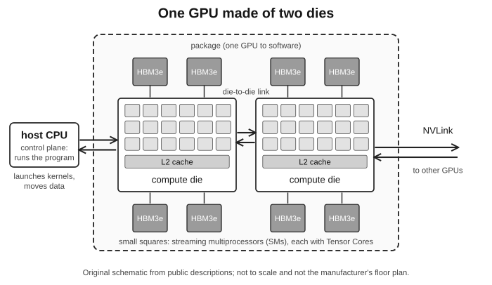

INTERLUDE 3

# Silicon Minds

*The Art of Computer Architecture*

*HARDWARE*

<!-- AI-assisted: restructured from Sam's earlier draft and new vignette; Sam's own lines kept wherever they survived; awaiting Sam's pass -->

<!-- AI-assisted editorial pass, 23 October 2026: approved recoveries, mechanism teaching and factual repairs; substantive new sections marked below. -->

I was hired by Nature Inc. at birth. Not a glamorous job: no salary, no dental, no exit interview. The onboarding consisted mostly of crying and being told to keep breathing. It was, as internships go, about average.

My hardware arrived fully assembled, though documentation was sparse. No one could tell me the clock speed, and any attempt to inspect the internals voided the warranty. For the next twenty years I tested peripherals: arms (acceptable), legs (quirky drivers), vocal cords (beta release) and curiosity (known to overheat).

Most bugs were fixed through trial, error, and embarrassment. The system was stable enough for daily use, although uptime during adolescence was unreliable.

<!-- AI-assisted source alignment, 27 October 2026: merged the author’s Moore/Good addition; retained the prior Moore qualification and distinguished publication from the earlier drafting dates. -->
In the same year I started my internship with Nature Inc., Gordon Moore delivered a proclamation grand enough for a burning bush: the economically sensible number of components on a chip would double every year for the coming decade.[^v1-i3-moore] I got a blanket and a bottle; Silicon got a mandate from heaven. While I was still figuring out why spoons existed, Silicon was doubling its transistor count like a prodigy who'd discovered compound interest. That same year, a British mathematician named I. J. Good, who had broken codes beside Alan Turing at Bletchley Park, published a vision of where machine intelligence might lead. Once machines could design better machines than we could, he argued, there would be an "intelligence explosion," and the first ultraintelligent machine would be "the last invention that man need ever make," provided it was docile enough to tell us how to keep it under control.[^v1-i3-good] Moore had described a runway. Good had imagined the takeoff. Between them, before I could hold a rattle, they had sketched the trajectory of my lifetime.

## The Boy Who Wanted Knobs

By the end of my toddler years, I had already learned how to be a good primate. Being a primate myself, this was the only proper and honorable thing to do, and my performance was, I would say, good enough: more fits, fewer starts, but I got it done. The fits never failed to test a mother's patience, and she passed every test. Nobody notices it, or credits a mother for it, but I learned a great deal through my mother: pretty much everything except her patience and her industry. Those seem to be strictly zero-sum, and I prudently left one hundred percent of the surplus in her possession. I was also conducting a great deal of high-level learning through my own meticulously designed experiments, assuming, of course, that "design" meant discovering the most efficient way to smash a household object. These trials produced spectacular results. Spectacular, that is, unless you happened to consult my mother, my little sister or, later in my teens, my long-suffering father.

But a completely bizarre thing began to manifest as I went from clumsy toddler to preschooler, then student, and ultimately teenager. The world increasingly fell into the delusion that my brain was a piece of machinery: raw hardware, not particularly useful on its own, on which coders now had to run their programs. The coders were teachers, well-meaning adults (well, sometimes they were simply mean), and just about any run-of-the-mill stranger with a talent for finger-pointing. Those strangers, at least, appeared to be seasoned professionals, judging by the robustness of their fingers. Even my parents became subtly strange, as if I had become their class project, and the world would grade them on it someday. They had an unusual term for this, "expectations," as if nature, or the machine that had become of it, had already set aside neatly tagged training and evaluation datasets for my brain. And more and more of that training data arrived cleansed and bound in the respectable form of textbooks.

At school, the expectations came in a vastly different flavor. I had arrived looking for the advanced, older-child version of smashing things, only to discover that the entire institution was dedicated to preventing that very pleasure, enforcing the strict discipline of a praying mantis. This great conformity machine wasn't confined to the classroom, either; it extended to nationalism, to religion, and to any other institution you care to name. Whatever the establishment, the curriculum always seemed to have been drafted by someone who was distinctly not me.

Inevitably, the learning became more organized and of a higher caliber. It progressed whether I liked it or not, which, as far as the method of education was concerned, fell mostly into the "not" category, though the subject matter was occasionally interesting. A natural aptitude started to develop for astrophysics, molecular biology, neuroscience, animal behavior, nature, and anything with the word *chimpanzee* in it. But somewhere between my full-time daydreaming in high school and the three semesters of doodling in business classes that came after, I landed in a surreal place for a year. It was totally unexpected, entirely unplanned, and executed with the absolute freedom that only zero preparation and a complete lack of prior knowledge can provide.

My father had heard that a rather swanky new institute for computer science had set up shop in town, and he suggested I apply. He asked, so I did. The only catch was a mandatory entrance exam, and when I arrived, it appeared that half the young men in the city had fathers with the exact same stroke of genius. The test itself proved quite civil: a pure trial of aptitude, reminiscent of the mathematics and analytical rigmarole of the SAT, but entirely unburdened by the nuisance of a verbal section. Perhaps my early experiments in crystal-shard geometry and tablecloth thermodynamics had given me an unfair advantage. At any rate, I placed first, and the prize was a full scholarship. It was a Hobson's choice: nobody walks out on an earned full scholarship. So I walked through the front door, expecting a grand spectacle. I knew I wouldn't be prying into the secrets of physics, genes, neurons or the grand vocabulary of the chimpanzee, but this promised the next best thing: prying apart and building the computers that would do that kind of science.

My imagination had promised me an imposing fortress of science: walls festooned with knobs, dials, gauges, indicator lights and spinning spools of tape, precisely as seen on television and in the movies. Instead, we were ushered into a room of ordinary desks and told to sit before a device that closely resembled an electronic typewriter married to a small television. On the screen was what looked like an alphabet-soup-themed second cousin of the game Pong. I was itching to ask: when do we get to see the *computor*, that grand wall with the dials and knobs and the other usual stuff? (Mind you, I'm only moderately exaggerating. Allowance must be made for my feeling brain as it attempts to chronicle the naive escapades of my thinking brain, for as we have established, a brain, or perhaps two, is all I have to work with at this point in the narrative. There is no person in this room yet.) Then the lecturer began to talk about the "typewriter," and presumably also about the modest television beside it. "These," he announced, with no small amount of gravity, "are Sord computers," followed by a model name with "Mark" in it, or something along those lines.[^v1-i3-sord]

I set to work learning the trade of writing programs on those modest machines. Soon after, I acquired a Sinclair ZX Spectrum, and then my mother got me a Sharp MZ-731, an MZ-700 with all the trimmings, which was the state of the art as far as I was concerned: a built-in four-color pen plotter for printing, and a cassette recorder to save my work.[^v1-i3-machines] I loaded BASIC and wrote simple programs. My programming was elegant and uniquely efficient. Elegance is good in programming; uniqueness is good for writing books but horrible for reusing code.

The boy who wanted knobs and dials got more letters and words instead: for the cultivation of his own brain, and for the silicon brain he wished to play with. That, I would later learn, is exactly what computer architecture is for. It hides the hardware behind layers of abstraction (instruction sets, microcode, operating systems), so that civilized people may converse in words rather than voltages.

Having stumbled serendipitously into this new field, I struck a Promethean, perhaps even Faustian, bargain. Without my express permission, my cortex had extended itself into a silicon wafer: not exactly into a lattice of atoms, but into logic gates and code.

Just as the social machinery of school had been clamped onto my brain before I could properly read or write, a corresponding apparatus called software was now wedged between the computer's physical hardware and me. The hardware became a passive reliquary; the software became its prime mover. So in this brief interlude, much as we did for the anatomy of my own brain in the preceding pages, we shall dismiss the authorities, remove the outer casing and dissect the hardware. And you may take it on my personal authority that once the plastic casing comes off, a great deal is exposed that is ripe for a good, old-fashioned smashing.

## The First Silicon Mind

A generation before I existed, John von Neumann had written a memo describing the whole business of computing: a processing unit, a control unit, a memory holding both the data and the instructions, and channels to the outside world.[^v1-i3-edvac] It served as a kind of Platonic birth certificate for nearly every machine that followed. (Interlude 2 left him deducing the logic of self-reproducing life; here he is drawing the floor plan of the computer, on the same principle of instructions kept as data.) This became computer architecture, without a single porch column. What he laid out was how a mind might look if it were flat enough to be printed. It was thought, diagrammed.

Before machines learned to "learn," they learned to think in straight lines. A processor is, at heart, an idea about how thought ought to behave: clear, sequential, unflustered by paradox or memory lapses, immune to distraction and perfectly obedient to its own logic. Humans have never thought this way. We are parallel storms pretending to be a single, unified sky. But in the mid-twentieth century, the dream of pure rationality had a seductive pull. Von Neumann, Turing and the rest of the early computational exiles saw a territory where thought didn't have to slosh through blood, childhood, trauma, hormones or hunger, where ideas could exist as voltage levels, arguments as branches and conclusions as gates.

The early electronic machines used vacuum tubes; silicon would inherit the ambition. Here was philosophy given circuitry: specified reasoning broken into small operations, complexity made tractable by steps. Whether sufficiently elaborate symbol manipulation amounted to understanding was the wager, not a result delivered with the hardware. Φ has already denied us the comforting version in which every truth yields to computation. Even so, a thinker without a childhood had its attractions.

That rabbit hole worked better than it had any right to.

## An Anatomy of Silicon

<!-- AI draft: approved instruction mechanism, ISA distinction and memory teaching, with retained author metaphors. -->
Long before computers grew "intelligent" in the modern sense, they had an anatomy eerily reminiscent of our own oldest neural hardware. The resemblance is useful provided we don't make the ALU responsible for childhood trauma.

The **arithmetic logic unit**, or ALU, adds, compares, shifts and performs logical operations. It's a little like a reflex arc: give it the right inputs and the appropriate control signals, and the circuitry produces its result. The **control logic** determines which operation to perform and where the values should go. It doesn't ask "why?"; it asks "what next?" Gates supply the transformations; the latches and flip-flops of Interlude 1 let a machine retain a state between transformations.

Suppose two registers contain 7 and 5, and an instruction requests their sum in a third register. The **program counter** holds the address from which to fetch the instruction. Its bits arrive from the memory system; decoding separates the operation from the identifiers of the source and destination registers. Control signals select the two values and configure the ALU to add. The result, 12, is written into the destination register; the program counter advances to the next instruction, unless a branch tells it otherwise. Nothing in the chip has read the word *add*. We arranged matter so that a particular bit pattern selects the circuitry that adds.[^v1-i3-execution]

That small agreement scales. The **instruction set architecture**, or ISA, defines the operations and state that software may rely on. The **microarchitecture** is how a particular processor fulfills that agreement. Two processors can run the same instructions while using different pipelines, caches and execution units underneath. Some instructions are implemented through **microcode**, an internal sequence of control operations; others use more direct control circuitry. Microcode is one way to organize the machinery, not a compulsory second brain.[^v1-i3-isa]

Memory comes in tiers, and the tiers read like a psychology.

**Registers** hold the values at hand: operands, intermediate results, addresses. They are small stores inside the processor, available directly to its execution machinery. A register doesn't forget when attention moves elsewhere; it retains its bits until something overwrites or resets them, or its physical support is lost. There is, regrettably, no embarrassment-based deletion policy.

**Caches** keep nearby copies of instructions and data that would otherwise require a slower trip to main memory. They exploit *locality*: what was used recently may be needed again, and what sits near it may be needed next. The smallest, fastest level is usually L1; larger levels trade some speed for capacity, with a last-level cache often shared by several cores. A **cache hit** supplies the requested data there; a **miss** sends the request farther down the hierarchy. A processor with a cold cache is a mathematician waking up from anesthesia.[^v1-i3-memory]

**RAM**, the main memory, holds the running programs and their working data. It offers far more space than registers or caches, but a core can do considerable work in the time a main-memory request takes. Ordinary DRAM also needs power and periodic refreshing to retain its bits. It is the working canvas, not the archive.

**Storage**, such as an SSD or disk, keeps programs and files across power cycles. Parts of them must be brought into memory to be worked on. This is autobiography written in charge or magnetism: the machine's childhood, its logs, its humiliating swap files. If history is written by the victors, machine history is written by a file system with no sense of humor.

{#fig-v1-i3-instruction-memory width=100% fig-alt="An instruction selected by the program counter is fetched and decoded. Control selects registers containing 7 and 5, the ALU adds them, and 12 is written to a destination register. A second panel distinguishes registers, caches, RAM and persistent storage."}

No mind is merely what it knows; it is what it can move in time. Buses and on-chip interconnects are the white-matter tracts of silicon, the routes between its regions. A brilliant ALU with a narrow bus is a genius trapped in a slow conversation with himself. **Pipelining** overlaps the stages of different instructions: fetch one while decoding another and executing a third. This improves throughput without making every individual instruction instantaneous. **Branch prediction** lets a processor guess which instructions it will need next and start work before the answer is certain. A wrong guess discards the affected speculative work and redirects execution. The machine pays for its misplaced confidence in lost time, a more enforceable arrangement than we generally provide for our own.[^v1-i3-pipeline]

### Where the Mirror Bends

<!-- AI-assisted factual repair: biological analogy and timing. -->
The resemblance is real, but it's a resemblance between cousins, not twins. The brain has no central clock; its neurons respond to local inputs, and timing itself carries information. It mixes electrical spikes with graded voltages and chemistry. Synapses both influence passing signals and change with experience, so part of the memory is embedded in the machinery doing the computation. That isn't the brain's only form of storage, but it is a striking contrast with a conventional processor repeatedly fetching data from separate memory.

The brain's metabolic budget is roughly twenty watts, the power of a dim light bulb.[^v1-i3-watts] It's an extraordinary engineering provocation. Calling it the winner of every efficiency contest would require agreeing what the contestants are doing and which costs count. A light bulb is not much competition at remembering my mother; a calculator is rather better at long division.

The two also fail differently. A wrong bit can crash a computer, although redundancy and error correction can make computers remarkably resilient. High-energy particles can upset memory cells, which is one reason servers use error-correcting memory (Interlude 2's redundancy, back in hardware). In a Belgian election count in 2003, one candidate acquired 4,096 extra votes; the official investigation identified a spontaneous bit inversion as the probable explanation. A cosmic-ray strike is a possible cause, not a culprit anyone caught at the ballot box.[^v1-i3-bitflip] Brains can tolerate some local losses and reorganize around them, although damage at the wrong place can be catastrophic. The crowd may keep singing when a few voices drop out. It still needs the conductor's oxygen supply.

### Clocks and Rhythms

A processor needs appointments. Clock signals coordinate when synchronous circuits capture their next state, after the signals feeding them have had time to settle. Modern chips have several clock domains; a quartz reference may help set the pace, but circuitry generates the much faster clocks used inside the cores. The whole computer does not advance on a single crystal's billionth twitch.[^v1-i3-clock]

On the Z80 processors inside my Spectrum and Sharp, instruction timings were counted in clock periods called **T-states**. A programmer chasing speed counted them like a miser counts coins. The manual gave the costs, sometimes different ones depending on whether a conditional branch was taken; slower memory or peripherals could demand extra waiting.[^v1-i3-tstates] Even this apparently tidy time had terms and conditions.

The brain has rhythms instead, many of them, rising and falling across regions: slow waves in deep sleep, hippocampal theta during exploration, faster gamma activity coordinating local populations.[^v1-i3-rhythms] Timing can change what gets learned. In a well-studied form of **spike-timing-dependent plasticity**, repeated presynaptic activity shortly before a postsynaptic spike strengthens a connection; reversing the order can weaken it. The rule depends on the synapse, its state and the activity pattern; it isn't a universal neural stopwatch.[^v1-i3-stdp] But Hebb has acquired a watch, and Maggie's coincidence detector is one of its gears.

In the hippocampus of a running rat, place cells can fire at progressively earlier phases of the theta rhythm as the animal crosses their firing fields: where a spike falls within a cycle carries spatial information.[^v1-i3-phase] During sleep, previously experienced sequences can recur on a compressed timescale, as if the brain were rehearsing them for storage.[^v1-i3-replay] The brain doesn't just compute in time; it can write information into timing.

Silicon can do that too, through timed signals and event-based designs. The interesting difference is how much of this work conventional digital hardware hides beneath the neat sequence of instructions, while biological circuits make temporal relationships part of their ordinary vocabulary. Both run on longer cycles as well. Spikes become patterns that support perception and action; habits and moods unfold across the long-haul time of the next chapter. Clock ticks become instructions; instructions become programs that run for hours, days, or as long as the servers stay up, the long runs of the next interlude.

## The Cortex Born by Accident

<!-- AI draft: approved architecture/GPU teaching and dated product example. -->
For decades, one architectural argument concerned the instruction vocabulary. **CISC** designs offered comparatively elaborate instructions; **RISC** designs emphasized simpler, regular operations that compilers could combine efficiently. The research gathered force in the 1970s and 1980s. Today's boundary is untidy: modern x86 processors can break complex instructions into simpler internal operations, while RISC processors can contain very sophisticated machinery. A short vocabulary doesn't oblige the speaker to have a small brain.[^v1-i3-risc]

Another bargain began to expire. Smaller transistors had allowed lower voltages and faster switching without a corresponding explosion in power density. During the 2000s, voltage could no longer fall as readily, while leakage and heat constrained further clock increases. More transistors remained useful, but simply making one core run faster became an expensive way to heat a room. Designs put more work into parallel cores and specialized units.[^v1-i3-scaling] <!-- AI draft, 2026-11-15. -->The bill is the one Interlude 1 wrote down, paid every cycle. Dynamic power is roughly $P \approx \alpha\,C V^{2} f$, where $C$ is the load capacitance, $V$ the supply voltage, $\alpha$ the switching activity per clock cycle, and $f$ the clock frequency. Once $V$ stopped falling, every extra step in $f$ came straight out of the cooling budget.<!-- End AI draft 2026-11-15. -->

Graphics processors had been preparing for this without knowing it. Pixels, polygons, shadows and lighting equations offered enormous amounts of similar work that could be done in parallel. Researchers found that much of neural-network arithmetic fitted that machinery too. In 2012, AlexNet trained on two gaming graphics cards and helped produce a decisive advance in image recognition.[^v1-i3-alexnet] This was no proof that a GPU was a cortex, or that cortex had started as a graphics card. It was a good demonstration that an apparatus built for one kind of pattern could become useful for another.

<!-- AI draft, 2026-11-15. -->
The accident needed a door. In 2007 NVIDIA released CUDA, a programming platform that let ordinary programmers write general-purpose code for its graphics chips, instead of disguising their arithmetic as pictures. AlexNet's authors walked through it.[^v1-i3-cuda] Libraries written for CUDA have since piled up into a gravity of their own, Interlude 1's informational gravity in commercial dress: the more software assumes one platform, the more new software gets written for it.
<!-- End AI draft 2026-11-15. -->

A CPU and a GPU both execute instructions and both exploit parallelism. A CPU invests heavily in getting diverse, often dependent tasks through quickly. A GPU devotes much of its area to handling many concurrent work items, with enough other work available when some have to wait. NVIDIA groups its execution machinery into **streaming multiprocessors**, or SMs. Threads (individual sequences of work) run in groups called **warps**, normally 32 threads sharing instruction issue. Divergent paths can reduce efficiency: a warp whose members want different things has acquired a small committee.[^v1-i3-gpu]

<!-- AI draft, 2026-11-15. -->
The two also divide the labor between them. In a typical accelerated system, the CPU is the **host**: it runs the operating system and the program, decides what needs doing, and launches work onto the GPU, the **device**, as parallel routines called **kernels**. Data has to reach the device before a kernel can use it, over a link such as PCIe or, where NVIDIA pairs its own Grace CPU with Blackwell GPUs, a faster chip-to-chip connection.[^v1-i3-host] Engineers borrow networking's vocabulary for the split: the CPU runs the **control plane**, the GPU the **compute path**. One decides; the other does the heavy arithmetic. A GPU left waiting on its host, or on data still crossing the link, is an orchestra that has tuned up and lost its conductor. Interlude 4 follows the software that issues those launches.
<!-- End AI draft 2026-11-15. -->

The **Tensor Cores** within these SMs specialize in multiplying small blocks of numbers and accumulating their results. Other execution units handle the surrounding work. Training includes forward calculations, loss evaluation, backward gradients and parameter updates; activation functions and other operations prevent this from being merely a stack of matrix multiplications. Without nonlinear steps, stacking linear layers would give us another linear transformation, however expensive its upbringing.

Take one ordinary layer. Each output is a weighted sum of inputs, followed by an activation function. If one example has inputs 2 and 3, a unit with weights 4 and −1 first forms 2 × 4 + 3 × (−1) = 5, before any bias or activation. Another example can reuse those same weights; another output unit can reuse those inputs with different weights. For a batch of examples, these weighted sums can be assembled as a matrix product. Its useful hardware lesson is **reuse**: the same weights act on many examples, and each input contributes to several outputs. <!-- AI draft, 2026-11-15. -->Count it. Multiplying an $m\times k$ matrix by a $k\times n$ one takes about $2mnk$ operations, a multiply and an add for each term, while using $mk + kn + mn$ distinct input and output numbers. For square matrices of side $n$, that's $2n^{3}$ operations on $3n^{2}$ numbers: the work grows faster than the data, and the surplus is what reuse can harvest.<!-- End AI draft 2026-11-15. --> A GPU divides the product into tiles, brings the needed values from its external memory through its cache hierarchy into nearby working storage, and reuses them for many multiply-and-accumulate operations before sending the completed results back. Registers, software-managed shared memory and specialized matrix storage keep the arithmetic close to its ingredients.[^v1-i3-tiling]

{#fig-v1-i3-gpu-reuse width=100% fig-alt="HBM supplies input and weight tiles through cache to a streaming multiprocessor. Nearby storage feeds Tensor Core matrix operations, which accumulate a result tile. Neighboring multiprocessors work on other tiles. Capacity, bandwidth and arithmetic throughput are distinguished."}

**High-bandwidth memory**, or HBM, is DRAM assembled in stacks beside the compute dies, joined by many short connections. Capacity tells us how much fits; bandwidth tells us how much can move per second. Neither tells us how much useful arithmetic is performed on each byte that arrives. That last ratio, **arithmetic intensity**, helps distinguish a memory-bound workload from a compute-bound one. A large, well-organized matrix multiplication may keep the arithmetic units busy; generating the next token for a small batch may instead spend much of its time feeding them weights. A faster multiplier can't cure a queue at the pantry.[^v1-i3-gpu-bounds] <!-- AI draft, 2026-11-15. -->Samuel Williams, Andrew Waterman and David Patterson drew the bound as a **roofline**:

$$
P_{\text{attainable}} \;=\; \min\!\left(P_{\text{peak}},\; B \times I\right),
$$

where $B$ is memory bandwidth and $I$ the arithmetic intensity, in operations per byte transferred. Actual performance can fall below this ceiling. Below the ridge point $I^{*} = P_{\text{peak}}/B$, bandwidth sets the ceiling; above it, arithmetic does. For dense FP8 work on a chip of the B200's class the ridge sits at several hundred operations per byte. At batch size one, a weight-matrix product using 8-bit weights streamed from HBM gets about two operations from each weight byte fetched, far down the slope.[^v1-i3-roofline]<!-- End AI draft 2026-11-15. -->

Take NVIDIA's **B200**, from the Blackwell generation announced in 2024, as a dated specimen rather than a promise about the newest machine on your desk. Its roughly 208 billion transistors occupy two large compute dies joined by a fast internal link and presented as one GPU. Each die approaches the lithographic **reticle limit**, the area patterned in one exposure field, not the diameter of the wafer. HBM3e stacks sit alongside; the B200's documented usable capacity is up to 180 GB. These are different solutions to different limits: join dies to gain compute area, stack memory to gain capacity and connectivity, keep frequently used values on-chip to reduce travel.[^v1-i3-blackwell] <!-- AI draft, 2026-11-15. -->The numbers on the connections tell the same story. NVIDIA rates the coherent die-to-die link at about 10 terabytes per second across both directions; the HBM3e stacks supply about 8 terabytes per second; and NVLink offers about 1.8 terabytes per second of two-way bandwidth per GPU.[^v1-i3-links] The memory-hierarchy lesson has reached the scale of a package: every boundary brings its own traffic limit.

{#fig-v1-i3-b200 width=100% fig-alt="Two compute dies inside one package, joined by a die-to-die link. Each die shows a grid of streaming multiprocessors and an L2 cache, with two HBM3e stacks above and two below. NVLink arrows lead off the package to other GPUs. A host CPU on the left, outside the package, launches kernels and moves data."}
<!-- End AI draft 2026-11-15. -->

Blackwell also supports low-precision formats, including FP8 and FP4. Using fewer bits can save storage and arithmetic, but the format must suit the calculation; accumulation, gradients and other sensitive quantities may need higher precision. Scaling and mixed-precision methods manage the errors. Four bits are not thirty-two bits with better marketing.[^v1-i3-precision]

The same pressures shape the next generation. In January 2026 NVIDIA specified Rubin with up to 288 GB of HBM4 per GPU and up to 22 TB/s of memory bandwidth, alongside new compute and interconnect machinery.[^v1-i3-rubin] These are the manufacturer's announced specifications, not a measured speedup for every model. A collection of GPUs also needs to exchange its work, using links such as NVLink within a system and networking beyond it. That larger circulation belongs to our networking interlude. For now, the lesson is already visible inside one package: **parallelism, locality and specialization** determine what all those transistors can accomplish together.

In the way alkaline vents may have incubated life in Chapter 2, graphics clusters incubated neural computation. The data center replaced the primordial ocean; software libraries for parallel computing replaced the proton gradient; matrix multiplication replaced metabolism. And learning systems crawled out of the computational sea.

Biological evolution is slow, brutal and wasteful. Silicon evolution is deliberate, accelerating and weirdly poetic: from one processor core to many, from scalar arithmetic to vectors, from graphics shaders to tensor engines, from fixed instructions to compilers that write the instructions for us. Humans stumbled into consciousness. Machines are being dragged toward something like it, not by natural selection but by benchmarks, latency budgets and venture capitalists with delusions of grandeur.

## Architecture as Destiny

Every intelligence is bounded by its substrate. Your processor shapes your thoughts; a graphics chip shapes your possibilities; a tensor core shapes your model. Architecture is thought. More precisely, architecture is the bias field in which thought can form.

<!-- AI-assisted factual repair: communication costs and dated electricity estimate. -->
The separation of memory and compute has haunted machines for decades, but caches and registers exist precisely so that every operation need not make the full journey to main memory. The **memory wall** names the growing mismatch between processing speed and the ability to supply data. The older **von Neumann bottleneck** concerns the constrained traffic between processor and memory; the problems overlap, without being identical. Where communication dominates, moving or reusing data better can buy more than another row of multipliers.[^v1-i3-memorywall]

Brains pay for communication too. Axons, synapses and the restoration of ion gradients all consume energy; biological locality does not abolish transport. What matters is how the work is arranged and what it costs across the whole system, including the parts we would rather leave off the invoice. The IEA estimated that data centers used about 415 terawatt-hours of electricity in 2024, roughly 1.5 percent of the world's total; that includes workloads other than AI and the infrastructure supporting them.[^v1-i3-power] The first silicon mind thought in straight lines. Its descendants think in parallel, but they still pay for every thought in heat.

## Bob, Through the Looking-Glass: The Knobs Came Back

<!-- AI draft: author-approved Bob revision; preserves the knobs, grids, 1985 FPGA coincidence and livewired-hardware conjecture. -->
*The twist, in one line: we can know exactly how a machine executes its operations and still have remarkably little idea what it has learned to do.*

I had mistaken the knobs for access to the mind. It was a respectable mistake, shared by a surprising amount of engineering. Registers can disclose their contents; caches can confess their misses; branch predictors can admit their guesses, a feat no politician has managed. With the right instruments we can trace an execution. Reproducing it may also require capturing the inputs, timing and interleavings that changed it. The machine offers handles on its behavior. Handles aren't explanations, even when there are enough to fill the grand wall I had hoped to find.

<!-- AI draft, 2026-11-17: author-approved Carroll connection. -->
The White Knight keeps rain out of his box by carrying it upside down. Alice points out that the open lid lets the contents fall out.[^v1-i3-carroll] I can imagine the specification: waterproof, fully inspectable, sandwiches optional.
<!-- End AI draft 2026-11-17. -->

The hidden parts were there before neural networks. In 2018, Spectre showed how a processor could be induced to speculate down a wrong path and leak information through traces such as cache timing. Meltdown exploited a different failure: on vulnerable processors, a forbidden read could briefly influence subsequent work before the access fault took effect. Discarding the unauthorized result did not erase every physical consequence.[^v1-i3-spectre] The instruction-level account could be impeccable while the implementation gossiped underneath it. Our abstractions had omitted something that mattered.

Learning adds another difficulty. Software has always ridden on hardware; the stored-program computer was built for that. But a trained network's behavior isn't specified rule by rule by its programmers. Training adjusts numbers within an architecture and objective we chose, and useful procedures can emerge from those adjustments. Researchers have traced curve-detecting circuits in vision networks and pattern-copying mechanisms called induction heads in transformers.[^v1-i3-circuits] These are computational circuits, not newly soldered wires. They offer real footholds for explanation, without turning the whole model into an open book.

The boy who wanted knobs and dials got letters and words instead. Decades later, the knobs came back: billions of them, turned by training rather than by hand.

Count the grids: the possibility floor of Chapter 1, the crystal lattice of Interlude 1's wafer, the gates arranged upon it, the arrays of a network's weights, then patterns of influence discovered within the trained network. <!-- AI draft, 2026-11-14. -->Chapter 3 found the same layering in the cortex, where activity during a particular task can gather near a low-dimensional manifold within an astronomical space of possible states, much as the crystal's electrons keep to their bands.<!-- End AI draft 2026-11-14. --> These aren't all grids in the same mathematical sense. That is part of what interests me. An arrangement can host another kind of arrangement whose useful description scarcely resembles the machinery below it. Which of our descriptions reveals the action, and which merely inventories the furniture?

There was already a physical hint in the year I left for Milwaukee. In 1985 the first commercial field-programmable gate array, the FPGA, went on sale.[^v1-i3-fpga] Its manufactured transistors stayed put, but configuration bits could change the logic functions and the connections among them. The owner could rearrange part of the house without returning it to the brickworks. Learned weights and configurable hardware are different kinds of flexibility, but both loosen the assumption that a machine's useful organization must be settled by its original maker.

My more reckless question is whether learning could reach farther down: into the physical arrangement that carries the computation. Every computer already obeys physics, so saying the brain succeeds because it "works with nature" explains very little. The useful question is how closely a physical process can embody the operation we want, and how much machinery we need to translate between the two. Natural computing explores several versions of that question, from nature-inspired algorithms to computation in biological and other physical substrates.[^v1-i3-natural]

A modest example is already on the bench. In analog in-memory computing, a device's electrical conductance can encode a weight, an applied voltage an input, and the resulting current their product. Currents meeting on a wire add. With suitable encoding, a memory array can perform the weighted sums we've just spent so much effort transporting to Tensor Cores. But noise, drift, limited precision and the circuits that convert signals back into digital form send their own invoices. The whole apparatus has to win, not just the lovely multiplication at its center.[^v1-i3-physical]

Feynman's proposal to use quantum systems to simulate quantum physics supplies a different precedent: choose machinery whose dynamics suit the problem. Hopfield's attractor networks and Hinton's Boltzmann machines borrowed from statistical physics, contributions recognized by the 2024 Physics Nobel. Their mathematical energies guide settling or sampling; they are not automatically measurements of a processor's heat, nor guarantees of finding the best answer.[^v1-i3-physicsml] The attraction for my Chapter 1 nudge is the possibility of organization through local interactions. The analogy offers something to investigate; it doesn't supply the missing derivation.

So imagine architectures where the sculpting continues while the machine works: logic gathering where it's useful, weakening or dissolving where it isn't, perhaps eventually changing its physical structure as well as its stored settings. Interlude 1's epitaxy becomes a provocative image for this, not a claim that today's chips grow new transistors during inference. Neuromorphic systems, adaptive memory devices and trainable physical networks supply limited footholds; Interlude 20 can pick up their engineering.[^v1-i3-physical-training] The larger prize I want to examine is **an architecture that can revise where it puts its abstractions**. What must stay reliably fixed so that other parts can genuinely change?

That question reaches past cheaper multiplication. If we give a system more freedom to discover useful physical organization, might it reveal regularities our preferred interfaces keep hiding? The confounder holes I keep circling would still need evidence: a pattern that survives new measurements and interventions, not merely one we find pleasing. A machine could help expose such a hole without enjoying any privileged view from outside physics.

The danger is freezing an interface and then mistaking its convenience for the boundary of the possible. That is the idolatry worth resisting. We need the dependable layer, and we need to remember who put it there.

How does a mind see itself clearly without destroying the very complexity that makes it a mind? Transistors let us inspect more of the machinery. Learned networks remind us how much explanation remains after inspection. I may finally have my knobs, and still not know which one to turn.

## From Circuits to Shadows

As I learned to design computer hardware (the switches, gates and architectures that make electrons behave on command), I began to notice a strange parallel. A processor is just an obedient, silent slab until something runs inside it. It's the program that animates the machine, giving it habits, quirks and occasional meltdowns.

The comparison gets slippery with brains: their activity, structure and continuing life cannot be separated as neatly as a program from a board. Still, much of what shapes their behavior is hidden from outside inspection. You see only the outputs: a laugh, a lie, a hesitation, a regret. Glitches look different on the human console, but the pattern is familiar. Computers can run malicious code; humans can, too, often without realizing what's been installed.

I carried that suspicion with me to Milwaukee, a city where, a few years later and a short walk from my campus, a different kind of debugging failure would come to light: a man whose internal program no engineer could have traced.

It was the perfect moment to meet psychology.

> ***Maggie:** A brain wires itself while it works.*
>
> ***Alex:** Mine arrives wired. Some of us have learned to rearrange the furniture.*
>
> ***Maggie:** We hid the hardware behind words.*
>
> ***Alex:** Now the words have learned to hide the hardware.*
>
> ***Both:** Every mind outgrows the hands that built it.*

<!-- Source notes aligned 23 October 2026. Memoir, established mechanisms and author conjecture are distinguished in the notes and accompanying source audit. -->

[^v1-i3-moore]: Gordon E. Moore, [“Cramming More Components onto Integrated Circuits”](https://download.intel.com/newsroom/2023/manufacturing/moores-law-electronics.pdf), *Electronics* 38(8), 19 April 1965, pp. 114–117. The forecast concerns complexity at minimum component cost and projects the annual trend for another decade. It is an economic and technological projection, not a physical law.

[^v1-i3-good]: I. J. Good, [“Speculations Concerning the First Ultraintelligent Machine”](https://vtechworks.lib.vt.edu/bitstream/handle/10919/89424/TechReport05-3.pdf), *Advances in Computers* 6 (1965), pp. 31–88, especially p. 33. The original offprint reproduced by Virginia Tech carries a 1965 copyright imprint; [Elsevier’s current metadata](https://doi.org/10.1016/S0065-2458(08)60418-0) dates the chapter 1966. The opening footnote dates the first draft to April 1963 and its revision to May 1964, so the coincidence here concerns publication, not when Good first conceived the argument. [GCHQ’s account of Good’s career](https://www.gchq.gov.uk/information/codes-chess-and-kubrick-life-jack-good) confirms his work with Turing at Bletchley Park and also identifies this as his 1965 paper.

[^v1-i3-sord]: The maker and uncertain “Mark” designation are personal recollection. The Centre for Computing History holds a [Sord M23 Mark III](https://www.computinghistory.org.uk/det/8316/Sord-CGL/), dated 1980. That is a plausible contemporary model, not an identification of the machine in my classroom.

[^v1-i3-machines]: Sharp, *MZ-700 Series Owner’s Manual*, [§1.1 and §3.1.1](https://old.sharpmz.org/mz-700/download/mz-700_owners_manual.pdf), on the MZ-731’s plotter-printer and cassette equipment. Sinclair Research, [*ZX Spectrum BASIC Programming*](https://worldofspectrum.org/ZXBasicManual/) (1982). The acquisition sequence and family circumstances are recollection.

[^v1-i3-edvac]: John von Neumann, [*First Draft of a Report on the EDVAC*](https://library.si.edu/digital-library/book/firstdraftofrepo00vonn), 30 June 1945, §§2.2–2.6. The report describes central arithmetic, control, memory and input/output. The project and stored-program design were collaborative; the report’s single-author circulation should not erase J. Presper Eckert and John Mauchly.

[^v1-i3-execution]: MIT, [*Computation Structures*, lecture 13, “Building the Beta”](https://ocw.mit.edu/courses/6-004-computation-structures-spring-2017/pages/c13/c13s1/) (Spring 2017), especially “Multi-ported Register File,” “ALU Instructions” and “Instruction Fetch/Decode.” The addition and figure here are original simplified examples, not a timing diagram for a particular commercial processor.

[^v1-i3-isa]: MIT, [*Computation Structures*, lecture 9, “Designing an Instruction Set”](https://ocw.mit.edu/courses/6-004-computation-structures-spring-2017/pages/c9/c9s1/); John L. Hennessy and David A. Patterson, [“A New Golden Age for Computer Architecture”](https://www.doc.ic.ac.uk/~wl/teachlocal/arch/papers/cacm19golden-age.pdf), *Communications of the ACM* 62(2) (2019), pp. 48–60, especially pp. 48–51 on ISAs, implementations and microprogramming.

[^v1-i3-memory]: MIT, [*Computation Structures*, lecture 14, “Caches and the Memory Hierarchy”](https://ocw.mit.edu/courses/6-004-computation-structures-spring-2017/pages/c14/c14s1/), on SRAM, DRAM, locality and cache hits/misses; lecture 13 for register retention. Cache organization varies by processor; the figure presents roles, not a universal physical layout.

[^v1-i3-pipeline]: MIT, [*Computation Structures*, lecture 15, “Pipelining the Beta”](https://ocw.mit.edu/courses/6-004-computation-structures-spring-2017/pages/c15/c15s1/); Paul Kocher et al., [“Spectre Attacks”](https://arxiv.org/pdf/1801.01203) (2018 preprint), introduction and processor background, for branch prediction and speculative execution. Pipelining improves throughput; misprediction penalties depend on the implementation.

[^v1-i3-watts]: William B. Levy and Victoria G. Calvert, [“Communication Consumes 35 Times More Energy than Computation in the Human Cortex, but Both Costs Are Needed to Predict Synapse Number”](https://pmc.ncbi.nlm.nih.gov/articles/PMC8106317/), *PNAS* 118(18) (2021), e2008173118. Their energy audit discusses the customary approximately 20-W whole-brain figure and the distinction between metabolic supply, signaling and computation. The precise partition depends on the model; no universal brain/computer efficiency ranking is inferred.

[^v1-i3-bitflip]: Belgian parliamentary College of Experts, [2003 election report](https://www.dekamer.be/FLWB/pdf/51/0001/51K0001002.pdf), DOC 51 0001/002, §§5.3.7.1–5.3.7.2, p. 22: the 4,096-vote discrepancy is consistent with a spontaneous inversion of the counter’s thirteenth bit. The report does not establish a cosmic-ray cause. For radiation-induced errors, J. F. Ziegler et al., [“IBM Experiments in Soft Fails in Computer Electronics (1978–1994)”](https://research.ibm.com/publications/ibm-experiments-in-soft-fails-in-computer-electronics-1978-1994), *IBM Journal of Research and Development* 40(1) (1996), pp. 3–18.

[^v1-i3-clock]: Intel, [*Processor Datasheet*, volume 1, document 743844, revision 015](https://cdrdv2-public.intel.com/743844/743844-015.pdf) (May 2025), §2.7, “Clock Topology,” describes separate clock domains. Zilog’s manual below illustrates clocked state transitions in an earlier architecture.

[^v1-i3-tstates]: Zilog, [*Z80 CPU User Manual*](https://www.zilog.com/docs/z80/um0080.pdf), UM008011-0816 (2016), “Timing” and individual instruction descriptions. T-states are clock periods; conditional paths and inserted WAIT states can change elapsed execution time. The classroom Sord model remains unconfirmed, so it is not assigned a processor here.

[^v1-i3-rhythms]: György Buzsáki and Andreas Draguhn, [“Neuronal Oscillations in Cortical Networks”](https://pubmed.ncbi.nlm.nih.gov/15218136/), *Science* 304 (2004), pp. 1926–1929, doi:10.1126/science.1099745. See also Buzsáki, *Rhythms of the Brain* (Oxford University Press, 2006). Frequency bands and functional associations vary across species, regions and behavioral states.

[^v1-i3-stdp]: Guo-qiang Bi and Mu-ming Poo, [“Synaptic Modifications in Cultured Hippocampal Neurons: Dependence on Spike Timing, Synaptic Strength, and Postsynaptic Cell Type”](https://www.gatsby.ucl.ac.uk/~pel/course_wuhan/papers/bi.poo_1998.pdf), *Journal of Neuroscience* 18(24) (1998), pp. 10464–10472, doi:10.1523/JNEUROSCI.18-24-10464.1998. The experimental conditions and cell types matter; the before/after rule is not a universal law of synapses.

[^v1-i3-phase]: John O’Keefe and Michael L. Recce, [“Phase Relationship between Hippocampal Place Units and the EEG Theta Rhythm”](https://doi.org/10.1002/hipo.450030307), *Hippocampus* 3(3) (1993), pp. 317–330. The relation is between position within a firing field and spike phase, not a single universal clock coordinate for the animal.

[^v1-i3-replay]: William E. Skaggs and Bruce L. McNaughton, [“Replay of Neuronal Firing Sequences in Rat Hippocampus during Sleep Following Spatial Experience”](https://pubmed.ncbi.nlm.nih.gov/8596957/), *Science* 271 (1996), pp. 1870–1873; Zoltán Nádasdy et al., [“Replay and Time Compression of Recurring Spike Sequences in the Hippocampus”](https://www.jneurosci.org/content/jneuro/19/21/9497.full.pdf), *Journal of Neuroscience* 19(21) (1999), pp. 9497–9507. “Rehearsing” is an explanatory image; these observations alone do not establish every function of replay.

[^v1-i3-risc]: David A. Patterson and David R. Ditzel, [“The Case for the Reduced Instruction Set Computer”](https://people.eecs.berkeley.edu/~kubitron/courses/cs252-F00/handouts/papers/patterson80.pdf), *ACM SIGARCH Computer Architecture News* 8(6) (1980), pp. 25–33. For earlier IBM work and the later convergence of implementations, see Hennessy and Patterson, “A New Golden Age,” pp. 50–53. Instruction-set labels alone do not predict energy efficiency.

[^v1-i3-scaling]: Hennessy and Patterson, [“A New Golden Age for Computer Architecture”](https://www.doc.ic.ac.uk/~wl/teachlocal/arch/papers/cacm19golden-age.pdf), pp. 53–54, “End of Moore’s Law and Dennard Scaling.” Transistor count, voltage scaling, clock frequency and useful performance are distinct trends; multicore designs did not remove power or communication limits. For the switching-power equation, David Money Harris, [“Power,” *CMOS VLSI Design*, lecture 7](https://pages.hmc.edu/harris/cmosvlsi/4e/lect/lect7.pdf), slides 5–10, derives $P_{\mathrm{switch}}=\alpha CV^2f$. Here $\alpha$ counts charging transitions per clock cycle under the chosen convention; leakage and transient short-circuit current are additional costs.

[^v1-i3-alexnet]: Alex Krizhevsky, Ilya Sutskever and Geoffrey E. Hinton, [“ImageNet Classification with Deep Convolutional Neural Networks”](https://papers.nips.cc/paper_files/paper/2012/file/c399862d3b9d6b76c8436e924a68c45b-Paper.pdf), *Advances in Neural Information Processing Systems* 25 (2012), especially §3.2, “Training on Multiple GPUs,” and §6. The two devices were NVIDIA GTX 580 GPUs.

[^v1-i3-gpu]: NVIDIA, [*GPU Performance Background User’s Guide*](https://docs.nvidia.com/deeplearning/performance/dl-performance-gpu-background/index.html), §§2–3, and [*CUDA Programming Guide*, “Warps and SIMT”](https://docs.nvidia.com/cuda/cuda-programming-guide/01-introduction/programming-model.html#warps-and-simt). A warp has 32 threads; divergent paths reduce active-lane utilization. Tensor Cores specialize in matrix operations, while other units perform surrounding work.

[^v1-i3-tiling]: NVIDIA, [*Matrix Multiplication Background User’s Guide*](https://docs.nvidia.com/deeplearning/performance/dl-performance-matrix-multiplication/index.html), §§1 and 2.1; [*Blackwell Tuning Guide*](https://docs.nvidia.com/cuda/blackwell-tuning-guide/index.html), memory-system discussion. The numerical example and diagram are original. Actual staging can use shared memory, registers and generation-specific matrix storage; the diagram is not a literal B200 block diagram.

[^v1-i3-gpu-bounds]: NVIDIA, [*GPU Performance Background User’s Guide*, “Understanding Performance” and “DNN Operation Categories”](https://docs.nvidia.com/deeplearning/performance/dl-performance-gpu-background/index.html), and [*Matrix Multiplication Background User’s Guide*, “Math and Memory Bounds”](https://docs.nvidia.com/deeplearning/performance/dl-performance-matrix-multiplication/index.html). Arithmetic intensity compares operations with transferred bytes at a specified memory boundary. Batching, dimensions, kernels and hardware determine the actual bottleneck.

[^v1-i3-blackwell]: NVIDIA, [Blackwell architecture](https://www.nvidia.com/en-us/data-center/technologies/blackwell-architecture/) and [*Blackwell Tuning Guide*, §1.4.2.1](https://docs.nvidia.com/cuda/blackwell-tuning-guide/index.html): two reticle-limited compute dies, approximately 208 billion transistors and up to 180 GB of B200 HBM capacity. The initial 2024 announcement listed 192 GB; the main text uses the documented usable capacity rather than mixing configurations.

[^v1-i3-precision]: Eduardo Alvarez et al., NVIDIA, [“Introducing NVFP4 for Efficient and Accurate Low-Precision Inference”](https://developer.nvidia.com/blog/introducing-nvfp4-for-efficient-and-accurate-low-precision-inference/) (24 June 2025), format table and scaling discussion. Low-bit values can require additional scale metadata; not every training quantity or accumulation uses the same precision.

[^v1-i3-rubin]: Kyle Aubrey, NVIDIA, [“Inside the NVIDIA Vera Rubin Platform: Six New Chips, One AI Supercomputer”](https://developer.nvidia.com/blog/inside-the-nvidia-rubin-platform-six-new-chips-one-ai-supercomputer/) (5 January 2026; subsequently updated), “Memory and Decode Efficiency”: up to 288 GB HBM4 and 22 TB/s per GPU. These are manufacturer specifications. The passage makes no claim that every announced system was shipping on that date.

[^v1-i3-memorywall]: Wm. A. Wulf and Sally A. McKee, [“Hitting the Memory Wall: Implications of the Obvious”](https://libraopen.library.virginia.edu/entities/publication/a6907010-027d-405e-8f0b-4707e1263ad9), University of Virginia report CS-94-48 (1994), later *ACM SIGARCH Computer Architecture News* 23(1) (1995), pp. 20–24. MIT’s memory-hierarchy lecture and NVIDIA’s performance guides above explain how locality and bandwidth affect present designs.

[^v1-i3-power]: International Energy Agency, [*Energy and AI*, “Energy Demand from AI”](https://www.iea.org/reports/energy-and-ai/energy-demand-from-ai) (2025), “The Outlook for Energy Demand from Data Centres”: approximately 415 TWh and 1.5% of global electricity in 2024. This is total data-center electricity, not an estimate of AI alone.

[^v1-i3-spectre]: Paul Kocher et al., [“Spectre Attacks: Exploiting Speculative Execution”](https://arxiv.org/pdf/1801.01203) (2018 preprint; *IEEE Symposium on Security and Privacy*, 2019); Moritz Lipp et al., [“Meltdown: Reading Kernel Memory from User Space”](https://www.usenix.org/system/files/conference/usenixsecurity18/sec18-lipp.pdf), *USENIX Security* (2018), pp. 973–990. Both became public in January 2018. Their transient-execution mechanisms differ, as do affected processors.

[^v1-i3-circuits]: Chris Olah et al., [“Zoom In: An Introduction to Circuits”](https://distill.pub/2020/circuits/zoom-in/), *Distill* (2020), doi:10.23915/distill.00024.001; Catherine Olsson et al., [“In-context Learning and Induction Heads”](https://arxiv.org/abs/2209.11895) (2022). Curve detectors and induction heads are specific interpretability findings, not a complete explanation of all vision or language models.

[^v1-i3-fpga]: AMD Adaptive Computing, [“From Invention to AI Acceleration: Celebrating 40 Years of FPGA Innovation”](https://www.amd.com/en/blogs/2025/from-invention-to-ai-acceleration--celebrating-40-years-of-fpga-.html) (2 June 2025), identifies the Xilinx XC2064, introduced in 1985, as the first commercial FPGA. Configuration changes logic and routing through manufactured resources; it does not grow new transistors.

[^v1-i3-natural]: Grzegorz Rozenberg, Thomas Bäck and Joost N. Kok, eds., [*Handbook of Natural Computing*](https://link.springer.com/referencework/10.1007/978-3-540-92910-9) (Springer, 2012), introduction and overview of the field’s strands. Nature-inspired algorithms, modeling natural processes and computing with physical/biological substrates are related but distinct projects. The proposed shifting of abstraction boundaries is my question.

[^v1-i3-physical]: Manuel Le Gallo et al., [“A 64-Core Mixed-Signal In-Memory Compute Chip Based on Phase-Change Memory for Deep Neural Network Inference”](https://www.nature.com/articles/s41928-023-01010-1), *Nature Electronics* 6 (2023), pp. 680–693, especially Extended Data Fig. 2 and the mixed-signal architecture. Conductance encoding and current summation require supporting digital operations, conversion and communication. This is a demonstrated inference chip, not a self-growing general intelligence.

[^v1-i3-physicsml]: Richard P. Feynman, [“Simulating Physics with Computers”](https://authors.library.caltech.edu/records/a1kgk-xyk45), *International Journal of Theoretical Physics* 21 (1982), pp. 467–488; J. J. Hopfield, [“Neural Networks and Physical Systems with Emergent Collective Computational Abilities”](https://pmc.ncbi.nlm.nih.gov/articles/PMC346238/), *PNAS* 79 (1982), pp. 2554–2558; David H. Ackley, Geoffrey E. Hinton and Terrence J. Sejnowski, “A Learning Algorithm for Boltzmann Machines,” *Cognitive Science* 9 (1985), pp. 147–169. See the [2024 Physics Nobel’s scientific background](https://www.nobelprize.org/prizes/physics/2024/popular-information/). The mathematical energy in these models is not automatically physical energy consumption.

[^v1-i3-physical-training]: Logan G. Wright et al., [“Deep Physical Neural Networks Trained with Backpropagation”](https://www.nature.com/articles/s41586-021-04223-6), *Nature* 601 (2022), pp. 549–555. The demonstrated physics-aware training combines physical forward operations with a differentiable model for training. Continuous physical growth and an architecture that chooses its own abstraction boundaries are further conjectures, not results of this experiment.

<!-- AI draft footnotes, 2026-11-15. -->
[^v1-i3-cuda]: NVIDIA's [16 February 2007 release announcement](https://www.webwire.com/ViewPressRel.asp?aId=27584), preserved by its press-release distributor, describes the public CUDA SDK and C-compiler beta. The [CUDA 10.2 Programming Guide, §1.2](https://docs.nvidia.com/cuda/archive/10.2/cuda-c-programming-guide/#cuda-a-general-purpose-parallel-computing-platform-and-programming-model) dates the platform's introduction to November 2006; release and announcement are distinct. Krizhevsky, Sutskever and Hinton's [2012 paper](https://www.cs.toronto.edu/~hinton/absps/imagenet.pdf), §1, footnote 1, links their `cuda-convnet` implementation; §3.2 explains the two-GPU arrangement. The ecosystem's “gravity” is the author's reading.

[^v1-i3-host]: NVIDIA, [*CUDA Programming Guide*, §1.2.1, “Heterogeneous Systems”](https://docs.nvidia.com/cuda/cuda-programming-guide/01-introduction/programming-model.html#heterogeneous-systems), defines host, device and kernel launches; [§2.6, “Unified and System Memory”](https://docs.nvidia.com/cuda/cuda-programming-guide/02-basics/understanding-memory.html), explains memory access and migration. Data can remain on the device between kernels; unified or remotely accessible memory does not require an explicit whole-array copy before each launch. Device-side launches are also possible. “Control plane” and “compute path” describe the typical division here, not a rule that GPUs never make control decisions. NVIDIA's [Blackwell overview](https://www.nvidia.com/en-us/data-center/technologies/blackwell-architecture/) describes Grace's NVLink-C2C connection at 900 GB/s bidirectional bandwidth; it is distinct from both the link joining the two GPU dies and GPU-to-GPU NVLink.

[^v1-i3-roofline]: Samuel Williams, Andrew Waterman and David Patterson, [“Roofline: An Insightful Visual Performance Model for Multicore Architectures”](https://doi.org/10.1145/1498765.1498785), *Communications of the ACM* 52(4) (2009): 65–76, especially pp. 66–67 ([paper](https://aiichironakano.github.io/cs596/Williams-Roofline-CACM09.pdf)). This is a bound using a specified arithmetic mode and memory boundary; $P$ here measures operations per second, not electrical power. NVIDIA's [Blackwell datasheet](https://dam-cdn.nvd.orangelogic.com/AssetLink/y441155802qub41q118b2852i557jem5.pdf), p. 8, lists B200 FP8 throughput of 9 PFLOPS with sparsity, half that for dense work, and 7.7 TB/s of HBM bandwidth: $4.5\times10^{15}/(7.7\times10^{12})\approx584$ operations per byte. The text rounds the bandwidth to about 8 TB/s. The batch-one estimate counts only a multiply and an add per one-byte streamed weight; activations, attention/KV-cache traffic, scale metadata and other operations add work and transfers. Matrix element counts are not transfer counts: finite on-chip storage can require reloads. These are explanatory estimates, not measured application speeds.

[^v1-i3-links]: Ajay Tirumala and Raymond Wong, NVIDIA, [“NVIDIA Blackwell Platform: Advancing Generative AI and Accelerated Computing”](https://hc2024.hotchips.org/assets/program/conference/day1/64_HC2024.NVIDIA.TirumalaWong.pdf), *Hot Chips* (2024), slides 9–12: eight HBM3e sites, approximately 8 TB/s memory bandwidth, 1.8 TB/s bidirectional GPU-to-GPU NVLink, and 10 TB/s bidirectional NV-HBI between the dies. The [Blackwell datasheet](https://dam-cdn.nvd.orangelogic.com/AssetLink/y441155802qub41q118b2852i557jem5.pdf), p. 8, specifies 7.7 TB/s for the 180-GB B200 configuration. These are manufacturer peak/aggregate ratings on different paths, not comparable latency measurements or guaranteed application transfer rates. The package figure is an original explanatory schematic, not NVIDIA artwork or a literal floor plan; the drawn SM squares do not enumerate the actual units.
<!-- End AI draft footnotes 2026-11-15. -->

<!-- Source audit: work/volume-1-drafting/interlude-03-fable-adoption-2026-11-15/source-audit.json; new sources checked 2026-11-15, earlier audits retained with their dates. -->

<!-- Carroll source note, 2026-11-17: checked against the primary text. -->
[^v1-i3-carroll]: Lewis Carroll, [*Through the Looking-Glass, and What Alice Found There*, chapter VIII, "It's My Own Invention"](https://en.wikisource.org/wiki/Through_the_Looking-Glass,_and_What_Alice_Found_There/Chapter_VIII).
