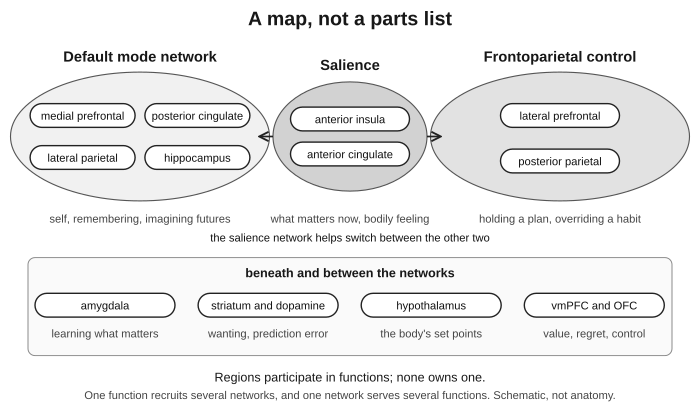

CHAPTER 4

# The Monster Within

*Psychology, Morality, and the Dance of Free Will*

*PERSON*

> "The line dividing good from evil cuts through the heart of every human being." --- **Aleksandr Solzhenitsyn**[^v1-c4-epigraph]

<!-- AI-assisted: restored from Sam's new vignette and earlier draft; Sam's own lines kept wherever they survived; awaiting Sam's pass -->

After I registered into the psychological domain (signed papers, surrendered photos, got a key), the clerk may well have pointed toward the horizon and told me, "You'll be living and eating in the beer can." In Beer Town (Milwaukee), "the beer can" was a valid address.

I stepped outside and there it was: a building shaped like a beer can, a colossal cylinder of concrete with a slice missing, like some birthday cake from which civilization had already helped itself. Through that missing wedge lay the entrance to my next life.

To me it looked like freedom; to others, perhaps, a well-funded form of academic incarceration. Either way, I marched in.

The place smelled of floor wax, detergent and brand-new independence. The hallway curved just enough that you couldn't see where it ended: a psychological trick designed to keep freshmen in a state of eternal curiosity, or, as it later turned out, in psychology's hamster wheel. I found my assigned room halfway around the arc, turned the key, and stepped into a small capsule of symmetry: two bunks, two desks, two lives yet to intersect.

One half of the room was already claimed: neatly folded jeans, an electric typewriter, and two registration forms lying on the lower bunk. The first bore the name *Eric*, the second *Estrada*. I blinked. *Erik Estrada?* My first roommate in America shared a name with the actor who played my favorite character in the television series *CHiPs*. A chip indeed, though not in silico. Something inside me laughed, and then moved on.

I dropped my suitcases, intending to sit, but my neurons had other plans. Somewhere between jet lag and euphoria, the squirrel-on-espresso circuit kicked in. I darted out to map every hallway, every vending machine, every corkboard announcing events that sounded supernatural. The carpet crackled under my sneakers like static from a Van de Graaff generator; the air itself felt ionized. Eight hundred unparented minds, all freshly formatted, booting their operating systems in parallel.

The days that followed have since blurred into a single broad memory. Like many evenings, I probably sat that first night by the window of my seventh-floor room and watched people mill around between the parking lot and the bars.

But in the months, then years, that followed, I was unwittingly applying the same crystal-smashing method I had perfected as a toddler, except that this time the crystal was my psychology. No wonder they call this austere science experiment a crash course. I'll keep it simple and call it a smash course: learning the new domain quickly while, in tandem, erecting out of thin air the illusion that you had always been like this, ignoring the fact that only a handful of summers ago you were plainly a bumbling child. This is how manhood arrives in boys. One summer you see a kid running around the cul-de-sac; the next, a never-before-seen human trudges down the same sidewalk with an air of unearned confidence.

In my case, there were no wild parties, no girls, modest beer consumption (modest, at least, by my later standards) and no real troublemaking (not intentionally). Even the classes weren't that interesting. (Remember: even engineers don't find engineering interesting.) Still, for me too, there was something undeniable in the air, and I also mean that literally. On cloudy days, if you stood at the correct spacetime of both physics and psychology, the heavy, sweet, molasses-like scent of brewing malt from the city's great breweries would drift over the campus. Even now, the memory of driving through Milwaukee on I-94, supercharged by the smell of that beer-in-training, triggers a deep wave of nostalgia.

Just as biology had been my DNA rippling through its environment, now my brain (a bulge in itself) was rippling through its own, and the ripples were dressed as psychology, as personality. The beer can and Beer Town became the spacetime of that ripple, even sans actual beer.

This sudden flash of personhood (the blue fairy granting Pinocchio-the-boy-brain his wish to become a real person) arrived with a hefty psychological weight. The particular lament that even the beer can's curved hallways couldn't hide was the sacrifice all this meant for my parents: the crazy tuition, the room-and-board fees that arrived like a forever-unfurling invoice, and their sheer generosity in letting me go despite having entirely different dreams for me.

And the Pinocchian bargain cut like a double-edged sword forged from high-carbon, weapon-grade irony. My parents were paying through their teeth for my grand pleasure of turning into a common man, while a prepackaged, fiat version of "success" had been sitting right there in their existing nest all along, requiring no additional contracts, struggle or fees. I had kicked that birthright privilege away to chase a common man's dream, and now they were funding the chase. But a person is such a beast. In the psychological phase, you no longer try to fit onto the shelves; the world begins to build shelves around you.

To balance this mental ledger (with all the modesty of a christening bottle taking credit for an entire voyage), I applied for a campus job as a "custodian." The title had an air of administrative authority, and I was genuinely happy when I was accepted. My excitement went through the roof when I learned that custodian was high-society campus speak for janitor.

It would be epically romantic to tell the world later that my very first job was as a janitor. I was casting myself in the grand tradition of those great figures whose genius always seemed obliged to crawl out of a sanitary installation before conquering the world. But when the actual job is two four-hour shifts over a single weekend, the narrative collapses. I wasn't swinging a mop out of economic desperation; I was auditioning for a blue-collar brag while my father's wire transfers were still the strings quietly running both the cast and the play. Despite my premature enthusiasm, I can't in full honesty say, "I started my life as a janitor, and look where I am now." There are major structural holes at both ends of that sentence.

And because my brief tour of duty included the beer can's common bathrooms, my romantic illusions quickly met real-world physics. Cleaning up the weekend barf of your own floormates is not a grant you'd readily summon the blue fairy for.

The fairy who granted me the beer can, and its pre-fizzled janitorial grandeur, had delivered it with an unspoken proclamation: you can live in the beer can, and you can drink from it too. It was the ultimate loophole of my new age, made better still by the architecture. Since the building looked like a massive birthday cake with a slice already eaten out of it, I figured I was officially allowed to have my cake and drink it, too.

That same fairy also seemed to possess a wicked sense of cosmic humor. The campus food service at the time was run by a company called Saga.[^v1-c4-saga] Most students agreed with that grand, exhausting taxonomy, but I simply enjoyed the sheer agency of it, however much of a Hobson's choice it actually was, curated by some faceless committee upstairs. I called the dining hall's illusion of choice free will, or perhaps free fill, and found it delicious.

<!-- AI-assisted targeted revision, 2026-10-27; adoption operation 6. -->

Somewhere in the grand script of coincidences (the cosmic course catalog, or the cosmic seven-course menu, if you will), Benjamin Libet had registered too. His experiments were already in print, but that December, in my first semester, he published his argument about unconscious initiative and conscious will. The brain appeared to prepare a simple movement before its owner reported deciding to make it.[^v1-c4-libet] Apparently, he and I had enrolled in the same course: *Introduction to Free Will 101*.

## The Monster of Psychology

If the most alarming reading of Libet's stopwatch was right, I'd spent most of my life under false management. The brain, it seemed, had been forging my signature all along. Every choice I'd ever credited to "me" was just an electrical impulse arriving early to the meeting.

For psychologists, this was a revelation. For theologians, a migraine. And for freshly minted adults staring out of dorm windows, it was liberation of a dangerous kind: if my neurons were already pulling the levers, what exactly was I experiencing here, human psychology or forgery? Physicists had long since given us quantum uncertainty; now psychologists were handing us cognitive uncertainty. Between stimulus and response, between cause and confession, lay a fog no microscope could pierce.

I wasn't studying psychology, at least not officially. My course load said engineering fundamentals, circuits and calculus. But the beer can itself was a living laboratory, its hallways a maze of case studies and its cafeteria a controlled experiment in social hierarchy. My father built bridges; I preferred observing the ones that collapsed. You could learn more about the human mind from watching two roommates share a RadioShack computer than from reading all of Freud. The negotiation over shelf space in a shared mini-fridge was a textbook of moral philosophy in itself. Who gets the milk? Who replaces the milk? Who pretends not to see the empty carton? Game theory in its purest form.

In lectures, I memorized Ohm's law; in life, I measured resistance of a different kind: how much pressure it took before politeness gave way to honesty, and honesty to cruelty. It was astonishing how much voltage a friendship could take before it blew a fuse. By day, I learned to trace electrons through circuits. By night, I learned to trace impulses through conversation. Both obeyed strange laws of potential and discharge, of stored energy looking for a path to ground. The electrodes were replaced by cafeteria trays, and the lab rats were voluntarily caffeinated.

That's when I first met the monster within: not a creature of evil, but of excuse. The little negotiator who always arrived half a second late, rewriting history to make chaos look like choice. It wasn't malice that shaped our psychology; it was narrative. We didn't want truth; we wanted continuity, like the eternal continuation of a software application. The most advanced neural system in the known universe, and we used it mostly to save face.

That realization hit me harder than any equation. Circuits I could trust; people, including the one inside me, ran on unstable voltages. Still, that unpredictability (the irrational surges of empathy, guilt and love) was the only thing that made consciousness worth debugging. The monster wasn't a villain. It was our conscience in camouflage.

<!-- AI draft, 2026-11-14. Short version; the full argument is in possibility-carried-forward-notes.md. -->
## Possibility, Carried Forward

Chapter 3 found a model of the world that could be wrong without anybody dying. A person is that model left running for a lifetime. Interlude 4 will describe a program as a state carried from step to step by a fixed rule, $s_{n+1}=F(s_n,x_n)$, and over a single thought I can approximate a brain that way. Over a life I need more than its momentary state, because the connections change too:

$$
(s_{n+1},\,w_{n+1}) \;=\; F(s_n,\,w_n,\,x_n).
$$

Here $s$ is the fast state, the activity of the moment, $x$ is incoming influence, and $w$ is the slow one, the strengths of roughly a hundred trillion synapses, nudged a little by nearly everything that happens. On Chapter 3's floor, $w$ was the hardware. On this one, it's the autobiography.[^v1-c4-timescales]

<!-- AI draft, 2026-11-15: figure drawn from the earlier DIAGRAM request. -->
{#fig-v1-c4-two-clocks width=100% fig-alt="A logarithmic time axis from one millisecond to eighty years, with bands for spikes, perception and thought, emotion, mood, habit and skill, and temperament and personality. Below, a jittery line labeled s, the activity of the moment, and a thick slowly drifting line labeled w, synaptic strengths, the autobiography. At the bottom, hippocampus and cortex exchange information through replay, much of it in sleep."}
<!-- End AI draft 2026-11-15. -->

Put Chapter 1's four questions to that, and the first answer is the new one. *What is possible* now includes the paths not taken. On every earlier floor an unrealized possibility simply wasn't there; a lineage that died out keeps no memory of the world it might have made. A person keeps them. A hope is a possibility given standing in the present, a plan is one given a schedule, and a regret is one that lost and stays on the books, with an address: in one gambling experiment, people with orbitofrontal damage registered what they won or lost, but did not report regret over the outcome they passed up.[^v1-c4-regret] The sense of free will belongs here too. On my reading, a system that keeps several of its own next states in view can feel each of them as available until one is taken. Whether they were metaphysically open is the business of "Free-ish Will," below. The feeling can be an accurate report that the options are being represented.

*What is cheap* is keeping the past rather than reliving it. A learner that learns fast risks overwriting yesterday's lessons; one that learns only slowly risks losing a one-time event. Complementary learning systems theory gives the brain two learners on two clocks: the hippocampus records episodes quickly, the cortex integrates them slowly, and replay helps integrate them, during sleep and waking rest.[^v1-c4-cls] *The sameness* is in the pattern, because it isn't in the parts. Many proteins holding a synapse together are replaced within days or weeks, while a childhood memory can last until death.[^v1-c4-turnover] A person, like Chapter 1's particle, is a shape kept up by work.

*The break* is the part with no precedent. Chapter 1's breaks were spontaneous, Chapter 2's were frozen accidents and Chapter 3's were developmental deadlines. A person can break its own symmetry on purpose, making one represented future cheaper than the rest before a weaker moment arrives. Ulysses had himself bound to the mast before the Sirens sang.[^v1-c4-elster] A promise, a vow or an identity is a frozen accident you arrange yourself, and much of character is a pile of them. Chapter 1's two-stroke runs here on a longer stroke: the self-model, replayed every morning until it feels like a fact, and then the event that refuses to fit it, such as a death, a move, or the stranger who stops at your terminal late one night and helps.

So Chapter 2's possibility space acquired a memory, and Chapter 3's a model. Here the model acquires a past and a future of its own, and the head count at last includes the counter. That's also why a self is harder to keep honest than a model of the world: much of its evidence is produced by the self it describes, which is where Alice is going. And it marks where this floor ends, though the floors in this book are views, not walls. A self is a container with a population of one. When several self-models start modeling one another, the result is behavior that no member holds: a band, a crowd, a city, the next rung's subject. On the ground floor, cheap and common were the same thing. In biology, common was earned by copying. In a brain, a thing could become common without ever having happened. In a person, what never happened can be kept for a lifetime, and still decide what does.
<!-- End AI draft 2026-11-14. -->

## Alice, Down the Rabbit Hole: The Loop That Must Stay Open

*The wager, in one line: a person can become a story the brain hardens by checking it against itself; escaping the loop may require changing who, or what, is allowed to correct it.*

Go back to the conjecture the earlier rabbit holes have been building. In that picture, possibility hardens into probability when something bounds it; probability hardens into near-certainty when the odds grow overwhelming; near-certainty hardens into what we call reality and fact. A self adds one more hardener: self-reference. You believe something about yourself, and every new experience gets checked against that belief, which grows firmer with every check it passes. The self is the brain's model of itself, compared against itself until it feels like a fact. Interlude 2 found DNA serving as one text used two ways, read for instructions and copied for the future. The self is the same kind of text: the brain lives by it and keeps copying it forward, day after day.

<!-- AI-assisted targeted revision, 2026-10-27; adoption operation 10. -->

The trouble is that the brain's explanation of its work is another product of that work. Introspection can tell us what we seem to feel without reliably telling us how the feeling or decision was produced. People confidently explain choices with reasons that experiments suggest weren't their causes.[^v1-c4-nisbett] In some split-brain experiments, the speaking hemisphere supplies a plausible explanation for behavior prompted by information it did not receive.[^v1-c4-interpreter] In "choice blindness" experiments, people shown a photograph they didn't choose, by sleight of hand, will often defend the substituted choice, with reasons.[^v1-c4-choiceblind] None of this makes self-knowledge impossible. It makes the self's account evidence to examine, not a certificate it can issue to itself. In the language of our silicon mirror, training on your own answers is a poor way to build an independent test set.

That's why the loop has to stay open. Normally, survival forces it open: the brain attends to deltas, to what the world says back, the way the retina's center-surround cells compare a spot with its neighbors. But a self has to strike a balance the retina doesn't. Accept the center too quickly, and you jump to conclusions, recognizing what you expected rather than what's there. Debate the surround forever, and you never act. Every classifier, biological or machine, lives on that threshold. And the self has a further temptation, a hardener on top of self-reference: cherry-picking. A mind that checks itself against itself can also choose which evidence gets to vote, attending to what confirms and explaining away what doesn't. Psychologists call it motivated reasoning.[^v1-c4-kunda] <!-- AI draft, 2026-11-15. -->Leon Festinger had named one of its engines decades earlier: cognitive dissonance, the discomfort of holding two beliefs that don't fit, which people often relieve by changing whichever is easiest to change rather than whichever is wrong. In their famous account of a failed flood prophecy, Festinger and his colleagues reported that some members recruited harder; that account is now challenged by an archival reanalysis.[^v1-c4-festinger] An argument that asks a mind to discard a cherished belief should expect the mind to consider discarding the argument instead, a lesson the later volumes of this book will have to design around.<!-- End AI draft 2026-11-15. --> It feels like thinking. It's actually the loop quietly closing.

<!-- AI draft, 2026-11-15. -->
{#fig-v1-c4-loop width=95% fig-alt="Two loops side by side. Open: self-model makes a prediction, a check compares it with evidence from the world, meaning other people, failures and surprises, and the result updates the self-model. Closed: the world is explained away and blocked; the check is fed by the self-model's own account, filtered to agree, so the self-model grows firmer with every check it passes."}
<!-- End AI draft 2026-11-15. -->

<!-- AI-assisted targeted revision, 2026-10-27; adoption operation 11. -->

When it closes, the self overfits. Interlude 2's model overfit by memorizing last year's exam; a closed self memorizes itself. Some predictive-processing accounts of psychosis examine how evidence and expectation receive the wrong relative weight, though the disturbance can differ across levels of processing; it is not simply believing everything too strongly.[^v1-c4-rigid] Research on extremist attitudes has also found associations with difficulty switching rules in laboratory tasks.[^v1-c4-zmigrod] Neither finding turns a metaphor into a diagnosis. But they give it something to work on: a person may become skilled at defending a story while losing the means to discover what the story excludes. The monster within, I've come to think, can grow in that protected space. Nothing gets in that might embarrass its landlord.

<!-- AI-assisted targeted revision, 2026-10-27; adoption operation 12. -->

What keeps it open? A person can sometimes choose the world it ripples through: new cities, new friends, new teachers, even a dormitory shaped like a beer can. Other organisms also alter and select their surroundings; biologists call the feedback through environmental modification niche construction.[^v1-c4-niche] We add the unsettling possibility of doing it with an imagined future self in mind. Five centuries ago, Giovanni Pico della Mirandola imagined God telling Adam that, unlike other creatures, he had no fixed station and must shape himself.[^v1-c4-pico] That's the Pinocchian bargain: to become a real person is to have no guaranteed shelf, and to keep choosing where to stand. And Chapter 3's dream hypothesis offers an analogy. If strange dream experience helps prevent a brain from overfitting to its day, might a life of moves help prevent a person from overfitting to one place?

Looking back, I can see the pattern in my own life, though I didn't plan it. The beer can let in a world no shelf had prepared me for. Madison, before long, would let me out from under a philosophy whose ceiling had been built in advance. And after that, the West. I'd like to say I knew I was keeping a loop open. Mostly, I was just moving. But the rabbit hole suggests the moves were doing something the mover didn't have to understand.

<!-- AI-assisted targeted addition, 2026-10-27: Alice extension; open conjecture, not a result attributed to the cited experiments; for author revision. -->

Here is the further wager. Perhaps a person changes most deeply not when a belief changes, but when the rule for admitting evidence changes: whose objection counts, what failure must be noticed, which encounter can no longer be dismissed. Could we distinguish a self that merely acquires new answers from one that changes what it permits to count as a question? And could a chosen environment help produce that second change without merely installing a different orthodoxy? Novelty alone will not do; a cult can offer an entirely new wardrobe. The test would be whether the person becomes more capable of correction, including correction of the new story. That remains a question to work on, not a theorem smuggled out of Chapter Φ.

## Minds Made of Layers

For most of human history, psychology suffered from a technical limitation: the only available measuring instrument was the mind itself. It was like trying to weigh a scale by standing on it, or judge a mirror by staring harder. Still, early thinkers gave it their best shot. They closed their eyes, took philosophical notes and tried to reverse-engineer themselves from the inside out. The results were... mixed.

Plato gave reason the reins of a chariot drawn by two horses, one spirited and cooperative, the other unruly and appetitive. I would still like to know who trained the second horse, and whether the chariot was insured. Freud later replaced the whole stable with a basement full of repressed wishes, angry ghosts and a superego that sounded suspiciously like his mother. Valuable metaphors, yes, but a bit like diagnosing a radio by studying Greek tragedy.

For a while, influential behaviorists tried to clean up psychology by excluding introspection from its method, declaring the mind off-limits: too messy, too subjective, too poetic. If you couldn't see it, time it or bribe it with food pellets, it wasn't science. Pavlov's dogs salivated, Skinner's rats pressed levers, and the human psyche was temporarily demoted to a black box with a treat dispenser.

Then came the cognitive revolution, the moment psychology looked at the rising world of computing and thought: *Ah, yes, that's me.* The mind became an information processor; attention, perception, memory and language became modules and buffers. Psychologists built flowcharts. They argued about bottlenecks and bandwidth as if the brain were an IBM mainframe with a caffeine addiction.

<!-- AI-assisted targeted revision, 2026-10-27; adoption operation 16. -->

The real plot twist arrived when machines finally let us watch. Magnetic resonance imaging gave us detailed pictures of the living brain's structure by the 1980s, and early functional MRI studies used changes in blood oxygenation to infer activity during a task.[^v1-c4-fmri] Freud's couch had been upgraded to a control room, though its screens measured a vascular response, not thoughts themselves. The maps revealed interacting networks, with emotion and deliberation woven through them rather than stacked as an old beast beneath a new accountant.[^v1-c4-networks] Even the default mode network, relatively more active during many resting conditions than during demanding external tasks, was busy with forms of internally directed thought.[^v1-c4-dmn] Doing nothing, apparently, required personnel.

<!-- AI draft, 2026-11-15: figure drawn from the earlier DIAGRAM request. -->
{#fig-v1-c4-networks width=100% fig-alt="Three large-scale networks: the default mode network (medial prefrontal, posterior cingulate, lateral parietal, hippocampus), for self, remembering and imagining futures; the salience network (anterior insula, anterior cingulate), for what matters now and bodily feeling, which helps switch between the other two; and the frontoparietal control network (lateral prefrontal, posterior parietal), for holding a plan and overriding a habit. Beneath them: amygdala, striatum and dopamine midbrain, hypothalamus, and ventromedial and orbitofrontal cortex."}
<!-- End AI draft 2026-11-15. -->

Daniel Kahneman later popularized the nicknames System 1 and System 2 for fast, largely automatic processing and slower, effortful processing. These are useful families of operations, not two little brains, but the gist was already clear: the mind is not a monarchy. It's a coalition government with unreliable voting habits, occasionally cooperating and prone to coups.[^v1-c4-kahneman]

### Remembering: The Tuning Fork

Memory is where the person lives longest, so it's worth a closer look. When I watch myself trying to recall something, it feels less like opening a file than like striking a tuning fork. The attempt sends a pattern through the brain, and somewhere among the countless patterns already humming, one answers: it resonates, and the memory arrives. Strike the wrong fork, and its hum can drown out the right one; the name sits on the tip of your tongue, blocked, until the noise settles. That uncanny familiarity without a place to put it is also how déjà vu feels to me; the tuning fork is my description of the experience, not its established mechanism.

<!-- AI-assisted targeted revision, 2026-10-27; adoption operation 19. -->

My amateur introspection has relatives in serious theory, though they are doing different jobs. Stephen Grossberg's adaptive resonance theory describes a match between incoming patterns and learned expectations, helping a system learn new categories without endlessly overwriting old ones.[^v1-c4-art] John Hopfield's networks offer another mechanism: learned connections make certain patterns stable, so a partial cue can lead the network back toward a stored pattern. It can also settle into the wrong pattern, or a mixture never deliberately stored.[^v1-c4-hopfield] Hippocampal pattern completion gives biological support to the idea that a fragment can bring back linked parts of an episode.[^v1-c4-completion] And Endel Tulving and Donald Thomson's encoding-specificity principle explains why a cue's usefulness depends on how it relates to the original encoding.[^v1-c4-tulving] Brewing malt on I-94 does not contain my first year in Milwaukee. It has an excellent forwarding address.

<!-- AI-assisted targeted addition, 2026-10-27: memory reconstruction, source monitoring and maintained traces; for author revision. -->

But an answer arriving is not the same as an answer arriving with valid papers. Memory reconstructs; it does not simply replay. A familiar image may come from something witnessed, something read or something vividly imagined. Source monitoring is the work of judging where it came from, using contextual and sensory detail, traces of the mental operations involved, and what we know about the situation.[^v1-c4-source] Familiarity can arrive before that checking succeeds. The memory feels present; its passport is missing. Confidence is not a substitute for provenance.

{#fig-v1-c4-memory-reconstruction width=100% fig-alt="A partial cue reaches overlapping memory traces. Reconstruction may recover associated details or blend them. A separate conceptual panel compares familiarity with checks on context and origin; confidence alone does not determine whether the attribution is accurate."}

The tuning fork is alive, too. Synapses, cells and molecular processes must maintain the conditions under which a pattern can return; a wiring diagram alone leaves much out.[^v1-c4-maintenance] Yet a memory need not be continuously replayed to remain available. In a working-memory experiment, a temporarily unattended item became detectable again after magnetic stimulation, even when its active signature had dropped below the researchers' ability to decode it.[^v1-c4-latent] That is evidence about recoverability, not a brain switched off and restarted. Sleep is active, and surgical cooling is no proof that identity survives any interruption. I am tempted to call the living arrangement a *dynamic serialization*: the dance helps maintain the conditions for another dance. What must persist for that dance to remain mine is the harder question.

Psychology today wanders freely across borders: into neuroscience, genetics, evolution and computation. But it keeps one allegiance no other discipline does. It still cares about the person: not only the firing patterns, but the bewildered creature living inside them, the one who dreams, suffers, lies, heals and occasionally buys self-help books at 2 a.m.

## The Self in Splinters

Once we accept that the mind is layered (half cathedral, half committee meeting), we run into the next uncomfortable truth: no two minds assemble themselves the same way. The self feels like a solid object when we're living inside it, but in practice it's a probability cloud, a temporary equilibrium perched on a spectrum so wide it could double as a national park.

Before we can talk about disorder, we have to at least pretend we understand order. Personality psychology is the scientific attempt to map what makes people reliably themselves, and one widely used descriptive model, the Big Five (openness, conscientiousness, extraversion, agreeableness and neuroticism), summarizes recurring patterns of variation rather than decoding their causes.[^v1-c4-bigfive] Still, the edges of those traits fray quickly. High neuroticism can look like sensitivity, or like doomscrolling with biological assistance. High openness can lead to creativity, or to entertaining the possibility that your toaster is flirting with you. Agreeableness sometimes dissolves into people-pleasing; conscientiousness can ossify into obsession. Personality is stable, yes, but porous. A single sleepless week can turn virtue into vulnerability.

<!-- AI draft, 2026-11-14. -->
The traits also have mechanics and a lifetime course, and they are the clearest place to watch this chapter's slow variable change. In one influential account, they are the long-run settings of control systems Chapter 3 already met: extraversion tracks sensitivity to reward, in which dopamine plays a large part, and neuroticism tracks sensitivity to threat and punishment.[^v1-c4-cb5t] A meta-analysis of twin, family and adoption studies attributed roughly 40 percent of the measured variation in such traits to genetic differences; the remainder includes environmental influences and measurement error.[^v1-c4-heritability] And the traits move, often in a familiar direction. People's relative ranks generally become more stable from childhood into young adulthood; on average, adults tend to become more conscientious and agreeable, and less neurotic: a drift researchers call the maturity principle.[^v1-c4-maturity] The self doesn't hold still. It settles.
<!-- End AI draft 2026-11-14. -->

<!-- AI draft, 2026-11-15. -->
Traits answer only part of the question of who someone is. Dan McAdams describes three layers: the traits; the goals, values and strategies a person adapts to a particular life; and, from adolescence on, a narrative identity, the evolving story a person tells to make the past cohere and point somewhere.[^v1-c4-mcadams] The story isn't a transcript. People revise it, finding redemption in one chapter and contamination in another, and the kind of story they tell predicts something about how they fare. It's also where this book's stories begin. Chapter 5 will watch selves weave shared ones, and from Chapter 7 on, stories scale until they run economies and nations. What keeps a person the same person, when the parts and even the story keep changing, waits for Chapter 13.
<!-- End AI draft 2026-11-15. -->

<!-- AI-assisted targeted revision, 2026-10-27; adoption operation 23. -->

Clinical psychology steps in when patterns produce substantial distress or impairment; unusual is not by itself a diagnosis. Depression can collapse motivation and reward as well as mood. Anxiety can keep threat detection on duty long after the predator has become an inbox. Psychosis can disturb perception, belief and the sense of where experiences originate, though no single broken "self versus signal" switch explains schizophrenia. Autism and ADHD are neurodevelopmental conditions; bipolar disorder concerns, among other things, episodes of altered mood and energy. They do not form one interchangeable spectrum. The environment can make a difference to disability without making every difficulty an invention of social disapproval. Armchair diagnosis would give half the Enlightenment hypomania and half the tech industry a standing appointment. Somewhere, a monk and a clinician are disagreeing about whether a visionary is enlightened or needs help. Neither should diagnose him from the jacket copy.

Genetics complicates everything. Large genetic studies find many contributing variants, generally with small effects, and some shared influences across psychiatric diagnoses.[^v1-c4-polygenic] Genes participate in development rather than supplying a finished blueprint. Childhood stress, prenatal conditions and lived experience interact with that inheritance. The construction crew works from instructions it keeps interpreting, while chance is the foreman with a gambling problem. Add the livewired brain of Chapter 3, and the self becomes a moving target. Trauma can rewire attention; therapy can strengthen new circuits. The mind that wakes each morning is never quite the mind that went to sleep.

In the end, the self isn't split; it's pluripotent: a flexible, fragile, adaptive system capable of fracturing, rebuilding, compensating and occasionally transcending. Psychology's gift is not to label the splinters as aberrations but to map their origins and dignify the full spectrum of minds that call themselves "I."

## Free-ish Will

Consciousness likes to imagine itself in charge, a pilot in the cockpit with a hand on the throttle. But the more we study the mind, the more the cockpit looks like a movie set: impressive switches, no wiring in the back. The pilot might just be a passenger with a strong Wi-Fi signal.

The experiment behind Libet's 1985 argument was modest in method. No one was asked to sacrifice themselves for science; they were asked to wiggle. Volunteers flexed a wrist whenever they felt like it and reported, by watching a fast clock, the moment they decided. A wave of brain activity called the readiness potential began several hundred milliseconds *before* the reported decision. The brain, it seemed, had started the action before the mind finished its speech about doing it. Later studies using fMRI found patterns that could predict a simple choice up to several seconds in advance, though only modestly better than a coin toss.[^v1-c4-soon] Consciousness, on the unsettling reading, is late to its own party and spends most of its time explaining decisions it didn't make: less a pilot than a press secretary, very busy, very articulate and mostly after the fact.

<!-- AI-assisted targeted revision, 2026-10-27; adoption operation 27. -->

The science has since added a twist worth knowing. Aaron Schurger, Jacobo Sitt and Stanislas Dehaene modeled spontaneous movement as noisy neural activity accumulating toward a threshold. Align many trials backward from the moment of movement and average them, and a readiness-like ramp appears; the ramp need not mark an earlier, completed decision.[^v1-c4-schurger] In a later experiment comparing arbitrary button choices with considered choices about donations, the familiar readiness potential appeared in the arbitrary condition but not in the same way in the deliberate one.[^v1-c4-maoz] Neither result proves free will. They do make the leap from choosing when to twitch to choosing a career look rather athletic.

<!-- AI-assisted targeted revision, 2026-10-27; adoption operation 28. -->

Philosophers, confronted with this mess, did not all throw up their hands and go into accounting. Many reached for compatibilism: you don't need a magical exemption from physics to be free; you need your actions to flow from your own values, memories, character and deliberation, even if those were shaped by the past.[^v1-c4-dennett] I don't believe in free will. But that does not oblige me to claim that the universe is demonstrably deterministic, or that deliberation does nothing. A reason heard, an imagined consequence or a conversation can change what the brain does next. Those causes do not become unreal because they operate through me. The person need not stand outside causation to participate in it.

<!-- AI-assisted targeted revision, 2026-10-27; adoption operation 29. -->

Morality's favorite parlor trick exposes some of that participation. A runaway trolley is heading for five people; pull a lever, and it kills one instead. Many people say yes; the numbers look clean. Now you must push a large man off a footbridge to stop the trolley. Suddenly the arm gets heavy. The arithmetic survives, but the action changes: personal force, intention and using someone as a means affect judgment, not simply whether skin touches skin.[^v1-c4-trolley] The psychological machinery weighs features the head count misses. Damage can alter that weighing. Phineas Gage, the railroad foreman who survived an iron rod through his frontal lobes, became a famous case of changed behavior. His later ability to work also matters: the endlessly repeated story of a personality permanently demolished leaves out evidence of adaptation.[^v1-c4-gage] A person is injured in time, and may recover in time; neither the skull nor the anecdote should be treated as a sealed box.

The elbow room varies. Cognitive biases tilt our decisions along grooves carved by prior information and social cues. Addiction drives a wedge between wanting and liking: the brain's dopamine circuits keep a person craving what they no longer enjoy or endorse, a compulsion that feels alien and yet inescapably theirs.[^v1-c4-wanting] Mental illness can shred the boundary between impulse and intention. And sometimes the machinery itself is bent: in one well-documented case, a man developed disturbing new urges that vanished when a tumor pressing on his frontal lobe was removed, and returned when the tumor regrew.[^v1-c4-tumor] Whatever we call these capacities for control, they are neither simple nor evenly distributed. Courts already act as if they know this, granting some defendants fewer "free-will credits" through terms like diminished capacity and insanity, though how a society should design its justice around that fact is a question for later chapters.

<!-- AI-assisted targeted revision, 2026-10-27; adoption operation 31. -->

The capacity for control, then, is more like a dimmer than a light switch. Habit, attention, fatigue, practice and the situation change what a person can inhibit or reconsider. That does not settle the metaphysics; it tells us where to look for useful leverage. Early experiments suggested that undermining belief in free will increased cheating, but larger replication attempts did not reliably reproduce that result.[^v1-c4-belief] The experience of agency is itself a construction: predictions about our actions, their observed effects and the surrounding context contribute to the feeling that "I did that."[^v1-c4-agency] A feeling of control can be mistaken. Actual control can also improve. Confusing the two would be an unfortunate way to demonstrate our mastery of the subject.

<!-- AI draft, 2026-11-14. -->
Part of what sets the dimmer is a record of whether reaching for the switch has worked before, and the evidence comes from experiments that once seemed to show the opposite. In the 1960s, dogs given shocks they couldn't escape later failed to escape shocks they could, and Martin Seligman and Steven Maier called it learned helplessness. Fifty years on, neuroscience, largely in rats, reversed their reading. Passivity under prolonged, uncontrollable stress turns out to be the default, driven by serotonin-releasing cells in a brainstem nucleus called the dorsal raphe. What animals learn is the other lesson, that their actions change what happens. When they do, the ventromedial prefrontal cortex detects the control and restrains the default, and the protection carries over to stress met later.[^v1-c4-helplessness] Helplessness, it turns out, isn't what gets learned. Control is, and in this book's terms that gives hope, as a learned expectation, a circuit-level foothold.
<!-- End AI draft 2026-11-14. -->

<!-- AI-assisted targeted addition, 2026-10-27: appraisal and reappraisal mechanism; for author revision. -->

One way that improvement happens is through appraisal. An unanswered message can be read as rejection, distraction or a dead battery; the interpretation helps organize the emotion and the next action. Reappraisal changes the interpretation rather than merely hiding its expression. In James Gross's experiments with disturbing film, participants asked to reinterpret what they saw showed a different emotional and physiological response from those asked to suppress outward signs of feeling.[^v1-c4-reappraisal] Neither strategy is universally best. Sometimes the message really is rejection, and an endlessly charitable reinterpretation is just motivated reasoning in nicer clothes. The useful skill is to keep an interpretation revisable long enough to choose a response worth having.

A line often credited to Viktor Frankl, without a verified source in his writings, places a space between stimulus and response.[^v1-c4-frankl] It is a good image, not a measured gap in the neurons. Reflection, practice and help from outside can change the response that becomes possible. In that work lives the monster within, and some of what may tame it.

## The Monster as Continuum

There comes a point in many lives (not always at rock bottom, more often somewhere in the creaking floorboards of middle years) when you look inward and realize that there are parts of you that you wouldn't hire to babysit your better self: a flash of anger that comes too quickly, a petty thrill when a rival trips, the quiet talent for rationalizing what, in others, you'd call selfish. Most of us manage these impulses with a running commentary: *I shouldn't have said that; I'll do better next time*. That commentary, awkward and self-protective and often late, is the sound of a psyche trying to integrate its monster rather than outsource it. It's also the loop staying open.

<!-- AI-assisted targeted revision, 2026-10-27; adoption operation 33. -->

Now consider the limits of reading another person from the outside. Jeffrey Dahmer, the Milwaukee killer, did things so grotesque that our first instinct is to file him under another species and move on. In his interviews, his flat, mechanically articulate account of himself makes that filing harder. But a performance, even a confession, does not let us measure felt remorse. Experts disagreed at his trial; the jury rejected the insanity defense and found him legally responsible.[^v1-c4-dahmer] That verdict answered a legal question. It did not settle every question about his mind. Planning and concealment can coexist with appalling indifference to another person's life. Knowing how to manage people is not the same as caring what happens to them.

<!-- AI-assisted targeted revision, 2026-10-27; adoption operation 34. -->

No single factor explains such a person: not genes, not early stress, not development, not a social world that missed warning signs. Nor does ordinary selfishness put someone on a conveyor belt toward murder. The disturbing continuity lies in shared human capacities, combined and developed in radically different ways, not a single scale with an absent-minded neighbor at one end and a serial killer at the other. Alice's sealed loop is one question to bring to the case, not its diagnosis. The worst cases still confront us with something difficult: they are human minds. Calling them another species lets our explanation leave the room before the victims do.

<!-- AI-assisted targeted addition, 2026-10-27: recovered punishment-as-pruning thread, kept at person level; for author revision. -->

It also changes the question we ask of punishment. If it is a kind of pruning, what are we trying to remove: a harmful action, a learned pattern, or the person who carries it? Restraint may be necessary to protect others. But suffering imposed is not, by itself, evidence that anything has been learned or repaired. The psychological question is whether the person can acquire a different response, under what conditions, and with what limits. The branch is not a bug in an otherwise innocent tree. We will come to the gardener later.

## The Moral Mind

If neuroscience is the study of the brain's wiring, and psychology the study of its glitches, then morality is what happens when the wiring and the glitches start worrying about other people. It's the inner voice that says, *Yes, I could, but maybe not in front of witnesses*. It's also the part of us that occasionally behaves well even when there are no witnesses, which is where things get interesting.

<!-- AI-assisted targeted revision, 2026-10-27; adoption operation 35. -->

At street level, the moral mind doesn't look like a halo. Parts of the anterior insula and cingulate cortex respond both to one's own pain and to cues that someone else is in pain, though the overlap does not mean we reproduce their whole experience. Hence the appeal of that little simulation: *what if that were my toe under the table leg?* Mirror neurons, first studied in macaque action and observation, do not by themselves explain human empathy.[^v1-c4-mirror] Feeling with someone, understanding their perspective and wanting to help them are distinguishable capacities.[^v1-c4-compassion] A skilled manipulator may understand you beautifully. A compassionate person may help without feeling your pain at full volume. No single prefrontal checkpoint stamps "ouch" into "ought."

<!-- AI-assisted targeted revision, 2026-10-27; adoption operation 36. -->

Then come the chemical lobbyists, whose portfolios are less tidy than the popular press suggests. Some experiments administering oxytocin found increased favoritism toward an in-group, under particular social conditions; that is not a universal trust serum.[^v1-c4-oxytocin] In one study, lowering serotonin availability made people more likely to reject unfair offers without changing how unfair they judged them.[^v1-c4-serotonin] The reaction changed without the stated moral standard changing. Put together, we get interacting networks and bodily states influencing whose needs command attention and what we do about them. Chemistry enters the argument. It does not arrive carrying a pocket constitution.

<!-- AI-assisted targeted addition, 2026-10-27: recovered collective-superego thread, kept within personhood; for author revision. -->

And the witnesses need not be present. Parents, friends and teachers can remain as an internal audience long after we leave the room. The result is a kind of *collective superego*: a distributed conscience that feels private because we carry its voices inside us. We internalize the crowd's gaze, then call it "my values." That can help us keep a promise when nobody is watching, or keep an inherited prejudice when somebody finally is. Becoming a person includes learning which of those voices deserves to stay. The society that trained the choir will have its own chapter.

### Monkey Ethics

<!-- AI-assisted targeted revision, 2026-10-27; adoption operation 37. -->

Our cousins run a proto-ethics lab of their own. In a famous experiment, Sarah Brosnan and Frans de Waal trained capuchin monkeys to exchange a token for cucumber. They were more likely to refuse when a partner received a preferred grape.[^v1-c4-capuchin] The reaction was vivid; its interpretation was less settled. Was the monkey protesting unequal treatment, a disappointed expectation, or the experimenter who plainly had better produce? A later meta-analysis found no overall evidence for inequity aversion across the acceptance-and-refusal tasks it examined.[^v1-c4-inequity] That does not settle every question about animal fairness. It does warn against translating a flying cucumber straight into a declaration of rights. Chimpanzees and bonobos, meanwhile, reconcile, trade grooming and navigate alliances. The capacities from which our moral lives develop have a history longer than the courthouse.

<!-- AI-assisted targeted revision, 2026-10-27; adoption operation 38. -->

And the monster isn't fixed, even in primates. Robert Sapolsky and Lisa Share described a baboon troop whose aggressive males were disproportionately lost in a tuberculosis outbreak linked to contaminated food. The survivors, now with a changed sex ratio as well as fewer aggressive males, showed a more tolerant social pattern; newcomers later participated in it.[^v1-c4-forest] This was an observed upheaval, not a randomized lesson in kindness. It nevertheless gave the idea of an unalterable baboon temperament a difficult afternoon. The environment a new male entered mattered.

### Apes with Ledgers

<!-- AI-assisted targeted revision, 2026-10-27; adoption operation 39. -->

Evolutionary psychology begins with an awkward confession: capacities with deep histories are being asked to navigate circumstances they did not evolve specifically to handle. Reputation, reciprocity, status and coalition-building matter to a primate before they matter to a stock exchange. But the mind is not a sealed Pleistocene instruction manual. Development and culture alter what those capacities attend to and how they are expressed. A follower count can recruit an old appetite without being the same thing as rank in a small band. The emotional infrastructure comes before our formal ledgers: the thrill of a win, the sting of a loss, the fear of being the sucker in a one-sided deal. What happens when markets organize those feelings is a later chapter's story.

### Epigenetics and the Local Rewrite

<!-- AI-assisted targeted revision, 2026-10-27; adoption operation 40. -->

Experience also reaches into gene regulation. Epigenetic mechanisms are not a recent add-on to biology; they help regulate which genetic instructions are used without changing the underlying sequence. In rats, differences in maternal licking and grooming were linked to chemical marks at a glucocorticoid-receptor gene, its expression, and the offspring's regulation of stress responses.[^v1-c4-meaney] That is more specific than life writing a personality into DNA. Human adversity can shape development through several interacting routes; the rat result does not establish that a person's later behavior has an epigenetic explanation. A nervous system adapted to danger may keep finding danger where a safer childhood would not. The adaptation can be understandable and costly at the same time.

<!-- AI draft, 2026-11-15. -->
Psychology approached the human version of that lesson by a crueler road, west of the beer can. At the University of Wisconsin in Madison, the campus I would soon transfer to, Harry Harlow separated infant rhesus monkeys from their mothers and offered them two substitutes, one wire and one cloth. Even when only the wire figure supplied milk, the infants fed there and clung to the cloth, running to it when frightened.[^v1-c4-harlow] Comfort, not the milk supply, decided which one they clung to. John Bowlby had argued that an infant's tie to a caregiver is a system in its own right, built by evolution to keep a small primate close to safety, and Mary Ainsworth gave it a laboratory test: a stranger enters, the mother leaves and returns, and the reunion helps reveal how secure the bond is.[^v1-c4-attachment] Attachment is among the first settings of the slow variable, written before the person can read it. Harlow's experiments are now remembered for their cruelty as much as for their findings, which is its own evidence about what a field once allowed itself.
<!-- End AI draft 2026-11-15. -->

<!-- AI-assisted targeted revision, 2026-10-27; adoption operation 41. -->

The person brings that history into the next encounter as expectations: whether patience is rewarded, whether trust is dangerous, whether tomorrow can be counted on. In Alice's terms, the loop is already partly set, but not finished. Psychology isn't only about people on couches. It is about how a world gets under the skin, and how a person then meets the next piece of world.

## Out of the Beer Can and Into the Fire

After a year, I left the beer can and moved off campus, just across the street from Murphy's Law, both the bar and the principle.[^v1-c4-murphy] I didn't drink in the bars much. The dozens of students on my side of the beer can's floor were the first people in my life I could simply have fun with, and the first to treat me as a person without any other social baggage. But despite that, or perhaps exactly because of it (no society had hardened around us yet), they were more my psychological environment than my company: people I watched, learned from, laughed with and occasionally joined for a planned outing, but not yet a society to be carved into. They came, and then they flickered out as we each moved on. For me, it was as simple as moving from this side of the bar to the far side. Solo off-campus living felt like a promotion in freedom, though Burns (and Steinbeck after him) might forgive the amendment: the best-laid free will of mice and men often goes sideways. Murphy, for his part, would have amended: if anything can go wrong, it will, especially after you sign a lease.

It was also in the shadow of Murphy's Law that I met one of **my** best friends, Anees: a graduate student whose interests were a strange cocktail of industrial engineering, automobiles, philosophy and cooking brains, both figuratively and literally. I would sit at his place for hours, eating his signature brain dish (fitting fare for this chapter) while we talked about nothing, forever. On many weekends we'd take out his car and drive the longest possible distances to absolutely nowhere. To be fair to us, by "nothing" and "nowhere" I only mean that our plans had the exquisite crystal clarity of salt. He still has one of the biggest hearts I know, and the same vicious sense of humor. Or viscous: his jokes stick. I've retold them more than anyone else's.

I spent my second year behind the bars (Murphy's Law included). Then Anees helped me find a place farther west on Wells Street, sharing it with one of his fellow graduate students, for my last semester at Marquette. Rent was cheap, the walls were thin, and the view was a brick wall with delusions of grandeur. It felt quiet, more or less peaceful.

It was a strange season of departures. Theology dressed as philosophy: out of Nimrod's furnace and into the Jesuit pan. At least mine was progress, unlike the proverbial route from pan to fire. I had applied to transfer to the University of Wisconsin, and been accepted. The biggest reason was that I had fallen in love with the Madison campus, and it had, then as now, strong programs in engineering and computer science. But first I had that last semester to finish, on Wells Street, before I would move to Madison.

Only much later did I learn what else had been breathing nearby. On one side of me, a block away, stood the Ambassador Hotel. Elsewhere nearby was the apartment building the same man would move into a few years later. I had been living within walking distance of both. I thought the silence of that neighborhood was peaceful. It turns out it was just well insulated.

## Leaving the Person

After that short semester, I left for Madison, where I collected a degree (a semester off schedule, thanks to prerequisites the transfer had shuffled), a few friendships that refused to decay, and a growing suspicion that consciousness was just the universe talking to itself in the first person.

I also collected a broken heart. A long-distance relationship, begun at my parents' encouragement, had turned into hopeless romance. When I finished my classes, I flew back to see her, and came back without her. She was far more devout than I had understood, and the distance between us turned out to be measured in more than miles. I returned to Madison so bummed that when commencement came that spring, I didn't even go to my own graduation.

That summer, my mother and my brother came to Madison. He had transferred from Norman, Oklahoma, and would start at Madison in the fall, so we had one summer together. My mother bought us better cars. I ended up with a newish Corolla, an upgrade over the old one, which had broken down about as thoroughly as I had: her ultimate gesture of sympathy for my predicament.

As the summer ended, like any self-respecting pioneer with a Toyota Corolla, I packed it with everything I owned and pointed myself toward Los Angeles, where graduate school in computer engineering would begin that fall. I had AAA plan a TripTik for the entire journey, knowing very well that plan and journey are two opposite things. It was long and flexible, guaranteeing only one thing: that the empty stretches of the American West would match the vastness of my own emptiness.

Irony, at least, had the courtesy to pull up a chair. I had entered this domain saying goodbye to my parents and my brother. Now, instead of going back to them, I was leaving, and my mother and brother were the ones seeing me off once again, this time from Wisconsin. Such is the manner in which the fragile arrow of a person moves: arrivals and departures that wait on one another, like processes sharing a resource. To explain that kind of irony, you need semaphores, and those come in the next interlude.

But before I could leave, I had to make room in the car for Patrick's boombox. For that, we have to go back to the start of my Madison years, where my personality found it was already fiercely competing with its own silicon mirror: a moody, bubbly and ambitious character named Software.

Then I drove away.

## The Upheaval: Shadow Revealed

Honestly, I don't remember exactly when the arrest happened, only that I had already set foot in Los Angeles and settled in. Suddenly, it was on every station. Teams of criminal profilers and forensic psychiatrists descended on the networks, dissecting the news with the frantic energy of commentators recapping Monday Night Football. The story shook the collective psyche far beyond Milwaukee. The killer's name was Jeffrey Dahmer, and his story had morphed into a modern urban legend before its reality fully sank in for me.

Some time later, Anees brought it up. "You know that guy was right next to where you lived?" He was absolutely right. During that semester, while I spent my nights asleep a block away, one of those horrors happened in a room at the Ambassador Hotel.[^v1-c4-ambassador] Only a city block and a couple of thin walls separated two psychologies that night: one of them asleep, and one of them not.

It wasn't the horror that stayed with me. It was the symmetry: the proximity of ordinary life to its shadow.

The same synaptic machinery that builds rocket engines can also build rooms like that. The same neural patterns that compose empathy can erase it. Biology gave us hunger. Mind gave us wonder. Psychology gave us the capacity to rationalize both.

They said on television that what he had done couldn't be explained by psychology, as though psychology were the problem. It wasn't. It was the mirror, and we had all been avoiding eye contact.

<!-- SOURCE NOTES: checked 2026-10-27; evidence depth and qualifications in the Chapter 4 adoption dossier. -->

[^v1-c4-epigraph]: Aleksandr Solzhenitsyn, *The Gulag Archipelago*. Wording checked against the [Solzhenitsyn Center’s excerpt](https://www.solzhenitsyncenter.org/his-writings/large-work-and-novels/the-gulag-archipelago), which uses “good from evil.”

[^v1-c4-saga]: Marquette University Archives, [Division of Student Affairs records, series 1](https://www.marquette.edu/library/archives/SuperA/UNIV-A-8-5-series1.php), lists Saga Food Service material in box 3. The company’s presence during my first semester is my recollection; the archive inventory does not date that particular experience.

[^v1-c4-libet]: Benjamin Libet et al., [“Time of conscious intention to act in relation to onset of cerebral activity (readiness-potential)”](https://doi.org/10.1093/brain/106.3.623), *Brain* 106 (1983): 623–642; Libet, [“Unconscious cerebral initiative and the role of conscious will in voluntary action”](https://doi.org/10.1017/S0140525X00044903), *Behavioral and Brain Sciences* 8 (December 1985): 529–539. The college-arrival conjunction is with the 1985 article, not the first experiment. Libet himself allowed a possible role for conscious control.

[^v1-c4-nisbett]: Richard E. Nisbett and Timothy D. Wilson, [“Telling more than we can know: Verbal reports on mental processes”](https://web.mit.edu/curhan/www/docs/Articles/15341_Readings/Social_Cognition/Nisbett_Wilson_1977_Telling_more_than_we_can_know.pdf), *Psychological Review* 84 (1977): 231–259. The argument concerns access to higher-order causal processes, not the impossibility of all introspective knowledge.

[^v1-c4-interpreter]: Michael S. Gazzaniga, [“Cerebral specialization and interhemispheric communication: Does the corpus callosum enable the human condition?”](https://people.psych.ucsb.edu/gazzaniga/PDF/cerebral%20specialization%20and%20interhemispheric%20communication.pdf), *Brain* 123 (2000): 1293–1326, especially the split-brain example in figure 19, p. 1318.

[^v1-c4-choiceblind]: Petter Johansson et al., [“Failure to detect mismatches between intention and outcome in a simple decision task”](https://doi.org/10.1126/science.1111709), *Science* 310 (2005): 116–119.

[^v1-c4-kunda]: Ziva Kunda, [“The case for motivated reasoning”](https://doi.org/10.1037/0033-2909.108.3.480), *Psychological Bulletin* 108 (1990): 480–498.

[^v1-c4-rigid]: Philipp Sterzer et al., [“The Predictive Coding Account of Psychosis”](https://pubmed.ncbi.nlm.nih.gov/30007575/), *Biological Psychiatry* 84 (2018): 634–643. The account considers disturbances of precision weighting at different processing levels, not one universally overstrong prior.

[^v1-c4-zmigrod]: Leor Zmigrod, Peter J. Rentfrow and Trevor W. Robbins, [“Cognitive Inflexibility Predicts Extremist Attitudes”](https://www.frontiersin.org/journals/psychology/articles/10.3389/fpsyg.2019.00989/full), *Frontiers in Psychology* 10 (2019): 989. These are associations between task performance and measured attitudes, not a causal diagnosis of an ideology.

[^v1-c4-niche]: F. John Odling-Smee, Kevin N. Laland and Marcus W. Feldman, [*Niche Construction: The Neglected Process in Evolution*](https://www.jstor.org/stable/j.ctt24hqpd) (Princeton University Press, 2003), especially chapter 2 on organisms modifying their environments. The extension to choosing experiences that reshape a self is mine.

[^v1-c4-pico]: Giovanni Pico della Mirandola, [*Oration on the Dignity of Man*](https://sourcebooks.web.fordham.edu/med/oration.asp), composed in 1486 and first published in 1496; the passage imagining God’s address to Adam. The Pinocchian connection is mine.

[^v1-c4-fmri]: Seiji Ogawa et al., [“Brain magnetic resonance imaging with contrast dependent on blood oxygenation”](https://doi.org/10.1073/pnas.87.24.9868), *PNAS* 87 (1990): 9868–9872. BOLD contrast measures a blood-oxygenation response associated with neural activity; it does not directly read thoughts. Human functional studies followed in 1991–1992.

[^v1-c4-dmn]: Marcus E. Raichle et al., [“A default mode of brain function”](https://doi.org/10.1073/pnas.98.2.676), *PNAS* 98 (2001): 676–682. “Default” concerns a pattern of activity relative to task conditions, not a brain doing nothing.

[^v1-c4-kahneman]: Daniel Kahneman, *Thinking, Fast and Slow* (Farrar, Straus and Giroux, 2011), introduction and part I. The System 1/System 2 terminology was used by Keith E. Stanovich and Richard F. West in [“Individual differences in reasoning: Implications for the rationality debate?”](https://doi.org/10.1017/S0140525X00003435), *Behavioral and Brain Sciences* 23 (2000). The labels distinguish families of processing, not two anatomical agents.

[^v1-c4-art]: Stephen Grossberg, [“Adaptive Resonance Theory: How a brain learns to consciously attend, learn, and recognize a changing world”](https://sites.bu.edu/steveg/files/2016/06/ART.pdf), *Neural Networks* 37 (2013): 1–47, especially the stability–plasticity problem and matching of bottom-up inputs with top-down expectations. The tuning fork is my introspective metaphor.

[^v1-c4-hopfield]: John J. Hopfield, [“Neural networks and physical systems with emergent collective computational abilities”](https://doi.org/10.1073/pnas.79.8.2554), *PNAS* 79 (1982): 2554–2558. Content-addressable retrieval in a model network supplies an analogy, not a complete biological memory theory.

[^v1-c4-completion]: Aidan J. Horner et al., [“Evidence for holistic episodic recollection via hippocampal pattern completion”](https://www.nature.com/articles/ncomms8462), *Nature Communications* 6 (2015): 7462.

[^v1-c4-tulving]: Endel Tulving and Donald M. Thomson, [“Encoding specificity and retrieval processes in episodic memory”](https://doi.org/10.1037/h0020071), *Psychological Review* 80 (1973): 352–373. A cue’s effectiveness depends on its relation to the encoded trace, not just its general association with the target.

[^v1-c4-source]: Marcia K. Johnson, Shahin Hashtroudi and D. Stephen Lindsay, [“Source monitoring”](https://memlab.yale.edu/sites/default/files/files/1993_Johnson_Hashtroudi_Lindsay_PsychBull.pdf), *Psychological Bulletin* 114 (1993): 3–28. Source judgments draw on characteristics of remembered information and judgment processes; they are not infallible origin tags. The figure is an original conceptual synthesis of this framework and the retrieval work cited above.

[^v1-c4-maintenance]: Wickliffe C. Abraham, Owen D. Jones and David L. Glanzman, [“Is plasticity of synapses the mechanism of long-term memory storage?”](https://www.nature.com/articles/s41539-019-0048-y), *npj Science of Learning* 4 (2019): 9. The review examines evidence and unresolved questions about synaptic and other mechanisms. “Dynamic serialization” is my proposed framing, not the paper’s conclusion.

[^v1-c4-latent]: Nathan S. Rose et al., [“Reactivation of latent working memories with transcranial magnetic stimulation”](https://doi.org/10.1126/science.aah7011), *Science* 354 (2016): 1136–1139. The unattended item became decodable again after stimulation. Failure to decode a representation is not proof of zero activity everywhere.

[^v1-c4-bigfive]: Robert R. McCrae and Paul T. Costa Jr., [“Validation of the five-factor model of personality across instruments and observers”](https://pubmed.ncbi.nlm.nih.gov/3820081/), *Journal of Personality and Social Psychology* 52 (1987): 81–90. A descriptive trait model is not a causal explanation or a clinical diagnosis.

[^v1-c4-polygenic]: Cross-Disorder Group of the Psychiatric Genomics Consortium, [“Genomic Relationships, Novel Loci, and Pleiotropic Mechanisms across Eight Psychiatric Disorders”](https://pmc.ncbi.nlm.nih.gov/articles/PMC7077032/), *Cell* 179 (2019). Genetic associations overlap across diagnoses; they do not determine an individual’s fate.

[^v1-c4-soon]: Chun Siong Soon et al., [“Unconscious determinants of free decisions in the human brain”](https://doi.org/10.1038/nn.2112), *Nature Neuroscience* 11 (2008): 543–545. Classification of a simple binary choice was modestly above chance, around 60 percent, not a complete prediction of a person’s decision.

[^v1-c4-schurger]: Aaron Schurger, Jacobo D. Sitt and Stanislas Dehaene, [“An accumulator model for spontaneous neural activity prior to self-initiated movement”](https://doi.org/10.1073/pnas.1210467109), *PNAS* 109 (2012): E2904–E2913. Movement-locked averaging is crucial to the proposed explanation of the readiness potential.

[^v1-c4-maoz]: Uri Maoz et al., [“Neural precursors of decisions that matter—an ERP study of deliberate and arbitrary choice”](https://elifesciences.org/articles/39787), *eLife* 8 (2019): e39787. The deliberate condition involved meaningful donation decisions. The result challenges straightforward generalization from arbitrary movement tasks.

[^v1-c4-dennett]: Daniel C. Dennett, [*Elbow Room: The Varieties of Free Will Worth Wanting*](https://mitpress.mit.edu/9780262527798/elbow-room/) (MIT Press, 1984; new edition 2015). Compatibilism is presented here as a philosophical position; the author’s own rejection of free will is distinguished from it.

[^v1-c4-trolley]: Joshua D. Greene et al., [“An fMRI Investigation of Emotional Engagement in Moral Judgment”](https://doi.org/10.1126/science.1062872), *Science* 293 (2001): 2105–2108; Greene et al., [“Pushing moral buttons: The interaction between personal force and intention in moral judgment”](https://pubmed.ncbi.nlm.nih.gov/19375075/), *Cognition* 111 (2009): 364–371. The latter distinguishes personal force from contact or proximity alone.

[^v1-c4-gage]: Malcolm Macmillan and Matthew L. Lena, [“Rehabilitating Phineas Gage”](https://pubmed.ncbi.nlm.nih.gov/20480430/), *Neuropsychological Rehabilitation* 20 (2010): 641–658. Historical evidence supports substantial later psychosocial adaptation, qualifying the familiar permanent-ruin story.

[^v1-c4-wanting]: Kent C. Berridge and Terry E. Robinson, [“Liking, wanting, and the incentive-sensitization theory of addiction”](https://pubmed.ncbi.nlm.nih.gov/27977239/), *American Psychologist* 71 (2016): 670–679. “Wanting” and pleasure can dissociate; this is one influential account, not an exhaustive theory of addiction.

[^v1-c4-tumor]: Jeffrey M. Burns and Russell H. Swerdlow, [“Right orbitofrontal tumor with pedophilia symptom and constructional apraxia sign”](https://jamanetwork.com/journals/jamaneurology/fullarticle/783830), *Archives of Neurology* 60 (2003): 437–440. A case report of symptom onset, remission after resection and recurrence with tumor regrowth.

[^v1-c4-belief]: Kathleen D. Vohs and Jonathan W. Schooler, “The Value of Believing in Free Will” (2008), *Psychological Science* 19: 49–54; Nicholas Buttrick et al., [“Many Labs 5: Registered Replication of Vohs and Schooler (2008), Experiment 1”](https://doi.org/10.1177/2515245920917931) (2020); Thomas Nadelhoffer et al., [“Does encouraging a belief in determinism increase cheating? Reconsidering the value of believing in free will”](https://doi.org/10.1016/j.cognition.2020.104342), *Cognition* 203 (2020): 104342.

[^v1-c4-agency]: James W. Moore and Paul C. Fletcher, [“Sense of agency in health and disease: A review of cue integration approaches”](https://doi.org/10.1016/j.concog.2011.08.010), *Consciousness and Cognition* 21 (2012): 59–68. Motor prediction, observed outcomes and contextual cues contribute to agency judgments.

[^v1-c4-reappraisal]: James J. Gross, [“Antecedent- and response-focused emotion regulation: Divergent consequences for experience, expression, and physiology”](https://pubmed.ncbi.nlm.nih.gov/9457784/), *Journal of Personality and Social Psychology* 74 (1998): 224–237. The experimental comparison concerns reappraisal and expressive suppression during disgust-eliciting film.

[^v1-c4-frankl]: Garson O’Toole, [“Between Stimulus and Response There Is a Space”](https://quoteinvestigator.com/2018/02/18/response/), *Quote Investigator* (2018), traces the saying and its uncertain attribution. It should not be presented as a verified quotation from Viktor Frankl.

[^v1-c4-dahmer]: [“Jury finds Dahmer sane”](https://www.upi.com/Archives/1992/02/15/Jury-finds-Dahmer-sane/6349698130000/), UPI, 15 February 1992, reports the verdict and disagreement among expert witnesses. Legal responsibility is not a clinical consensus about every aspect of his psychology.

[^v1-c4-mirror]: Tania Singer et al., [“Empathy for pain involves the affective but not sensory components of pain”](https://doi.org/10.1126/science.1093535), *Science* 303 (2004): 1157–1162; Vittorio Gallese et al., [“Action recognition in the premotor cortex”](https://doi.org/10.1093/brain/119.2.593), *Brain* 119 (1996): 593–609. Evidence about macaque action observation does not by itself establish a human empathy mechanism.

[^v1-c4-compassion]: Tania Singer and Olga M. Klimecki, [“Empathy and compassion”](https://doi.org/10.1016/j.cub.2014.06.054), *Current Biology* 24 (2014): R875–R878, especially the distinction between perspective taking, shared feeling, empathic distress and compassion.

[^v1-c4-oxytocin]: Carsten K. W. De Dreu et al., [“The Neuropeptide Oxytocin Regulates Parochial Altruism in Intergroup Conflict Among Humans”](https://pubmed.ncbi.nlm.nih.gov/20538951/), *Science* 328 (2010): 1408–1411. These administration experiments concern particular social games and conditions.

[^v1-c4-serotonin]: Molly J. Crockett et al., [“Serotonin modulates behavioral reactions to unfairness”](https://pmc.ncbi.nlm.nih.gov/articles/PMC2504725/), *Science* 320 (2008): 1739. Acute tryptophan depletion increased rejection of unfair offers without changing fairness judgments.

[^v1-c4-capuchin]: Sarah F. Brosnan and Frans B. M. de Waal, [“Monkeys reject unequal pay”](https://www.nature.com/articles/nature01963), *Nature* 425 (2003): 297–299. Refusal behavior is observed; the explanation in terms of inequity aversion is an interpretation.

[^v1-c4-inequity]: Oded Ritov et al., [“No evidence for inequity aversion in non-human animals: A meta-analysis of accept/reject paradigms”](https://doi.org/10.1098/rspb.2024.1452), *Proceedings of the Royal Society B* 291 (2024): 20241452. The scope is these paradigms, not every possible form of animal social evaluation.

[^v1-c4-forest]: Robert M. Sapolsky and Lisa J. Share, [“A Pacific Culture among Wild Baboons: Its Emergence and Transmission”](https://doi.org/10.1371/journal.pbio.0020106), *PLOS Biology* 2 (2004): e106. The selective mortality, changed troop composition and later social pattern were observed, not experimentally assigned.

[^v1-c4-meaney]: Ian C. G. Weaver et al., [“Epigenetic programming by maternal behavior”](https://www.nature.com/articles/nn1276), *Nature Neuroscience* 7 (2004): 847–854. The rat study concerns regulation of a glucocorticoid-receptor gene and stress responses; it does not establish an epigenetic destiny for human children.

[^v1-c4-murphy]: “Murphy’s Law” was a period name for the bar, not merely my private misremembering. A [local Marquette history](https://www.wiki.muscoop.com/doku.php?id=bars%3Amurphy_s) records that name before the later move and adoption of “Murphy’s Irish Pub.” The personal recollection remains mine.

[^v1-c4-ambassador]: The FBI’s [Milwaukee history](https://www.fbi.gov/history/field-office-histories/milwaukee) dates Dahmer’s arrest to 22 July 1991, after my departure from Wisconsin. Steven Tuomi’s death at the Ambassador Hotel belongs to 1987; a [contemporary retrospective](https://www.washingtonpost.com/archive/politics/1994/11/29/serial-killer-dahmer-slain-at-prison-job/7b18ac27-cd04-4482-8aac-0d8a25ddb1f7/) places it about September. Sources differ on the precise date. My residence nearby throughout that fall semester is personal recollection; the overlap does not require naming a particular night.

[^v1-c4-regret]: Nathalie Camille et al., [“The involvement of the orbitofrontal cortex in the experience of regret”](https://dornsife.usc.edu/coricelli/wp-content/uploads/sites/338/2023/11/Camille_Coricelli_Science_2004.pdf), *Science* 304 (2004): 1167–1170, especially the partial/complete-feedback gambling comparison and figures 2–3; DOI: 10.1126/science.1094550. The patients responded to obtained outcomes but did not report the comparison-dependent regret seen in controls or anticipate it in later choices. This task does not establish that every orbitofrontal injury abolishes all regret.

[^v1-c4-cls]: James L. McClelland, Bruce L. McNaughton and Randall C. O'Reilly, [“Why there are complementary learning systems in the hippocampus and neocortex”](https://doi.org/10.1037/0033-295X.102.3.419), *Psychological Review* 102 (1995): 419–457; Dharshan Kumaran, Demis Hassabis and McClelland, [“What Learning Systems do Intelligent Agents Need? Complementary Learning Systems Theory Updated”](https://web.stanford.edu/~jlmcc/papers/KumaranHassabisMcClelland16FinalMS.pdf), *Trends in Cognitive Sciences* 20 (2016): 512–534, sections on catastrophic interference, replay and rapid neocortical learning. McCloskey and Cohen named catastrophic interference in 1989 (*Psychology of Learning and Motivation* 24: 109–165). Replay occurs during sleep and quiet waking; hippocampus and cortex interact rather than passing a finished file one way. Cortex can learn rapidly when new information fits established structure. The two learners are a framework, not an exhaustive inventory of learning systems.

[^v1-c4-turnover]: Francis Crick, [“Memory and molecular turnover”](https://doi.org/10.1038/312101a0), *Nature* 312 (1984): 101, poses the persistence problem. Laurie D. Cohen et al., [“Metabolic Turnover of Synaptic Proteins”](https://doi.org/10.1371/journal.pone.0063191), *PLOS ONE* 8 (2013): e63191, measured turnover of synaptic proteins in cultured neurons; Seok Heo et al., [“Identification of long-lived synaptic proteins by proteomic analysis of synaptosome protein turnover”](https://pubmed.ncbi.nlm.nih.gov/29610302/), *PNAS* 115 (2018): E3827–E3836, found a subset with half-lives of months or longer. Guang Yang, Feng Pan and Wen-Biao Gan, [“Stably maintained dendritic spines are associated with lifelong memories”](https://doi.org/10.1038/nature08577), *Nature* 462 (2009): 920–924, tracked enduring spines in mice. Protein replacement, synapse survival and memory persistence are different measurements; no one turnover rate explains a human lifetime of remembering.

[^v1-c4-elster]: Jon Elster, *Ulysses and the Sirens: Studies in Rationality and Irrationality* (Cambridge University Press, 1979; revised 1984), chapter II on self-binding; Elster describes that argument and its limits in his [preface to *Ulysses Unbound*](https://www.cambridge.org/core/books/abs/ulysses-unbound/preface-and-acknowledgments/6AEA4ECD5522129D20070A1D6B8A827B) (2000). George Ainslie, *Picoeconomics* (Cambridge University Press, 1992), develops hyperbolic discounting and preference reversal; see also his [author-hosted discussion](https://picoeconomics.org/HTarticles/RSP%26Failure/RSP_Fail.html). The classical episode is Homer's *Odyssey*, book XII. A self-arranged frozen accident is this chapter's analogy, not a claim that every promise is effective or irrevocable.

[^v1-c4-cb5t]: Colin G. DeYoung, [“Cybernetic Big Five Theory”](https://doi.org/10.1016/j.jrp.2014.07.004), *Journal of Research in Personality* 56 (2015): 33–58, §§4.1–4.2 on extraversion and neuroticism ([paper](https://gwern.net/doc/psychology/personality/2015-deyoung.pdf)). This is one mechanistic theory, not a one-transmitter-per-trait map. The reward/dopamine and threat links combine theory and evidence at several levels; individual correlations are not a diagnostic assay.

[^v1-c4-heritability]: Tena Vukasović and Denis Bratko, [“Heritability of personality: A meta-analysis of behavior genetic studies”](https://pubmed.ncbi.nlm.nih.gov/25961374/), *Psychological Bulletin* 141 (2015): 769–785; DOI: 10.1037/bul0000017. The overall estimate was .40, with .47 for twin designs and .22 for family/adoption designs. These estimates concern measured variation in sampled populations under model assumptions, not the genetic fraction of an individual or an immutable destiny. The unexplained remainder is not a clean measure of parenting or experience.

[^v1-c4-maturity]: Brent W. Roberts and Wendy F. DelVecchio, [“The rank-order consistency of personality traits from childhood to old age”](https://doi.org/10.1037/0033-2909.126.1.3), *Psychological Bulletin* 126 (2000): 3–25; Roberts, Kate E. Walton and Wolfgang Viechtbauer, [“Patterns of mean-level change in personality traits across the life course”](https://pubmed.ncbi.nlm.nih.gov/16435954/), *Psychological Bulletin* 132 (2006): 1–25. The maturity principle is discussed by Avshalom Caspi, Roberts and Rebecca L. Shiner, “Personality Development: Stability and Change,” *Annual Review of Psychology* 56 (2005): 453–484. An updated synthesis, Wiebke Bleidorn et al., [“Personality stability and change”](https://pubmed.ncbi.nlm.nih.gov/35834197/), *Psychological Bulletin* 148 (2022): 588–619, found rank-order stability plateauing in young adulthood, with little evidence of further increase after 25. Rank order and mean trait level are different quantities; average maturation does not prescribe an individual's path, and trends differ by trait and period of life.

[^v1-c4-helplessness]: Steven F. Maier and Martin E. P. Seligman, [“Learned Helplessness at Fifty: Insights From Neuroscience”](https://ppc.sas.upenn.edu/sites/default/files/learnedhelplessnessat50.pdf), *Psychological Review* 123 (2016): 349–367, especially the controllability circuits and final “Hope” discussion; DOI: 10.1037/rev0000033. The early dog experiment was Seligman and Maier, “Failure to escape traumatic shock,” *Journal of Experimental Psychology* 74 (1967): 1–9. Much of the later circuit evidence comes from rats: prelimbic medial prefrontal/dorsomedial striatal control detection and prefrontal inhibition of dorsal raphe stress responses. The authors themselves propose a “hope circuit” interpretation; this is not a demonstrated location for all human hope, nor a complete theory of depression.

<!-- AI draft footnotes, 2026-11-15. -->
[^v1-c4-festinger]: Leon Festinger, *A Theory of Cognitive Dissonance* (Stanford University Press, 1957); Festinger, Henry W. Riecken and Stanley Schachter, [*When Prophecy Fails*](https://bookofmormonism.com/wp-content/uploads/2022/11/festinger-riecken-schachter-when-prophecy-fails-1956.pdf) (University of Minnesota Press, 1956), especially chapters VI–VIII. The flood narrative is disputed: Thomas Kelly, [“Debunking ‘When Prophecy Fails’”](https://doi.org/10.1002/jhbs.70043), *Journal of the History of the Behavioral Sciences* 62 (2026): e70043, first published online 4 November 2025, argues from archival records that the book misrepresented prior proselytizing and the group's later dissolution. This challenges the case's evidentiary use; it does not by itself decide the wider experimental literature on dissonance. Dissonance can involve conflicts between belief, action and commitment, not only two verbal beliefs.

[^v1-c4-mcadams]: Dan P. McAdams, [“The Psychology of Life Stories”](https://doi.org/10.1037/1089-2680.5.2.100), *Review of General Psychology* 5 (2001): 100–122; McAdams and Jennifer L. Pals, [“A New Big Five: Fundamental Principles for an Integrative Science of Personality”](https://doi.org/10.1037/0003-066X.61.3.204), *American Psychologist* 61 (2006): 204–217, especially principle 4 on life narratives. Traits, characteristic adaptations and narrative identity are distinct levels situated in biology and culture, not three anatomical modules. Associations between narrative themes and well-being do not establish that retelling alone causes recovery.

[^v1-c4-harlow]: Harry F. Harlow, [“The Nature of Love”](https://psychclassics.yorku.ca/Harlow/love.htm), *American Psychologist* 13 (1958): 673–685, especially the dual-surrogate experiment and figures 4–9. Four infants received milk from cloth and four from wire; both groups preferred cloth contact. The wire-fed condition makes contact comfort separable from the food source. These are rhesus-monkey findings, not proof of a single human attachment mechanism or of the rat epigenetic mechanism discussed above.

[^v1-c4-attachment]: John Bowlby, [“The Nature of the Child's Tie to His Mother”](https://web.english.upenn.edu/~cavitch/pdf-library/Bowlby_Nature.pdf), *International Journal of Psycho-Analysis* 39 (1958): 350–373, on attachment responses not reducible to feeding; developed in *Attachment and Loss*, vol. 1, *Attachment* (Hogarth Press, 1969). Mary D. Salter Ainsworth and Silvia M. Bell, [“Attachment, Exploration, and Separation”](https://www.fre.uy/a/e68bbdc6/Ainsworth.Attachmentexplorationandseparation.pdf), *Child Development* 41 (1970): 49–67, pp. 53–54 for the eight-episode Strange Situation; Ainsworth, Mary C. Blehar, Everett Waters and Sally Wall, *Patterns of Attachment* (Erlbaum, 1978). The initial stranger entry precedes the first separation. Reunion behavior helps classify an infant–caregiver relationship under these conditions; it is not an unchangeable personality verdict.
<!-- End AI draft footnotes 2026-11-15. -->

<!-- AI-assisted source and figure qualifications, 2026-11-15. -->
[^v1-c4-timescales]: The state equation and the “autobiography” reading are the author's coarse model. Updating connections can itself follow a fixed rule; the equation does not establish determinism, consciousness or free will. Synaptic efficacy can change quickly as well as persist, and memory involves more than scalar weights (see the maintenance and turnover notes). The figure's lower traces illustrate relative rates, not activity measured along its logarithmic axis. Its hippocampus/cortex panel follows complementary learning systems theory, cited below; the timescale bands are teaching approximations, not hard physiological boundaries. The book's floors distinguish views, not exclusive capacities: nonhuman brains also learn, plan and respond to alternatives.

[^v1-c4-networks]: Devarajan Sridharan, Daniel J. Levitin and Vinod Menon, [“A critical role for the right fronto-insular cortex in switching between central-executive and default-mode networks”](https://cns.iisc.ac.in/sridhar/pi/pdfs/sridharan_etal_pnas_2008.pdf), *PNAS* 105 (2008): 12569–12574; DOI: 10.1073/pnas.0800005105, especially figures 1–4 and the discussion. Their switching account uses fMRI timing and Granger-causal analysis, not a literal switch operated by one region. The diagram selects prominent participants and functions; membership depends on network definitions, tasks and resolution. Its lower panel mixes cortical and subcortical structures, and its placement is not anatomical depth. The existing regret, control-learning and moral-mind notes support the corresponding examples.
<!-- End AI-assisted source and figure qualifications, 2026-11-15. -->

<!-- Source audit: work/volume-1-drafting/chapter-04-fable-adoption-2026-11-15/source-audit.json; new material checked 2026-11-15, earlier evidence retained with its dates. -->
