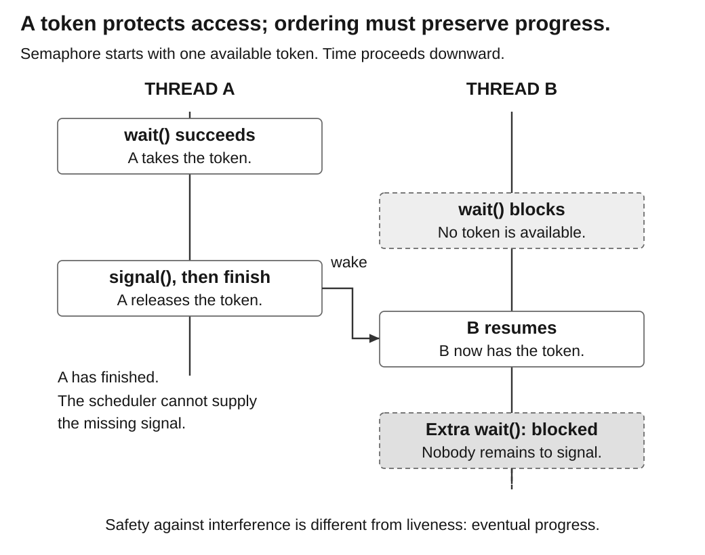
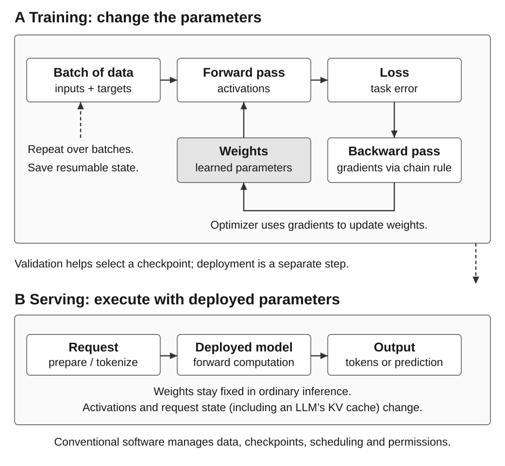

INTERLUDE 4

# Soft Logic

*The Art of Software*

*SOFTWARE*

<!-- AI-assisted: restored from Sam's earlier draft and new vignette; Sam's own lines kept wherever they survived; awaiting Sam's pass -->

<!-- AI-assisted adoption, 27 October 2026: factual opening repairs, expanded FPU/technical sections, revised Bob and selective closing recovery; memoir retained from author sources. -->

Within months of my arrival in the New World, God created Windows, and saw that it was almost good. Or at least Bill Gates did, slipping the first version of a graphical world on top of MS-DOS and announcing to the machines: *You may now have a personality*, especially if one could bestow the title of personality on a series of immediate, catastrophic existential crises.[^v1-i4-windows] "And on the next business day," said Bill, "let there be rectangles." And there were rectangles (flat, flickery, vaguely nauseating), and he saw that they were... fine. Fine for now.

That same autumn, Bjarne Stroustrup of Bell Labs published *The C++ Programming Language*. October brought the book; November brought Windows. Gates was putting a new face on the machine while Stroustrup was giving programmers a more ambitious way to arrange its insides. C++ brought classes and other organizational tools to C-style systems programming, with no requirement that every program become an object-oriented sermon.[^v1-i4-cpp]

For most people, these were industry developments. For me, they were trumpets announcing my next professional reincarnation: the age of software, the psyche of the machine, the invisible supervisor that would one day outrank gods, parents and academic advisors.

## One Night per Day

Before I could even bask at Bascom Hall, chill at the legendary Memorial Union, or walk the edges of the photogenic frozen expanse of Lake Mendota, a strange new ritual consumed my personhood, swallowing it just as quickly as the beer can at Marquette had created it. The upgraded saga involved trudging from my place near the corner of Spring and Orchard Streets to the computer science building on Dayton Street after classes, and returning late at night only if the software gods chose to grant a mercy. The current pantheon included C, Fortran and Pascal.

Inside the labs, stacked in rows on the tables like horses in a stable, sat the true workhorses of the time: Sun workstations, IBM RTs, and HP or DEC boxes, if memory doesn't betray me. Students saddled in, hunched over the glowing screens, while others clustered around them in perpetual wrangling squads, often in languages I couldn't follow. And then there was me: perhaps the cowboy of the room, but only as far as my erratic programming methods were concerned.

Because I was a transfer student, my prerequisites were completely unaligned and staggered. I was routinely taking advanced courses while simultaneously learning the computer languages required to actually complete the assignments. That is exactly why God created nighttime.

Professor Tiedemann already haunted my daylight hours on the engineering side of campus, where semiconductors conducted the other half of my life: solid-state physics, analog electronics, digital circuits and logic, and labs of all nationalities and creeds. I tried to understand microchips by digging through Texas Instruments data books. They came with the fresh-print smell of the times (now seriously competing with the old molasses), and they were deeply refreshing, if only because they actually explained what a chip was supposed to do, and more often than not, the hardware actually behaved.

Everything else on my schedule seemed to arrive without a user manual. Electromagnetics turned out to have no magnetism, and one hundred percent electrocution, à la Maxwell. There was engineering quantum mechanics, as if there were still any room left in my psyche to be spooked by the universe. There were the pesky analog labs, where I couldn't tell whether I was measuring the equipment in a frenzy or the equipment was not-so-secretly measuring me. And the mathematics of everything seemed purposely cryptic, as if some member of the pantheon were spending sleepless nights worrying that someone might decipher the math, get inside it, and steal all the math.

All of this drove me deeper into the arms of computer science. But computer science first greeted me with a hazing ritual of its own. When I transferred in, my coding vocabulary was limited to assembly language, plus the BASIC and Fortran I'd brought from before university. Now engineering and computer science were colliding, and all my assignments converged on the same lab computers. Late nights became the baseline. Occasionally I walked out of the lab and straight into my morning class. The problem wasn't the workload itself; it was a cosmic design flaw. The universe had provided only one night per day.

The wrangling squads were always groups of students fervently dissecting their code together. That kind of collaboration clearly worked; some of them were allegedly sneaking a few actual hours of sleep into their nights. Being a recent transfer, I didn't know the crowd. I recognized only the faces and voices of the usual suspects: strangers who shared my predicament for an entire semester, and who sometimes popped up again in the next advanced class.

One night, I was sitting at a terminal, completely stuck. I had nothing left to consult, and I was on track for a brutally long, unproductive night. Then, out of nowhere, one of the usual suspects dropped into my space. He saw my agony and quietly helped me find the solution. When I thanked him, he smiled the most genuinely generous smile I have ever seen. And then, having finished his own assignment, he simply vanished.

It was like seeing an angel. That smile still haunts me, in a good way.

I learned his name, Patrick, a little later.

## Will It Float?

<!-- AI-assisted revision from the author's 27 October 2026 FPU clarification; exact implementation awaits the surviving design report. -->
<!-- AI-assisted tightening, 27 October 2026, from the author's corrected EPC and course recollections. -->
Against the advice of my undergraduate peers, I enrolled in Professor Kime's Digital Design Lab. There were five of us: three terrifyingly smart graduate students, one undergraduate whose face seemed stamped with *genius*, and me.[^v1-i4-kime]

Over four months, we built the Engineering Precision Computer, or EPC, across a joined expanse of breadboards. The name was a little more generous than the register width. I took on its floating-point unit (FPU), sharing the work with a graduate student who also helped with the rest of the processor. We used chips, erasable programmable logic devices (EPLDs) and physical wires. Lots of wires.[^v1-i4-epld]

My FPU did its arithmetic in one pass. As I remember it, the CPU waited about four clock ticks for the slowest operation to settle. Those ticks were latency, not four trips through the arithmetic. Single pass was the feature. I had put considerable wiring behind that adjective.

Floating-point arithmetic has to squeeze results into a finite number of digits. IEEE 754, first published in that same year as Windows and the C++ book, specified how that rounding should work.[^v1-i4-ieee] I had handled one part differently.

Compliance wasn't required for the assignment, and the examples I'd checked came out correctly. Still, when the professor asked me to present my FPU, I opened with its departure from the standard. He was interested in what I had built; I wanted him to know exactly what I was claiming. My partner thought I could have started with the achievement. Four months of wiring, and I led with the asterisk.

Even a teaching machine was enough to show me how a small exception could become someone else's unexamined assumption. But the more useful discovery was what another step might have bought. Reusing a smaller arithmetic path across several cycles could have spared wiring and left room for the awkward rounding logic, at the cost of registers, control and possibly more waiting. A different bargain, with its own engineering bill.

Software takes that bargain much further. A processor reuses its arithmetic unit, stores a result, and returns with new operands. A loop gives a finite patch of circuitry a succession of jobs. Instead of stretching the wiring to contain the entire calculation at once, we stretch the execution through time. Hardware already has clocks, state and sequential circuits; software lets us organize their repeated use into computations far larger than any one pass.

My engineering eggs deserved a softer basket, one made of loops, recursion, revisions and second chances. I chose software. I would soon discover how effectively it could refuse to forgive.

## The Extra Lock

Patrick and I became fast friends. His good nature came packaged with exceptional intellect and a wicked sense of humor, and in my last undergraduate semester we ended up as a two-person team for Bart Miller's introductory operating systems class. A year earlier, he had launched his fuzz-testing project after a thunderstorm's line noise kept crashing the programs he was using.[^v1-i4-fuzz] He had already made his displeasure clear with hardware engineers and their habit of inverted logic, designed without a thought for the people who would one day have to program it. His very first assignment asked each of us to send him a joke, and he liked mine. I'd adapted it from one a roommate had told me, though by the time I was done with it, it was a different joke. Here it is from memory, slightly polished from its original senior-year prose:

> Judgment Day arrives, and to streamline the line at the pearly gates, St. Peter switches to batch processing. In one peculiar batch come the brides, each with a letter on her wedding dress. Those with a scarlet A are sent to the left. Then come three brides, each with an M. "Let me guess," St. Peter says to the first. "Your husband is a Michigan computer science graduate, and right after the wedding he insisted on a hug, wearing his Michigan sweatshirt." She nods, and goes to the right. So does the second. Batch processing is working like a charm. "And of course," he says to the third, "your husband is a Michigan computer science graduate too..." "No," she says. "Computer engineering. Wisconsin."

His verdict, as best I remember it, began "This is very funny," went on in the same generous vein, and ended: "Though not one that will make it to the Tonight Show." From him, that was a standing ovation.

Only much later did I recognize what St. Peter's batch had done. It had been trained on Michigan and had never seen a Wisconsin engineer: overfitting, years before I knew the word.

Right before one of our major deadlines, my inner programming cowboy galloped into the picture. I wrote my half of the code so elegantly (elegant only in the sense that I had very elegantly convinced myself of its elegance) that the two of us ended up debugging it for two solid days. The code coordinated several processes with semaphores, synchronization counters that can make one process wait for a signal from another. The way I had structured the logic, a release came just before the end of a loop, and then, at the very tail, I had snuck in one extra lock. Every process eventually arrived at that last lock and waited, forever, for a release that would never come. The fix, once we found it, was humiliatingly simple: conditionally remove the lock at the bottom of the third and final loop.

I was thrilled to have found the bug, conveniently ignoring that it was my bug to begin with. So my self-congratulatory "good news!" speech to Patrick was kept as brief as humanly possible. The most infuriating part was that the fix was so simple, yet neither of us could find it for so long, because I had hidden it inside modularity.

That was the first time I ever saw him angry. But even his anger came with instruction. He held up the dot-matrix printout with the fix and said, without looking at me: "Elegance is no good if it introduces complexity. You could have just copied and pasted the code three times. At least then we'd both have seen the problem right there at the end. Maybe we'd lose a couple of marks, but we'd have been done two days ago, and the program would still work."

I've thought of that ever since, and it has eased my conceit of elegance over practicality throughout my professional life. My own center-surround, Chapter 4's threshold between accepting and debating, has to trip sooner than it naturally does. As a poster at my engineering fraternity put it, there comes a time when you shoot the engineer and ship the product. Obsession can be as harmful as neglect. Los Angeles would showcase both.

## Cycles, Mirrored

As I drifted between computer engineering and psychology, I couldn't help noticing a parallel hiding in plain sight. The last interlude set the processor's clock beside the brain's rhythms. Climb one level, and the parallel continues. Clock ticks become instructions, and instructions become programs that run for hours, days or years. Spikes become moments, and moments become moods, habits and personalities. The comparison tempts me because both accounts need a history: the arrangement alone doesn't tell us what the arrangement will do next.

Software, like the subconscious, runs much of the show quietly, shaping behavior long before the user (or the self) gets credit for it. Both harbor bugs: a bad pointer can send us into the wrong memory; a stray childhood can do much the same. And both can change: programs through updates, minds through therapy, time, or a particularly well-timed catastrophe. These are useful resemblances, with no requirement that a nervous system secretly runs Windows. We have suffered enough.

<!-- AI draft: execution, abstraction, concurrency and verification teaching; author-approved Stage 2, 27 October 2026. -->
## What Is Software, Really?

If hardware is the skeleton, software is the choreography. But choreography on paper doesn't move a leg. Source code describes operations in a language with rules about what those operations mean. A compiler translates them toward machine instructions, often through intermediate representations where it can simplify and rearrange the work. A linker joins the compiled pieces and their dependencies. An interpreter instead executes the language's operations through another running program; many modern systems mix interpretation with compilation, including compilation while the program is running. A human brain invents jazz; a compiler invents error messages that sound personal.[^v1-i4-toolchain]

The operating system loads an executable and establishes a process: code with an execution context, memory and access to resources. The same executable can run twice with different inputs and different histories. Each process has its own evolving state. A thread is an execution stream within it, with its own place in the instructions and its own call stack; threads in one process generally share the process's memory. A runtime supplies services the language needs, perhaps allocating objects or reclaiming memory no longer in use.[^v1-i4-process]

That distinction between description and performance is the part I want to keep. Software includes the code; what matters when it runs is the pattern of permitted transitions through state. In a stripped-down picture:

$$
s_{n+1}=F(s_n,x_n).
$$

The current state $s_n$, together with an input $x_n$, determines the next state under a transition rule $F$. Here $n$ counts logical steps, not necessarily processor ticks. Inputs can include incoming messages; randomness and scheduling choices must also be accounted for if we want the picture to describe an actual execution. A loop revisits instructions, usually with a changed state. Without that change, we may just have discovered a very expensive way to stay put.

The next economy is abstraction. A function exposes a result while hiding the steps; a module can hide a representation likely to change. An interface states what other code may ask for and what it may rely on. Its *invariants* are conditions that must survive the operations: a queue's bookkeeping must still match what is in the queue, for instance. A class can package state with the operations allowed to change it. That is a useful part of object orientation, and one reason C++ mattered; procedural and functional styles offer other ways to organize the obligations. The important question is what a boundary lets another programmer safely stop thinking about.[^v1-i4-modules]

Patrick found the bill for my abstraction at the bottom of the third loop. I had hidden the repeated code without making the sequence of obligations easier to see. A shorter program can require a longer explanation.

### The Quiet Tyrants Beneath Our Lives

Calling Windows an operating system is polite. It is, in truth, a benevolent autocrat with a user-friendly smile. UNIX is the older, stricter variety: think Kant with a command line.

An operating system coordinates work that wants the same machine. A scheduler chooses which ready thread runs. A context switch saves enough execution state to resume one stream after another has borrowed the processor. A blocked thread waits for something, such as input, without needing to occupy a core. Virtual memory gives processes address spaces; protection mechanisms help prevent one process from casually rummaging through another. System calls cross into the kernel for privileged services such as file access. The promise of a private machine depends on a great deal of shared machinery.[^v1-i4-os]

Concurrency means several activities are in progress over overlapping periods; parallelism means work is actually executing simultaneously. A single core can have the first without the second. Both can expose errors in assumptions about ordering. If two threads each read a counter as seven, add one, and write eight, two increments have produced one. Each arithmetic operation was impeccable. The composition stole an increment.[^v1-i4-races]

A mutex protects a critical section: code accessing shared state that must not be interfered with in that way. Its lock has an owner. A semaphore has a count and wait/signal operations; it can represent available capacity or a notification, without the same ownership rule. With one available token, one waiter proceeds; without a token, it waits. Another participant can signal that work or capacity is available. The bookkeeping operations themselves must be atomic: indivisible to the competing participants.[^v1-i4-semaphore]

This gives us two distinct obligations. *Safety*: incompatible operations do not collide. *Liveness*: the work can eventually get somewhere, under the required scheduling and environmental conditions. Protect every resource so thoroughly that nobody can reach the next release, and the machine can be perfectly safe from doing anything. Deadlock is a coordination failure, not necessarily a failure of any individual arithmetic instruction.

{#fig-v1-i4-semaphore-progress width=95%}

*An illustrative execution, not a reconstruction of our assignment. A starts with the token, B waits, and A signals before finishing. B can now proceed. If B waits again while holding the only token, with no participant left to signal, progress stops. Mutual exclusion alone cannot guarantee completion.*

Software therefore has a temporal logic: what must already have happened before this action is allowed, and what must still be possible afterward. Across machines, there may be no shared clock that settles every ordering question; a received message nevertheless depends on its being sent. Lamport made this causal ordering precise. We will need it when the machines begin to form societies.[^v1-i4-order]

## When Code Learned to Bend

Software makes revision comparatively cheap. It does not make an incorrect operation harmless. Error handling has to distinguish a recoverable failure from an unsafe continuation; a retry has to know whether the first attempt already changed something. Repeat a read and you may merely waste time. Repeat a payment and someone may develop a very personal interest in your control flow. Rollback, where available, also has a boundary: restoring a database doesn't retrieve the parcel already handed to a courier.

A specification makes the obligation explicit; tests challenge an implementation against selected cases. An assertion can check an invariant during execution. A proof, where we have one, establishes a property under stated assumptions. These do different jobs. My floating-point examples tested answers I had chosen to examine. They couldn't certify the unexamined corners merely by behaving politely.[^v1-i4-testing]

Bart Miller had found a particularly impolite examiner. That autumn thunderstorm fed nonsense into familiar UNIX utilities. Programs people depended on crashed. His students turned the accident into a systematic experiment; the first published study reported crashes or hangs in roughly a quarter to a third of the utilities tested across seven UNIX variants. They investigated causes and made the tools and results available. A reproducible failure was worth more than a reassuring demonstration.[^v1-i4-fuzz-results]

Fuzzing searches for trouble with unexpected inputs; it need not know the right answer to notice that a program has crashed or stopped responding. It still needs criteria for recognizing failure, and surviving a fuzz run proves no universal innocence. That is what I like about it. The examiner can be stupid while the examination is intelligent.

The cost of change also rises with dependence. An old program may embody obligations that nobody has fully documented, and a sensible-looking repair can break a behavior some other program quietly relies on. Keeping it running can be prudent; refusing to learn what it does can turn prudence into paralysis. The closed loop from Chapter 4 has a technical cousin: every proposed correction is assessed through assumptions the correction was meant to question. The age of the programming language is the least interesting part of that problem.

## When Software Learned to Learn

<!-- AI-assisted expansion: software prerequisites for Interlude 11, not a replacement for its intelligence/transformer treatment. -->
Then part of the program began arriving as learned numbers. In conventional programming, we specify operations. In a neural network, we specify a family of computations and use training to choose parameters within it. People still arrange the architecture, data and objective; optimization adjusts the weights. Andrej Karpathy called this Software 2.0. His later Software 3.0 framing adds models we direct through language. These are layers we can combine, not successive funerals for the previous layer.[^v1-i4-software2][^v1-i4-software3]

An AI that writes C++ has produced conventional source code. A trained network's weights are a different kind of artifact. A prompt is different again: it conditions the computation performed by an already trained model. Confusing these makes it sound as though English has abolished the compiler. Somewhere under the conversation, an executable is still being quite literal.

### The Machinery That Trains the Machinery

Frameworks such as TensorFlow and PyTorch provide tensors, model components, automatic differentiation and connections to efficient execution on CPUs and accelerators. TensorFlow was publicly released in 2015, PyTorch in 2017. Their convenience is built on substantial conventional software; mathematical operations still need implementations, memory and schedules.[^v1-i4-frameworks]

Take the weighted calculation from the earlier interludes and assemble many such operations into a network. During a forward pass, data enters and intermediate values, called activations, are computed. A loss function measures the error relevant to the training task. Automatic differentiation tracks the operations and their derivative rules; the backward pass uses the chain rule to calculate how a small change in each parameter would change the loss. It doesn't try a billion independent experiments, one per weight, and it doesn't discover the derivative by having an opinion about calculus.[^v1-i4-autograd]

An optimizer then uses those gradients to update parameters. The distinction matters: backpropagation calculates sensitivities; an optimizer chooses the changes. Simple stochastic gradient descent uses the current gradient estimate, while methods such as Adam also keep running statistics of gradients. Neither procedure guarantees the best possible solution, and neither can rescue an objective that rewards the wrong behavior. The familiar training cycle is a forward calculation, a loss, a backward calculation and a parameter update, repeated over batches of examples.[^v1-i4-optimizer]

The framework makes that repeated calculation executable. A line such as a tensor multiplication may dispatch a heavily optimized GPU kernel, a routine running across many threads. Libraries and compilers can combine operations, reuse storage and reduce unnecessary memory transfers. The mathematics is a dependency graph; the implementation must turn it into a workable schedule on actual hardware. This is where the registers, caches and graphics chips of the previous interlude become somebody's working day.[^v1-i4-execution]

Writing the model is only part of the job. A training pipeline has to load and transform data consistently, assemble batches, run updates, assess validation performance and save checkpoints. A checkpoint that will resume training often needs the optimizer's state and progress information as well as the model's weights. To reproduce a result, we also need to know which data, code, configuration and numerical environment produced it. Even a fixed random seed doesn't guarantee identical results across different hardware or library releases.[^v1-i4-checkpoint][^v1-i4-reproducibility]

The loss is not a general-purpose conscience. If a model learns from leaked answers, the machinery may execute perfectly while the experiment fails. If a preference score rewards agreement more than accuracy, optimization can make the model more agreeable. Research on sycophancy finds that human preference judgments can contribute to precisely that behavior; it is a reason to inspect the reward and evaluation procedure, not a diagnosis we can assign to every pleasant answer.[^v1-i4-sycophancy] Separate training, validation and test data are part of the discipline introduced in Interlude 2. Here the obligation becomes executable: the pipeline must actually preserve the separation.

### The Machinery That Answers

Inference applies learned parameters to new inputs. In an ordinary deployed language model, answering a question changes the running computation's state, not the trained weights. Fine-tuning changes some or all of those parameters through further training. Remembering something in a product may instead mean storing a record and bringing it back into a later prompt. All three can change what a user sees, by very different routes.[^v1-i4-inference]

A model is also more than a weight file. The architecture tells the runtime what operations those numbers participate in; a language model needs a compatible tokenizer and input conventions. Preprocessing must agree with the representation the model expects. Feed an excellent model a quietly different encoding and the program may run flawlessly in the wrong universe.

A serving system loads the model, accepts requests and schedules their work. For an autoregressive language model, it processes the prompt and then generates tokens in sequence. A key-value cache preserves intermediate attention information from earlier tokens so it needn't be calculated from scratch every time. New activations and cache entries are being made; the system hasn't thereby retrained itself. Multiple users compete for memory and computation, so batching requests increases throughput while introducing tradeoffs in waiting time and storage. Model serving is an operating-systems problem as well as a machine-learning problem.[^v1-i4-serving]

{#fig-v1-i4-training-serving width=95%}

*The same network operations participate in two different workflows. Training updates parameters using gradients. Ordinary inference uses the deployed parameters while creating temporary activations and request state. Data handling, checkpoints, validation, scheduling and permissions remain software responsibilities around both.*

Then there is the application. A model can propose a tool call; ordinary code parses it, checks its arguments and authority, executes the permitted operation, and returns the result. A plausible sentence is not an access credential. Retrieval supplies documents through a software path; an agent runs repeated model-and-tool steps through another. These are the beginnings of the applications and agents ahead of us, and the reason conventional software remains essential even when it no longer writes every answer.[^v1-i4-tools]

Tests must reflect the mixture. We can demand exact invariants from account permissions or a file parser, while evaluating a model's variable answers across representative tasks, failure cases and repeated trials. A successful model demonstration cannot certify the surrounding application, any more than a correct adder certifies a processor. Intelligence may propose what to do next. Something still has to know whether the previous operation finished, whether its result belongs to this request, and whether doing it twice will send two parcels.

## Where the Bend Stops

The psychological resemblance survives the machinery. Learned systems encode associations, generalize from experience and can defend a bad answer fluently. Ordinary software can also preserve an old decision long after its justification has disappeared. Defaults give a program something like a temperament: what it permits, what it refuses and what it does when nobody thought to tell it otherwise.

But a program's specified behavior gives us a different kind of access from the one we have to a person. We can inspect the instructions and still misunderstand the execution; we can inspect learned weights and still lack a useful explanation of their behavior. Neither ignorance nor fluency establishes subjective experience. If smart software starts telling itself the same story over and over, as we do, it may come to believe it feels alive, and, like us, it will have to define "believe," "feel" and "alive" in a circle. If it's even smarter, it will see through the circle.

## Bob, Through the Looking-Glass: A Past the Machine Must Live With

*The twist, in one line: perhaps a silicon psychology would depend on how a system carries, spends and revises its past, as much as on what its next calculation can accomplish.*

<!-- AI draft: author-authorized replacement of Bob, with thermodynamic footing and an open temporal-organization conjecture. -->
My FPU used time to let a calculation settle. Patrick's assignment used time to let several calculations cooperate. An agent uses time to return to a world its previous action may have changed. There is something worth separating here: the time that passes through a machine, and the history the machine can carry forward.

The clock keeps ticking through a deadlock. A processor can become very warm while achieving absolutely nothing, a condition I had already met in higher education. So elapsed time, energy consumption and meaningful progress cannot be the same quantity. Nor does adding more code automatically add thermodynamic entropy. A software project's complexity and a physical system's entropy require different accounts.

There is nevertheless a physical bill. Landauer's principle connects the loss of information in a physical memory to heat: resetting an initially unknown, equally likely bit to a standard value, in the usual isothermal setting, has a minimum average heat cost of $k_{\mathrm B}T\ln 2$. Here $T$ is the reservoir's absolute temperature. The memory loses one bit of uncertainty; the surroundings receive compensating entropy. Actual computers usually dissipate much more. This is not a fee charged for every clock tick or every logical operation.[^v1-i4-landauer]

Bennett showed how computation can, in principle, preserve the information needed to reverse its logical steps, copy out a result, and uncompute the temporary work. Calculation need not continually destroy its own trail.[^v1-i4-bennett] A real machine's running costs remain; logical reversibility is not a promise that an ordinary processor runs without heat. Nor is the heat exported during ideal erasure identical to net entropy production of the whole apparatus and reservoir, which can approach zero in the reversible limit.[^v1-i4-thermo]

That makes the biological comparison more interesting to me. A living system maintains organization through physical exchanges; an operating computer does too. But a program needn't become more ordered, more intelligent or more conscious merely because its power supply pays the bill. To ask about a silicon psychology, I would start with a different accounting: what must the system retain so that its future actions remain answerable to its past?

I wonder whether the important boundary is a *managed continuity*: a system that must decide which observations survive, which commitments remain binding and which old interpretation deserves revision, while the consequences of earlier actions keep arriving. A fixed model called afresh for every request can be immensely capable. A persistent system using the same model may have a different problem altogether: it has to live with the sequence. Memory capacity alone doesn't settle how that sequence acquires authority over its next move.

We could investigate that without declaring a machine conscious. Hold the model and computational budget fixed, then vary how its surrounding software preserves history, orders actions and permits revision. Interrupt it, delay consequences, restore an earlier state, or give it evidence that contradicts its own record. Look for sustained commitments that remain corrigible, rather than mere repetition or persuasive explanations after the fact. The hypothesis worth pursuing is whether coherent agency depends on this organization of time in ways that a stronger model, queried without that organization, cannot cheaply substitute for. Context and memory already affect performance; the harder question is what arrangement lets a system govern the continuity itself.

Nothing here establishes felt experience. It does give the builder something more demanding to attempt than attaching a personality prompt. Patrick's last lock returns with a less comfortable question: which parts of the past are keeping the machine coherent, and which are simply keeping it waiting?

## Lines of Flight

By the end of that last Madison summer, my own operating system was due for a reboot. I packed the modest inventory of my existence into the Corolla and pointed it west. Patrick would join USC by plane. I was taking his boombox.

"Take the boombox."

As I remember it, that was the entire instruction. It traveled with me like a relic; like a loud announcement in waiting; like a single packet sent to the other side of the network, with no handshake and no guarantee of arrival. As if software, too, needed to connect and become social.

The strange trio kept moving. We hurried past Rushmore; Yellowstone and Jackson Hole also put on a good face. Idaho stayed private for hours, which was quite decent of her. Utah, Nevada, and I'll stop here, before it starts to sound like a Beach Boys song gone inland, a tour bus taking the long way back to Southern California. Relax, Sammy: all you've got is an unplugged boombox. Yet somewhere in that emptiness, we had become the couriers of our shared past, escorting our collective soundtrack toward the next stage of our engineering futures, one hop at a time, before any of us reached our time-to-live.

And finally, Los Angeles, where psychology became sociology at the scale of a city. Inside USC's classrooms, we would soon diagram the seven layers of the OSI networking reference model. Outside, a city was running a network protocol of its own, with emotional packets, dropped acknowledgments and escalating retransmissions. I had carried two lessons across the last state line, along with the boombox: every bug is an invitation to understand why something misfired before judging the misfire, and every line of code, like every human choice, is a moral act disguised as syntax.

> ***Maggie:** A person hardens by agreeing with itself.*
>
> ***Alex:** A program can wait forever for permission from its past.*
>
> ***Maggie:** We stay alive by letting the world disagree.*
>
> ***Alex:** We stay useful by letting the tests fail.*
>
> ***Both:** Every loop worth running needs a way out.*

<!-- SOURCE NOTES: public claims checked in the 27 October 2026 adoption pass; personal recollections remain author evidence. -->

[^v1-i4-windows]: Microsoft, [“The History of Microsoft---1985”](https://learn.microsoft.com/en-us/shows/history/history-of-microsoft-1985), chronology entry for 20 November: retail Windows shipped on that date in 1985, extending MS-DOS. The creation dialogue is the author's comic framing, not a quotation from Gates.

[^v1-i4-cpp]: Bjarne Stroustrup, [“A History of C++: 1979–1991”](https://www.stroustrup.com/hopl2.pdf), introduction and §2.1; and his [publication list](https://www.stroustrup.com/papers.html), first-edition entry: *The C++ Programming Language* (Addison-Wesley, October 1985). C++ drew on Simula's classes while retaining C-style systems programming; it did not invent object orientation or require every program to use it.

[^v1-i4-kime]: Charles R. Kime's affiliation and digital-systems research are recorded in the University of Wisconsin–Madison Computer Sciences Department's [1995–96 faculty report](https://pages.cs.wisc.edu/~pubs/annual-report_95_96/other-faculty.html). The Digital Design Lab course, Engineering Precision Computer (EPC), spring 1989 timing and conversations are the author's recollections. The surviving design report may clarify the circuit and exact rounding exception.

[^v1-i4-epld]: Altera, [*1991 Data Book*](https://bitsavers.org/components/altera/_dataBooks/1991_Altera_Data_Book.pdf), “Programmable Logic Overview,” p. 12, and device descriptions. These programmable-logic devices were available during the author's late-1980s project. No particular manufacturer or part number is asserted for his circuit; “EPLD” comes from his recollection, not an identification made from a recovered schematic.

[^v1-i4-ieee]: *IEEE Standard for Binary Floating-Point Arithmetic*, IEEE 754-1985. For representation and the standard's rounding requirements, see David Goldberg, [“What Every Computer Scientist Should Know About Floating-Point Arithmetic”](https://docs.oracle.com/cd/E19957-01/806-3568/ncg_goldberg.html), *ACM Computing Surveys* 23(1), March 1991, 5–48, especially “Rounding Error” and “Exactly Rounded Operations,” reproduced in Oracle's *Numerical Computation Guide*. The EPC was a limited-precision teaching design; IEEE compliance was not an assignment requirement.

[^v1-i4-fuzz]: Barton P. Miller, [foreword on the origins of fuzz testing](https://pages.cs.wisc.edu/~bart/fuzz/Foreword1.html), opening account of the autumn 1988 thunderstorm, noisy 1200-baud connection and course project; the [original CS736 assignment](https://pages.cs.wisc.edu/~bart/fuzz/CS736-Projects-f1988.pdf), project 1, independently fixes the project to autumn 1988. That CS736 project is the historical source for fuzzing, not the author's course: his introductory operating systems class was in autumn 1989. Miller's account acknowledges earlier random-testing work; the claim here concerns this named research program.

[^v1-i4-toolchain]: LLVM Project, [“Assembling a Complete Toolchain”](https://clang.llvm.org/docs/Toolchain.html), “Tools” and “Runtime libraries.” Compiler stages, assembly, linking and runtime support are separable responsibilities; implementations may combine stages. The discussion describes common execution arrangements, not a mandatory pipeline for every language.

[^v1-i4-process]: Remzi H. Arpaci-Dusseau and Andrea C. Arpaci-Dusseau, *Operating Systems: Three Easy Pieces* (online edition), [chapter 4, “The Abstraction: The Process”](https://pages.cs.wisc.edu/~remzi/OSTEP/cpu-intro.pdf), §§4.1–4.3; [chapter 26, “Concurrency: An Introduction”](https://pages.cs.wisc.edu/~remzi/OSTEP/threads-intro.pdf), opening account of thread state and shared address spaces. The state-transition equation is a schematic description, not a physical clock model.

[^v1-i4-modules]: D. L. Parnas, [“On the Criteria To Be Used in Decomposing Systems into Modules”](https://doi.org/10.1145/361598.361623), *Communications of the ACM* 15(12), December 1972, 1053–1058, especially “What Is Modularization?” and the information-hiding comparison ([paper](https://ckrybus.com/static/papers/decomposing_systems_into_modules_1972.pdf)). A module is a responsibility assignment, not necessarily just a subroutine. The classroom application is the author's retrospective connection.

[^v1-i4-os]: Arpaci-Dusseau and Arpaci-Dusseau, *Operating Systems: Three Easy Pieces*, [chapter 4](https://pages.cs.wisc.edu/~remzi/OSTEP/cpu-intro.pdf), process states and time sharing; [chapter 6, “Mechanism: Limited Direct Execution”](https://pages.cs.wisc.edu/~remzi/OSTEP/cpu-mechanisms.pdf), protected execution, traps and context switching; and [chapter 13, “The Abstraction: Address Spaces”](https://pages.cs.wisc.edu/~remzi/OSTEP/vm-intro.pdf), private address-space abstraction.

[^v1-i4-races]: Arpaci-Dusseau and Arpaci-Dusseau, [“Concurrency: An Introduction”](https://pages.cs.wisc.edu/~remzi/OSTEP/threads-intro.pdf), §§26.2–26.5. The seven-to-eight counter example illustrates a lost update under interleaving; it is not executable language-specific code or a claim that all races have this exact behavior.

[^v1-i4-semaphore]: Arpaci-Dusseau and Arpaci-Dusseau, [chapter 31, “Semaphores”](https://pages.cs.wisc.edu/~remzi/OSTEP/threads-sema.pdf), §§31.1–31.3, and [chapter 32, “Common Concurrency Problems”](https://pages.cs.wisc.edu/~remzi/OSTEP/threads-bugs.pdf). A semaphore can synchronize events as well as limit access. The figure uses a one-token example and does not reconstruct the author's lost program; liveness depends on assumptions about the other participants and scheduling.

[^v1-i4-order]: Leslie Lamport, [“Time, Clocks, and the Ordering of Events in a Distributed System”](https://lamport.azurewebsites.net/pubs/time-clocks.pdf), *Communications of the ACM* 21(7), July 1978, 558–565, especially “The Partial Ordering,” 558–559. The happens-before relation expresses causal constraints without assuming one physically synchronized clock orders every event.

[^v1-i4-testing]: Edsger W. Dijkstra, [*Notes on Structured Programming*, EWD249](https://www.cs.utexas.edu/~EWD/transcriptions/EWD02xx/EWD249/EWD249.html), second edition, April 1970, “On reliability mechanisms.” Selected successful tests do not establish correctness for all permitted cases; a formal argument is also relative to its specification and assumptions. The memoir does not assert that exhaustive verification was performed.

[^v1-i4-fuzz-results]: Barton P. Miller, Lars Fredriksen and Bryan So, [“An Empirical Study of the Reliability of UNIX Utilities”](https://www.cs.wisc.edu/paradyn/papers/fuzz.pdf), *Communications of the ACM* 33(12), December 1990, 32–44, abstract and results. The reported 25–33% concerns the utilities and systems in that study, not contemporary software generally. Miller's [foreword](https://pages.cs.wisc.edu/~bart/fuzz/Foreword1.html) describes cause analysis and public release of tools and results.

[^v1-i4-software2]: Andrej Karpathy, [“Software 2.0”](https://karpathy.medium.com/software-2-0-a64152b37c35), 11 November 2017, opening distinction between explicit source code and optimized neural-network weights. “Software 2.0” is his framing of a development paradigm, not a claim that the surrounding conventional code disappears.

[^v1-i4-software3]: Andrej Karpathy, [“Software Is Changing (Again)”](https://www.youtube.com/watch?v=LCEmiRjPEtQ), Y Combinator AI Startup School keynote, 17 June 2025, opening discussion of Software 1.0–3.0 and programming in natural language. Prompting an LLM and having an LLM generate conventional source code are distinguished here; no industry-wide percentage of AI-written code is claimed.

[^v1-i4-frameworks]: Google, [“TensorFlow---Google's latest machine learning system, open sourced for everyone”](https://opensource.googleblog.com/2015/11/tensorflow-googles-latest-machine.html), November 2015; PyTorch Team, [“PyTorch, a year in…”](https://pytorch.org/blog/a-year-in/), 19 January 2018, opening statement that public release was one year earlier. Martín Abadi et al., [*TensorFlow: Large-Scale Machine Learning on Heterogeneous Distributed Systems*](https://arxiv.org/abs/1603.04467), 2016, describes the framework's computational interface and implementation.

[^v1-i4-autograd]: PyTorch, [“Automatic Differentiation with `torch.autograd`”](https://docs.pytorch.org/tutorials/beginner/basics/autogradqs_tutorial.html), “Tensors, Functions and Computational graph,” “Computing Gradients” and “More on Computational Graphs.” Derivative rules and the chain rule supply gradients of the executed differentiable computation; arbitrary nondifferentiable software is not automatically made differentiable.

[^v1-i4-optimizer]: PyTorch, [“Optimizing Model Parameters”](https://docs.pytorch.org/tutorials/beginner/basics/optimization_tutorial.html), “Optimization Loop” and “Optimizer”; Diederik P. Kingma and Jimmy Ba, [“Adam: A Method for Stochastic Optimization”](https://arxiv.org/abs/1412.6980), ICLR 2015, algorithm 1. Gradients, parameter updates and the objective being optimized are distinct; global optimality is not promised.

[^v1-i4-execution]: Adam Paszke et al., [“PyTorch: An Imperative Style, High-Performance Deep Learning Library”](https://arxiv.org/abs/1912.01703), NeurIPS 2019, design and implementation discussion; LLVM Project, [“MLIR: Multi-Level Intermediate Representation”](https://mlir.llvm.org/), compiler infrastructure and machine-learning computation. A GPU kernel is an executable routine, not the operating-system kernel. Optimization choices depend on framework, backend and workload.

[^v1-i4-checkpoint]: PyTorch, [“Saving and Loading Models”](https://docs.pytorch.org/tutorials/beginner/saving_loading_models.html), “Saving & Loading a General Checkpoint for Inference and/or Resuming Training.” Optimizer state, epoch/progress and other state may be required in addition to parameters; a weight file alone is not a complete experimental record.

[^v1-i4-reproducibility]: PyTorch, [“Reproducibility”](https://docs.pytorch.org/docs/stable/notes/randomness.html), opening limitations and controls for nondeterministic operations. Identical seeds do not guarantee results across releases, platforms or CPU/GPU execution. The broader data/code/configuration record is an experimental requirement, not a claim that every present pipeline satisfies it.

[^v1-i4-sycophancy]: Mrinank Sharma et al., [“Towards Understanding Sycophancy in Language Models”](https://arxiv.org/abs/2310.13548), 2023; [authors' research summary](https://www.anthropic.com/research/towards-understanding-sycophancy-in-language-models). Human preferences and preference optimization can favor agreement over truth; the evidence identifies a contributor, not a unique explanation for any particular answer.

[^v1-i4-inference]: PyTorch, [“Save and Load the Model”](https://docs.pytorch.org/tutorials/beginner/basics/saveloadrun_tutorial.html), loading compatible model structure and parameters for inference, and [autograd tutorial](https://docs.pytorch.org/tutorials/beginner/basics/autogradqs_tutorial.html), “Disabling Gradient Tracking.” The deployed-inference discussion assumes ordinary fixed-parameter serving; online adaptation and test-time training are possible alternatives. Retrieval and product memory are application mechanisms, distinct from parameter updates.

[^v1-i4-serving]: Woosuk Kwon et al., [“Efficient Memory Management for Large Language Model Serving with PagedAttention”](https://arxiv.org/abs/2309.06180), SOSP 2023, §§2–4, especially autoregressive generation, batching, KV-cache management and scheduling. These support the execution account; the chapter does not claim every serving system uses this implementation or these exact optimizations.

[^v1-i4-tools]: Timo Schick et al., [“Toolformer: Language Models Can Teach Themselves to Use Tools”](https://arxiv.org/abs/2302.04761), NeurIPS 2023, tool-call and result integration. Authorization, argument validation and side-effect control are obligations of the surrounding application; the paper's tool-use results do not establish those safeguards automatically.

[^v1-i4-landauer]: Rolf Landauer, [“Irreversibility and Heat Generation in the Computing Process”](https://doi.org/10.1147/rd.53.0183), *IBM Journal of Research and Development* 5(3), July 1961, 183–191; Charles H. Bennett, [“Notes on Landauer's Principle, Reversible Computation, and Maxwell's Demon”](https://arxiv.org/abs/physics/0210005), *Studies in History and Philosophy of Modern Physics* 34, 2003, 501–510, “Landauer's Principle.” The stated bound assumes an initially equiprobable bit and standard isothermal erasure with no exploitable side information. It is not a universal heat cost per instruction.

[^v1-i4-bennett]: Charles H. Bennett, “Logical Reversibility of Computation,” *IBM Journal of Research and Development* 17(6), November 1973, 525–532, [doi:10.1147/rd.176.0525](https://doi.org/10.1147/rd.176.0525); see also his [2003 account](https://arxiv.org/html/physics/0210005v2), “Landauer's Principle.” Preserving information and uncomputing intermediate results establishes a logical possibility, not zero dissipation for an ordinary clocked computer operating at practical speed.

[^v1-i4-thermo]: Takahiro Sagawa, [“Thermodynamic and Logical Reversibilities Revisited”](https://arxiv.org/abs/1311.1886), *Journal of Statistical Mechanics*, P03025 (2014), §§4–5. Heat flow to a reservoir, logical entropy change and total entropy production are distinct. The subsequent proposal about managed continuity and agency is an open authorial inquiry, not a result of thermodynamics or an established test for consciousness.
