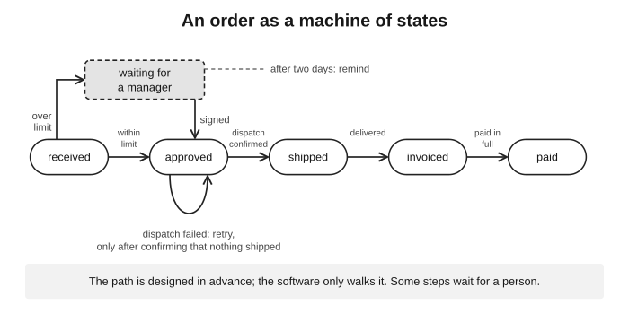

<!-- AI-assisted: restored from Sam's earlier draft and new recollections; Sam's own lines kept wherever they survived; awaiting Sam's pass -->

INTERLUDE 6

# Systems in Concert

*Applications and the Work Machines Do*

*APPLICATION*

The summer after my commencement, I worked for a small computer company in Los Angeles. We assembled personal computers, sold them through a couple of storefronts, and advised the customers who came in, mostly small businesses and a few home users, on what to buy and how to connect it. I even traveled to an industry seminar in Dallas to help promote the company's products. It was the least glamorous part of the computing industry, and probably the most honest: machines that had to work, for people who couldn't afford for them not to.

Part of the routine, for every new machine, was formatting its hard drive: preparing it to receive data and making any existing files inaccessible. One afternoon, a senior coworker was doing exactly that, as he'd done hundreds of times, on a machine he believed was new. In the middle of the day, from my bench nearby, I heard him swear, loudly, and saw him lunge for the plug. The drive he'd just begun to format wasn't new. It belonged to a customer, a small-business owner, and it held his business.

For the next several days, the owner came in every day to ask how the recovery was going. He was a polite, well-groomed man, and he never raised his voice, but I could hear the pain in it every time. "I had my entire business on this computer," he said. It hadn't been backed up anywhere. The damage had been done by a single line typed at a DOS prompt, the FORMAT command. My boss took on the recovery himself, spending days with tools of the Norton Utilities kind that promised to unerase and even unformat, trying to piece the business back together. It wasn't in his calendar, but neither was losing a customer's business. It also freed my coworker to serve the other customers. The recovery had very limited success. I felt bad every time the man walked in.

The strain spread through the little company the way failures spread through tightly coupled systems. A few days later, the owner of our company snapped at me over something small. I said nothing, finished my work, went home, and came in the next morning with a two-week notice, explaining that my university work had become too much. He read it, and was quiet for a moment. Then he said he knew why I was leaving, and that he understood. The pressure was his, he said; the accident fell on him. He could fire the man who'd made the mistake, but that wouldn't solve the problem, and that man had been with him since the company began, and had a family to support. We worked our last two weeks together quietly, and before the summer ended, I was gone.

One routine command, typed into the wrong machine, had erased a business. No villain, no catastrophe, just an ordinary procedure applied to the wrong object. I didn't have the vocabulary for it then, but I had just watched every lesson of the last chapter play out on a single disk: a system robust to everything it had been designed for, and defenseless against one small, unanticipated slip; a business that had trusted its life to a spinning platter; and an owner who took responsibility rather than sacrifice the person at the keyboard. A few months later, in the Bay Area, I would find myself writing the software that prepares those platters in the first place.

## Debt, of Biblical Proportions

By the time I left Los Angeles, my credit card had paid for my last tuition installments and a fair share of my expenses, and its balance was compounding with an enthusiasm I could only envy. So it seems cosmically fitting that, while my debt was quietly maturing, a programmer named Ward Cunningham gave my new profession a name for its own version of the same affliction: technical debt.[^v1-i6-debt] An early version can buy time to learn; the debt comes when the code still embodies an understanding you've outgrown. Refactoring pays it down. Leave it there, and every later change pays interest in workarounds. There was a warning in it, the engineering equivalent of: "Kid, if you keep borrowing trouble, one day it'll collect." But the phrase eventually metastasized. Managers treated it like a credit card; developers treated it like astrology. A civilization of code began quietly mortgaging its future to meet the next deadline.

I didn't hear of it for years. But I was driving north to join an industry that ran on that loan, and I'd just watched a small business learn what a debt to the future costs when it comes due all at once: a system with no backup, built on the assumption that nothing would go wrong, until one keystroke called in the whole balance.

Up north, I was soon pounding the pavement, half philosopher, half assembly-language janitor, trying to find a system that would have me. I couldn't tell whether the bugs were in the code or in the species that wrote it.

## An Application with Its Casing Off

The servo-writer I worked on with Sage was not, by any ordinary definition, an app. It was a machine on a workbench. But it was an application in the oldest and broadest sense: an arrangement of parts put to work for a purpose that none of them could achieve alone. And unlike most applications, which hide everything inside a box of software, it had its casing off. You could see every component doing its job.

Its job came before the formatting that had gone so wrong in Los Angeles: giving a hard drive its bearings. A blank magnetic surface carries no track addresses for the head to follow. In a common arrangement, position information is written onto the data surfaces: thin wedges of position information, spaced around the disk like the spokes of a wheel, containing timing marks, track numbers and carefully offset magnetic bursts. As the head flies over them, the strength of the bursts tells it exactly how far it has drifted from the center of its track. Every read and write the drive ever makes afterward depends on those wedges being placed precisely right.[^v1-i6-servo]

Writing them takes several parts working in concert. The general mechanism is worth opening up; the precise fixtures varied. The drive's own heads, sealed inside it, do the writing, but they can't yet position themselves, because the pattern that would guide them doesn't exist. So a pin reaches in through a small opening and pushes the head arm from outside, one minute step at a time. A laser interferometer measures where the arm actually is by counting the bright and dark fringes made when two beams of laser light interfere: each cycle registers a known fraction of a wavelength in displacement, so counting and subdividing the fringes can resolve movement far smaller than a micron. A separate clock head lays down a timing track, so every wedge lands at exactly the right moment in the disk's rotation. Software coordinates the whole performance: reading the position, commanding the movement, checking that it has settled, and triggering the writing, track after track, until the disk knows its own geography. I worked on that coordinating program, in a proprietary language whose name has escaped me. The part that hasn't is the trick: the drive's own head wrote the tracks it would later need to follow.

That's an application, laid bare. A purpose (give the drive a map of itself). A set of components, each with a narrow skill: a laser that only measures, a pin that only pushes, a head that only writes, a clock that only keeps time. And a coordinating procedure that turns their separate skills into a single piece of work. Strip away the hardware, and you have exactly what every software application is: components with narrow skills, coordinated by a procedure toward a purpose. In software, the components are routines and libraries, the coordination is code, and all of it is invisible. The servo-writer just let me watch it happen with my eyes.

It also showed me the application's oldest risk. Every component had to be right, every time, or the whole performance failed. That was the unease I described in the last chapter, and it's the unease every application carries. The question the rest of this interlude asks is how software learned to live with it.

## From Machines to Programs

In 1979, VisiCalc gave the Apple II a reason to sit on a small-business owner's desk. Change one number, and every dependent figure recalculated itself.[^v1-i6-visicalc] It became the classic *killer app*: software so useful that people bought the hardware to run it.

The spreadsheet is the purest example of what an application does. It takes a procedure that used to live in a person's head and hands (add these, carry that, recompute everything if one number changes) and freezes it into a structure anyone can reuse. Every application since, from word processors to accounting packages to the database programs that ran the small businesses I'd served in Los Angeles, has made the same move: it captures a piece of work, so that the work no longer depends on any one worker. <!-- AI draft, 2026-11-14. -->It is Chapter 6's move, the procedure leaving the head and running in the world, made once more in software.<!-- End AI draft 2026-11-14. --> That's why a business could keep its entire life on a single disk. And why one keystroke could erase it.

<!-- AI draft, 2026-11-17. -->
### The Loop That Waits

Under the menus, nearly every interactive application is the same small machine: a loop that waits. It sits idle until something happens (a key pressed, a mouse clicked, a packet arrived, a timer run out), hands that event to the routine written for it, lets the routine change the application's *state*, its record of everything that matters right now, redraws the screen to match, and goes back to waiting. A word processor, a game and an accounting package differ in their routines and their state, not in this heartbeat. In the familiar desktop version, the person at the keyboard chooses the task, though timers and other programs can trigger actions too. The application offers what's possible and carries out what was chosen. Hold on to that division of labor; Interlude 20 will meet the same loop with something else doing the deciding.

The spreadsheet runs a mechanism of its own inside the loop. Each formula names the cells it depends on, so the sheet is secretly a graph, with arrows from every cell to the cells that use it. Change one number, and the application follows the arrows outward, finds every cell downstream and recomputes them in an order in which nothing is calculated before the things it depends on. Ask a cell to depend on itself, and the spreadsheet normally warns of a circular reference; deliberate loops need an iterative calculation mode with a stopping rule.[^v1-i6-recalculation] A procedure that once lived in an accountant's head and hands now lives in a graph that recomputes itself.

### A Ledger That Can't Half-Happen

What a business actually lives in is its data, and applications guard it with a promise borrowed from bookkeeping: a change happens completely or not at all. Moving money from one account to another takes two writes, a debit and a credit, and a crash between them would create or destroy money. So databases wrap such changes in a *transaction*. With write-ahead logging, the record of a change must reach durable storage before the corresponding changed data page does. A commit record marks the transaction's success. After a crash, recovery uses the log to restore committed work not yet reflected in the data files and undo or exclude unfinished work. The ledger may be physically half-written when the power goes out; recovery keeps that half-change from becoming its settled account.[^v1-i6-wal]

None of that would have saved the business at my bench. A transaction protects data from a crash in the middle of a change. It can't protect it from a complete, correct, perfectly logged command applied to the wrong disk. FORMAT did exactly what it was told. Checking the target and restricting destructive commands can prevent the mistake. Once it has happened, a copy kept where the instruction can't reach may be the only way back, and that man's business had none. Serious systems keep several, including copies isolated from the same failure, and test whether they can actually restore them.[^v1-i6-backup]

<!-- AI-assisted integration, 2026-11-17; author-approved recovery. -->
I had already spent graveyard shifts in the server rooms at USC, monitoring CPU loads and feeding magnetic tapes into backup drives. The room felt like a high-tech wine cellar: over-refrigerated, with cabinets demanding a specific vintage of respect. DEC VAX machines stood among the Unix boxes. Backups had been part of my night's work. In that shop, I saw the business that could vanish when they weren't part of anyone's.
<!-- End AI-assisted integration 2026-11-17. -->
<!-- End AI draft 2026-11-17. -->

## Small Tools, Loosely Joined

There's another way to build applications, and it was the way of the Unix machines I worked on at school. In the 1970s, the programmers at Bell Labs who built Unix settled on a philosophy that Doug McIlroy summed up as: write programs that do one thing and do it well, and write them to work together.[^v1-i6-unix] Instead of one large application for every task, Unix offered dozens of small tools (one to search text, one to sort it, one to count it) and a way to connect them, called a pipe, so that the output of one became the input of the next. Complex work emerged from simple pieces joined loosely, which is the robust-yet-flexible structure the last chapter praised, written in software.

Even the smallest tools had personalities, and their users had loyalties. The great divide of my student years was between two text editors. Emacs could be customized endlessly through its own built-in dialect of Lisp, until it was less an editor than a way of life. Vi was terse, fast and modal: one mode for typing text, another for issuing commands, so that newcomers often found themselves trapped, unable even to work out how to quit. The rivalry between their partisans was known, without much exaggeration, as the editor wars. I was a vi man. It suited someone who preferred a few sharp tools to one that could do everything, and it meant I never had to admit how long it took me, the first time, to get out.

### Worse Is Better

The editor wars were a skirmish in a larger argument. In 1989, the computer scientist Richard Gabriel, himself a Lisp expert, wrote an essay asking why Unix and its C language, which he considered crude, kept beating the beautifully designed Lisp systems he loved. His answer was a phrase that stuck: worse is better. The provocation was about which compromises let a system survive and improve, not a license to ship arbitrary wrong answers.[^v1-i6-gabriel] The elegant approach insisted on getting everything right (correct, consistent, complete) before shipping, and so it shipped late, if at all. The Unix approach favored simplicity of implementation over perfection: it did most things reasonably well, shipped early, ran almost everywhere, and spread like a virus. Once it had spread, its users improved it, and the imperfect system that existed beat the perfect one that didn't.

I had learned that lesson at Patrick's expense, two days into debugging my elegant deadlock: elegance is no good if it introduces complexity, and copying the code three times would have been fine. Gabriel's essay is the same lesson at the scale of an industry. It's also a close cousin of the last chapter's robust-yet-fragile systems, seen from the other side: a simple, imperfect application that's easy to understand and easy to fix often survives longer than a perfect one that's brittle in ways no one can see.

## Contracts Between Strangers

Small tools only work together if they agree on how to talk. In software, that agreement is called an interface, and when one program offers its services to others, it publishes an application programming interface, or API: a contract that says, in effect, *ask me in exactly this form, and I promise to answer in exactly that form*. Neither side needs to know how the other works inside. An API is the software version of the standard screw thread in the last chapter: an agreement that lets strangers' work fit together without the strangers ever meeting.

Every working engineer eventually learns to fear three kinds of system, and all three are about those contracts. The first is the system you inherit, written by people who have long since moved on, often in the belief that comments were a form of weakness; opening it is less engineering than archaeology. The second is the system you build, where every shortcut and every "temporary" fix is a time-delayed confession. The third is the system you integrate with, someone else's software, whose API promises compatibility and whose behavior suggests otherwise. Engineers spend a surprising share of their lives as diplomats, negotiating treaties between programs that were never designed to meet.

## The Enterprise Machine

Meanwhile, the largest applications of all were growing up. In the same year I left Los Angeles, the German company SAP released R/3, a version of its enterprise software designed for the networks of personal computers and servers spreading through offices, and over the following years it and its rivals swept through the world's corporations.[^v1-i6-sap] These systems, known as enterprise resource planning, tried to capture an entire company's work in one application: purchasing, inventory, manufacturing, accounting, payroll and sales, all sharing one database and one set of rules.

That ambition had a strange consequence. To install such a system, a company had to describe how it actually worked, precisely enough for software to follow, and often discovered that nobody knew. Then, once the rules were written into the software, they became very hard to change. The application didn't just record how the business worked; it began to dictate it. The tacit knowledge of the pencil, scattered across thousands of hands, was being forced into explicit rules, with all the gains and losses that implies. An enterprise application is a company's procedures, frozen. It's the most valuable kind of software there is, and the most stubborn.

<!-- AI draft, 2026-11-17. -->Inside such a system, a business process becomes a machine of states. An order is *received*, then *approved*, *shipped*, *invoiced* and *paid*, and between each pair of states the software defines which transitions are allowed and what triggers them: a warehouse scan, a delivery, a payment, a deadline passing. Some transitions wait for a person. An order over a set amount stops until a manager signs; a large refund waits for a second pair of eyes. Timers chase whatever stalls, and failed steps are retried with care, because shipping an order twice isn't like checking its status twice. The path is designed in advance, and the software only walks it. Engineers call such a thing a *workflow*, and Interlude 20 will set it beside a newer kind of software that chooses its own path.[^v1-i6-workflow]

A database can roll back a transaction; it cannot unship a parcel. Work that has crossed into the world needs a compensating action, a return or a refund, and sometimes a loss that no later step can erase. If a carrier times out, the parcel may already be on its way. Check what happened before trying again, or give repeated requests the same identity so they cannot create a second shipment.[^v1-i6-compensation]

{#fig-v1-i6-workflow width=95% fig-alt="Five rounded boxes in a row: received, approved, shipped, invoiced, paid, joined by arrows labeled within limit, dispatch confirmed, delivered and paid in full. From received, an arrow labeled over limit leads up to a dashed box, waiting for a manager, which leads down to approved when signed; a dashed line notes a reminder after two days. A loop under approved is labeled dispatch failed: retry, only after confirming that nothing shipped."}
<!-- End AI draft 2026-11-17. -->

### Conway's Law

The enterprise machine also revealed something about the companies that built it. In 1968, a programmer named Melvin Conway observed that organizations which design systems are constrained to produce designs that copy their own communication structures.[^v1-i6-conway] If four teams build a compiler, the joke goes, you get a four-pass compiler. Software splits along the seams where people stop talking to each other: the modules match the departments, and the interfaces between modules match the meetings between teams. Fred Brooks named the observation Conway's law, and researchers studying real software projects have since found strong evidence for it.

Read the other way, it's a diagnostic. The shape of an application is an X-ray of the organization that made it: its silos, its alliances, its gaps. A clumsy interface between two parts of a program can mark two groups who rarely communicated; it doesn't, by itself, tell us why. That makes software one of the most honest documents a company produces. It also explains why reorganizing a company so often means rewriting its software, and why software that has hardened into place can keep an outdated organization frozen long after everyone wants to change it. Industry and its applications mirror each other, in both directions.

## A Commons in the Open

Technical debt is the software form of the lock-in Sage described in the last chapter: past decisions, once embedded, accumulating interest. But the same years produced an answer of a very different kind.

Around the time I arrived in the Valley, a Finnish student named Linus Torvalds tossed his hobby project to the world, an operating system kernel called Linux, under a license that let anyone use, change and share it, with source-sharing obligations when they distributed modified versions.[^v1-i6-linux] Stitched into the GNU fabric, it grew into a complete system with many contributors and copyright holders. While corporations were consolidating their software into enterprise machines, a commons was being built in the open. It had maintainers with real authority, a license with legal teeth, and reputation and shared norms doing work that a contract alone couldn't. The kind of commons Elinor Ostrom would have recognized had rules, not an exemption from them. Hierarchy and heterarchy, contracts and trust, in different proportions. Uptime versus uptime-ish, depending on who was minding it. Both right. Both wrong. Both human.

<!-- AI draft, 2026-11-17. -->
## Rules Before Learning

Before applications learned, they were taught rules, and for a while that looked like the road to artificial intelligence itself. An *expert system* kept two things apart. One was a knowledge base of if-then rules, written down with the help of human experts: *if* these laboratory findings and patient characteristics hold, *then* give this candidate organism a certain degree of support. The other was an inference engine that chained them. It could work forward from known facts to conclusions, or backward from a question to the evidence needed to answer it. MYCIN mainly worked backward; in a blinded evaluation of ten meningitis cases, experts rated its antibiotic recommendations at least as highly as those of the specialists compared with it. That was a test of recommendations, not proof of better patient outcomes. Another, at a large computer maker, took customers' orders and worked out which of thousands of components each configuration needed and how they fit together, a job that had tied up teams of technicians; by the mid-1980s it was handling most of the company's orders and saving it tens of millions of dollars a year.[^v1-i6-expert]

Then the limits of hand-written rules became expensive. The systems were superb inside the cases their rules anticipated and helpless a step outside them, Chapter 6's robust-yet-fragile pattern in its purest form. Worse, the rules had to come from experts, and experts turned out to be unable to say most of what they knew. Chapter 6's tacit knowledge, *we can know more than we can tell*, became the bottleneck of an entire field. Every new rule interacted with hundreds of old ones, and maintaining the knowledge bases became an industry of its own, then a cemetery for many of its vendors. The useful rules survived them. When the market for these systems collapsed at the end of the 1980s, it helped bring on the long winter I walked into at USC, in Interlude 5.

The same era left a second idea that outlived the winter: *planning*. Interlude 1's monkey, moving a box under the bananas, became a formal problem. Describe the world as a set of facts. Describe each action by what must already be true for it to work, its preconditions, and by what it makes true or false, its effects. Then search for a sequence of actions that turns the starting facts into the goal. A wheeled robot named Shakey, built in the late 1960s, planned its way between rooms like this, pushing boxes and checking after each move whether the world still matched its plan, slowly by today's standards, but on its own. One search method developed in that project, called A*, is Interlude 5's shortest-path algorithm given a sense of direction, and it still finds routes in maps and games.[^v1-i6-shakey] Shakey was an agent without language: a goal, a model of its own actions and a loop that looked at the world after every step. Those pieces will return, in very different clothing, in Interlude 20.
<!-- End AI draft 2026-11-17. -->

## Applications That Learn

For most of their history, applications were frozen procedures: a programmer decided the rules, and the software followed them until someone shipped an update. Then, quietly, applications began to contain parts that learn. Email programs learned to filter spam by studying which messages people marked as junk. Online stores learned to recommend books by noticing which ones were bought together. Banks' software learned to flag unusual transactions as possible fraud. Search engines learned to rank pages, phones learned to predict the next word, and photo applications learned to recognize faces.[^v1-i6-learning]

<!-- AI draft, 2026-11-17. -->Take an early Bayesian spam filter, a learned component many people trained without knowing it. It keeps, for every word it has seen, two tallies: how often the word turned up in mail people kept, and how often in mail they marked as junk. When a new message arrives, the filter combines what its words suggest (*free* and *winner* pushing one way, a colleague's name and *agenda* the other) into the odds that the message is spam.[^v1-i6-spam] A click on *junk* can update the tallies, so the application's users are its trainers. Its opponents read the same scoreboard. Spammers learned to misspell their words, hide them in images and pad their messages with innocent text, and the filter had to keep learning just to stand still. A learned component lives in a world that changes partly because it's there.

The filter also shows a pattern underneath many learned applications. The learned part produces a *score*, not a decision. The application turns the score into action with thresholds, and where they go is a judgment about costs: a missed spam is a nuisance, but a client's email buried in the junk folder can cost a contract. So the application rarely deletes; it files the doubtful cases where a person will see them. A bank can arrange its fraud checks the same way. Above one threshold, a transaction is blocked; below another, it goes through; in the band between, it waits for an analyst, or for a text message to the cardholder. Review brings another source of evidence, not a guarantee that the person will be right. It's Chapter 6's andon cord, built into software, and the ancestor of every point at which a later, more capable system will stop and ask.

{#fig-v1-i6-thresholds width=95% fig-alt="A score axis from 0 to 1 with two overlapping humps: a taller one for legitimate transactions at low scores and a smaller one for fraud at high scores. Two dashed thresholds divide the axis into three bands labeled let it through, ask a person and block. A note in the middle band reads review band: an additional check. The curves are schematic score distributions, not measured fraud prevalence."}
<!-- End AI draft 2026-11-17. -->

In each case, the application kept its old shape (menus, buttons, files, rules) while a learned component sat inside it, making judgments no programmer had written down: the Software 2.0 of Interlude 4, living inside a Software 1.0 shell. And in the last few years, the learned part has moved to the front. Word processors now draft; spreadsheets now explain their own formulas; programming tools write code alongside the programmer. The application is no longer only a procedure you operate. Increasingly, it's a collaborator you consult.

That changes what an application captures. The spreadsheet froze a procedure. A learned application freezes something closer to experience, the patterns in millions of past examples, and like any experience, it can be wrong in ways its makers never anticipated. It inherits the robust-yet-fragile character of the last chapter in a new form: often strongest on the conditions represented in its training, and vulnerable when those conditions change. Even familiar-looking cases can fool it. That's the layer Interlude 11 will build on.

## Bob, Through the Looking-Glass: From Frozen Labor to Liquid Labor

<!-- AI draft, 2026-11-17: Bob revised from Codex review and Sam approval; earlier Bob in interlude-6-before-2026-11-17.md. -->
*The twist, in one line: an application is work frozen into a procedure; an agent is work that thaws, given a goal instead of a recipe; and when the steps of work can reorganize themselves, its promises have to live somewhere the reorganizing can't reach.*

Marx’s "dead labor" lives in machinery: the work of past hands, congealed into a mechanism that keeps working long after its makers have gone home.[^v1-i6-marx] An application is dead labor of exactly that kind. The accountants who first worked out how a ledger should be kept, the engineers who designed a format command, the programmers who wrote my servo-writer's routines: their labor sits frozen inside the software, executed again every time someone runs it. That's what makes applications so powerful, and so brittle. A fixed check can catch only what it was built to recognize. On a hard disk, FORMAT typically asked first whether you really meant to erase everything on it, and a man who believed the machine was new would answer yes. A confirmation can catch a slip of the hand. It may only confirm a mistaken belief.

An agent is something stranger. Built on large AI models, an agent can be handed a goal rather than every step (book the travel, fix the bug, reconcile these accounts) and works out its own steps, calling applications as tools along the way. It's neither the dead labor of an application nor the living labor of a person. Call it liquid labor: work that takes the shape of whatever task it's poured into. Chapter 6 ended on work as the last of this book's emergences. Agents suggest that work itself may be about to emerge again, one floor up, in silicon. <!-- AI draft, 2026-11-17. -->Interlude 20 will take one apart; this interlude has already laid out most of what it's made of: the loop, the ledger, the workflow, the planner and the threshold at which a person is asked.<!-- End AI draft 2026-11-17. -->

Everything this pair of chapters has learned applies to it, often more sharply. An agent can create tight coupling when later actions depend immediately on earlier ones, with little slack to interrupt or recover: an error early in the chain can race through every later step before anyone notices, a reformat performed by a worker who never sleeps. It carries technical debt of an unusual kind, decisions embedded in weights that no one can easily read or repay. And it raises the question my old boss answered, standing in a small store in Los Angeles: when the work goes wrong, do you sacrifice the hand at the keyboard, or take responsibility for what has happened? Then comes the question his recovery work couldn't settle by itself: how do you keep the next business from being erased?

Liquid labor sharpens that question into a stranger one. If the steps of work can reorganize themselves, task by task, where do its obligations live? In much frozen software they were buried in the procedure, though databases and operating systems already enforced some rules outside it. Once the procedure becomes fluid, the promises can't ride along inside it, any more than a contract can be written on water. They have to live somewhere the reorganizing can't reach.

<!-- AI draft, 2026-11-17: author-approved Carroll connection. -->
Humpty Dumpty makes words mean whatever he chooses, then explains that the question is who gets to be master.[^v1-i6-carroll] A promise that can change its meaning whenever convenient is Humpty Dumpty with an API.
<!-- End AI draft 2026-11-17. -->

This interlude has already built a few such places, almost without noticing. The ledger that can't be left half-written holds a promise about money, whatever sequence of steps produced the change. The workflow's gate holds a promise about authority: no order over the limit moves without a signature, however it got there. The threshold holds a promise about doubt: cases in the review band must receive another check. And a contract between programs, which can't guarantee good behavior, makes specified behavior checkable, though checking an output's shape is easier than checking its truth or consequences. These are the parts of software designed not to thaw.

My conjecture is that adaptive work will need exactly this division: freeze the promises, thaw the procedure. Let the steps reorganize as freely as the task demands, but fix, outside them, what must stay true, who must agree and what must never happen twice. Toyota's andon cord belongs here, as a promise any worker can invoke rather than a step any procedure must include. So does a just culture, which investigates how an obligation was missing, defeated or impossible to meet before passing a verdict on the hand that slipped. What I can't yet say is how much can be frozen before the liquid stops being liquid, or who should hold the freezer. Chapter 6's Alice watched organized success harden into a cage. The question here runs the other way: how work can escape its fixed procedures without dissolving the accountability those procedures used to carry.<!-- End AI draft 2026-11-17. -->

Liquid labor will need channels. The next interlude follows one of the largest channels ever built, the web, where applications learned to sell.

> ***Maggie:** A business lived on a single disk.*
>
> ***Alex:** And the disk lived on a pattern someone wrote.*
>
> ***Maggie:** We freeze our work so others can use it.*
>
> ***Alex:** And now the frozen work has started to thaw.*
>
> ***Both:** Every tool is a debt owed to the hands that made it.*

<!-- SOURCE NOTES: from memory unless linked; verify each before print. -->
<!-- Source alignment reviewed 2026-11-17; evidence scope and remaining edition-level checks are recorded in work/volume-1-drafting/pair-06-fable-adoption-2026-11-17/SOURCE_AUDIT.md. Earlier source-note comments are retained as provenance. -->

[^v1-i6-debt]: Ward Cunningham, ["The WyCash Portfolio Management System"](https://c2.com/doc/oopsla92.html), OOPSLA ’92 experience report (1992). Shipping early can buy learning; debt accumulates when the implementation fails to incorporate the improved understanding. Refactoring repays it.

[^v1-i6-servo]: For a contemporary example of laser-interferometer servo positioning and clock-track writing, see [U.S. Patent 4,920,442](https://patents.google.com/patent/US4920442A/en) (1990). Abdullah Al Mamun, GuoXiao Guo and Chao Bi, *Hard Disk Drive: Mechatronics and Control* (2007), provides the wider control context. The chapter describes a representative external servo-writer arrangement, not a recovered specification of the author’s particular fixture; equipment and proprietary language remain unidentified.

[^v1-i6-visicalc]: Dan Bricklin’s [first-person development history](https://www.bricklin.com/history/saiproduct1_m.htm) records VisiCalc for the Apple II shipping in October 1979. The claim here concerns a decisive personal-computer application, not the invention of all software or all electronic tabulation.

[^v1-i6-recalculation]: Microsoft’s [Excel recalculation documentation](https://learn.microsoft.com/office/client-developer/excel/excel-recalculation) explains dependency trees and calculation chains. [Iteration settings](https://support.microsoft.com/en-us/excel/change-formula-recalculation-iteration-or-precision-in-excel) permit some circular references to be solved by repeated calculation; convergence depends on the formulas and settings.

[^v1-i6-wal]: C. Mohan et al., ["ARIES: A Transaction Recovery Method Supporting Fine-Granularity Locking and Partial Rollbacks Using Write-Ahead Logging"](https://www.cs.cmu.edu/~15849g/readings/mohan92.pdf), *ACM Transactions on Database Systems* 17(1) (1992): 94–162; Jim Gray and Andreas Reuter, *Transaction Processing: Concepts and Techniques* (1993). For a concise implementation account, see [PostgreSQL’s WAL introduction](https://www.postgresql.org/docs/current/wal-intro.html). Relevant log records reach durable storage before the associated data-page changes; commit and recovery make transaction guarantees visible despite partial physical writes. Logging is not an independent backup.

[^v1-i6-backup]: Paul Ruggiero and Matthew A. Heckathorn, [*Data Backup Options*](https://www.cisa.gov/sites/default/files/publications/data_backup_options.pdf), US-CERT (2012), describes the 3-2-1 rule: three copies, two media types, one off-site. Independent access and tested restoration matter as well as the count. Backups address recovery; validation, permissions and confirmation can also prevent some destructive mistakes.

[^v1-i6-unix]: M. D. McIlroy, E. N. Pinson and B. A. Tague, "UNIX Time-Sharing System: Foreword" (1978), *Bell System Technical Journal* 57(6): 1899–1904. Pipes were added to Unix in 1973 at McIlroy's urging. [Original publication](https://onlinelibrary.wiley.com/doi/10.1002/j.1538-7305.1978.tb02135.x).

[^v1-i6-gabriel]: Richard P. Gabriel, ["The Rise of Worse Is Better"](https://dreamsongs.com/WorseIsBetter.html), originally part of "Lisp: Good News, Bad News, How to Win Big." Gabriel’s retrospective dates the talk to spring 1989. His comparison concerns tradeoffs among implementation simplicity, correctness, consistency and completeness—not indiscriminate tolerance of bugs.

[^v1-i6-sap]: SAP’s [company history, 1991–2000](https://www.sap.com/about/company/history/1991-2000.html), records the 1992 release of R/3 and its client-server architecture.

[^v1-i6-workflow]: David Hollingsworth, [*The Workflow Reference Model*](https://wfmc.org/wp-content/uploads/2022/09/tc003v11.pdf), Workflow Management Coalition, TC00-1003, issue 1.1 (19 January 1995). The schematic is an illustrative business workflow, not a BPMN specification. The retry rule depends on a known failed effect or a duplicate-safe operation; a timeout alone does not prove failure.

<!-- AI draft footnotes, 2026-11-17; from memory, to be verified. -->

[^v1-i6-compensation]: Hector Garcia-Molina and Kenneth Salem, ["Sagas"](https://www.cs.princeton.edu/techreports/1987/070.pdf) (1987), on breaking long-lived transactions into steps with compensating transactions. Compensation makes an appropriate subsequent change; it does not erase an external physical event. A parcel’s return is not the same event as never dispatching it.

[^v1-i6-conway]: Melvin E. Conway, ["How Do Committees Invent?"](https://melconway.com/Home/Committees_Paper.html), *Datamation* 14(4) (1968): 28–31; Alan MacCormack, Carliss Baldwin and John Rusnak, ["Exploring the duality between product and organizational architectures"](https://doi.org/10.1016/j.respol.2012.04.011), *Research Policy* 41(8) (2012): 1309–1324. The mirroring hypothesis concerns organizational and technical structure; it does not by itself reveal whether two departments trust each other.

[^v1-i6-linux]: Linus Torvalds announced Linux in August 1991 and released it under the GNU General Public License in 1992. The GNU project was launched by Richard Stallman in 1983. The [GNU GPL FAQ](https://www.gnu.org/licenses/gpl-faq.html#GPLRequireSourcePostedPublic) explains that the source-sharing obligations concern conveying covered software, not an obligation to publish every private modification. The kernel archive preserves the [0.12 release notes](https://www.kernel.org/pub/linux/kernel/Historic/old-versions/RELNOTES-0.12), including the proposed shift to GNU copyleft effective that February; the earlier 1991 license was different.

[^v1-i6-expert]: Edward H. Shortliffe, *Computer-Based Medical Consultations: MYCIN* (1976); Bruce G. Buchanan and Edward H. Shortliffe, [*Rule-Based Expert Systems*, chapter 1](https://shortliffe.net/Buchanan-Shortliffe-1984/Chapter-01.pdf) (1984). Victor L. Yu et al., ["Antimicrobial Selection by a Computer: A Blinded Evaluation by Infectious Diseases Experts"](https://doi.org/10.1001/jama.1979.03300120033020), *JAMA* 242(12) (1979): 1279–1282, evaluated recommendations for ten meningitis cases, not outcomes in a clinical deployment. The rule in the text is a toy example, not prescribing advice or a verbatim MYCIN rule. John McDermott, ["R1: A Rule-Based Configurer of Computer Systems"](https://web.cs.wpi.edu/Research/aidg/CS540/papers/McDermott-R1-XCON.pdf), *Artificial Intelligence* 19 (1982): 39–88; Virginia E. Barker and Dennis E. O’Connor, "Expert Systems for Configuration at Digital: XCON and Beyond," *Communications of the ACM* 32(3) (1989): 298–318. Savings are contemporary estimates, not audited causal estimates. The commercial contraction did not make rule-based systems disappear.

[^v1-i6-shakey]: Nils J. Nilsson, ed., [*Shakey the Robot*](https://www.sri.com/wp-content/uploads/2021/12/629.pdf), SRI Technical Note 323 (1984); Richard E. Fikes and Nils J. Nilsson, "STRIPS: A New Approach to the Application of Theorem Proving to Problem Solving," *Artificial Intelligence* 2 (1971): 189–208; Peter E. Hart, Nils J. Nilsson and Bertram Raphael, "A Formal Basis for the Heuristic Determination of Minimum Cost Paths," *IEEE Transactions on Systems Science and Cybernetics* 4(2) (1968): 100–107. A* uses accumulated path cost plus an estimate of what remains. Shortest-path guarantees require suitable costs, an admissible heuristic and correct handling of revisited states; STRIPS is a planning formalism, not another name for A*.

[^v1-i6-learning]: Mehran Sahami et al., ["A Bayesian Approach to Filtering Junk E-Mail"](https://cdn.aaai.org/Workshops/1998/WS-98-05/WS98-05-009.pdf) (1998); Greg Linden, Brent Smith and Jeremy York, ["Amazon.com Recommendations: Item-to-Item Collaborative Filtering"](https://doi.org/10.1109/MIC.2003.1167344), *IEEE Internet Computing* 7(1) (2003): 76–80. These demonstrate distinct ways of embedding learned statistical structure in applications, not one universal algorithm.
<!-- End AI draft footnotes 2026-11-17. -->

[^v1-i6-spam]: Mehran Sahami et al., ["A Bayesian Approach to Filtering Junk E-Mail"](https://cdn.aaai.org/Workshops/1998/WS-98-05/WS98-05-009.pdf) (1998). Naive Bayes treats the features as conditionally independent given the class; it does not claim that words in ordinary language are unconditionally independent. A classification score need not be a calibrated probability. The review thresholds are policy choices informed by evidence, consequences and review capacity.

[^v1-i6-marx]: Karl Marx, [*Capital*, Volume I, chapter 10](https://www.marxists.org/archive/marx/works/1867-c1/ch10.htm) (1867), calls capital "dead labour." The extension to applications as frozen labor and agents as liquid labor, and the proposal to separate revisable procedures from durable obligations, are the author’s. On tight coupling, Charles Perrow, *Normal Accidents* (1984), chapter 3: consequential dependencies, time pressure and limited slack matter, not merely whether calls are chained.

<!-- Carroll source note, 2026-11-17: checked against the primary text. -->
[^v1-i6-carroll]: Lewis Carroll, [*Through the Looking-Glass, and What Alice Found There*, chapter VI, "Humpty Dumpty"](https://en.wikisource.org/wiki/Through_the_Looking-Glass,_and_What_Alice_Found_There/Chapter_VI).
