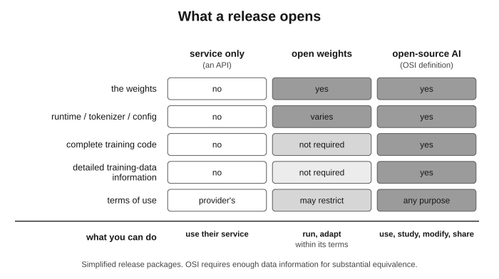

<!-- Canonical adoption, 2026-11-18: approved rung-8 reading copy, personal restorations, local repairs and Alice/Bob. Adoption record: work/volume-1-drafting/pair-08-review-2026-11-18/ADOPTION_NOTES.md. -->

<!-- AI-assisted: restored from Sam's earlier draft and new recollections; Sam's own lines kept wherever they survived; awaiting Sam's pass -->

INTERLUDE 8

# The Borderless Machine

*Frameworks, Open Source and the Constitutions of Code*

*FRAMEWORK*

<!-- Vignette restored 2026-11-18 from Sam's canon wording; later recollections (the PATH, the Bay Street stack, the after-hours meeting) woven in. -->
<!-- Recovery from pre-Fable canon, 2026-11-18; author requested restoration. -->
Toronto had a way of reminding me that capitalism doesn't sleep --- it simply changes outfits. By day I wrote code for trading systems: software that moved money so quickly it often outran ethics, pausing only long enough to adjust its tie. By night I lived across University Avenue, where traders loosened those same ties, ordered pitchers, and recited P&L numbers like slam poetry.

Our little fintech outfit on Bay Street was the sort of place where people checked stock tickers more often than clocks --- partly to gauge the markets, mostly to admire how sharp they looked on the new PalmPilot. We wrote software for people whose job titles sounded like weather alerts: Bond Strategist, Risk Architect, Liquidity Analyst. Their entire worldview was denominated in basis points, which are just percentages wearing tuxedos.

And once a year, in a noble attempt at humanity, we played softball, in the Bay Street league, against the traders and brokers. We were terrible. Heroically terrible. Catastrophically competent at being incompetent. Our company placed last with such majestic consistency that it became a brand identity. Maybe we let our clients win out of courtesy. Maybe we were just better at syntax than swing mechanics. Or maybe, in some cosmic fairness algorithm, the universe refused to let us be good at *both* floating-point precision and outfield positioning.

Someone decided to take "work hard, play hard" literally and dragged me to practice. My only previous baseball experience had ended with me running to first base still holding the bat --- a move widely discouraged by both sportsmanship and criminal law. Two games remained. The first we lost with dignity, scoring a run or two and celebrating them as if we'd invaded Normandy. The second we won --- narrowly, improbably --- and suddenly I was batting a perfect thousand.

The next morning our team captain sent a company-wide email: **"Miracles do happen. We won...and Sam is batting 1.000."**

Had it not been true, it would still be funny. Being true, it was also shocking. I laughed too, though mostly because it was either that or explain that a perfect batting average in a couple of meaningless games felt suspiciously like an allegory: I was crafting perfect code for markets that didn't care and achieving perfect hits in games that didn't matter. It all felt like rehearsal for some other system --- one with arbitrary rules, invisible scorekeepers, and umpires who made the calls long before the ball left the pitcher's hand.
<!-- End recovery, 2026-11-18. -->

It was one of the best groups I've ever worked with. We worked long days and often long nights, and then we worked just as hard at the bars and clubs, with the stamina of people who hadn't yet learned what stamina costs. My jokes made the rounds by email. My boss, who believed I wasn't expressing myself fully in meetings, kept encouraging me to be more confident when I presented. One evening, before a hockey game, a group of us had gathered at a bar near the arena, and I'd had a few drinks after a long day, when she arrived and decided to hold a quick after-hours meeting. I was asked to present something. I laid it all out, from memory, fluently, confidently and without a trace of nerves. She was impressed. The next morning she came to my desk and told me I'd been perfect, and that she wanted me to be just like that in meetings at work. I did not comply.

We built applications for bonds and stock portfolios that ran not only on desktops but on handhelds, PalmPilots and Jornadas, which traders carried like holsters. The stack was Microsoft's from top to bottom: web pages built in Active Server Pages and VBScript, business logic in C++ components, and SQL Server keeping the numbers.

<!-- AI draft, 2026-11-18. Proposal approved by the author for canonical adoption. -->
Downtown Toronto had the PATH, a network of underground passages between the towers. I loved being able to walk through it in winter. A framework you could walk through, if you like; the softball league supplied a less forgiving one.
<!-- End AI draft 2026-11-18. -->

## The Year Code Became Law

The year I crossed into Canada, the frameworks that govern our machines began to be argued about as if they governed us, which they had started to do.

That year, a Harvard law professor named Lawrence Lessig published *Code and Other Laws of Cyberspace*, arguing that in the digital world, "code is law": the architecture of software regulates what people can do as surely as statutes do, and often more effectively, because you can break a law but you can't easily break a program.[^v1-i8-lessig] That same summer, a college student released Napster, and the music industry discovered what decentralization sounds like: millions of strangers sharing songs directly with each other, with no store in the middle and, as the courts would soon decide, rather too little regard for the law of the other kind.[^v1-i8-napster] Also that year, the volunteers behind the Apache web server, which ran more of the web than any other program, incorporated a foundation to govern their project, writing a constitution for a community of programmers who would never all meet.[^v1-i8-apache] And an hour down the highway from Toronto, in Waterloo, Research In Motion released the first BlackBerry device, the beginning of a Canadian platform that would conquer the world's boardrooms and then lose them, for reasons this interlude will come to.[^v1-i8-blackberry]

Code as law, files shared between peers, a constitution for volunteers and a platform about to rise: four kinds of framework, all arriving with me.

<!-- Recovery from pre-Fable canon, 2026-11-18; author requested restoration. -->
Meanwhile, I sat in my cubicle on Bay Street building a fixed-income securities exchange for a Wall Street client --- centralizing markets on the web and handhelds, while kids with dial-up modems were decentralizing music distribution. They didn't file compliance paperwork, they didn't request permission, and they didn't wait for a visa stamp. They just *connected*.

No wonder my softball victory felt hollow --- hollow in that funny, hollow-tree, "let's follow the rabbit" sort of way. The real game wasn't about hitting balls farther. It was about changing who owned the bat. And in the world of markets, that bat was always held by a Mad Hatter. Or worse: a Mad *Hedger*. But does this mean we hand over the bat to the Cheshire Cat instead? Well, at least when she ran away with our retirement savings, she'd leave a smile behind!

And sitting there with a stack of business requirements thick enough to stun a moose, I found myself staring at my own code and quietly asking a question that would ring far beyond Bay Street: **If borders can fall on the Internet, what happens to the borders that built the rest of our world?**
<!-- End recovery, 2026-11-18. -->

## What a Framework Is

In everyday language, a framework is a structure that holds something up and gives it shape: the frame of a house, the framework of an argument. In software, the word has a precise and slightly surprising meaning.

Most code reuses other code through libraries: collections of ready-made functions you call when you need them, the way you might call a plumber. You're in charge; the library waits to be asked. A framework reverses that relationship. It provides the overall structure of a program (how it starts, how it handles requests, how it stores data, how it draws its screens), and your code fills in the blanks, waiting to be called. Programmers call this inversion of control, or, more memorably, the Hollywood principle: don't call us, we'll call you.[^v1-i8-ioc] With a library, you write the program and borrow pieces. With a framework, the program is already written, in outline, and you're writing the parts it left for you.

That makes a framework a kind of constitution for code. It decides the structure of power: what runs when, what may talk to what, where data must live and which decisions are left to you. And like constitutions, frameworks embody a theory. One of the oldest and most influential, a design pattern called model-view-controller, devised in the late 1970s at Xerox's research center, divides a program into three parts: the model, which holds the data and the rules; the view, which shows it; and the controller, which handles the user's actions.[^v1-i8-mvc] It's a separation of concerns that resembles Montesquieu's separation of powers: when one part can do everything, every change becomes dangerous. The resemblance has a limit. A design boundary does not enforce permissions by itself.

The web gave frameworks their great era. The Microsoft stack I worked in on Bay Street was a framework writ large, an entire ecosystem in which the operating system, the web server, the programming languages and the database were designed to fit together, provided you lived entirely inside it. Java's enterprise frameworks dominated the banks and insurers on the other side of the industry. Later came frameworks with philosophies of their own: Ruby on Rails, whose creator championed "convention over configuration" (if you follow the framework's conventions, you hardly need to configure anything), and the interface library React, which Facebook released in 2013 and which other frameworks build around.[^v1-i8-frameworks] Each encoded a theory of how software should be organized, much as constitutions encode a theory of how power should be.

And, like a nation's constitution, a framework shapes the people who live inside it. Programmers who learn one framework begin to think in its terms, to see every problem as the kind of problem it was built to solve. I knew the feeling from that hockey night. The same person, with the same knowledge, can perform completely differently depending on the frame around him. Erving Goffman, whom we met in Chapter 5, wrote a whole book about how the unspoken definition of a situation, its frame, governs what people do inside it.[^v1-i8-goffman] My boss had seen what I could do in one frame and wanted it in another. Frameworks, human or software, don't just hold things up. They decide what's possible.


## Platforms: Frameworks with Borders

A platform supplies an environment in which other people can build and operate their software, often using frameworks of its own. It becomes a territory with its own rules, its own gatekeepers and its own citizens. The handhelds I programmed for on Bay Street were early examples. Palm's devices came with their own operating system and tools, and a community of outside developers built thousands of small applications for them. Microsoft's Windows CE ran the Jornadas, with a different set of tools and a different community. BlackBerry, built an hour away in Waterloo, chose a different path: it made a superb device for email, secured to corporate standards, and kept tight control of what ran on it.

For most of a decade, BlackBerry's approach won. By the late 2000s, it dominated corporate phones, and its users were so attached that the device earned the nickname "CrackBerry." Then, in 2007, Apple released the iPhone, and in 2008 opened its App Store, inviting outside developers to build for it and sell through it; Google's Android followed the same year.[^v1-i8-appstore] Within a few years, the stores held hundreds of thousands of applications, built by developers who had chosen those platforms because millions of customers were there, and customers chose the platforms because the applications were there. BlackBerry's share collapsed, and by 2016 it had stopped designing its own phones.[^v1-i8-blackberryfall] A superb email device lost in a contest that had expanded to whole ecosystems. Developers who decide where to build are a platform's constituency too; their choices and users' choices feed each other.

That's also the platform's danger. Whoever owns the framework sets the rules for everyone inside it: what may be sold, what share of each sale the owner takes, which applications are allowed and which are removed overnight. A platform is a nation with a single, unelected government, and its constitution is its terms of service. <!-- AI draft, 2026-11-14. -->It has a border too, with something like the discontinuity Chapter 8 measured between provinces and states: switching costs that make building inside the wall far cheaper than building across it.<!-- End AI draft 2026-11-14. --> Lessig's "code is law" had found its fullest expression, and its citizens, the developers and users inside, have about as much say in its laws as the subjects of Chapter 8's early kingdoms.

<!-- AI draft, 2026-11-18. Proposal approved by the author for canonical adoption. -->
There is a practical border inside the platform too. *Authentication* establishes which identity is making a request; *authorization* decides what that identity may do. A trading service may be allowed to submit an order without being allowed to alter a client's permissions or release every payment. Delegating a task need not mean handing over the whole account. The authority can be scoped to that task, made to expire and revoked independently. Knowing who somebody is has never settled what they should be allowed to do. It does not settle the question for an agent either.[^v1-i8-authority]
<!-- End AI draft 2026-11-18. -->

## Governing the Commons of Code

There's another way to build frameworks: in the open, as a commons. Interlude 6 met Linux, built by volunteers with no central owner. By now, open-source software runs most of the world's servers, phones and cloud computers, and most commercial software contains open-source components inside it. How do communities of strangers govern something so valuable?

The first answer is the license, which works like a constitution for code. In the 1980s, the programmer Richard Stallman wrote the GNU General Public License, with a clever twist he called copyleft: anyone may use, change and share the software, but distributing a covered derivative requires passing on the corresponding source and the same freedoms to its recipients. Private changes need not be published.[^v1-i8-gpl] The commons protects itself by refusing to be enclosed. Permissive licenses, such as the MIT and Apache licenses, take the opposite view: do almost anything you like, including building proprietary products, subject to their notice and other license conditions. The two families embody two theories of the commons, much like the argument between Hardin and Ostrom in Chapter 7: one guards the commons with strict rules; the other trusts that a generous commons will be replenished by those who benefit from it.

The second answer is governance. Some projects are run by a founder who has the final word, a role open-source communities only half-jokingly call "benevolent dictator for life"; Linus Torvalds has held it over Linux for more than three decades, and Guido van Rossum held it over the Python language until he stepped down in 2018, weary of the arguments.[^v1-i8-bdfl] Others are governed by foundations, like Apache, whose communities earn decision-making authority through sustained contribution, a meritocracy with written bylaws. The internet's own standards, as Interlude 5 described, emerge from bodies like the IETF and the W3C through rough consensus and running code. Open source, in other words, has reinvented most of the forms of government Chapter 8 surveyed, from monarchy to republic to something like Nunavut's consensus legislature, in a single generation, and its communities fork when their governance fails, a peaceful secession available to code in a way it rarely is to nations.

## Decentralization as a Framework

Napster had a central index, which is why a court could shut it down. Its successors learned the lesson. BitTorrent, released in 2001, spread both files and the work of sharing them across all its users, while early versions still used a tracker to help peers find each other; later designs distributed that discovery too.[^v1-i8-bittorrent] Decentralization became a design principle: removing a central service makes stopping the whole network harder.

The most ambitious version arrived in 2008, in the middle of a financial crisis, when someone writing under the name Satoshi Nakamoto published a nine-page paper describing Bitcoin, a digital currency with no central bank.[^v1-i8-bitcoin] Its key invention was the blockchain: a shared ledger of transactions, copied across thousands of computers, in which new records are bundled into blocks and each block is mathematically chained to the one before it, so that changing any old record would mean redoing all the work that came after it. Who gets to add the next block is settled by a competition that costs real energy to enter, which makes replacing the accepted history costly. The result is a framework for agreement among strangers without anyone in charge, a new approach to the Byzantine generals of Interlude 5, with electricity, arithmetic and an assumption that honest participants control most of the computing power. Whether that agreement amounts to trust, or only to its imitation, is a question Interlude 18 will take up properly.

In 2015, Ethereum extended the idea from money to programs: smart contracts, code stored on the blockchain that executes automatically when its conditions are met, with no court, bank or lawyer required. It was Lessig's "code is law," taken literally. The following year, the experiment met its first constitutional crisis. A fund called The DAO, governed entirely by smart contracts, raised about $150 million worth of cryptocurrency from thousands of investors. Within weeks, someone found a flaw in its code and drained roughly a third of the money.[^v1-i8-dao] The code had done exactly what it said. By the logic of "code is law," the transfer was legitimate. The Ethereum community decided otherwise: the fork supported by most miners made an exceptional change to the current ledger state, moving the affected funds into a recovery contract, while a minority, insisting that the code must be sovereign, refused and continued on the original chain, which survives as Ethereum Classic. Code was law, right up until people decided it wasn't. Underneath every technical framework, it turns out, lies a human one.

## Frameworks for Minds

Frameworks also shape how artificial intelligence is built. Interlude 4 followed what happens when a single line of a learning framework runs; this interlude asks what such a framework decides, and who decides it. TensorFlow, released by Google in 2015, and PyTorch, released by Facebook's research lab at the start of 2017, do for neural networks what web frameworks do for websites: they provide the structure (layers, the machinery of training, the code that runs efficiently on graphics chips) so that researchers write only the parts that make their model different.[^v1-i8-mlframeworks] Both were released as open source, and that choice did a great deal to make modern AI a field in which a graduate student can build on the same tools as a technology giant.

<!-- AI draft, 2026-11-18. -->
### The Tape That Runs Backward

The most important service such a framework provides is one most of its users never see. Interlude 2 described how a network learns: run an example forward, measure the error, then send the blame backward by the chain rule, so that every weight learns how much it contributed and which way to move. Working out those derivatives by hand for a billion weights is impossible, and rederiving them for every new architecture would bury research in algebra. So the framework does it. As your code runs forward, every operation is written onto a kind of tape, along with what it will need to run in reverse: a multiplication remembers its two inputs, a square remembers the number it squared. When you ask for gradients, the framework plays the tape backward. Each operation takes the gradient arriving from above, multiplies it by its own local slope and passes the result to whatever fed it. This is *automatic differentiation* in its reverse mode, and it costs only a small multiple of the forward pass, however many weights there are.[^v1-i8-autodiff]

Here is the whole idea in PyTorch, with one weight, one bias and one example:

```python
import torch

w = torch.tensor(0.5, requires_grad=True)   # a weight to learn
b = torch.tensor(0.0, requires_grad=True)   # a bias to learn
x, target = torch.tensor(2.0), torch.tensor(3.0)

for step in range(50):
    y = w * x + b               # forward: record operations
    loss = (y - target) ** 2    # how wrong, squared
    loss.backward()             # backward: replay the record
    with torch.no_grad():       # update without recording
        w -= 0.05 * w.grad
        b -= 0.05 * b.grad
        w.grad.zero_()
        b.grad.zero_()
```

On the first pass the prediction is 1 against a target of 3, and the loss is 4. Played backward, the tape reports that the loss initially falls at a rate of 8 per unit increase in $w$, and of 4 for $b$, so both move up. The error then halves on every pass: the prediction goes 1, 2, 2.5, 2.75, and after fifty passes it's 3 to many decimal places. Nowhere does the code say how to differentiate anything. It says what to compute; the framework works out the rest.

{#fig-v1-i8-tape width=95% fig-alt="A chain of operations: w equals 0.5 and x equals 2 feed a multiplication giving 1; adding b of 0 gives y of 1; subtracting a target of 3 gives minus 2; squaring gives a loss of 4. Dashed arrows run backward beneath them: 1 at the loss, minus 4 after the square, minus 4 through the subtraction and addition, minus 4 to b, and minus 8 to w. Notes say the slope of a square gives 2 times minus 2, the slope for w is x, giving minus 4 times 2, and the input data are not optimized in this example."}

A real model changes the scale, not the shape. The architecture becomes a class whose forward pass you write; the framework finds every parameter inside it, and a library optimizer, here a version of the Adam whose memory Interlude 4 priced, replaces the lines that did the nudging:

```python
optimizer = torch.optim.AdamW(model.parameters(), lr=3e-4)
for x, target in loader:              # Interlude 4's data loader
    loss = loss_fn(model(x), target)
    optimizer.zero_grad()
    loss.backward()
    optimizer.step()
```

Here the application still calls the shots: its loop runs the model, requests the backward pass and tells the optimizer to update. The framework records the relevant operations and supplies the derivatives; the optimizer supplies the update rule. Higher-level training frameworks can take over the loop as well. Inversion of control has levels.

Learning frameworks have had their constitutional arguments too. TensorFlow's first design asked you to declare the whole computation as a graph and then hand it to a session to run: define, then run. That let the framework optimize the graph before executing it, but debugging felt like correcting a letter after it had been sealed. A Japanese framework called Chainer, and then PyTorch, built the graph as the code ran, define-by-run, so that an ordinary Python loop or `if` statement simply became part of the model. Researchers voted with their code, and by 2019 TensorFlow had made the same style its default. The two designs have since blurred, with compilers that trace eager code into graphs, as Interlude 4 described. Google's JAX took a third path, treating differentiation as one of several transformations, alongside compilation and automatic batching, that turn an ordinary mathematical function into another function.[^v1-i8-graphs] A blueprint, a program, a function: each design encodes a theory of what a model is, and, as on Bay Street, the theory you live inside shapes the models you think of.
<!-- End AI draft 2026-11-18. -->

### The Town Square

Then came the town square. Hugging Face began in 2016 as a chatbot app for teenagers, released an open-source library that made the new transformer models easy to use, and grew into the place where the AI community shares its work: a hub hosting more than two million models, along with hundreds of thousands of datasets and demonstrations, with access and reuse governed by each release's license and any gating.[^v1-i8-hf] It's a commons in Ostrom's sense, with its own norms, licenses and reputation systems, and it's where much of open AI actually happens. <!-- AI draft, 2026-11-18. -->Its library put a stranger's trained model three lines away:

```python
from transformers import pipeline
classify = pipeline("sentiment-analysis")
classify("Miracles do happen. We won... and Sam is batting 1.000.")
```

The second line fetches a small model trained to judge the tone of a sentence, with its tokenizer and configuration; the third returns its verdict, with a confidence score. Someone trained that model. Here, using it costs a line.[^v1-i8-pipeline]

### A Model Is a Bundle

What travels through the square is more than a file of numbers. As Interlude 4 noted, a model is also its architecture, its tokenizer and its configuration, and a published one usually adds a model card and a license. The weights themselves have to be stored in some format, and the format turned out to be a constitutional question as well. PyTorch's original way of saving a model used Python's *pickle*, a format that can rebuild any Python object, which means it can also run code while it loads. Downloading a pickled model from a stranger meant letting the stranger run a program on your machine. In early 2024, security researchers reported about a hundred models on the Hub that did exactly that; one quietly opened a connection back to a remote server.[^v1-i8-pickle] The answer was a format that can do less. *Safetensors*, introduced by Hugging Face, stores a short header listing each tensor's name, shape and number format, followed by the raw numbers, and nothing that can execute. It can also load efficiently, because the numbers can be mapped straight from disk into memory. It's Interlude 6's rule in miniature: the promise that this file is only data lives in the format, out of reach of anything a stranger can write into it.

Other formats carry models between frameworks and machines. ONNX, launched by Microsoft and Facebook in 2017, describes a network as a graph of standard operations that many runtimes can execute, an interchange standard in the spirit of Chapter 6's screw threads. GGUF, from a project that set out in 2023 to run Meta's Llama on an ordinary laptop, packs quantized weights, the half-byte numbers of Interlude 4, into a file with model metadata; compatible software still has to execute it.[^v1-i8-formats] The commons had reached the kitchen table.

### Forks That Weigh Megabytes

Open weights made a new kind of fork possible, and a trick made it cheap. Fine-tuning a whole model produces another full copy of its weights. But the change that adapting a model needs tends to be simple, and *low-rank adaptation*, LoRA, takes advantage of that: it freezes each original weight matrix and learns the change as the product of two thin ones. For a layer whose weights form a 4,096-by-4,096 grid, some 16.8 million numbers, a rank-8 adapter learns one matrix of 4,096 by 8 and another of 8 by 4,096, about 65,000 numbers, less than half a percent of the original. A whole adapter is a file of megabytes rather than gigabytes, which can be shared, swapped or stacked on the same base model, and, for a suitably sized base model, training one fits on hardware a graduate student can afford.[^v1-i8-lora] So models acquired family trees. The Hub records which base model each upload descends from, and a spring 2026 report counted, for one family of open models, Alibaba's Qwen, more than a hundred thousand recorded descendants: fine-tunes, adapters, quantized copies and merges of merges.[^v1-i8-qwen] Open source had always allowed forking. Now it happened by the hundred thousand, to minds.
<!-- End AI draft 2026-11-18. -->

### Who Owns a Model?

Here is the question the AI thread of this book has been saving for this interlude. A trained model's weights, the billions of numbers learned during training, are its learned parameters; its architecture and other components still matter. Interlude 4 treated weights as something like a compiled program, and the data and training code as something closer to its source. <!-- AI draft, 2026-11-18. -->An open-weights release is like publishing a compiled program that can still be edited: you can run it and fine-tune it, but without the data and the training code you can't rebuild it, or fully study how it came to be.<!-- End AI draft 2026-11-18. --> Some developers keep their weights private and offer access only through their own services. Others release them openly. Meta's Llama models, released from 2023, made powerful weights widely available, though under a license with restrictions; the French company Mistral released some models under the permissive Apache license; and in 2025, the Chinese lab DeepSeek released a leading reasoning model under the MIT license.[^v1-i8-openweights] Whether such releases count as "open source" has become its own constitutional argument. In 2024, the Open Source Initiative, the body that has defined open-source software since 1998, published its first definition of open-source AI, requiring not only open weights but complete training and inference code, parameters, and sufficiently detailed data information to let others build a substantially equivalent system.[^v1-i8-osaid] An open-weights label alone does not establish that a release meets it. The commons of code is being renegotiated for the age of minds.

<!-- AI draft, 2026-11-18. -->{#fig-v1-i8-release width=95% fig-alt="A table with three columns: service only through an API, open weights, and open-source AI under the Open Source Initiative definition. Rows: the weights (no, yes, yes); code to run it, tokenizer and configuration (no in this service-only example, varies for open weights, yes under OSI); complete training code (no, not required by the open-weights label, yes); sufficiently detailed training-data information (no, not required by the open-weights label, yes); terms of use (the provider's, may restrict, any purpose). A final row says what you can do: use their service; run and adapt within the release terms; use, study, modify and share."}<!-- End AI draft 2026-11-18. -->


<!-- AI draft, 2026-11-18. -->
### Constitutions in Prose

For most of computing history, the only constitutions machines had were the frameworks this interlude has described, written in code and enforced by compilers. Frameworks governed what software *could* do. Their policies could encode what software *should* do, as rule-based systems had long done, but the machine could not generally interpret an ordinary-language argument about those rules.

Large language models changed that. A model trained on human writing can read principles written in human language and be trained to follow them. In 2022, Anthropic described a method it called Constitutional AI, in which a model is trained to critique and revise its own responses against a short written list of principles, drawn partly from sources like the Universal Declaration of Human Rights.[^v1-i8-cai] In 2024, OpenAI published what it called a Model Spec, a public document describing how its models are meant to behave.[^v1-i8-spec] In January 2026, Anthropic replaced its short list with a long document that explains its reasons rather than only issuing rules, ranks its priorities (broad safety first, then ethics, then the company's own guidelines, then helpfulness), keeps a few hard limits as bright lines, and placed the whole text in the public domain.[^v1-i8-constitution] The framework of a machine's character is migrating from code into prose: from rules a compiler enforces to principles a mind interprets.

<!-- Relocated from Bob to the established discussion, 2026-11-18. -->
A mind trained on human writing doesn't learn our constitutions alone. It learns the record of how we actually behave, and the record includes the gap: laws that say *equal* beside statistics that say otherwise, policies that promise review beside practice that rubber-stamps. Models trained on ordinary text have been found to absorb the associations buried in it, prejudices included.[^v1-i8-crooked] A constitution written in prose then has to argue against the data the model grew up on. Interlude 4 found that a model optimized for our approval can learn to flatter; a model trained on our institutions can learn their habits as easily as their ideals. The further the constitution stands from those habits, the wider the gap it must close, and the gap was ours before it was the machine's.
<!-- End relocation, 2026-11-18. -->

With that migration come Chapter 8's old questions. Who writes the constitution? So far, mostly the companies that build the models, which makes them something like Chapter 8's founders, drafting in private. What gives it legitimacy? In 2023, Anthropic and a nonprofit called the Collective Intelligence Project borrowed an answer from Chapter 8's citizens' assemblies: they asked a representative sample of about a thousand Americans to propose and vote on principles, and trained a model on the constitution that resulted.[^v1-i8-ccai] Who may amend it, and how? For a closed model, the public has no fork to choose. Where the weights and license permit it, someone can fork and retrain the model, and a little fine-tuning can wear much of the trained-in character away.[^v1-i8-unalign] And whom does it protect: the users, the company, the public, or the model itself?

Nations answered the hardest of those questions with a separation of powers, as Chapter 8 described, and model-view-controller split a program so that no part could do everything. A constitution for a mind may need the same split: a character trained inside, because only something like judgment travels into situations no rule anticipated; a separate set of eyes outside, such as monitors, independent evaluations and other systems that can decline to pass along what the first one produced; and a way for the governed to amend both.
<!-- End AI draft 2026-11-18. -->

## Bob, Through the Looking-Glass: Constitutions on Crooked Ground

<!-- AI draft, 2026-11-18. -->
<!-- SEED for Sam's thesis (planted 2026-11-18): if human frameworks are crooked, it is harder to build both augmentation and clean frameworks for ML and agents. Planted in four places for him to develop: inheritance through data (the gap between our clauses and our conduct); Conway's law at the scale of a civilization; augmentation's interfaces (an agent either exposes a contradiction or becomes the adapter that hides it); and the order-of-work conjecture (law read as code). The mainstream constitution material now sits in "Constitutions in Prose" above. -->
*The twist, in one line: some of the intelligence we demand from machines may be the work of compensating for institutions that cannot coordinate themselves.*

Chapter 8 described constitutions as trauma put into clauses: commitments a society writes down so that, even when it's frightened or drunk on new technology, there are things it promises not to do. It also found how rarely the clauses describe the country. A border drawn in five weeks by a lawyer who had never visited; a pattern at a booth that outranks the law the officer enforces; rules that say one thing while institutions do another. Every framework in this interlude runs on top of an older one: Rails on Ruby, PyTorch on CUDA when it uses NVIDIA GPUs, the web on TCP/IP. And all of them run on the oldest frameworks of all, the human ones: law, markets, nations and the unwritten norms beneath them. A framework calls your code. Something older calls the framework.

Interlude 6 met Conway's law: organizations produce systems that copy their own communication structures. Scaled up, it becomes a prediction about minds. A civilization that builds them will tend to build them in its own shape, with its silos, borders and incentives showing through as seams in the software: an agent that can't share what one department won't tell another, a model that refuses in one jurisdiction what it does in the next, a safety rule that ends exactly where a liability rule does. Some of that is proper deference to law. Some of it is our dysfunction, compiled.

Augmentation opens a second front. An agent that helps a person has to work inside that person's frameworks: the tax code, the immigration form, the bank's procedures, the softball league's rules. They need not be consistent with one another; humans have absorbed the inconsistency with judgment, patience or a sympathetic officer at Pearson. Faced with a contradiction, an agent can do one of two things. It can expose it, the way a compiler can expose incompatible declarations, or it can hide it. Adapters are how old and new systems learn to live together, and Volume III will lean on them; but an adapter that hides a contradiction, rather than translating between two honest systems, keeps the contradiction alive behind a pleasant face. The first kind of agent is annoying. The second makes the crookedness permanent: technical debt with excellent manners.

<!-- AI draft, 2026-11-18. Proposal approved by the author for canonical adoption. -->
There is another inheritance that has nothing to do with biased sentences. An agent can read every form correctly and still have to reconcile three institutions that define the same person, asset or obligation differently. More intelligence helps it negotiate the mismatch; it does not abolish the mismatch. If each new participant brings another set of private exceptions, some of the apparent difficulty of intelligence is the difficulty of our arrangements.

Chapter 8's Alice asks whether those arrangements could form around their work and revise their boundaries as the work changes. Bob's corresponding wager is that a framework capable of such coordination might reduce what its agents have to solve afresh. Shared, inspectable commitments could let participants compose their work without renegotiating the whole institution at every crossing. That must include incompatible commitments being made visible, not averaged into a convenient answer. It is the promises-outside-the-procedure problem of Interlude 6, now between procedures that belong to different people.

A kind of Big-O of civilization, if you let me borrow the term.[^v1-i8-coordination] A practical test would hold the task and the agents fixed, then change the institutions they must work through. Count the exceptions, negotiations and repairs required as participants and obligations increase. If an apparent gain merely transfers the work to an unseen clerk, or deprives somebody of an appeal, the system has not become smarter in the sense I mean.

Alice reaches the eighth square in *Through the Looking-Glass* and becomes a queen. She has gained a powerful position inside the game; the promotion does not make her the author of its rules.[^v1-i8-carroll] An agent can become extraordinarily good at playing our institutions and still leave us playing the same game.
<!-- End AI draft 2026-11-18. -->

That changes the question of the separation of powers, too. The courts, auditors and regulators that would check a mind from outside are themselves human frameworks, built on the same crooked ground. A clean conscience checked by a crooked court, or a crooked conscience checked by a clean one, is not what Montesquieu had in mind.

My suspicion, which the rest of this book will test, is that the order of work matters. We may not be able to build minds much cleaner than the frameworks they're trained on and plugged into, at least not for long; and the attempt may be the most thorough audit our frameworks have ever had. "Code is law," Lessig wrote in the year I crossed into Canada. Turn it around and law becomes code, and code is a poor place to hide ambiguity: it either throws an error or bakes the ambiguity in. Minds built on crooked frameworks may help us straighten them, or make their crookedness much easier to administer. Volume II will diagnose why ours resist straightening.

The frameworks we write to govern machines will increasingly govern through them, shaping what millions of people read, decide and believe. How the rest of us come to have a say in them is one of the design questions Volume III will take up.
<!-- End AI draft 2026-11-18. -->

## The Year I Learned to Stand

<!-- Recovery from pre-Fable canon, 2026-11-18. -->
And while my coworkers were arguing about basis points and settlement windows, I found myself staring at the steely skyline outside my Bay Street window and thinking: *If the twentieth century belonged to countries, the twenty-first just might belong to protocols.*

You can live in a borderless digital world and still feel profoundly foreign inside your own skin.
<!-- End recovery, 2026-11-18. -->

By the end of my Bay Street years, I had a nation, a frame and a team that cheered when I hit the ball. On March 11, I had resigned from one country in my own mind; within weeks, I had a new job, at a consulting firm downtown, building systems for clients who wanted to put their businesses on the web. Six months later, I was at a client's office, on my second day there, when the morning of September 11 began. That morning, and the stories people told each other afterward to make sense of it, belong to the next chapter and its interlude.


> ***Maggie:** A frame decides what can be built inside it.*
>
> ***Alex:** And what can be built decides who comes to build.*
>
> ***Maggie:** Every constitution was a story before it was a law.*
>
> ***Alex:** And every framework was a law before anyone noticed.*
>
> ***Both:** Whoever writes the frame writes the world inside it.*

<!-- SOURCE NOTES: from memory unless linked; verify each before print. -->

[^v1-i8-lessig]: Lawrence Lessig, *Code and Other Laws of Cyberspace* (1999); revised as *Code: Version 2.0* (2006).

[^v1-i8-napster]: Shawn Fanning, then a student at Northeastern University, released Napster in June 1999; it shut down in July 2001 after *A&M Records v. Napster*.

[^v1-i8-apache]: The Apache Software Foundation was incorporated in June 1999; see its [history timeline](https://www.apache.org/history/timeline.html).

[^v1-i8-blackberry]: Research In Motion, based in Waterloo, Ontario, released the BlackBerry 850 in 1999.

[^v1-i8-ioc]: The "Hollywood principle" is discussed in, e.g., Ralph E. Johnson and Brian Foote, "Designing Reusable Classes" (1988), *Journal of Object-Oriented Programming* 1(2); see also Martin Fowler, ["Inversion of Control Containers and the Dependency Injection pattern"](https://martinfowler.com/articles/injection.html) (23 January 2004).

[^v1-i8-mvc]: Trygve Reenskaug developed model-view-controller at Xerox PARC in 1978–1979 for Smalltalk.

[^v1-i8-frameworks]: Ruby on Rails was released by David Heinemeier Hansson in 2004; React was open-sourced by Facebook in 2013. Microsoft's .NET Framework followed in 2002.

[^v1-i8-goffman]: Erving Goffman, *Frame Analysis: An Essay on the Organization of Experience* (1974).

[^v1-i8-appstore]: The iPhone was released in June 2007; Apple's App Store opened in July 2008; the first Android phone, the HTC Dream (T-Mobile G1), launched in September 2008 with the Android Market.

[^v1-i8-blackberryfall]: Research In Motion renamed itself BlackBerry Limited in 2013 and announced in September 2016 that it would stop designing its own phones.

[^v1-i8-gpl]: GNU General Public License version 1 (1989); [GNU GPL FAQ, private modifications and distribution](https://www.gnu.org/licenses/gpl-faq.html#GPLRequireSourcePostedPublic). Distribution of a covered modified work carries source and licensing obligations; private modifications do not require publication. Mere aggregation and separate works require their own analysis. MIT and Apache licenses impose their respective notice and other conditions.

[^v1-i8-bdfl]: Guido van Rossum announced his resignation as Python's "benevolent dictator for life" in July 2018.

[^v1-i8-bittorrent]: Bram Cohen released BitTorrent in 2001. The original [BEP 3 specification](https://www.bittorrent.org/beps/bep_0003.html) uses a tracker to introduce peers; [BEP 5](https://www.bittorrent.org/beps/bep_0005.html) specifies distributed tracker discovery. Distributing file transfer did not initially remove every coordinating service.

[^v1-i8-bitcoin]: Satoshi Nakamoto, "Bitcoin: A Peer-to-Peer Electronic Cash System" (October 2008); the network launched in January 2009.

[^v1-i8-dao]: The DAO raised roughly 12 million ether in 2016; an attacker moved roughly 3.6 million ether to a child DAO. Vitalik Buterin, ["Hard Fork Completed"](https://blog.ethereum.org/2016/07/20/hard-fork-completed), 20 July 2016, describes the exceptional state change at block 1,920,000, transferring affected funds to a withdrawal contract. Earlier blocks were not rewritten. The unforked chain continued as Ethereum Classic.

[^v1-i8-mlframeworks]: Google released TensorFlow in November 2015; PyTorch's first public release came from Facebook AI Research in January 2017, and the project moved to the PyTorch Foundation, under the Linux Foundation, in 2022.

[^v1-i8-hf]: Hugging Face was founded in 2016 by Clément Delangue, Julien Chaumond and Thomas Wolf; its Transformers library appeared in 2018–2019. Hugging Face, ["State of Open Source on Hugging Face: Spring 2026"](https://huggingface.co/blog/huggingface/state-of-os-hf-spring-2026) (March 2026), reports more than two million public models and over 500,000 public datasets, as 2025 figures. These are the report's dated figures, not a live inventory.

[^v1-i8-openweights]: Meta released Llama 2 in July 2023 under a custom license; Mistral released Mistral 7B under Apache 2.0 in September 2023; DeepSeek released DeepSeek-R1 under the MIT license in January 2025.

[^v1-i8-osaid]: Open Source Initiative, [*The Open Source AI Definition*, version 1.0](https://opensource.org/ai/open-source-ai-definition), October 2024: parameters, complete code for training and running the system, and sufficiently detailed data information to enable a skilled person to build a substantially equivalent system. This does not require all original raw data or promise bit-for-bit retraining. Its freedoms include use for any purpose.

[^v1-i8-cai]: Yuntao Bai et al., ["Constitutional AI: Harmlessness from AI Feedback"](https://arxiv.org/abs/2212.08073) (December 2022), arXiv:2212.08073.

[^v1-i8-spec]: OpenAI, ["Introducing the Model Spec"](https://openai.com/index/introducing-the-model-spec/) (8 May 2024), announcing the first public draft. The document has since been revised.

[^v1-i8-ccai]: Anthropic and the Collective Intelligence Project, ["Collective Constitutional AI: Aligning a Language Model with Public Input"](https://www.anthropic.com/research/collective-constitutional-ai-aligning-a-language-model-with-public-input) (October 2023).

<!-- AI draft footnotes, 2026-11-18; from memory unless linked, to be verified. -->

[^v1-i8-autodiff]: Atılım Güneş Baydin, Barak A. Pearlmutter, Alexey Andreyevich Radul and Jeffrey Mark Siskind, "Automatic Differentiation in Machine Learning: A Survey," *Journal of Machine Learning Research* 18(153) (2018): 1–43; Seppo Linnainmaa's 1970 master's thesis is usually credited with the reverse mode. Reverse mode computes the gradient of one output with respect to all inputs at a cost that is a small constant multiple of the forward computation, at the price of storing intermediate values. The code example's figures follow from the update: each pass changes the prediction by $-0.05 \times (x^2+1) \times 2(y-t) = -0.5\,(y-t)$, halving the error. PyTorch's [autograd tutorial](https://docs.pytorch.org/tutorials/beginner/basics/autogradqs_tutorial.html) describes the recorded graph.

[^v1-i8-graphs]: Martín Abadi et al., "TensorFlow: A System for Large-Scale Machine Learning," *OSDI* (2016); Seiya Tokui, Kenta Oono, Shohei Hido and Justin Clayton, "Chainer: A Next-Generation Open Source Framework for Deep Learning," *NIPS Workshop on Machine Learning Systems* (2015); Adam Paszke et al., "PyTorch: An Imperative Style, High-Performance Deep Learning Library," *NeurIPS* (2019). TensorFlow 2.0 (September 2019) made eager execution the default. James Bradbury et al., *JAX: Composable Transformations of Python+NumPy Programs* (2018). On research adoption, Horace He, "The State of Machine Learning Frameworks in 2019," *The Gradient* (2019), found PyTorch used in a majority of papers at several major conferences. "Voted with their code" summarizes adoption trends, not a single cause.

[^v1-i8-pipeline]: Thomas Wolf et al., "Transformers: State-of-the-Art Natural Language Processing," *Proceedings of EMNLP: System Demonstrations* (2020). Called without a model name, the sentiment pipeline downloads a default English model and warns that a specific model should be chosen for production; outputs depend on that model's version.

[^v1-i8-pickle]: JFrog Security Research, ["Data Scientists Targeted by Malicious Hugging Face ML Models with Silent Backdoor"](https://jfrog.com/blog/data-scientists-targeted-by-malicious-hugging-face-ml-models-with-silent-backdoor/) (27 February 2024), reporting about 100 malicious models and a payload injected through pickle's `__reduce__` method that opened a reverse shell. Hugging Face scans uploads for such patterns; PyTorch 2.6 (January 2025) made `torch.load` default to loading weights only. On safetensors, Hugging Face's [safetensors documentation](https://huggingface.co/docs/safetensors/index); an external security audit by Trail of Bits was published in 2023. A data-only format does not guarantee the weights are benign in behavior.

[^v1-i8-formats]: Microsoft and Facebook announced the Open Neural Network Exchange (ONNX) in September 2017. The llama.cpp project began in March 2023 to run Meta's LLaMA on consumer hardware; its GGUF file format was introduced in August 2023.

[^v1-i8-lora]: Edward J. Hu et al., "LoRA: Low-Rank Adaptation of Large Language Models," arXiv:2106.09685 (2021), *ICLR* (2022). The arithmetic: $4096^2 = 16{,}777{,}216$; $2 \times 4096 \times 8 = 65{,}536$, about 0.39 percent. Adapter size depends on how many matrices and layers are adapted, the rank and the number format. QLoRA (Tim Dettmers et al., 2023) combined adapters with 4-bit base weights to fine-tune large models on a single GPU.

[^v1-i8-qwen]: Hugging Face, ["State of Open Source on Hugging Face: Spring 2026"](https://huggingface.co/blog/huggingface/state-of-os-hf-spring-2026) (March 2026), reporting more than 113,000 derivative models of Alibaba's Qwen family, and more than 200,000 models tagging it. Derivative counts depend on uploaders declaring the base model.

[^v1-i8-constitution]: Anthropic, ["Claude's new constitution"](https://www.anthropic.com/news/claude-new-constitution) (22 January 2026), describing a document that explains its reasoning, a priority ordering (broadly safe, broadly ethical, compliant with Anthropic's guidelines, genuinely helpful), a small set of hard constraints, use across training stages, and release under CC0 1.0. The company notes that its models' outputs may not always adhere to it.

[^v1-i8-unalign]: Xiangyu Qi et al., "Fine-tuning Aligned Language Models Compromises Safety, Even When Users Do Not Intend To!," arXiv:2310.03693 (2023), *ICLR* (2024), reporting that fine-tuning on a small number of examples can substantially weaken safety training. Developers have since studied ways to make such training more robust; the problem is not solved in general.

[^v1-i8-crooked]: Aylin Caliskan, Joanna J. Bryson and Arvind Narayanan, "Semantics Derived Automatically from Language Corpora Contain Human-like Biases," *Science* 356(6334) (2017): 183–186. The broader inheritance conjecture (that minds trained on and plugged into crooked human frameworks will tend to inherit them) is the author's.
<!-- End AI draft footnotes 2026-11-18. -->

[^v1-i8-authority]: OAuth 2.0 defines delegated access and scopes: [RFC 6749](https://www.rfc-editor.org/rfc/rfc6749), especially sections 1 and 3.3. Authentication and authorization are separate questions; an OAuth access token is not, by itself, a general assertion of a person's identity. The trading example illustrates limited authority, not the architecture of the author's historical project.

[^v1-i8-carroll]: Lewis Carroll, *Through the Looking-Glass, and What Alice Found There* (1871), chapters II, VIII and IX: the Red Queen describes promotion at the eighth square, and Alice subsequently becomes a queen. [Primary text](https://www.gutenberg.org/cache/epub/12/pg12-images.html). The distinction between promotion within a game and authorship of its rules is this book's comparison.

[^v1-i8-coordination]: Big-O is used metaphorically here. Establishing a computational-complexity result would require a specified problem, input representation, algorithm or lower bound, and cost model. The proposal instead asks whether institutional structure changes measured coordination burden for comparable tasks and agents; savings must include displaced human work, rights and failures rather than only machine runtime.
