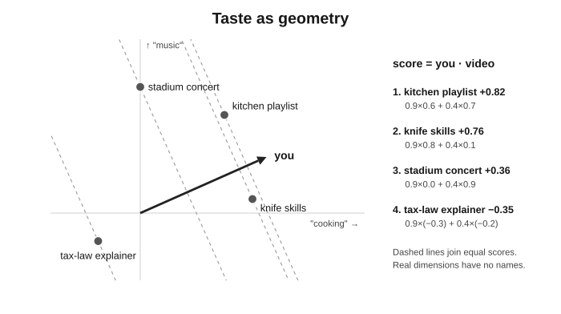

<!-- AI-assisted: restored from Sam's earlier draft and new recollections; Sam's own lines kept wherever they survived; awaiting Sam's pass -->

INTERLUDE 9

# Interfaces & Experiences

*Computing's Human Touch*

*INTERFACE*

I had reached that specific stage of consulting where I could translate a business requirement into three dialects: English, PowerPoint and panic. Toronto had trained me well. I had mastered the art of the "polite escalation," the "firmly worded dependency," and, when necessary, the "Canadian no," which is indistinguishable from a yes, except that nothing ever happens afterward.

It was my second day on site with a new client, a global automaker, one of those engagements where you could feel the hourly billing in the air, and we were debating user experience with the solemnity usually reserved for peace treaties. Someone wanted the Submit button for the credit application to be "trustworthy but bold," a design brief normally achievable only with a Labrador retriever. Behind that button, each application would travel through a Rube Goldberg sequence of systems, which the teams politely called "integration," before landing on a mainframe. The whiteboards were clean; the coffee was an existential threat. The future looked tidy, at least in our Gantt chart.

One of our business analysts was quietly checking her phone for messages: a normal habit, a normal Tuesday morning.

"A plane hit the World Trade Center," she said. Her voice was almost casual, the way one reports a traffic delay.

A pause. The room, full of people paid to have answers, had none.

"One tower's gone," she whispered. Then: "The other one, too." And then: "There were people in those buildings."

She fell silent for a long moment, then wept, quietly, instinctively, the way humans do before the news cycle teaches them their lines. The room went still. Project manager, team lead, analyst, architect, software engineer, UX designer: a whole taxonomy of experts suddenly reduced to one species, staring at a tragedy none of our process diagrams had prepared us for. For the first time in months, we encountered a user interface more powerful than any we had designed: a human face breaking. We simply remembered it as the day Sonia cried.

Our director called and told us to stop work and go home. We walked out together, quiet, some of the team heading back downtown. Somewhere along the way, I said that with my looks, I wouldn't even point a finger at a building. Everyone laughed. It turned out I wasn't wrong.

## When Design Exhales

Six weeks later, Steve Jobs walked onto a stage holding something the size of a deck of cards and promised "a thousand songs in your pocket."[^v1-i9-ipod] The first iPod had arrived, a product so simple and serene that it felt like technology's apology note.

While the world staggered through fear and confusion, the iPod offered something strangely healing: a scroll wheel that respected your intentions, a screen that didn't scream for attention, and a design that made complexity feel merciful again. It was a handshake between human and machine, a small proof that technology could be civil, even kind, and that design could be diplomacy. And that, I realized, was the hidden theme of the trade I'd wandered into. Interfaces aren't just aesthetic choices. They're treaties, between our fragile species and the silicon that now shares our lives.

## What an Interface Is

In engineering, an interface is simply the boundary where two systems meet and agree on how to exchange something: a plug and a socket, two programs and their API, two circuits and the signals they exchange. The user interface is the special case where one of the two systems is a person. It's the place where a machine's logic has to be translated into something a human can perceive, understand and act on, and where human intention has to be translated back into something a machine can execute.

<!-- AI draft, 2026-11-19: machine-to-machine interfaces added at the author's direction (silicon's counterpart to ideology; the human interface as the place where the two rails leak into each other). The word "confluence" is held back for Coda I. -->
## Interfaces Between Machines

Most computing interfaces have no human users. Behind a screen are boundaries no person ever sees, where one program hands something to another: a function and its caller, a service and its clients, one model and the next. Interlude 6 called the published version of such a boundary an API, a contract between strangers. Seen from the silicon side, that contract plays the part an ideology plays on ours. It's a shared format that lets millions of separately written programs treat one another as predictable without knowing what goes on inside, and, like an ideology, it is cheap to adopt and expensive to leave.

Contracts drift, though, and the drift has a law. An engineer at Google gave it his name: with enough users, it doesn't matter what an interface promises; every behavior anyone can observe will be depended on by somebody.[^v1-i9-hyrum] The order in which results happen to come back, the exact wording of an error message, a delay nobody designed: some program relies on each of them, and changing it breaks that program even though no promise was broken. Engineers fight back with version numbers that announce what a change may break (in semantic versioning, the first of three numbers signals an incompatible public-API change after the initial development stage) and with deprecation schedules measured in years. Interlude 5's generous receiver turns out to have a cost here. A protocol that accepts sloppy input teaches its peers to send it, the sloppiness becomes part of the contract, and the internet's own engineers have since warned that tolerance, practiced long enough, can make a protocol impossible to fix.[^v1-i9-robust]

At internet scale, the drift hardens into something like geology. Boxes in the middle of the network, firewalls, load balancers and traffic shapers, learned to inspect the protocols passing through them and to drop anything they didn't recognize. Over time that froze the protocols in place, which engineers call *ossification*. When the security protocol that protects web traffic reached version 1.3, so many of those boxes balked at the new number that the protocol had to travel disguised as its predecessor, announcing itself as version 1.2 and revealing its real age only in a field deeper inside the handshake.[^v1-i9-tls] Its designers drew a lesson Chapter 9 would recognize. A newer transport protocol, QUIC, encrypts nearly everything a middlebox might be tempted to depend on, and implementations deliberately offer some reserved, unsupported values, a practice named GREASE, so that nobody can build a habit around their absence.[^v1-i9-grease] An interface, like a story, thickens by sinking into the floors beneath it. These are deliberate efforts to keep one thin.

The machine-learning track has interfaces of its own, and the most interesting is a space rather than a format. Train an image model and a text model together on hundreds of millions of pictures and their captions, pushing the dot product of each matching pair up and of each mismatched pair down, and the two end up writing into a single shared embedding space, where a photograph of a dog and the words "a photo of a dog" land near each other.[^v1-i9-clip] Neither model knows how the other works; they agree only on the geometry. That shared space is how a system finds photographs from a description, and how image generators are steered by words. Agents need interfaces too. A model that can call a tool is handed a description of it: a name, a purpose and a schema listing the arguments it accepts, usually written in JSON, the format Interlude 7 met carrying data between web services. Since late 2024, open protocols such as the Model Context Protocol have standardized how agents discover tools and data, and newer ones how agents talk to one another: Interlude 6's API, rewritten for readers that are themselves programs.[^v1-i9-mcp]

All of this stays out of sight. The interfaces the rest of this interlude follows are the exceptions, the boundaries where the machine world reaches across to a person: a screen, a voice, a headset, a feed. They are a small fraction of all the interfaces there are, and by far the most consequential to us, because they are where the two worlds leak into each other on purpose, and where whatever crosses can be shaped.
<!-- End AI draft 2026-11-19. -->


## The First Law of UX: Don't Make Me Feel Stupid

The psychologist and designer Don Norman gave the field its vocabulary. A well-designed object makes its possible actions discoverable (a handle affords pulling; its visible shape signals where to pull) and tells you clearly what just happened.[^v1-i9-norman] Bad design opens two gulfs: a gulf of execution, between what you want and what the machine lets you do, and a gulf of evaluation, between what the machine did and what you can tell it did. Every frustrating door you've pushed when you should have pulled is a small failure of interface, and Norman insisted it was the designer's fault, not yours. One web-usability classic compressed the whole discipline into three words: "Don't make me think."[^v1-i9-krug] The deeper law, the one the iPod obeyed, is older and gentler. Good design is the art of keeping users from feeling stupid. We don't crave interfaces that impress us. We crave interfaces that forgive us.

## Interfaces That Shape Belief

Chapter 9 found that ideology is the story that decides where our moral instincts aim. Interfaces are where such stories now reach us, and they shape what we believe more quietly than any sermon.

The simplest tool is the default. In a famous comparison, opt-in countries had effective consent rates of roughly four to twenty-eight percent, while opt-out countries ranged from about eighty-six to almost a hundred percent.[^v1-i9-defaults] The comparison alone can't hold people and values constant. An experiment in the same paper did isolate the default, and the choice changed with it. Every interface is full of such defaults, and every default is a decision someone made on your behalf. Behavioral economists call the deliberate arrangement of choices "choice architecture"; used well, it's the nudge of Chapter 7, helping people save for retirement or eat better.

Used badly, it becomes what one designer named "dark patterns": interfaces engineered to trick people into doing things they didn't intend.[^v1-i9-dark] Chapter 9's Toronto felt like a city without any. The free trial that silently becomes a subscription; the cancel button hidden five screens deep; the "No thanks, I don't like saving money" link designed to shame. Regulators have begun to prohibit such manipulation: Europe's Digital Services Act now bans many of them outright.[^v1-i9-dsa]

One of the most powerful interfaces of the last two decades needs no button to make its central decision. It's the feed. Infinite scroll removes the natural stopping point at the bottom of a page. Combine infinite scroll with a recommendation algorithm that learns, from every pause and swipe, what keeps each person watching, and you get the feeds that now organize the attention of billions. Herbert Simon warned in 1971 that "a wealth of information creates a poverty of attention."[^v1-i9-simon] The feed is the machine that harvests that poverty. It is also, in Chapter 9's terms, an ideology delivery system: it doesn't argue for a worldview; it simply decides, millions of times a day, which slice of the world you see next.

## Into the Room: The Basics of Spatial Computing

Screens were training wheels: bright rectangles that taught us how to think with machines. But humans don't live in rectangles. We live in space, and the next generation of interfaces is trying to join us there. Virtual reality replaces the world around you with a computed one; augmented reality overlays digital objects on the world you see; mixed reality, the newest combination, lets the two interact, so that a virtual ball can bounce off your real table. The industry increasingly calls all of it spatial computing.

Designing for space has its own physics, and most of it comes from the body. The first principle is *presence*, the convincing feeling of being somewhere, and the fastest way to destroy it is delay. When you turn your head, the image should follow with very little delay; around twenty milliseconds is a common engineering target. Larger delays can worsen the conflict between sight and balance and make people sick.[^v1-i9-latency] Headsets therefore track your head's position and rotation in all directions (six "degrees of freedom") many hundreds of times a second. The second principle is comfort. Moving through a virtual world while your body stands still causes nausea, so designers invented tricks like teleportation, in which you point to where you want to go and simply appear there. And there's a subtler problem the eye itself creates: in most headsets, your eyes converge on a virtual object at one distance while focusing on a screen at another, a mismatch called the vergence-accommodation conflict, which causes fatigue and is still an active engineering problem.[^v1-i9-vac]

Input changes too. Instead of a mouse, spatial interfaces use your hands, tracked by cameras, and increasingly your eyes. Apple's Vision Pro, released in 2024, made the eyes the pointer: you look at a button and pinch your fingers to press it.[^v1-i9-visionpro] Eye tracking also lets the headset render in full detail only the small region you're looking at, saving enormous computing power, a trick called foveated rendering, which borrows the eye's own economy: only the center of the retina sees sharply, and peripheral vision trades fine detail for other sensitivities. And it raises new questions: where your eyes linger reveals what interests, attracts or worries you, data more intimate than any click. The likely destination isn't a heavy headset but ordinary-looking glasses, and the first steps are already here: camera-equipped smart glasses that can describe what you're seeing, and prototype glasses that overlay holograms on the world.[^v1-i9-glasses]

## Talking to Machines

Conversation is the oldest interface, and the newest. In 1966, the computer scientist Joseph Weizenbaum wrote ELIZA, a simple program that mimicked a psychotherapist by reflecting users' statements back as questions. He was disturbed to find that people, including his own secretary, confided in it as if it understood them. The tendency to attribute understanding to a machine that merely mirrors us is still called the ELIZA effect.[^v1-i9-eliza] Today's chatbots, built on the large language models Interlude 11 will explain, do far more than mirror, which makes the effect both more justified and more dangerous.

One of the field's veteran usability researchers has called AI the first new interface paradigm in sixty years.[^v1-i9-nielsen] Much everyday interaction has been command-based: you tell the computer which operations to perform. Conversational AI is intent-based: you describe the outcome you want, and the machine works out the steps. That shifts the hardest part of design from the screen to the conversation. Good conversational interfaces now show their work as they go, streaming their answers word by word so you can read along; they cite their sources, so you can check them; they signal uncertainty instead of bluffing; and they remember context, so you needn't start over. Bad ones flatter you, the sycophancy of Interlude 4, or answer confidently and wrongly.

<!-- AI draft, 2026-11-19. -->Voice is closing the gap with human conversation, and the gap is measured in milliseconds. In conversations recorded across ten languages, from Japanese to Danish, the most common pause between one speaker finishing and the next starting was under a fifth of a second.[^v1-i9-turns] That is faster than anyone can plan a sentence, so we must be planning our replies while the other person is still talking, predicting where their sentence will end. The earlier chatbot voice pipelines did the work in sequence. They had to decide that you'd stopped speaking rather than merely paused, a guess called *endpointing*; turn your speech into text; generate a reply; and turn that back into sound. Done step by step, the first voice modes for chatbots took several seconds to answer. In 2024, systems that handle audio directly, rather than passing text between separate models, began answering in about a third of a second on average, within the range of a human reply.[^v1-i9-gpt4o] They can be interrupted mid-sentence, as people interrupt each other, which means listening while speaking and yielding the floor gracefully, a courtesy Toronto would approve of. They are also multimodal:<!-- End AI draft 2026-11-19. --> they can see through a phone's camera, hear tone of voice and respond with images or speech. The interface is becoming less a window you look through than a companion you talk with.

## What's Under the Glass

Almost every interface in this interlude now runs on machine learning. The voice that answers you is turning sound into words, and words back into sound, with neural networks trained on vast amounts of recorded speech. The headset that follows your hands is running models trained to find fingers in camera images. The feed is a model trained to predict what you'll watch next. Interlude 2 explained how such models learn; three ideas here are worth carrying forward to Interlude 11.

<!-- AI draft, 2026-11-19: embedding and dot-product material expanded for the ML track. -->
The first is the *embedding*, which Interlude 2 introduced for words. A recommendation system can't compare people and videos directly, so it represents each of them as a list of numbers, a point in a space with dozens or hundreds of dimensions, placed so that things that tend to go together end up near each other. A common score for retrieving candidates is the simplest one available, the *dot product*: multiply the two lists number by number, and add.

```python
import numpy as np

you = np.array([0.9, 0.4])                 # a learned taste: two dimensions of many
videos = {"knife skills":      [0.8, 0.1],
          "kitchen playlist":  [0.6, 0.7],
          "stadium concert":   [0.0, 0.9],
          "tax-law explainer": [-0.3, -0.2]}

for name, v in videos.items():
    print(f"{name:18} {you @ np.array(v):+.2f}")
# knife skills       +0.76
# kitchen playlist   +0.82
# stadium concert    +0.36
# tax-law explainer  -0.35
```

Geometrically, the dot product measures how far a video reaches in your direction, scaled by how strongly you lean that way. The kitchen playlist wins, though knife skills sits nearer the tip of your arrow, because it reaches further along it. I've labeled the two dimensions cooking and music to make the picture readable; a learned system's dimensions need not have human-readable names. Nobody tells it that cooking is a dimension. It learns positions that make its scores predict what people actually did, every finish and every skip nudging both you and the video a little, which is Interlude 2's training recipe with clicks as the answer key. "Similar" becomes "close," and taste becomes geometry. Finding the highest scores among billions of items without computing them all is a craft of its own, called approximate nearest-neighbor search.

{#fig-v1-i9-taste width=95% fig-alt="A two-dimensional plane with an arrow labeled you pointing up and to the right. Four points are videos: kitchen playlist, knife skills, stadium concert and tax-law explainer. Dashed lines perpendicular to the arrow join equal scores. A table at right ranks them: kitchen playlist +0.82, knife skills +0.76, stadium concert +0.36, tax-law explainer -0.35."}

Netflix found that a better score was not automatically a better service. Matrix factorization helped predict movie ratings and became part of its recommendation engine, but the full ensemble that won its million-dollar prize never went into production: the last increments of accuracy weren't worth the engineering.[^v1-i9-netflix] Interlude 11 will meet the same multiply-and-add again, deciding which words in a sentence should pay attention to which: each word asks with one vector, every other word answers with another, and their dot product helps decide how much to listen.

<!-- End AI draft 2026-11-19. -->

The second is the *objective*. Every trained model is trained to make some number as good as possible, and the number is never quite the thing we care about. A feed optimized for minutes watched learns to keep you watching, whether or not you're glad afterward. It's Goodhart's law, which Chapter 7's economists would recognize: when a measure becomes a target, it stops being a good measure. Much of what goes wrong with AI begins here, in the gap between the number a system was trained on and the good it was meant to serve. Interlude 11 will show how today's models are trained on human preferences to narrow that gap, and why it never quite closes.

<!-- AI draft, 2026-11-19: feedback loops and explore-exploit added for the ML track. -->
A feed has a further problem that a speech recognizer doesn't: it writes its own exam. Interlude 7's advertising system learned from clicks, but only about the ads it chose to show; nobody can click on a video the feed never offered. So every recommender faces the dilemma machine-learning researchers call *explore or exploit*. Exploit, and you show what you already believe the person likes, learning a little more about what you already know. Explore, and you spend some of their attention on a guess, which is the only way to discover you were wrong. The textbook version is named for a gambler choosing among slot machines, the multi-armed bandit.[^v1-i9-bandit] The simplest remedy sets aside a slice of recommendations for guesses; better ones guess where the system is least certain.

Then comes the twist that makes a feed more than a statistics problem: its subject doesn't hold still. People can warm to what they're shown. In a toy feed with eight topics a user likes almost equally, a recommender that always serves its best current guess ends up favoring the user's original favorite only about a quarter of the time. Setting aside one slot in ten for guesses roughly doubles that. Now add an assumption: each click makes the user a little fonder of that topic. The feed settles on an early winner, usually not the original favorite, and by the end the chance of a click on that topic has more than tripled. In this model the feed didn't just find a taste; it helped make one. Exploration alone no longer restores the original ranking, because what it explores keeps changing with what it shows.[^v1-i9-feedsim] The habit rule is something we put into the model, not something the experiment discovered about people. It exposes the problem with taking tomorrow's clicks as independent proof that yesterday's recommendations were right. It's Chapter 4's closed loop, with the check fed by the system's own choices, and Chapter 9's cheap belief, delivered one recommendation at a time.

{#fig-v1-i9-feed width=95% fig-alt="Left: a circular loop of four boxes, feed shows, person clicks or skips, clicks become training data, model updates. A small arrow labeled explore enters from outside, and a dashed arrow labeled habit runs from the feed to the person. Right: a line chart over 5,000 recommendations. The chance of a click on the topic the feed settled on rises from about 0.17 to about 0.57 and levels off; the average for the other seven stays near 0.16."}
<!-- End AI draft 2026-11-19. -->

The third is the *decoder*. The speech implants described later in this interlude work because a neural network learned to map patterns of brain activity onto words, in the same way that speech recognition maps sound onto words and hand tracking maps pixels onto fingers. What looks like a dozen different technologies is one method, learning to translate one pattern into another, applied wherever there's enough data. That's why AI arrived everywhere at once.

## After the App

The deepest change may be the disappearance of the app itself. For fifteen years, doing something on a phone meant finding the right app, learning its menus and tapping through its screens. AI agents, which Interlude 6 introduced, can now operate other software on a person's behalf: since late 2024, systems have been able to look at a screen, move a cursor, click and type, completing tasks across websites and applications that were designed for human hands.[^v1-i9-agents] The user states a goal; the agent does the tapping.

That turns interface design inside out. The question is no longer only "How does a person use this screen?" but "How does a person supervise a machine that uses it for them?" The new design elements are about delegation and trust. Agents need *permissions*, scoped like a house key that opens only certain doors. They need *confirmations* before irreversible actions outside the authority already granted, the andon cord of Chapter 6 rebuilt for software. They need *audit trails*, so a person can see what was done and why, and *undo*, wherever possible. And they need what researchers call calibrated trust: interfaces that make people neither too suspicious to benefit nor so trusting that they stop checking. Some interfaces may even be generated on the fly, assembled by an AI to fit a single task and then discarded. The screen doesn't vanish, but it becomes one surface among many, summoned when needed, rather than the place where life happens.

## Feeling Machines

In 1997, an MIT engineer published a book called *Affective Computing*, arguing that computers would need to recognize and respond to human emotions to work well with people.[^v1-i9-picard] Much of what she imagined has arrived: software that estimates mood from voice, text or face; wearables that track stress through heart rate; assistants that adjust their tone. But the science has proven more complicated than the marketing. A major review by a team of psychologists concluded that people's facial movements don't reliably reveal their inner emotions across situations and cultures: a scowl may mean anger, concentration or a headache.[^v1-i9-barrett] Systems that claim to read emotions from faces are often reading stereotypes. Europe's AI Act now bans emotion-recognition systems in workplaces and schools, except for medical or safety reasons.[^v1-i9-aiact]

The more powerful development may be emotional *expression* by machines rather than recognition. Chatbots designed as companions now hold long, warm conversations with millions of people, some of whom describe them as friends or partners. For the lonely, that can be a comfort; for the vulnerable, it can become a dependence designed to keep them engaged, the feed's logic applied to affection. An interface that seems to care is the most persuasive interface there is, which is why, of all the design questions in this interlude, it most needs a constitution.

## Beyond Hands and Eyes

At the frontier, the interface reaches inside the body. Brain-computer interfaces record signals from the brain and translate them into commands. For years, the research consortium BrainGate has let people with paralysis move cursors and robotic arms by thought. In 2023, two research teams reported implants that decoded attempted speech from the brains of people who had lost the ability to speak, at rates of sixty to nearly eighty words a minute, one of them giving voice to a woman through an animated avatar.[^v1-i9-bci] In 2024, the company Neuralink implanted its first device in a human patient, who used it to play chess with his thoughts.[^v1-i9-neuralink] These implanted systems are being developed as medical devices for people with severe disabilities; their wider future remains open. But they complete a journey this interlude has traced: from punched cards, to keyboards, to fingers, to voices, to the signals of the brain itself, the interface moving ever closer to the self.

## Designing for Everyone

The best design principle of all may be the oldest: design for the people at the margins, and you improve things for everyone. The curb cut, the small ramp at a street corner, was won by disability activists for wheelchair users; it turned out to help parents with strollers, travelers with suitcases and workers with carts. Designers call this the curb-cut effect. Captions, built for deaf viewers, are now used by millions watching videos on silent phones. Voice interfaces, built partly for people who couldn't type, became the way millions talk to their homes. And AI is extending the effect. In 2023, the volunteer service Be My Eyes, which connects blind people with sighted volunteers by video, added an AI assistant that can describe a photograph, read a label or explain a scene.[^v1-i9-bemyeyes] Accessibility isn't charity. It's where the future of interfaces is usually tested first.


<!-- AI draft, 2026-11-19: mainstream material (Weiser, seamful design) moved here from the earlier Bob, with confirmation fatigue, breakthrough systems and loose coupling added. The earlier Bob is in interlude-9-previous-session-2026-11-19.md. -->
## Seams, Alarms and Breakthroughs

In 1991, the computer scientist Mark Weiser, at Xerox's research center, wrote a sentence that became the field's guiding star: "The most profound technologies are those that disappear."[^v1-i9-weiser] Writing and electricity, he observed, are so woven into daily life that we no longer see them. Computers, he predicted, would follow, receding from boxes on desks into the walls, the furniture and the air. Every good interface since has chased that goal. The iPod's scroll wheel disappeared under your thumb. The best conversational AI disappears into the conversation. An agent that books your trip makes the interface vanish entirely.

Everything this volume has learned says that disappearance has a cost. Chapter 8's state governs through legibility, making its citizens visible while its own workings stay opaque. Interlude 8's code governs as law, precisely because people don't see it as law. Chapter 9's ideology works best when it feels like common sense rather than a story. An interface that disappears joins that company. When you can no longer see the choices it made for you (the defaults, the order of results, the omitted options, the word the chatbot chose), you can no longer question them. A visible interface is a proposal. An invisible one is a premise. Some designers argue for the opposite of seamlessness, *seamful design*: deliberately show some of the seams, where showing helps people understand and question what the system is doing.[^v1-i9-seamful] The citations in a good chatbot's answer are seams. So is an agent's audit trail, or a feed that tells you why it showed you a post and lets you choose a different ordering. Seams cost a little smoothness. They buy back the ability to disagree.

Seams can be overdone, though, and the failure has been measured. When Windows Vista arrived in 2007, its security prompts asked permission so often that people learned to click "Allow" without reading, and Microsoft spent its next release cutting them back.[^v1-i9-uac] In one study, researchers watched people's brains in a scanner and their eyes with a tracker as the same security warning reappeared through a working week. Attention fell off day by day and partly recovered over the weekend; varying the warning's appearance slowed the decline, in the laboratory and in a three-week field test.[^v1-i9-habituation] A confirmation draws on a small account of attention, and an interface that asks about everything has nothing left for the moment that matters. That moment is the one Chapter 6 warned about: automation that works almost always leaves its human least practiced for the exception.

Two industries have had to solve the problem in hardware, because their exceptions are physical. A virtual-reality headset is the most complete disappearing interface ever sold: done well, the room vanishes. Some headsets therefore keep watch on the room they hide. Meta's Quest asks you to mark out a boundary around your play area. As your hands near it, a grid fades into view, a seam; step through, and the headset switches to its outside cameras and shows you the real room.[^v1-i9-guardian] Apple's Vision Pro lets people nearby appear through an immersive scene as they approach, and when you move too quickly toward an object such as a wall, it reveals your surroundings whether you like it or not; that reveal can't be switched off.[^v1-i9-awareness] Cars reached the same structure from the other direction. In an ordinary car, the human drives and an automatic emergency braking system watches the road: a warning first, then, if the driver doesn't respond, the brakes. Studies found such systems cut rear-end crashes roughly in half, and a U.S. rule issued in 2024 set September 2029 as the main compliance deadline for new cars and light trucks.[^v1-i9-aeb]

Underneath both is a principle from Chapter 6. Perrow's normal accidents need complexity and tight coupling, and software engineers fight the second with *loose coupling*: components isolated behind narrow interfaces, to limit how far a failure in one can race through the rest. They speak of a failure's *blast radius*, how much it can take down with it, and they build circuit breakers in software that do what the one in your basement does: trip, so the fault stays where it started.[^v1-i9-breaker] An interface is where coupling gets decided. Making it disappear is a decision about what can cross it unseen.
<!-- End AI draft 2026-11-19. -->

<!-- AI draft, 2026-11-19: new speculative Bob built on Sam's premise (interface governors; VR breakthrough as the muse; the emergency-brake analogy; natural, self-assembling governors; loose coupling and the rung-8 Big-O). -->
## Bob, Through the Looking-Glass: A Governor at the Glass

*The twist, in one line: the question isn't whether an interface should disappear but when it should come back, and the answer may be closer to a quantity than a taste: surprise, weighted by what can't be undone, rising sharply wherever an action crosses a boundary.*

In *Through the Looking-Glass*, the White Queen shrieks that her finger is bleeding before anything has happened to it. A little later her brooch flies open, she pricks her finger on the pin, and she smiles. Alice asks why she doesn't scream now. "Why, I've done all the screaming already," says the Queen. "What would be the good of having it all over again?"[^v1-i9-whitequeen] She is every confirmation dialog ever written: an alarm spent in advance, with nothing left when it counts.

The usual argument sets two goods against each other. Smooth augmentation means not acknowledging every step; an agent's whole point is to relieve you of the tapping. Safety means knowing where the boundary is, and some boundaries are subtle. My wager is that the two stop conflicting once you ask the question the White Queen gets wrong. Not *whether* an interface should speak, but *when*. And I suspect the answer is less a matter of taste than of something we can estimate, which nature has been estimating for a long time.

Chapter 3 found a brain that rides the delta: higher levels send down predictions, and lower levels send back mainly what the predictions got wrong. That makes the body the most successful disappearing interface we know. You don't feel your shirt, hear your own heartbeat or notice the floor, until the floor tilts. In this predictive-processing picture, much bodily signaling stays outside awareness until a mismatch demands attention. Your name, spoken across a noisy party, breaks through; so does a step that isn't there. Not every error breaks through equally, either. A missing stair gets a lurch before you know what happened; an odd itch gets ignored. The surprise is weighted by the stakes.

Take that as a design rule, and an interface's governor becomes a small model with two jobs: predict what the person wants, or what the world will do next, and estimate how costly it would be to be wrong. Low surprise and low stakes: act, and keep a record, the way your reflexes correct your balance without consulting you. Rising surprise, or stakes that can still be reversed: show a seam, like the headset's grid or a line in an agent's log. High surprise at high stakes: break through. Stop and ask or, when there's no time to ask, act, as the brakes do. Predictability is not consent, though: a perfectly expected action can still cross a boundary the agent has no authority to cross. Permissions and hard limits have to stand outside that score.

{#fig-v1-i9-governor width=95% fig-alt="A plane with surprise on the horizontal axis and stakes on the vertical. Two curved boundaries divide it into three bands: disappear near the origin, show a seam in the middle and break through in the far corner. Examples: a balance correction in disappear; a grid at the play boundary in show a seam; automatic braking and someone walking into the room in break through. An arrow labeled crossing a boundary lifts a transfer between my accounts up to the same transfer, to a stranger."}

The subtle cases, the ones I care most about, are boundary crossings. An agent moving money among my own accounts is managing my affairs. The same transfer to a stranger is speaking for me to someone else, and the interface should reappear there even when the agent is confident, because the stakes have left my circle. That's the headset's play-area line drawn around a self instead of a room, and Chapter 8's border drawn around an action. Stakes jump at a border.

The headset teaches a second lesson: the governor watches a different feed from the one the interface shows. Immersion hides the room, and the guardian watches the room. The emergency brake doesn't need to be a better driver than the driver; it needs to be looking at the road while the driver looks at the radio. For agents, I suspect the equivalent is a governor that watches the world the agent acts on (the balance, the sent folder, the commitments that can't be taken back) rather than the agent's own account of what it's doing. That's Chapter 4's open loop at the glass, a check fed by evidence the checked party doesn't control. It's also the safeguard against Interlude 8's adapter that hides a contradiction behind a pleasant face. A governor that reads only the adapter's report will be told that everything is fine.

My hesitation is cost. Interlude 8's Bob borrowed Big-O to count how much coordination a civilization's frameworks demand as participants grow. A governor bolted onto an interface from outside adds to that bill. It has to understand every combination of components it might see, and the kind of point-to-point plumbing my automaker client politely called "integration" grows with the number of pairs that must agree, roughly the square of the number of systems. But a governor built the way a nervous system builds one may cost less than the interruptions it replaces. Nature doesn't put one central monitor in charge of every boundary. The withdrawal reflex pulls your hand from a hot stove through spinal circuits without waiting for a conscious decision; signals also travel to the brain. Each boundary carries its own small sentinel, fast and narrow, and passes up only what it can't handle. That's loose coupling and fault containment in a single design. The reflex keeps the blast radius small, and the narrow channel means the interface carries surprises rather than everything. My hope is that, where each component has a limited set of neighbors, much of the cost could grow with those local boundaries rather than every possible pair, and much of the traffic with surprise rather than activity. And if Chapter 8's Alice is right that a boundary can be something the work keeps discovering, governors may not have to be designed boundary by boundary at all. They may form where prediction keeps failing, the way a callus forms where a shoe rubs.

There's a catch, and Chapter 6 already named it. A person who never sees the interface is least practiced when it finally breaks through. A driver handed back the wheel by an automated system can need several seconds to take in the scene, seconds a hazard may not grant.[^v1-i9-takeover] So a governed interface may need a second duty: to break through now and then when nothing is wrong, as fire drills do, keeping the human half of the handoff in practice. That's the White Queen's mistake turned to use. Rehearsal is screaming in advance, but on a schedule, cheaply, and labeled as practice.

The wager makes predictions, which keeps it honest. A governor built this way should reduce interruptions and missed hazards together, rather than trading one for the other, which is what separates it from a settings slider. It should be quiet in proportion to how well it knows you, so that its silence becomes a measure of trust, and a rising rate of interruptions becomes a sign that its model of you, or of the world, has drifted. And across a system of many agents, breakthroughs per task should grow slowly as participants are added if the governors are local, and quickly if they're central. Those are numbers someone can measure.

The mirror runs both ways. For seventy years, interfaces made machines legible to people. The newest ones, which read our voices, eyes, moods and even brain signals, make people legible to machines, and a governor that predicts what you want is one more of them. Volume III's design question is how to build interfaces that disappear where they should and come back where it matters: smooth enough to fade into the background, governed well enough never to fade out of reach.
<!-- End AI draft 2026-11-19. -->

## From Human Interfaces to Planetary Interfaces

For all our pixel-perfect ambitions, there comes a moment when even the most immersive interface feels too small. We can design for fingers, for eyes, for emotions, even for the obscure tics of the human heart, but sooner or later, the frame of the screen reveals its limits. The Earth has no menu. The atmosphere has no settings pane. The oceans don't offer customer support. And as our machines learn to understand us, we're forced to remember that we still struggle to understand the planet that made us.

Design taught us that clarity is an act of care. Civilization taught us that trust is an act of choice. Nature runs on older laws, indifferent to interfaces, etiquette or error messages. And yet, if we bother to look, the planet is flashing familiar signals: an amber warning, an orange sky, the occasional blue screen of a flooded city. If we keep treating the Earth like a poorly documented app, we shouldn't be surprised when it stops trying to be user-friendly. The next chapter turns to the oldest system we know, the one that never needed an interface at all.


> ***Maggie:** A face is the first interface.*
>
> ***Alex:** A screen is just a face for machines.*
>
> ***Maggie:** We learned to read each other's faces before we learned to speak.*
>
> ***Alex:** Now machines are learning to read ours.*
>
> ***Both:** Every window looks both ways.*

<!-- SOURCE NOTES: from memory unless linked; verify each before print. -->

[^v1-i9-ipod]: Apple, [“Apple Presents iPod”](https://www.apple.com/newsroom/2001/10/23Apple-Presents-iPod/), 23 October 2001, exactly six weeks after September 11. The first model used a mechanical scroll wheel; the later Click Wheel should not be projected backward into this scene.

[^v1-i9-norman]: Donald A. Norman, *The Psychology of Everyday Things* (1988), subsequently *The Design of Everyday Things*, revised edition 2013; [“Signifiers, not affordances”](https://jnd.org/signifiers-not-affordances/) (2008). An affordance is a possibility for action in the relationship between actor and object; a signifier is a perceptible cue to it. The gulfs of execution and evaluation concern performing an intended action and understanding its outcome.

[^v1-i9-krug]: Steve Krug, *Don't Make Me Think: A Common Sense Approach to Web Usability* (2000).

[^v1-i9-hyrum]: Hyrum Wright's observation, known as Hyrum's law; see [hyrumslaw.com](https://www.hyrumslaw.com/) and Titus Winters, Tom Manshreck and Hyrum Wright, *Software Engineering at Google* (2020), chapter 1. On version numbers, Tom Preston-Werner, [Semantic Versioning 2.0.0](https://semver.org/).

[^v1-i9-robust]: Martin Thomson and David Schinazi, ["Maintaining Robust Protocols"](https://www.rfc-editor.org/rfc/rfc9413), RFC 9413 (June 2023), which argues that unconditional tolerance of deviations can entrench them and recommends active maintenance instead.

[^v1-i9-tls]: Eric Rescorla, ["The Transport Layer Security (TLS) Protocol Version 1.3"](https://www.rfc-editor.org/rfc/rfc8446), RFC 8446 (August 2018), §4.1.2 and §4.2.1: the ClientHello's legacy_version field is set to the value for TLS 1.2, and the actual version is negotiated in the supported_versions extension, for compatibility with middleboxes.

[^v1-i9-grease]: Jana Iyengar and Martin Thomson (eds.), ["QUIC: A UDP-Based Multiplexed and Secure Transport"](https://www.rfc-editor.org/rfc/rfc9000), RFC 9000 (May 2021); David Benjamin, ["Applying Generate Random Extensions And Sustain Extensibility (GREASE) to TLS Extensibility"](https://www.rfc-editor.org/rfc/rfc8701), RFC 8701 (January 2020).

[^v1-i9-clip]: Alec Radford et al., ["Learning Transferable Visual Models From Natural Language Supervision"](https://arxiv.org/abs/2103.00020) (2021), the CLIP model, trained on about 400 million image–text pairs with a contrastive objective over normalized dot products (cosine similarities).

[^v1-i9-mcp]: OpenAI introduced JSON-schema function calling in June 2023; Anthropic announced [Model Context Protocol](https://www.anthropic.com/news/model-context-protocol) on 25 November 2024; Google announced [Agent2Agent](https://developers.googleblog.com/en/a2a-a-new-era-of-agent-interoperability/) on 9 April 2025. These are dated examples of discovery and exchange protocols, not a promise of common semantics, safe tools or lasting interoperability.

[^v1-i9-defaults]: Eric J. Johnson and Daniel Goldstein, [“Do Defaults Save Lives?”](https://www.dangoldstein.com/papers/DefaultsScience.pdf), *Science* 302 (2003): 1338–1339. The country figure reports effective consent, not transplantation: opt-in countries range from 4.25% to 27.5%, and opt-out from 85.9% to 99.98%. Their separate randomized online choice experiment holds the decision scenario constant; cross-country comparisons alone do not isolate defaults from institutions or culture.

[^v1-i9-dark]: Harry Brignull coined "dark patterns" in 2010; see his *Deceptive Patterns* (2023).

[^v1-i9-dsa]: Regulation (EU) 2022/2065 (Digital Services Act), Article 25. [Regulation text](https://eur-lex.europa.eu/eli/reg/2022/2065/oj/eng).

[^v1-i9-simon]: Herbert A. Simon, "Designing Organizations for an Information-Rich World" (1971), in Martin Greenberger (ed.), *Computers, Communications, and the Public Interest*.

[^v1-i9-latency]: Motion-to-photon latency around 20 milliseconds is a common engineering target, not a universal physiological cutoff. See [Varjo’s latency explanation](https://support.varjo.com/hc/en-us/latency). Comfort also depends on motion, tracking, display characteristics, exposure and the person; low delay alone cannot eliminate visually induced motion sickness.

[^v1-i9-vac]: David M. Hoffman et al., "Vergence–accommodation conflicts hinder visual performance and cause visual fatigue" (2008), *Journal of Vision* 8(3): 33. [Original experiment](https://pmc.ncbi.nlm.nih.gov/articles/PMC2879326/).

[^v1-i9-visionpro]: Apple Vision Pro was released in the United States on 2 February 2024.

[^v1-i9-glasses]: For example, Ray-Ban Meta smart glasses (2023) and Meta's Orion augmented-reality prototype (shown in September 2024). Check current products before print.

[^v1-i9-eliza]: Joseph Weizenbaum, "ELIZA" (1966), *Communications of the ACM* 9(1): 36–45; *Computer Power and Human Reason* (1976).

[^v1-i9-nielsen]: Jakob Nielsen, "AI: First New UI Paradigm in 60 Years" (Nielsen Norman Group, June 2023). [Author’s essay](https://www.nngroup.com/articles/ai-paradigm/).

[^v1-i9-agents]: For example, Anthropic's "computer use" capability (October 2024) and OpenAI's Operator (January 2025).

[^v1-i9-picard]: Rosalind W. Picard, *Affective Computing* (1997).

[^v1-i9-barrett]: Lisa Feldman Barrett et al., "Emotional Expressions Reconsidered" (2019), *Psychological Science in the Public Interest* 20(1): 1–68. [Review](https://doi.org/10.1177/1529100619832930).

[^v1-i9-aiact]: Regulation (EU) 2024/1689 (Artificial Intelligence Act), Article 5(1)(f). [Regulation text](https://eur-lex.europa.eu/eli/reg/2024/1689/oj/eng).

[^v1-i9-bci]: Francis R. Willett et al., "A high-performance speech neuroprosthesis" (2023), *Nature* 620: 1031–1036; Sean L. Metzger et al., "A high-performance neuroprosthesis for speech decoding and avatar control" (2023), *Nature* 620: 1037–1046. [Willett et al.](https://www.nature.com/articles/s41586-023-06377-x). [Metzger et al.](https://www.nature.com/articles/s41586-023-06443-4). These are participant- and task-specific research results, not universal speech decoding.

[^v1-i9-neuralink]: Neuralink implanted its first human participant, Noland Arbaugh, in January 2024. [Company’s dated participant report](https://neuralink.com/updates/a-year-of-telepathy/).

[^v1-i9-bemyeyes]: Be My Eyes launched "Be My AI," built on OpenAI's GPT-4, in 2023. [Service announcement](https://www.bemyeyes.com/news/announcing-be-my-ai-soon-available-for-hundreds-of-thousands-of-be-my-eyes-users/).

[^v1-i9-turns]: Tanya Stivers et al., "Universals and cultural variation in turn-taking in conversation," *PNAS* 106 (2009): 10587–10592, doi:10.1073/pnas.0903616106. Across ten languages, the most frequent gap between turns fell between 0 and 200 milliseconds; average gaps differed by language within a range of about 250 milliseconds, Japanese at the short end and Danish at the long. [Original study](https://doi.org/10.1073/pnas.0903616106).

[^v1-i9-gpt4o]: OpenAI, ["Hello GPT-4o"](https://openai.com/index/hello-gpt-4o/) (13 May 2024): audio responses in as little as 232 milliseconds and 320 milliseconds on average, compared with average latencies of 2.8 and 5.4 seconds for its earlier voice mode, which chained separate speech-to-text, language and text-to-speech models. These are the company's own figures.

[^v1-i9-netflix]: Yehuda Koren, Robert Bell and Chris Volinsky, “Matrix Factorization Techniques for Recommender Systems,” *Computer* 42(8) (2009): 30–37. Netflix’s [“Recommendations: Beyond the 5 stars (Part 1)”](https://netflixtechblog.com/netflix-recommendations-beyond-the-5-stars-part-1-55838468f429), Xavier Amatriain and Justin Basilico, 6 April 2012, explains the ten-percent RMSE target, deployment of factorization and restricted-Boltzmann-machine components, and why the full final ensemble was not deployed. Latent-factor methods predate the prize. For candidate retrieval versus more elaborate ranking, Paul Covington, Jay Adams and Emre Sargin, [“Deep Neural Networks for YouTube Recommendations”](https://research.google/pubs/deep-neural-networks-for-youtube-recommendations/), RecSys 2016.

[^v1-i9-bandit]: Herbert Robbins, “Some aspects of the sequential design of experiments,” *Bulletin of the American Mathematical Society* 58(5) (1952): 527–535. Lihong Li, Wei Chu, John Langford and Robert E. Schapire, [“A Contextual-Bandit Approach to Personalized News Article Recommendation”](https://arxiv.org/abs/1003.0146), WWW 2010. Allison J. B. Chaney, Brandon M. Stewart and Barbara E. Engelhardt, [“How Algorithmic Confounding in Recommendation Systems Increases Homogeneity and Decreases Utility”](https://oar.princeton.edu/bitstream/88435/pr1zc2c/1/RecSystemsUtility.pdf), RecSys 2018. Exploration alone is not a general cure for preference change, objective misspecification or feedback confounding.

[^v1-i9-feedsim]: Illustrative model reproduced for this edition, not fitted to a real platform. Four conditions each use 400 runs of 5,000 recommendations, eight baseline click probabilities 0.20, 0.19, …, 0.13, and estimates starting at one click in five showings. The feed either chooses its highest estimated rate (random ties) or explores uniformly with probability 0.10. In the habit condition a click raises that topic's probability by 1% of its remaining distance to 0.60; after each round all probabilities relax 0.05% toward their baselines. The leading topic is the most shown in the last 1,000 rounds. Without habit it was the original favorite in 26.5% of greedy runs and 53.0% of exploratory runs; with habit, 21.5% and 22.5%. For the greedy habit condition its mean click probability rose from 0.174 to 0.565. Curves select that leading topic retrospectively and average across runs. Python standard-library implementation; master seed 20261119, incremented by run. Reinforcement, decay and click-as-preference are modeling choices, not empirical estimates; clicks do not establish welfare. Reproduction code and data are retained with the editorial source materials.

[^v1-i9-weiser]: Mark Weiser, "The Computer for the 21st Century" (1991), *Scientific American* 265(3): 94–104.

[^v1-i9-seamful]: Matthew Chalmers and Ian MacColl, "Seamful and Seamless Design in Ubiquitous Computing" (2003), Workshop at the Crossroads: The Interaction of HCI and Systems Issues in UbiComp.

[^v1-i9-uac]: Windows Vista introduced User Account Control in January 2007; Windows 7 (2009) added a slider and reduced the number of prompts in its default setting. [Microsoft design guidance](https://learn.microsoft.com/en-us/windows/win32/uxguide/winenv-uac).

[^v1-i9-habituation]: Anthony Vance, Jeffrey L. Jenkins, Bonnie Brinton Anderson, Daniel K. Bjornn and C. Brock Kirwan, ["Tuning Out Security Warnings: A Longitudinal Examination of Habituation Through fMRI, Eye Tracking, and Field Experiments"](https://misq.org/tuning-out-security-warnings-a-longitudinal-examination-of-habituation-through-fmri-eye-tracking-and-field-experiments.html), *MIS Quarterly* 42(2) (2018): 355–380. "Polymorphic" warnings, whose appearance changes, reduced habituation in the scanner and slowed the fall in adherence over a three-week field experiment with mobile app permission warnings.

[^v1-i9-guardian]: Meta's Guardian boundary system for Quest headsets shows a boundary grid as the user approaches it and switches to passthrough video when the user steps outside. [Meta boundary guidance](https://www.meta.com/help/quest/463504908043519/).

[^v1-i9-awareness]: Apple, [Apple Vision Pro User Guide](https://support.apple.com/guide/apple-vision-pro/tan3a6602fdd/visionos): "People Awareness detects and shows people around you"; the device "also reveals some objects in front of you (such as walls)" and reveals surroundings when the user approaches an object too quickly, reveals that cannot be adjusted or turned off.

[^v1-i9-aeb]: Jessica B. Cicchino, “Effectiveness of forward collision warning and autonomous emergency braking systems in reducing front-to-rear crash rates,” *Accident Analysis & Prevention* 99 (2017): 142–152; automatic braking was associated with about a 50% reduction in the studied crash category. NHTSA’s [2024 final rule, FMVSS No. 127](https://www.govinfo.gov/content/pkg/FR-2024-05-09/html/2024-09054.htm), set 1 September 2029 as the principal compliance date, with exceptions and later provisions. The prose dates that rule rather than guaranteeing its future implementation.

[^v1-i9-breaker]: For the software circuit-breaker pattern, see Michael T. Nygard, [*Release It! Design and Deploy Production-Ready Software*](https://www.oreilly.com/library/view/release-it/9781680500264/f_0043.xhtml) (Pragmatic Bookshelf, 2007), pattern 5.2, “Circuit Breaker.” On loose coupling in organizations, Karl E. Weick, [“Educational Organizations as Loosely Coupled Systems”](https://doi.org/10.2307/2391875), *Administrative Science Quarterly* 21(1) (1976): 1–19. On interactive complexity and coupling, Charles Perrow, *Normal Accidents: Living with High-Risk Technologies* (Basic Books, 1984; [updated edition](https://press.princeton.edu/books/paperback/9780691004129/normal-accidents), Princeton University Press, 1999).

[^v1-i9-whitequeen]: Lewis Carroll, *Through the Looking-Glass, and What Alice Found There* (1871), chapter V, "Wool and Water." [Primary text](https://www.gutenberg.org/ebooks/12).

[^v1-i9-takeover]: Alexander Eriksson and Neville A. Stanton, "Takeover Time in Highly Automated Vehicles: Noncritical Transitions to and From Manual Control," *Human Factors* 59(4) (2017): 689–705, reporting takeover times from about two seconds to more than twenty in a driving simulator. [Original study](https://doi.org/10.1177/0018720816685832).

<!-- EDITORIAL AUDIT 2026-11-19: work/volume-1-drafting/pair-09-fable-adoption-2026-11-19/SOURCE_AUDIT.md distinguishes checked sources, bibliographic-only checks and remaining edition/locator questions. -->
