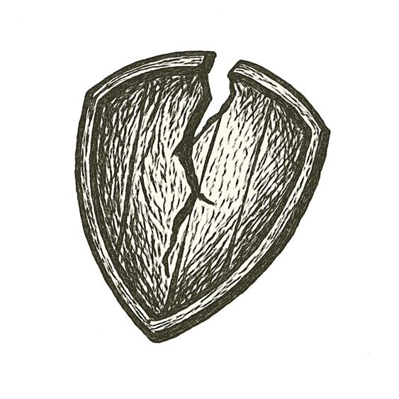

<!-- AI-assisted: the Opens are written in a deliberately oracular register, outside the narrator's voice. The opening quotation is Matthew 2:18 (King James Version), from the Christmas story's massacre of the innocents. -->

_In Rama was there a voice heard, lamentation, and weeping, and great mourning, Rachel weeping for her children, and would not be comforted, because they are not._

Christmas was one day old, and the city's main street was crowded with people hunting for bargains.

A fifteen-year-old girl was shopping with her older sister. She crossed the street to find a washroom.

A few steps away, two groups of young men had found each other. Someone drew a gun, and then more than one.

Seven people were hit. Six of them lived.

She was the city's fifty-second gun death that year. Most of the other fifty-one had been mourned by their own neighborhoods. Her name, the whole country learned.

---

*How thin is the ice we build our peace upon?*
