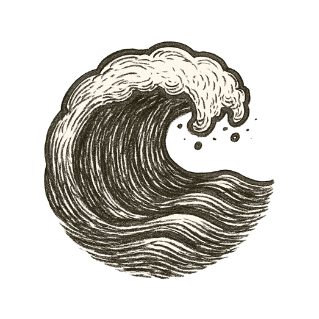

<!-- AI-assisted: the Opens are written in a deliberately oracular register, outside the narrator's voice. The opening quotation is Exodus 9:24 (King James Version), from the plague of hail and fire. The last line adapts Exodus 8:6 and 8:11, with Adam (Hebrew for humankind) in Aaron's place. -->
<!-- SOURCE-CHECK 2026-11-18: the added amphibian sentence is supported by Luedtke et al., Nature (2023), doi:10.1038/s41586-023-06578-4: 40.7% globally threatened. See the adoption record for the source link. -->

_So there was hail, and fire mingled with the hail, very grievous, such as there was none like it in all the land of Egypt since it became a nation._

In the summer of the plague year, a lid of air settled over the mountains, and the heat beneath it broke the nation's record three days running.

In a village by the river, the thermometer reached a number no one in that country had ever seen. The next day, the village burned.

In the cities, hundreds died in their apartments, most of them old, many of them alone. Along the shore, more than a billion small creatures cooked in their shells at low tide.

In the autumn, a river came down out of the sky. The highways to the rest of the country washed away, and a lake drained a century before, and its people's fishery with it, came back to reclaim its bed, and the animals in the barns that had been built there.

Two of every five kinds of amphibian on Earth are now in danger of vanishing.

_And Adam stretched out his hand over the waters; and the frogs departed from the land._

---

*Then even the wind held its breath.*
