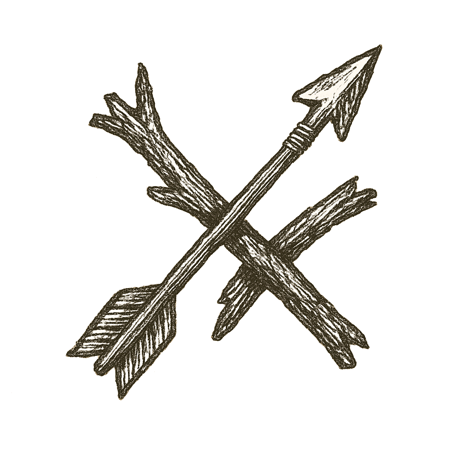

<!-- AI-assisted: Volume II Opens draw on journey literature. The epigraph renders Porus's reply as reported in Arrian's Anabasis, Book V (compare E. J. Chinnock's public-domain translation, 1884); verify wording before print. -->

_"Treat me, Alexander, as a king."_  
--- **Porus**, defeated, after Arrian, _Anabasis_ V

The river was high with the rains, and on the far bank stood the elephants, which the horses would not face.

So the conqueror crossed upstream, at night, in a thunderstorm, and by morning the field was his.

The king of that country was brought to him wounded, taller than any man there, and asked how he wished to be treated. He answered as a king, and was given his kingdom back.

The conqueror's horse, which had carried him from Macedon to the edge of India, died there. He built a city and gave it the horse's name.

A little farther east, at another river, his army sat down and would go no farther.

And the road turned, at last, back the way it had come.

---

*How far can glory ride before it curses every road behind it?*
