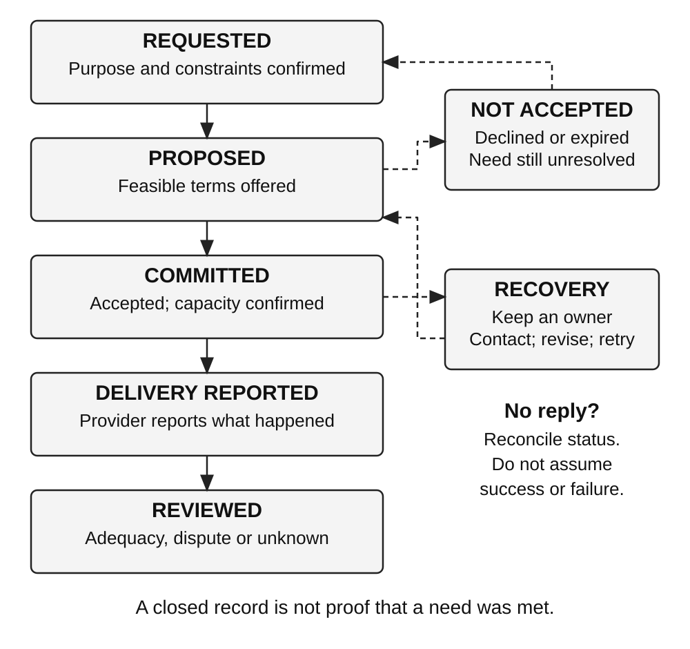
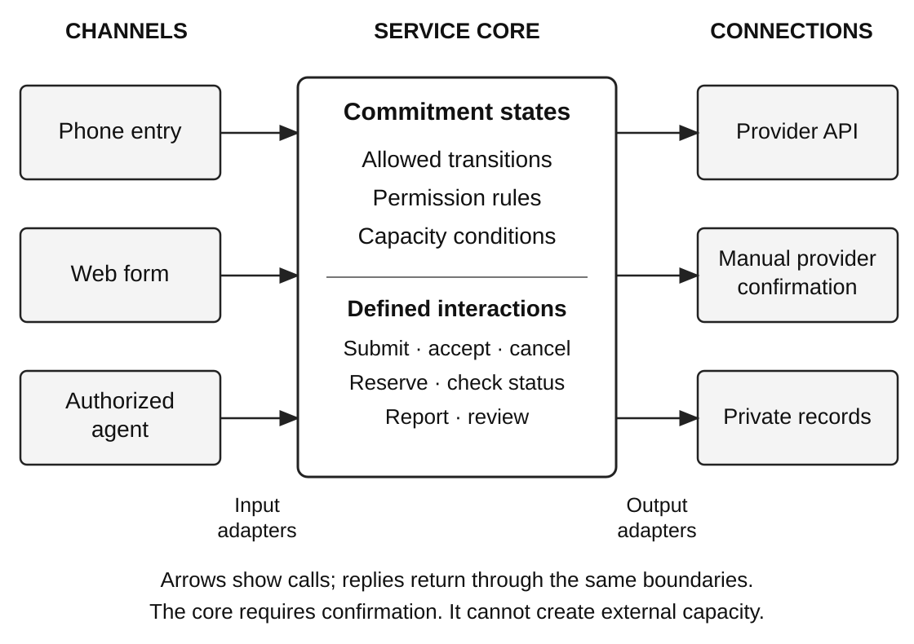

INTERLUDE 23

# The Loom of Design

*Ethical Systems Thinking for Builders*

*BUILDING*

\[TODO: change from "you" to "I"\]

You arrive at the coordination room because someone has mistaken you for a builder.

This is flattering for roughly twelve seconds.

Then you discover what they mean.

The room is not a command center, though several people have tried to make it one by standing near the largest screen and looking as if they have recently used the word *protocol* with confidence. It is not a startup war room either, despite the laptops, the coffee, the extension cords, the suspicious number of hoodies, and the young man in the corner who keeps saying "we can spin something up" as though civilization were a containerized service with adequate documentation.

It is a school library.

Or it was, until the bookshelves were pushed aside, the tables rearranged, and the whiteboards conscripted into public service. Children's drawings still hang along one wall: trees, rockets, dogs with medically improbable proportions, and one purple dinosaur apparently serving as mayor. The dinosaur looks over the room with the serene authority of an elected official who cannot yet be indicted.

On the main board someone has written:

**NEEDS**\
**CAPACITIES**\
**TRUST**\
**BOUNDARIES**\
**ESCALATE**\
**DO NOT SHARE**

The last column is already crowded.

Good.

A humane system often begins with the first thing it refuses to expose.

Outside, March is doing its usual Calgary performance: half thaw, half threat. Inside, a temporary civic nervous system is trying to form before the official ones fully wake up. The municipal channels exist, but they are slow. The clinic channels exist, but they do not talk cleanly to the school. The school talks to parents, but not to pharmacy routing. The pharmacy has inventory, but not enough trusted delivery. Volunteers are available, but no one knows how to verify them quickly without building a little surveillance state beside the vending machine.

The old systems are not gone.

That matters.

This is not the apocalypse. The apocalypse is too clean a fantasy for people who have never dealt with legacy software. What you have instead is more realistic: functional systems with mismatched seams, confused authority, stale data, rigid permissions, live need, and a room full of people trying not to accidentally create either chaos or a ministry.

A coordinator hands you a marker.

This, too, is how civilizations get you. Not with crowns. With markers.

"We need a platform," says the young man in the corner.

"No," says the nurse practitioner.

"We need a shared source of truth," says someone from the municipality.

"No," says the older woman from the community association.

"We need a way to route needs to capacity," says one of the teenagers.

The room pauses.

That sentence is allowed to remain alive.

The teenager continues, emboldened by the dangerous event of being right.

"But not everything. Not all needs. Not all people. Not publicly. And not forever."

Now even the marker in your hand seems to pay attention.

On the table are the day's fragments. An elder needs medication. A volunteer has winter tires and a clean driving record, though no one has yet decided who may ask for proof. A school gym is available as a charging and warming space. A mechanic can help with generator faults if people send photographs first and do not arrive bearing flaming equipment, because retirement has limits and so does heroism. A local clinic has a nurse practitioner available for remote triage, but no one wants medical details drifting through a community spreadsheet like gossip in a reflective vest.

Someone proposes a master database.

The room groans with the instinctive wisdom of people who have suffered under masters and databases separately, and do not wish to meet their offspring.

Someone else proposes an AI routing tool.

The teenagers brighten. The older woman narrows her eyes. The municipal representative looks as though policy has just bitten into a lemon.

The tool might help. It might also confidently send a diabetic elder to a closed pharmacy because the training data once saw the word "open" near the word "Saturday." Intelligence, like enthusiasm, must be supervised until it learns humility.

You write on the board:

**First primitive: Need Card.**

Then below it:

**Second primitive: Capacity Card.**

A few people look disappointed. They had expected architecture and have been given stationery.

This is another lesson. Civilization is often saved, if it is saved at all, by boring objects designed with moral seriousness.

A need card is not a form. Not yet. A form is a need card after bureaucracy has eaten too much and stopped listening. This first version is smaller, humbler, and still capable of shame.

What is needed?\
Who may see it?\
Who may respond?\
How urgent is it?\
What proof, if any, is required?\
What must not be shared?\
When does the request expire?\
How can it be corrected or withdrawn?\
Who can escalate it if the first match fails?

Then capacity:

What is offered?\
By whom?\
For how long?\
Under what limits?\
What verification is needed?\
What risk is involved?\
Can the offer be revoked without guilt?\
How does the system prevent generosity from becoming a sentence?

No one applauds.

This is good. Applause at this stage would be premature and structurally suspicious.

The nurse practitioner nods.

The older woman says, "Add: no permanent marks."

You add it.

The young coder asks whether "no permanent marks" means automatic deletion, archival hiding, reversible state, or privacy-preserving persistence.

The older woman says, "It means don't make a person wear Tuesday forever."

That becomes the rule.

You underline it.

Welcome to the loom.

<!-- AI-assisted source clarification: Codex, 2026-11-05; earlier prose retained. -->

## Iron, Lens, Log

Builders like to imagine they begin with ideas.

They do not.

They begin with substrate.

This is one of the quieter humiliations of design. You may have the most elegant concept in the room, but if the material refuses it, the material wins. Bronze does not become steel because the committee prefers resilience. Wet cardboard does not become architecture because the grant language says "adaptive." Trust does not become infrastructure because the app has a friendly onboarding sequence.

The old ironworkers knew this. Long before our rooms filled with screens and civic diagrams, somebody learned that metal has moods. Ore, charcoal, heat, air, impurity, timing: each mattered. A tool was not merely shaped by intention, but by the stubborn truth of what the material could become under constraint.

Renewal has a substrate too.

Human trust.

Local capacity.

Institutional legitimacy.

Shared memory.

Attention.

Time.

Bodies.

Weather.

The fact that people will bring soup to a neighbor before they will read a 43-page user agreement.

Design that ignores the substrate is not visionary. It is decorative failure warming up.

The second lesson is the lens.

To build well, one must see better. But magnification is not wisdom. A lens can reveal fine detail, and it can also concentrate sunlight until the thing under observation catches fire. Anyone who has ever received "visibility" from an institution knows this distinction in the bones.

A humane renewal system needs better sight: where need is emerging, where capacity lies unused, where the old forms are missing the actual flow of life. But it must not confuse seeing with owning. The purpose of the lens is not to expose the vulnerable to administrative daylight until they crisp at the edges. It is to let help find its way.

The third lesson is the log.

Near our **750 BCE** marker, Babylonian astronomy offers a more specific beginning: its sustained programme of regular sky observations probably began around **747 BCE**, three years later. The earliest surviving astronomical diary dates to 652 BCE; the earlier beginning is reconstructed, not a tablet we can hold from that year.[^v3-i23-log] These observers did not learn the sky by glancing upward between errands and declaring themselves aligned with the cosmos. They recorded and compared, keeping memory longer than mood.

Renewal needs logs too.

Not permanent scars.

Not dossiers.

Not civic gossip embalmed in JSON.

Memory.

What was needed? What helped? What failed? What recurred? What should have been structural repair rather than repeated emergency kindness? What did the system learn, and what did it conveniently forget because forgetting protected the system from embarrassment?

Substrate. Lens. Log.

Material constraint. Better sight. Durable memory.

That is the old builder's triad under the first civic loom.

If Chapter 23 asked how a society begins to reweave after fracture, this interlude asks the colder builder question:

What must be implemented so that the weave does not betray the people it claims to hold?

<!-- End source clarification. -->

<!-- AI-assisted substantive revision: Codex, 2026-11-05. Retained sentences have mixed earlier provenance. Worked mechanisms and wagers are proposals, not project results. -->

## Goodwill Is Not Architecture

Goodwill says: someone should help.

Architecture asks: who, how, under what authority, with what information, what consent, what limits, what memory, what appeal, what failure mode, and who cleans up when the beautiful impulse becomes a new mess with better intentions?

Goodwill is the warm hand reaching out. Architecture is making sure the hand does not accidentally grab the throat.

A crisis produces people who want to help, people who want to lead, people who want to be seen helping, people who genuinely know what to do, people who know what not to do but say it too late, and one person who will suggest blockchain because every age has its wandering minstrels. The builder's task is to give the useful impulses bones.

We can begin with the ordinary journey proposed on Θ's bench and examined in the chapter. Someone wants to reach a community centre and return home. A provider can supply transport. Someone must establish a workable arrangement between them. This is a proposed Breadboard exercise for Neuverse, with Tiers supplying infrastructure; it is not a report of a completed project or a claim that one journey tests a civilization.

Build one narrow path through the whole service before building a magnificent catalogue of features. A request arrives by phone or through an interface. A suitable provider accepts a defined job. The participant accepts the arrangement. The journey occurs—or fails—and someone learns what actually happened. This *thin working slice* must cross the real boundaries, including the human ones. Twenty completed screens on the front of an unconnected service are still twenty screens.

## Three Records, Three Different Claims

The first primitives are a **need**, an **offer of capacity**, and a **commitment**. They should not be three names for one row in a database.

A need describes something wanted. An offer describes something potentially available. A commitment records what particular parties have agreed to do. Conflating them makes a recommendation look like a reservation and an available name look like a person on the way.

| Record | Minimum useful contents in this trial | What it does not establish |
| --- | --- | --- |
| Need | A request identifier; purpose and necessary service constraints; useful time window; a private way to reach the requester or authorized representative; source and last confirmation of the information | Eligibility for every service, consent to public exposure, or agreement to the first proposed match |
| Capacity offer | Provider identity; service and equipment available; time and workload limits; cost or funding terms; conditions and expiry; who may confirm availability | A reservation, a duty to accept every request, or permission to disclose the provider's entire schedule |
| Commitment | References to the request and accepted offer; agreed scope and times; the parties' acceptances; reserved capacity confirmed by its owner; payment responsibility; change and recovery contacts | Proof that delivery happened or that the person's purpose was served |

These are example fields, not a universal form to impose on every act of kindness. A request for a shovel should not require a database migration. The records become valuable where an obligation must survive a change of person, interface or institution.

Keep identifying details separate from a shared board of needs. A coordinator might see that accessible transport is required in a particular area; the assigned provider receives the pickup details when entitled to act. The public board needs neither the person's diagnosis nor the fact that her home will be empty. Hashing a name or replacing it with initials does not make a recognizable combination of place, time and circumstances anonymous.

Allow a person to correct the request, use an interpreter or authorized representative, and decline an unsuitable offer. An observed need—a missed visit, for example—is a reason to ask, not automatic consent to open a case. Record whether a fact was supplied, inferred or confirmed. “The model thinks” and “the participant agreed” should never occupy the same field with different levels of confidence.

An offer also needs limits. The person with a car is not a vehicle owned by the mesh. Availability can change. Before acceptance, an expired offer simply stops being offered. After a commitment, withdrawal starts a recovery process. A driver's right to stop does not entitle the software to leave the passenger believing a car is still coming.

## A Promise Has States

A workflow state machine defines the states a request can occupy, the events that permit a change, and the conditions that must hold. The benefit is not the diagram's tidiness. It is the refusal to let a reassuring sentence skip a necessary event.

For this journey, the useful spine is **requested → proposed → committed → delivery reported → reviewed**. A proposal can be refused or expire while the need remains unresolved. A commitment can fail and enter recovery. A reported delivery may be disputed or inadequate. “Reviewed” means the outcome has been examined or the lack of confirmation recorded; it does not mean success by definition.

{#fig-v3-i23-commitment width=100% fig-alt="A five-state workflow from requested to proposed to committed to delivery reported to reviewed. A declined or expired proposal returns to the unresolved request. A failed commitment enters recovery, which retains responsibility. Missing acknowledgments require status reconciliation rather than an assumed success or failure."}

The transition to *committed* requires agreement to the same terms. The requester accepts this arrangement; the provider confirms that this capacity has been reserved; the funding responsibility is settled where payment is involved. A free-text model response saying “all set” supplies none of those facts by itself.

The coordinator remains responsible for resolving an open request until a provider accepts the delivery obligation. That handoff does not erase the coordinator's separate responsibility for monitoring and recovery. Name both roles. “Everyone can see the status” is not an allocation of either one.

Within a provider's booking system, capacity should be checked and reserved as one protected operation. Two coordinators reading the same available slot must not both be able to promise it. A version number can help detect that the offer changed while the decision was being made; the reservation authority must still enforce the limit. Across organizations, our local database cannot impose atomicity on someone else's resources. We need the provider's confirmation or an authorized person establishing it through another channel.

Where a short hold is available, reserve the slot provisionally while the participant considers the offer, then confirm or release it under explicit terms. Where holds are unavailable, explain that the proposal remains subject to availability. Do not represent a possibility as a guarantee because the interface would look indecisive.

Cancellation deserves its own acknowledgments. If the provider withdraws, the coordinator contacts the participant and seeks an acceptable alternative. If the participant cancels, the provider must receive the cancellation and release the reservation as appropriate. Costs already incurred may need settlement. This is compensation for an interrupted arrangement, not a magical undo of the world.

The crucial invariant—a condition the system must preserve—is that every unresolved or failed request has a responsible next action, or an explicit admission that no provision is available. The latter is painful. A silently optimistic status is worse.

## Keep the Promise Apart from the Machinery

A humane interface says what may be asked, what may be answered, what requires permission, and how an error can be corrected. The clinic should not have to become the school. The neighbourhood should not have to become an app. The app should not have to become government, though some apps have attempted this career path with alarming enthusiasm.

The *Ports and Adapters* pattern gives the builder a way to preserve that distinction in software. Alistair Cockburn proposed separating application logic from the technologies that let users and other systems interact with it. A port expresses an interaction the application supports; an adapter translates between that interaction and a particular outside mechanism. Tests can exercise the application without having to impersonate its production screen or database.[^v3-i23-ports]

Here the core decides whether a request can change state and whether a proposed action is permitted. A phone-entry screen, a web form and an authorized agent can all ask it to submit a request. Provider adapters can seek a reservation through an API or record a confirmation obtained by an authorized coordinator. A different adapter stores the records. None gets to change the meaning of *committed* to accommodate a convenient response from its vendor.

{#fig-v3-i23-ports width=100% fig-alt="Phone entry, a web form and an authorized agent connect through input adapters to a service core containing commitment states, permission rules and capacity checks. Output adapters connect the core to provider APIs, manual provider confirmation and a private record store. The core requests provider confirmation; it does not invent external capacity."}

This need not begin as a constellation of microservices. One maintainable application with explicit internal boundaries may serve the first experiment better. Separate responsibilities before multiplying deployments. The test is whether a provider or interface can be replaced without rewriting the civic rules, not how many boxes the architect can persuade the cloud to rent.

By the first Gate, an agent may build much of this plumbing, draft an integration, translate a conversation and investigate a failed handoff. Give it a well-defined action interface rather than unrestricted access to the tables and the hope that it remembers the oath. Permission checks and state transitions must be enforced by the service it calls, not merely described in the prompt. A more capable model makes that boundary more valuable: it can do more useful work within it, and more damage if authority is inferred from fluency.[^v3-i23-agents]

Test replacement early. Substitute a simple test provider that accepts or refuses reservations under controlled conditions. Exercise the same service rules through the phone and agent channels. Later test the real provider's interface too; a test substitute can faithfully confirm our own misunderstanding. This distinction is the beginning of *contract testing*: each side must agree on the meaning and shape of their exchanges, including rejection, expiry and uncertainty.

If the seams are not designed, people become the seams. And people used as seams fray quickly.

## When the Message Comes Twice

Suppose the provider accepts a booking, but its reply disappears on the way back. The agent sees a timeout. It tries again. Two cars arrive, one passenger is charged twice, and the software explains that it was being helpful.

An **idempotent operation** can be repeated without repeating its intended effect. The Idempotent Receiver pattern addresses duplicate messages through explicit duplicate detection or operations whose meaning already tolerates repetition.[^v3-i23-idempotence] For booking, use a caller-supplied operation identifier representing this one attempt to make this one commitment. Retrying the same intent carries the same identifier. A separate journey gets a new one even if its details look identical.

The receiving service records the identifier and the effect together, then returns the recorded result on a repeat. Saving the identifier and making the booking in unrelated steps leaves a crash-shaped gap between them. AWS's engineering account also distinguishes a late retry from a new intention and rejects reuse of an identifier with different parameters.[^v3-i23-retries] The practical discipline is to define the scope and retention of duplicate protection, rather than decorate the request with a token and declare victory.

Our own service can enforce that discipline for its own mutations. It cannot guarantee that an unrelated dispatcher will deduplicate a call, or that a physical action has happened exactly once. For a provider without that support, preserve its booking reference, query status after uncertainty, and escalate ambiguous cases to a person before issuing a fresh booking. If the reply is lost, the truth is **unknown**, not “failed.”

The same discipline applies to cancellation. A repeated cancellation must not repeatedly refund money or notify successive strangers. A late acceptance arriving after a cancellation needs reconciliation against the current agreement. Chronology is part of the contract, not a decorative timestamp.

Software coordination has a peculiar moral burden: the system must sometimes admit that it does not know whether its own request succeeded. That admission is much cheaper than a confident duplicate.

## Roles Are Not Crowns

“User” is a poor description of a person to whom something consequential may be done. The same person can be requester, contributor, coordinator and reviewer in different situations. Those roles confer different permissions, and none is a permanent rank of human worth.

Attribute-based access control supplies a useful vocabulary: evaluate the actor, the object, the requested action and relevant conditions against policy.[^v3-i23-access] In this example, being a driver does not entitle someone to browse every journey. Being the assigned driver, during the agreed service window, may justify access to that journey's pickup details. Being the software administrator gives technical duties; it should not quietly grant an unrestricted civic mandate.

Model contextual trust as evidence for a particular action. A verified driving qualification, current availability, the participant's acceptance and a known service relationship answer different questions. Do not compress them into a universal citizen score. Someone trustworthy with a database may still reverse badly in a parking lot; the reverse is also possible. Competence has neglected to arrange itself in a single convenient column.

An agent needs its own identity and a record of whose authority it is using. A participant's representative must not be mistaken for the participant; a provider's scheduling tool must not be mistaken for a clinician. Delegation should specify the permitted action and limits. The next pair will examine that personal agency in depth. This pair already needs enough of it to avoid building a hole in the floor and leaving the railing for Chapter 24.

The service should evaluate permission when the action occurs, not only when someone logs in. Revocation stops subsequent authorized access; it cannot make a person or an external system unsee information already disclosed. That is one reason to disclose narrowly in the first place.

A sunset clause is humility with a calendar. An offer expires unless renewed. Emergency access closes unless an accountable review extends it. Volunteer availability resets. An access deadline, however, is not the same as a record-deletion deadline. A minimal record of a disputed commitment may need to survive after the address is no longer needed for routing. Set the purpose, access and retention of each category deliberately; include correction, backups and required records in that account. “We forget everything” can be as irresponsible as “we keep everything.”

The log should distinguish what a participant reported, what a provider confirmed, what an agent inferred and what an observer checked. Record when an event reportedly occurred as well as when its message arrived if the difference matters. A durable trail preserves the provenance of a claim. It does not turn the claim into truth.

## Routing the Afternoon

Three helpers. Twelve requests. An optimization problem, says the screen.

Not yet. We have not decided what may count as a solution.

First eliminate infeasible assignments: incompatible equipment, unavailable time, unaccepted cost, missing authorization, unsafe workload. Then examine the values governing the feasible ones. Earliest request, greatest urgency, continuity, fairness of burden and preservation of capacity for later needs can pull in different directions. A numerical objective makes those choices explicit only if its definitions are visible; otherwise it merely gives a preference the posture of arithmetic.

For the trial, publish a small priority rule that participants can understand and challenge. Record the reason for an exception. Do not let chronic need disappear forever behind new emergencies, or assume that a quiet request has less urgency than a fluent one. The person with an agent should not acquire first place simply because the agent asks every seventeen seconds.

Keep a capacity budget. If one helper has two hours, include travel, preparation, waiting and any return trip in those two hours. Protect a buffer appropriate to uncertainty instead of booking every apparent minute. As requests approach the practical limit, either obtain more provision, negotiate a different time or admit the unmet need. The algorithm may find a better route. It cannot turn the helper's evening into an unreported subsidy.

A recommendation can be generated automatically. A low-risk action can also be executed automatically when its authority, conditions and consequences are settled. Higher stakes require appropriate professional or human judgment, not the ritual insertion of a tired person who will approve whatever appears. If the need is a shovel and the capacity is a shovel, civilization may proceed without appointing a commission. Transport requiring specialized support is a different assignment.

The requester can reject a proposed match without having the underlying need marked resolved. The provider can refuse work outside its limits. Record an unsuccessful search as unsuccessful. A platform that counts suggestions as help has discovered the easiest form of abundance: changing the noun.

## Local Enough to Answer

Start close enough to the work to discover what the shared model misses. That need not mean every neighbourhood runs its own server or every decision stays within walking distance.

Local can become captured, parochial and under-resourced, occasionally under the direction of someone who has attended every meeting since 1987 and considers this a constitutional mandate. Central provision can supply resources, standards and protection against that capture. It can also become blind to the consequences of its own categories. Allocate each function at a workable level, then make the interfaces between levels answerable.

A common dispatcher may be sensible for scarce vehicles. Participants may retain control of their own contact details. A wider institution may supply an appeal path or additional capacity. Technical concentration, decision authority and ownership need not share the same boundary. Chapter 29 will examine federation; we need not pretend to have implemented it by drawing a network here.

We do need a way to operate when the network fails. In the first trial, a designated dispatcher can take requests by phone and use a controlled paper list if necessary. Give each entry a temporary identifier and preserve the terms actually agreed. If capacity cannot be confirmed, accept the *request* without inventing a *booking*.

Do not allow disconnected copies to promise the same scarce resources independently. Either use preallocated capacity under clear limits or designate the party that remains authoritative for reservations. When connection returns, reconcile temporary entries, provider references and cancellations before replaying queued actions. An offline mode that simply sends everything later may turn yesterday's uncertainty into today's double booking.

This is graceful degradation: fewer capabilities, still intelligible obligations. It is not merely a cached screen continuing to smile.

## The Coordination Fabric Is Shared Work

A renewal mesh is itself a shared dependency. People maintain it, trust it and can be harmed by its failure. Calling it a commons should make those obligations more visible, not exempt it from a budget.

Elinor Ostrom's work on durable common-pool resource institutions offers relevant questions: do boundaries and rules fit the setting; can affected people help revise them; are monitors accountable; can disputes be resolved affordably; do responsibilities nest where larger systems are involved? These are findings from particular kinds of shared-resource arrangements, not a guarantee that any digital platform will flourish after adopting a list.[^v3-i23-commons]

For this trial, name who maintains the service rules, who approves access, who handles complaints and who pays for continuity. “The community” is insufficient. Community can mean the people affected. It can also mean the five people with time, confidence and chairs at the front.

Keep stewardship bounded and reviewable, with a credible replacement path. A provider can operate useful infrastructure without owning the participants' future. Record formats, access to necessary exports, documentation and a rehearsed operator handover make that more than a sentiment. Privacy limits still apply to exports; portability is not permission to hand everyone a copy of everyone else.

Use tools. Do not become food for them.

## A Test That Can Disappoint Us

Test the whole slice with consenting participants and appropriate providers only after its basic behavior has been checked safely. Use invented records and a test provider for failures that should not be inflicted on people. The point of a rehearsal is to discover a missing obligation while it is still possible to repair the design without stranding someone.

| Case to exercise | What the working system must demonstrate |
| --- | --- |
| Ordinary accepted journey | Both sides receive the same terms; capacity is confirmed; delivery and adequacy can be recorded separately. |
| Repeated booking message | One intended booking within the agreed duplicate-protection scope; a repeated response does not consume capacity again. |
| Provider accepts, reply is lost | Status remains uncertain until reconciled; no blind fresh booking. |
| Offer changes during acceptance | An outdated proposal cannot take capacity already withdrawn or committed elsewhere. |
| Provider cancels after commitment | The participant is informed; a named coordinator owns recovery; cancellation is not recorded as fulfilled need. |
| No suitable provider exists | The unmet request remains visible to responsible people, with an honest next step; no invented match. |
| Agent supplies unsupported availability | Unverified information cannot satisfy the commitment conditions. |
| Connection fails and returns | Requests can be received through the fallback; reservations remain controlled; recovery does not replay completed actions as new ones. |
| Passenger contests the reported outcome | The record can be corrected or disputed and the failure reviewed without destroying necessary evidence. |
| Operator is unavailable or replaced | Another authorized person can find the current obligations and continue them without receiving unrelated private information. |

These cases can become executable workflow tests, including assertions that forbidden transitions fail. Contract tests check the behavior expected at a provider boundary; integration tests check the actual connected systems. Neither replaces an observed service trial. A fake provider can test our handling of refusal. Only the real working arrangement can show whether the refusal reaches the passenger in time to matter.

Measure unresolved requests, completed commitments, elapsed time, failed handoffs, repeated needs and the work spent on each outcome. Keep the denominator: five completed trips out of five feasible requests mean something different from five out of fifty, with the other forty-five filtered out of view. Separate insufficient capacity, participant refusal, provider failure and lack of contact instead of putting all inconvenient endings in “closed.”

Good records help an investigation; safe reporting makes the investigation possible. Feedback should be private and proportionate, with a route to correction and review. Honest error must not automatically become permanent reputational damage. That does not mean tolerating abuse: deliberate misconduct and recurring dangerous failures need protective action as well as learning.

Then ask why the same work keeps returning. If five elders need medication rides every week, quicker booking may help. A different pharmacy arrangement or a changed service route may help more. If every delivery succeeds only because someone quietly covers the cost, the system has found a benefactor, not a viable budget.

Otherwise the renewal mesh becomes a beautiful bucket brigade carrying water to a house that keeps being set on fire by policy.

## Bob: Can the Coordinator Learn to Step Aside?

Alice asked whether cooperation could become stronger while its dependence on the original centre declined. The builder's corresponding wager is whether our tools can help discover the arrangements that would make that possible.

An agent watching repeated handoffs might propose a standing agreement, a shared interface or a direct relationship that removes an unnecessary intermediary. Existing automation can already simplify tasks; that alone is no new frontier. The harder question is whether a learning coordinator can help redesign the *distribution of coordination itself*, under constraints the participants can inspect and revise, without making its own convenience the objective.

A candidate change would have to carry its explanation: which dependency disappears, who inherits the work, which permission changes, which failure becomes harder to see. Try it in a bounded rehearsal against the existing arrangement. Preserve an easy return. The agent proposes; the affected parties authorize. Some services should remain mediated, particularly where newcomers, confidentiality or unequal bargaining power make direct access less humane.

A useful research test would measure service and recourse alongside the concentration of indispensable knowledge, privileges and unpaid effort. If the coordinator becomes optional only because one exhausted volunteer now holds the whole design in her head, it has merely emigrated into a person. If people can change operators and continue cooperating under understood terms, something more interesting may have been built.

The wager is not that a clever program will voluntarily surrender power. It is that we might design and evaluate it for increasing the participants' capacity to reorganize, including the capacity to dismiss it. A system that learns to be useful without becoming unavoidable would deserve a better success metric than engagement.

<!-- End 2026-11-05 substantive revision. -->

## The First Oath

By evening, the board in the school library has become both clearer and messier.

This is usually a sign of progress.

The first need cards have been tested. The first capacity cards revised. The first trust boundary disputed. The first match corrected. The first privacy mistake caught early enough to become a lesson rather than a lawsuit. The young coder has stopped saying "platform" as often, which suggests either growth or dehydration. The older woman has accepted the word "hashing" but only under protest. The municipal representative has discovered that policy can move faster when it stops pretending every edge case is an insult.

No one has saved civilization.

But several people have prevented it from becoming worse in a few specific places.

This is not nothing.

On the whiteboard, beneath the columns, someone writes what begins to look like an oath.

Not ceremonial. Not final. Not suitable for stone.

Stone is too confident.

This oath belongs on whiteboard, paper, code comments, training manuals, meeting agendas, and the inside of the builder's skull.

A renewal system must see need without exposing people.

It must see capacity without conscripting people.

It must route help without replacing judgment.

It must learn from failure without punishing honesty.

It must federate without swallowing local context.

It must scale without becoming a cage.

It must sunset emergency powers.

It must protect refusal.

It must preserve dignity before efficiency.

It must remember enough to improve and forget enough to forgive.

Someone asks if the oath should be shorter.

Yes, probably.

But first drafts of civilization are allowed to be wordy. The old ones often were, and some of them still managed to get holidays.

What matters is not that every phrase be perfect.

What matters is that the builders now understand the burden.

They are not merely designing a map.

They are designing how need becomes visible, how help becomes possible, how trust becomes actionable, how power is constrained, how memory learns, how error is repaired, and how the first knot does not become a leash.

This is ethical systems thinking at ground level.

No thunder.

No cathedral.

No planetary mind humming in benevolent abstraction.

Just a school library, a board, a few tired people, a kettle that has mercifully stayed out of governance, and the first primitive becoming real enough to be dangerous.

## Handoff: The Door Opens

The first loom of renewal can bring help to the door.

That is no small achievement. Many systems fail before reaching even that threshold. They cannot see the need, cannot find the capacity, cannot route the match, cannot verify the role, cannot protect the data, cannot remember the outcome, cannot admit the error, cannot stop themselves from becoming a little empire.

But if the loom works --- if help does arrive --- the next question begins.

The person inside the house looks through the door.

Who sent you?

What do you know about me?

Can I refuse?

Can I accept help without owing obedience?

Will the system remember this forever?

Can I correct what it thinks I am?

Can I belong to more than one category?

Will help leave when it is no longer invited?

Every helpful system eventually meets the person it hopes to help.

That is where Chapter 24 begins.

The Citizen's Dilemma begins when opening that door may cost agency.

[^v3-i23-log]: Lis Brack-Bernsen, [“The Observational Foundations of Babylonian Astronomy”](https://epub.uni-regensburg.de/58021/), in Alan C. Bowen and Francesca Rochberg, eds., *Hellenistic Astronomy: The Science in Its Contexts* (Brill, 2020), pp. 171–189, §2; accepted manuscript, PDF p. 2. The author places the probable beginning of regular observations around 747 BCE and the earliest surviving diary in 652 BCE. This is a nearby Babylonian development, not a Median invention or an exact 750 BCE founding claim. The substrate/lens/log triad is this book's interpretation.

[^v3-i23-ports]: Alistair Cockburn, [“Hexagonal Architecture”](https://alistair.cockburn.us/hexagonal-architecture/), HaT Technical Report 2005.02 (2005). Also called Ports and Adapters: application behavior is separated from particular external technologies through ports and adapters. The civic service and component boundaries shown here are proposed applications.

[^v3-i23-agents]: NIST, [“New Concept Paper on Identity and Authority of Software Agents”](https://www.nist.gov/news-events/news/2026/02/new-concept-paper-identity-and-authority-software-agents), February 5, 2026. The proposed research addresses identification, authorization and auditing of agents; it neither certifies the architecture described here nor guarantees a particular 2029 capability.

[^v3-i23-idempotence]: Gregor Hohpe and Bobby Woolf, [“Idempotent Receiver”](https://www.enterpriseintegrationpatterns.com/patterns/messaging/IdempotentReceiver.html), *Enterprise Integration Patterns* (2003), authors' online pattern catalogue. Duplicate detection and idempotent semantics address repeated messages; they do not establish exactly-once physical service delivery.

[^v3-i23-retries]: Malcolm Featonby, [“Making Retries Safe with Idempotent APIs”](https://aws.amazon.com/builders-library/making-retries-safe-with-idempotent-APIs/), *Amazon Builders' Library*, especially the sections on caller-provided request identifiers, atomic recording of an identifier and mutation, late requests, and the same identifier with different intent. Provider-specific guarantees must be checked rather than assumed from a local implementation.

[^v3-i23-access]: Vincent C. Hu et al., [*Guide to Attribute Based Access Control (ABAC) Definition and Considerations*](https://csrc.nist.gov/pubs/sp/800/162/upd2/final), NIST SP 800-162 (2014; updated 2019), doi:10.6028/NIST.SP.800-162. The service-specific permission examples, retention choices and division of responsibilities are design proposals here, not a claim of NIST compliance.

[^v3-i23-commons]: Elinor Ostrom, [“Beyond Markets and States: Polycentric Governance of Complex Economic Systems”](https://www.canr.msu.edu/fsp/outreach/presentations/Ostrom_Nobel_Lecture_27_October_2016.pdf), Nobel Prize Lecture, December 8, 2009, pp. 421–23, especially the revised design-principle list on p. 422. The link hosts a reprint of the lecture. Applying these questions to civic coordination requires attention to the different resource, participants and institutional setting; it is not a universal platform recipe.
