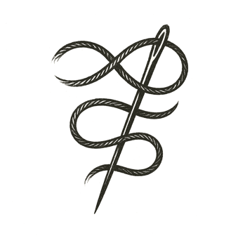

<!-- AI-assisted: new Open for the first Gate (March 2029), set in India, by Claude, replacing the earlier loom scene; epigraph a traditional Māori whakataukī (proverb), with a common English rendering; confirm wording and usage with a Māori-language source before print; awaiting Sam's pass. -->
<!-- SOURCE-CHECK 2026-11-18: the Maori proverb and net/succession reading are supported by Teorongonui Josie Keelan, Nga Reanga: Youth Development Maori Styles, ch. 5. The supplied English is a rendering, not an attributed verbatim translation. This Gate scene is fictional. -->

_Ka pū te ruha, ka hao te rangatahi._  
_The old net is laid aside; the new net goes fishing._  
--- **Māori whakataukī**

Pune, March 2029. The power has been back for an hour, the ceiling fan is turning again, and the grandmother has gone back to her loom.

Her granddaughter sits across the kitchen table with a tablet propped against a steel tumbler of cooling chai, untangling the afternoon: a refill that never arrived, a ride promised twice, a neighbor's offer of a spare room that no one had yet accepted, three agents insisting, politely and at length, that everything was resolved.

"You're doing it wrong," the grandmother says, without looking up.

"I'm not weaving, Nani."

"Everyone is weaving." She lifts a thread, frayed at one end. "This one was promised. Who's holding it?"

The girl looks at her screen. A ride, accepted by a driver at noon, then reassigned by one system, cancelled by another, and now held by no one at all. Somewhere across the city, an old man is waiting by his gate with his good shirt on.

She makes a call. A real one, with a voice at the other end.

The grandmother pulls the thread through, tightens it, and moves on to the next.

---

*What new net could we cast, if every thread had someone holding it?*
