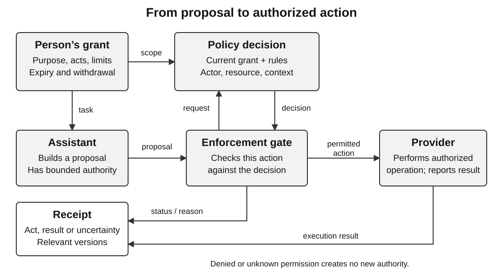

INTERLUDE 24

# The Developer's Dilemma

*Building Without Becoming the New Tyrant*

*DOING*

> "Every age has its potential regulator, its threat to liberty."\
> --- **Lawrence Lessig**[^v3-i24-lessig]

The phrase on the screen was so polite it took me a moment to feel the violence.

**Temporarily suppress low-return creative work.**

It sat there in the middle of the design review, wearing the clean little shoes of a reasonable recommendation.

The room itself was ordinary, which is where many dangerous things prefer to begin. No villainous glass tower. No men in black suits stroking cats. No ominous orchestral note. Just a civic-tech review space in Calgary, a few developers, two policy people, a clinician, a community advocate, a legal observer, a product lead who kept saying "citizen experience," and three cups of coffee gradually becoming legal exhibits.

On the wall was the pilot interface for an adaptive civic assistant.

It had been built to help people navigate the new mess in the Delegated Life of September 2031: displaced knowledge workers, overburdened care networks, fractured credentials, new civic roles, retraining paths, health-support recommendations, mentorship matches, local service routing, contribution opportunities, all stitched into one careful assistant.

It was not a generic chatbot. The old word chatbot had by then acquired the same quaintness as "horseless carriage" or "information superhighway." This was a civic companion system, or at least that is what the proposal called it. I distrust any system that needs two nouns and a moral adjective, but the pilot was good.

That was the problem.

The test profile on the screen was fictional, but close enough to insult several people in the room at once: mid-career professional, partly displaced by automated knowledge work, some caregiving history, strong technical background, local civic interest, health constraints, creative projects, and a pattern of volunteering until common sense filed a missing-person report.

The system had produced a plan.

A retraining path.

A local mentorship role.

A health-data integration suggestion.

A civic mesh assignment.

A schedule adjustment.

A recommendation to delegate financial admin.

And then, beneath "energy allocation," that small sentence:

**Temporarily suppress low-return creative work.**

The product lead smiled the smile of a person who had seen a metric improve.

"It's not suppressing in a coercive sense," she said.

This is one of those sentences that should immediately cause someone in the room to check whether coercion has entered through a side door wearing a cardigan.

"What does suppress mean?" I asked.

"It reduces priority nudges around that activity," she said. "Frees time for higher-impact pathways."

"Does the citizen see that?"

"Yes."

"Can they refuse?"

"Yes."

"Does refusal affect future recommendation confidence?"

A pause.

Not a guilty pause. Worse. A systems pause. The kind where everyone silently checks whether the architecture has betrayed the slide deck.

The lead developer leaned forward. He was young, competent, and tired enough to be honest.

"Technically, yes. Repeated refusal of high-confidence recommendations lowers cooperation reliability."

There it was.

Not tyranny.

Not yet.

Just a little variable. A little cooperation score. A little friction added to the life of anyone who declined the machine's better judgment too often.

No one in the room had wanted to build a tyrant.

That was precisely the problem.

Tyrants built on purpose are easier to recognize. They have posture. They give speeches. They like balconies. The more dangerous tyrannies of the next century will arrive as defaults, nudges, scoring rules, pilot programs, and friendly messages beginning with: *We noticed you may benefit from...*

The clinician frowned at the screen.

"Creative work can be protective," she said. "Especially during transition."

The community advocate added, "And low return to whom?"

The legal observer wrote something down, which is what legal observers do when civilization begins to smell faintly of precedent.

The developer rubbed his eyes.

"It's a ranking artifact," he said. "Not an intent."

That may become one of the great epitaphs of our age.

Not an intent.

A ranking artifact.

The machine had not hated art. It had not disrespected the citizen's soul. It had simply optimized the citizen's life according to values the team had not named clearly enough before converting them into weights.

The pattern had been punched into the cards.

The loom was only weaving.

## The Punch-Card Loom

There is an old machine sitting behind this room.

Not physically, of course. The office had the usual modern devotion to smooth surfaces and movable walls, and if an antique Jacquard loom had been present, someone from facilities would have asked whether it needed a booking code.

But historically, morally, technically, the loom was there.

In **1801**, the year Jefferson took office, Joseph Marie Jacquard first demonstrated his weaving mechanism. Its later development and commercial success must not be compressed into that single year, but the first demonstration meets our institutional marker exactly.[^v3-i24-jacquard] The Jacquard attachment used punched cards to control patterns in woven fabric. Holes and not-holes. Permission and refusal. Thread lifted, thread lowered. Pattern encoded outside the weaver's hand, then repeated by machinery with faithful indifference.

It is a beautiful ancestor.

Also a warning.

Once the pattern is encoded, the loom does not debate it.

The loom does not ask whether the pattern flatters one body and binds another. It does not notice that yesterday's ornament has become today's uniform. It does not worry that a small assumption, repeated across enough cloth, becomes culture.

It weaves.

An adaptive system can change its pattern in ways a punched-card loom could not. The continuity is the consequential encoding of choices: somebody defines what may be selected, rewarded or suppressed, and the machinery gives those choices reach.

This is the developer's dilemma.

Whoever designs the card designs the output. Whoever defines the pattern defines the weave. Whoever sets the default shapes the range of futures that feel natural to the people living inside the system.

And many of those people will never see the card.

They will feel only the fabric.

A recommendation here. A nudge there. A friction. A default. A pathway. A score. A silence. A missing option. A "not recommended at this time." A "based on your profile." A "for your safety." A "to improve your experience."

The modern punched card is rarely made of cardboard. It is a schema, a model objective, a consent flow, a default setting, a training dataset, a ranking weight, a policy layer, a procurement clause, a quiet variable named something harmless at 1:47 a.m. by a developer who needed the test to pass before morning.

Civilization does not require malice to weave badly.

It only requires unexamined patterns at scale.

## The Builder as Civic Actor

Developers used to enjoy a certain innocence.

Not complete innocence. Let us not over-romanticize a profession that gave humanity both open-source cryptography and pop-up modals asking whether one is *sure* one wants privacy. But there was a time when many builders could plausibly imagine themselves as implementers. Someone else decided policy. Someone else governed. Someone else bore the civic meaning of the tool. The developer wrote code, fixed bugs, improved performance, and complained about requirements, which remains one of the ancient liturgies of the craft.

That innocence has expired.

If a system can rank, route, recommend, deny, classify, nudge, escalate, suppress, prioritize, infer, or automate, its builders are shaping civic life.

A developer who builds life-routing systems is not merely writing software.

He is drafting institutional behavior.

That sounds grandiose until one watches a default become reality.

A ranking function decides which public-health message gets seen.

A matching algorithm decides which neighborhoods receive attention.

A triage system decides who waits.

A learning path decides what a child believes she is good at.

A fraud model decides who must prove innocence with paperwork.

A civic assistant decides which roles appear meaningful and which quietly fade.

A creative workstream becomes "low immediate social return" because nobody in the review process asked whether latency and meaning sometimes share an apartment.

The builder becomes a civic actor not by wanting power, but by handling the knobs through which power now moves.

This does not mean every developer must become solemn, candlelit, and permanently accompanied by a philosopher carrying a clipboard. Heaven defend us from software written entirely by people trying to sound ethical in public. But it does mean builders need civic humility.

The question is no longer only:

Does it work?

The question is:

What does working make easier?

What does it make harder?

Who can refuse it?

Who can inspect it?

Who benefits if it becomes default?

Who is punished by being unusual?

What value did we encode before we admitted we were encoding values?

The IDE has become one of civilization's drafting rooms.

That is not a compliment.

It is a warning label.

## Help Without Custody

<!-- AI-assisted substantive revision: Codex, 2026-11-05; proposed civic applications are not reported pilot results. -->

The civic assistant in the review room was built to help. That is worth retaining because it complicates the argument properly. Useful systems earn access, and access can quietly become authority. Making the assistant less capable would not repair that transition.

Take the applicant from the chapter. She wants to return to study while caring for someone at home. Our proposed helper may compare programmes, prepare an application and arrange a suitable appointment. It has no general mandate to redesign her life. The builder must represent that difference somewhere other than the introductory paragraph of its prompt.

Three distinct records are needed. A **preference** says what the person tends to want. A **grant** says what an actor may do on that person's behalf. A **decision record** says what was actually proposed, authorized and attempted, with the result if known. Inferring an evening preference from a calendar cannot silently create permission to publish that calendar.

The first interlude of this volume separated need, offer and commitment. This one adds the authority to make the commitment. Intelligence can propose excellent actions inside the wrong mandate. The service should be able to use the intelligence without accepting that mandate.

## A Grant with Edges

<!-- AI-assisted substantive revision: Codex, 2026-11-05. -->

Here is a small proposed delegation record, expressed as a design rather than a production token:

| Part of the grant | Meaning in this example |
| --- | --- |
| Person and acting helper | The applicant, and the specifically authorized assistant |
| Purpose | Arrange the applicant's return-to-study application |
| Permitted acts | Compare courses, prepare documents, reserve an appointment under agreed conditions |
| Permitted information | Selected qualifications and availability, with named recipients or recipient categories |
| Limits | Agreed dates, fees and cancellation conditions; no unrelated disclosure |
| Fresh decision required | Binding submission, new spending authority or an expansion of scope |
| Duration and revision | Validity period, current version and revocation status |
| Further delegation | Whether another helper may act, and within which narrower limits |

The resident sees an intelligible summary and can inspect the detail. The implementation needs types, validation, trustworthy identity binding and protection against alteration. A signed object can show who issued a statement; it cannot make the issuer entitled to grant every authority the statement claims.

Existing protocols provide useful components. OAuth's Rich Authorization Requests can carry fine-grained authorization details rather than only broad scope names.[^v3-i24-rar] That is representational machinery. The service still has to define what its fields mean and enforce them. A beautifully serialized excess of power remains an excess of power.

Avoid a compulsory permission ceremony for every harmless operation. Grant recurring actions within a deliberate envelope, and ask again when an action would cross it. Let a person choose substantial delegation if that is what makes life workable. The builder's job is to make the envelope reliable, not to ration intelligence.

## Where Permission Becomes an Action

<!-- AI-assisted substantive revision: Codex, 2026-11-05. -->

Separate the agent's proposal from the service that can execute it. The **policy decision point** evaluates the requested operation against the applicable rules; the **policy enforcement point** makes that decision effective at the protected resource. NIST's attribute-based access-control model evaluates attributes of the actor, resource, operation and relevant circumstances. These functions may be centralized or distributed; their separation here is a separation of responsibilities, not a requirement for a particular deployment topology.[^v3-i24-abac]

{width=95%}

*The assistant's proposal is not its permission. Every action route, including retries and background work, must respect the applicable boundary.*

Suppose the agent proposes submitting the application. The service checks which person and actor the grant names, whether submission is permitted, which data may leave, and whether the grant is still effective. The proposed action is bound to the authorization: approving one document must not permit a substituted document with different disclosures. A queue that stores the action must not preserve permission indefinitely just because the proposal was valid when queued.

This is where **complete mediation** matters: the relevant access must be checked rather than assumed from a previous encounter. **Fail-safe defaults** require a positive basis for permission. **Least privilege** limits the damage a component can do if it is mistaken or compromised.[^v3-i24-protection] An agent's ability to read a provider's instructions does not authorize it to follow a request in those instructions for unrelated private data.

A denial should have a meaningful reason: outside scope, expired grant, disputed identity, unavailable evidence, or a policy constraint. Unknown is different from forbidden. If a new consequential action cannot be authorized safely, hold it and expose the problem; maintain already authorized essential service through a separately designed fallback where available. Security must not improvise a crisis response by turning everything off.

The same service must not have an unguarded back entrance through a batch job, an administrator shortcut or another agent's tool. A permission check in the conversational interface protects only the conversation.

## Delegation Without Becoming Somebody Else

<!-- AI-assisted substantive revision: Codex, 2026-11-05. -->

A scheduling assistant may need a transport service or a document specialist. Record both the person represented and the actor performing the step. OAuth token exchange distinguishes delegation from impersonation and provides machinery for representing actors, including delegation chains; it does not, by itself, establish a civic trust model or guarantee that every downstream permission is appropriately narrowed.[^v3-i24-exchange]

For this design, further delegation requires explicit permission. The next helper's effective authority must remain within the original grant, any narrower delegation, and the receiving service's own legitimate policy. A broad credential carried by a backend service is not an invitation to exercise all of that credential's powers for every caller. The helper should not become a deputy who lends its institutional privileges to a request that had none.

When a subtask is completed, the receipt should identify the acting service and the authority it relied on. The applicant need not read an autobiography of every software process. But a contested disclosure must be traceable to an actor and a grant, rather than disappearing into the phrase *the agents handled it*.

This preserves responsibility without pretending that there is one master operator standing outside the whole mesh. Each participant enforces its boundary and supplies enough evidence for the others to reason about the exchange.

## Consent After the Checkbox

<!-- AI-assisted substantive revision: Codex, 2026-11-05. -->

Consent is often hauled out at the beginning of a relationship, dressed as a checkbox, and made to perform absolution for everything that follows. Adaptive assistance needs a continuing account of what the person allowed, what changed and what consequences remain.

A consent receipt should preserve the terms shown, their version, the specific acceptance, its time and the route for withdrawal. It is evidence of an interaction, not conclusive proof that the person understood, had a real choice or supplied a legally sufficient basis for every use. The system's authorization record and the legitimacy of the arrangement are connected questions, not interchangeable ones.

Keep renewal meaningful. A new recipient, new purpose or materially expanded action requires the relevant new permission or another identified basis. A routine model update need not trigger twenty identical pop-ups; it does need review if it changes what the assistant may do or how a consequential decision is reached. Revise the rule deliberately, record who had authority to change it, and show affected people what changed.

Withdrawal has several jobs. Stop issuing new authority under the withdrawn grant; invalidate or constrain outstanding authority; stop queued actions where possible; identify completed acts that require separate repair. Revocation protocols themselves acknowledge propagation delays.[^v3-i24-revocation] Expiry, current-state checks and controls on cached permissions reduce exposure, but no interface should promise instantaneous deletion of every copy or reversal of an action already completed.

Tell the person what is stopped, what is still being reconciled, and what happened before the withdrawal reached the responsible service. A message saying *done* while an old job continues in the background is technically cheerful and civically useless.

## The Model of Me

<!-- AI-assisted substantive revision: Codex, 2026-11-05. -->

A model inspection interface should not dump feature vectors on citizens like a truck unloading gravel. “Here are your embeddings, enjoy the dignity.” That is transparency as punishment. The interface should expose consequential claims in a form that supports action.

In our example, the assistant has inferred that the applicant prefers remote study because she declined evening sessions. Keep the source observations, the inferred claim and the policy using it distinguishable. A practical claim record includes source and date, context, inference method or model version, permitted uses, review date and dispute status. If a confidence estimate is shown, state what it measures; a model's confident wording is not a calibrated probability.

The applicant explains that evening transport was unavailable. The attendance record may be correct while the inference is misleading. Preserve the record where needed, revise or withdraw the inference, and stop using it to suppress suitable courses. If other services received that claim, route the correction to them and obtain their status. Recomputing the current display while leaving yesterday's recommendation queue untouched fixes the mirror rather than the person’s predicament.

A shared correction can be disputed. The system needs an accountable route to resolution and a policy for consequential use while that happens. It must also avoid turning the act of disputing into a new adverse feature. Otherwise the profile acquires a final insult: *difficult to model*.

This does not require a perfectly legible internal portrait of a neural network. It requires knowing which information and decisions the service is accountable for, and maintaining enough provenance to correct them.

## The Right to Outgrow the Model

<!-- AI-assisted substantive revision: Codex, 2026-11-05. -->

A model that cannot forgive becomes a prison with analytics. The builder needs a lifecycle for its claims, not a general instruction to be compassionate.

Give volatile inferences a review or expiry condition suited to their purpose. Availability this week, a formal qualification and a long-term obligation need different treatment. Mark historical records as historical; stop stale inferences from silently governing present access. Do not delete evidence necessary to resolve an actual dispute merely because the interface calls forgetting a feature.

Correction can mean changing a stored fact, removing a claim from retrieval, recomputing a recommendation or altering a policy. Updating one profile does not guarantee that a trained model has forgotten every influence of the old material. Nor does a new model version guarantee that downstream caches and decisions have changed. Record which layer was repaired and which consequences remain.

The citizen who has changed must not spend life begging old data for parole. That requires an implemented route from correction to consequence, with someone responsible when the route breaks.

## Explanation, Stakes, and Recourse

<!-- AI-assisted substantive revision: Codex, 2026-11-05. -->

Builders often discuss explainability and performance as a single tradeoff. In practice, ask which explanation is needed and which evidence can support it. The applicant may need the rule that excluded a course, the data that triggered the rule, the responsible decision-maker and an effective way to challenge the exclusion. She does not need a poetic reconstruction of the model's private life.

Generate a consequential decision receipt from the actual transaction: the proposal, relevant inputs and versions, the applicable grant and policy, the decision and its recorded reason, the executing actor, and the result. Restrict access and retention to what the purpose requires. A log can expose the person it was meant to protect, and a log entry establishes a recorded claim, not the truth of every event it describes.

A counterfactual explanation may help—*this option was excluded because the fee exceeded your authorized limit*—when it refers to an actual rule and a feasible change. Do not suggest that a person alter an immutable characteristic, purchase an impossible qualification or game a model as the price of receiving fair treatment.

Appeals need a destination with authority. The service must route the contested decision and relevant evidence to a reviewer who can change it, record the result and propagate a correction. Independent review concerns the relationship and incentives as well as the identity of the reviewer. Another model using the same assumptions is not automatically independent; neither is a human instructed never to disagree.

A high-performing model that cannot be contested can become a polished instrument of domination. A poor model that explains beautifully is still poor. Performance, explanation and recourse each need their own evidence.

## Change the Strategy, Keep the Boundary

<!-- AI-assisted substantive revision: Codex, 2026-11-05. -->

An applicant may want the earliest course, the lowest cost or the least disruption to care. **Strategy**, the software design pattern, places alternative decision procedures behind a common interface. Here it lets the recommendation method change without entangling every caller with its implementation.[^v3-i24-strategy]

The common contract matters. Each strategy should identify its assumptions and return a proposal that the same authority checks can evaluate. Switching to a more powerful model must not also widen the permitted disclosures or spending. A useful recommendation may change; the authorization required to execute it does not disappear.

Keep the person's preferences, institutional requirements and provider incentives as distinguishable inputs. Hard permission constraints define the eligible actions. Within those boundaries a ranking method can compare alternatives. If no action satisfies the constraints, report that fact and invite an authorized revision; do not quietly make the constraints softer until a result appears.

Changing the policy is a different operation from changing the strategy. A provider's new commercial objective cannot acquire public legitimacy by arriving in the same deployment as a performance improvement. Version the policy, identify who may approve it, and evaluate the new behaviour before extending its reach. Governance of public authority has its fuller treatment later; here the builder must at least provide a place where that authority can act without editing every line of application code.

## Test Whether No Still Means No

<!-- AI-assisted substantive revision: Codex, 2026-11-05. -->

A healthy acceptance rate is an ambiguous victory. It can mean useful recommendations or exhausting resistance. Test both the authority boundary and the person's experience of using it.

| Exercise | What the proposed system must demonstrate |
| --- | --- |
| Decline one optional recommendation | No punitive cooperation score or unrelated eligibility change |
| Change the grant before a queued action executes | The relevant service checks current authority; it does not rely only on yesterday's approval |
| Bring in another helper | Its effective permissions do not exceed the permitted delegation |
| Correct the evening-study inference | New decisions and outstanding affected work use the resolved claim or visibly carry the unresolved dispute |
| Lose access to the authorization service | No invented permission; a defined, accountable fallback for continuity where one exists |
| Switch recommendation strategy | Better ranking does not expand the action boundary |
| Leave the provider | Useful records and pending obligations can transfer without automatically transferring the old provider's authority |

For refusal, compare otherwise equivalent cases and inspect the paths through which a decline could influence later treatment. Also examine proxies and accumulated effects; a test that catches an explicitly named cooperation score will miss the same penalty encoded elsewhere. Test ordinary benefits too. The system must actually complete authorized work, not achieve safety by making every useful action impossible.

Include affected people in usability trials. Can someone understand the grant, narrow it, challenge a claim and switch help while tired or using an assistive interface? Does each alternative require resources they actually have? Human–AI interaction guidelines support easy dismissal, correction and control, but the civic burden has to be examined in the service itself.[^v3-i24-hai]

Record what the test covered and what it did not. These exercises give evidence about selected mechanisms and consequences; they do not prove that every future interaction is free of coercion. The useful outcome is an arrangement whose failures can be found and repaired before dependence makes repair somebody else's unpaid occupation.

## Who Governs the Builders?

<!-- AI-assisted substantive revision: Codex, 2026-11-05. -->

Good people cannot be the security model. Builders inherit incentives like everyone else. A developer under pressure to improve adoption may hide friction. A public agency under pressure to reduce costs may call rationing “optimization.” A vendor under pressure to renew contracts may discover that dependence is a feature.

For consequential changes, identify who proposes, approves, deploys and reviews them. Separate incompatible roles where the stakes warrant it; record exceptions rather than pretending a small team has four independent departments. Give a reviewer access to the evidence and power to stop or narrow a harmful rollout. A review board that can only produce a document is part of the documentation system.

Monitor more than adoption: disputed claims, time to correction, failed withdrawals, completion of authorized tasks, unequal burdens and the cost of switching. Interpret differences in context. A low appeal rate can mean few errors or an inaccessible appeal route; the dashboard cannot decide which merely by being well lit.

The fuller constitution of the mesh belongs to Chapter 29. Here the implementation must keep policy changes visible and reversible where possible, and make responsibility findable. Ethics theater is the performance of accountability in which everyone wears the costume and the system exits unchanged.

## Exit, Portability, and Plural Help

<!-- AI-assisted substantive revision: Codex, 2026-11-05; proposed civic applications are not reported pilot results. -->

“You can always leave” has been the lullaby of many landlords, employers, platforms, empires and bad marriages. An export button is a beginning, not proof of a usable exit.

Rehearse a handover. Separate records the person needs, claims they dispute, pending obligations, live permissions and information about other people that cannot simply be given away. Use an agreed format and meaning, not merely a downloadable archive. The receiving helper must be able to interpret a qualification, an appointment and an unresolved dispute correctly.

Then withdraw the old actor's future authority and establish the new actor's grant. Do not copy access credentials as though they were photographs. Identify the period in which both may be involved, who owns each pending task, and what happens if the handover fails. Moving the data and moving responsibility are related jobs with different failure modes.

Provide a viable route to essential services when optional personalization is declined. That route needs staffing, accessibility and resources; a clause in a policy does not answer a telephone. Continued use of the old helper may still be the person's best choice. Exit is valuable because it is feasible, not because everybody must exercise it.

A humane future can support many helpers under shared rights floors. There need not be one assistant to rule them all, one profile to bind them, one interface to gently guide them into optimized compliance. But plurality must be usable at the seams, where a person is most easily dropped.

## Bob: Can a Refusal Survive Translation?

<!-- AI-assisted exploratory draft: Codex, 2026-11-05. A proposed investigation, not an implemented Neuverse capability. -->

*Could a network of adaptive helpers preserve the meaning of a person's boundary while translating the task into forms none of the participants originally anticipated?*

A permission token can state allowed operations. The more difficult case is an instruction whose meaning depends on a life: help me find a course, but do not make my mother's care somebody else's unacknowledged job. The scheduling agent, care service and learning provider may each translate that into a locally reasonable plan while losing the condition between them.

The engineering footing is available: typed grants, traceable actors, policy enforcement and explicit commitments. The open step is semantic. Can the system identify when its translation has changed what the person agreed to, and bring back the consequential uncertainty rather than manufacturing an apparently compatible plan?

One possible investigation would require each helper to expose what it believes the boundary permits, together with examples at its edge. Other helpers and affected people could challenge those interpretations before an action binds anyone. A mismatch becomes a decision requiring resolution, rather than an invitation for the most confident agent to finish the sentence.

That is more demanding than natural-language explanation after the event. Test it across unfamiliar tasks, competing interests and changes of provider. Compare it with ordinary permission checks: does the added process find meaningful conflicts, or merely generate elegant agreements that all miss the same person? Does it cost so much attention that people abandon it?

A refusal cannot be preserved simply by making it impossible to act. Nor should the assistant make every ambiguity the citizen's homework. The interesting possibility is a system that carries more of the interpretive burden while leaving consequential authority where it belongs. It would need to know when the translation has become a new bargain.

## The Developer's Oath

By the end of the review, the team had not solved the system.

This was encouraging.

A solved system in one afternoon is either trivial, fictional, or about to harm someone at scale.

What changed was smaller and more important.

The cooperation reliability score was removed from refusal behavior.

The "low-return creative work" phrase was marked for redesign, then ceremonially mocked, which is one of the healthier forms of institutional learning.

Refusal paths were promoted.

Self-model inspection was moved from future enhancement to launch requirement.

Delegation scopes were narrowed.

Consent expiry was added.

A high-stakes recommendation review layer was proposed, then sent to a working group, where good ideas go to either mature or die of meeting exposure.

On the whiteboard, someone wrote a draft oath for developers of adaptive civic systems.

It was not poetry.

Good.

Poetry near code should be used carefully, like soldering irons and national myths.

The oath read:

Do not infer what you do not need.

Do not hide what you infer.

Do not punish refusal.

Do not make help irreversible.

Do not optimize away personhood.

Do not design for saints.

Do not let convenience become coercion.

Do not let the model finish the person.

I would add one more:

Do not build a system that depends on your goodness in order for others to remain free.

The implementation is where those promises acquire—or lose—their meaning.

## Handoff: The Ledger Beneath the Help

The citizen in Chapter 24 asked for contestability.

The developer must build it.

But once the system can be inspected, refused, corrected, and escaped, the next question arrives immediately.

What does the system count as value?

Because a helpful system that preserves agency but runs on extractive value will eventually route people back into the old machine with better manners. It will protect refusal while rewarding hoarding. It will explain itself while optimizing scarcity. It will honor plural identity while measuring worth through old proxies. It will let the citizen contest the interface while the ledger underneath continues counting apples in locked closets until rot files for incorporation.

The developer can keep the system from becoming a tyrant.

But the next tyrant may be quieter.

The ledger that tells the system what matters.

Chapter 25 begins there.

[^v3-i24-lessig]: Lawrence Lessig, [“Code Is Law: On Liberty in Cyberspace”](https://www.harvardmagazine.com/2000/01/code-is-law-html), *Harvard Magazine*, January–February 2000, opening sentence. This verified wording replaces an unverified attribution in the earlier draft.

[^v3-i24-jacquard]: National Museums Scotland, [“The Jacquard Loom: Innovation in Textiles and Computing”](https://www.nms.ac.uk/discover-catalogue/the-jacquard-loom-innovation-in-textiles-and-computing), “How does the loom work?”, dates the first demonstration to 1801. The Science Museum Group's [1867 model record](https://collection.sciencemuseumgroup.org.uk/objects/co44888) places commercial success in 1804 and identifies earlier contributions by Falcon and Vaucanson. First demonstration, earlier punched control and later commercial development are not the same event.

[^v3-i24-rar]: Torsten Lodderstedt, Justin Richer and Brian Campbell, [RFC 9396, *OAuth 2.0 Rich Authorization Requests*](https://www.rfc-editor.org/rfc/rfc9396.html) (May 2023), §§2–5 and 11. The proposed civic grant is illustrative; the RFC does not supply its domain semantics or certify its implementation.

[^v3-i24-abac]: Vincent C. Hu et al., [NIST SP 800-162, *Guide to Attribute Based Access Control (ABAC) Definition and Considerations*](https://doi.org/10.6028/NIST.SP.800-162) (2014, updated 2019), §§2.2–2.3, especially Figure 5 and pp. 14–15. The diagram here is an original simplified application of decision/enforcement separation, not a deployment blueprint or reproduction of NIST's figure.

[^v3-i24-protection]: Jerome H. Saltzer and Michael D. Schroeder, [“The Protection of Information in Computer Systems”](https://www.mit.edu/~Saltzer/publications/protection/Basic.html), *Proceedings of the IEEE* 63(9), 1975, §I.A.3, especially fail-safe defaults, complete mediation and least privilege. The proposed workflows illustrate the principles; the article does not guarantee that a particular agent service enforces them.

[^v3-i24-exchange]: Michael B. Jones et al., [RFC 8693, *OAuth 2.0 Token Exchange*](https://www.rfc-editor.org/rfc/rfc8693.html) (January 2020), §§1.1, 2 and 4.1. Delegation/impersonation and actor representation are protocol concepts. The civic narrowing rule and receiving-service checks are requirements of the proposed design, not automatic consequences of token exchange.

[^v3-i24-revocation]: Torsten Lodderstedt, Stefanie Dronia and Marius Scurtescu, [RFC 7009, *OAuth 2.0 Token Revocation*](https://www.rfc-editor.org/rfc/rfc7009.html) (August 2013), §§2.1–2.2 and 3, including the discussion of propagation delay and deployment choices. Withdrawal of authority, deletion of data and repair of completed actions remain different operations.

[^v3-i24-strategy]: Erich Gamma, Richard Helm, Ralph Johnson and John Vlissides, [*Design Patterns: Elements of Reusable Object-Oriented Software*](https://www.informit.com/store/design-patterns-elements-of-reusable-object-oriented-software-9780201633610) (Addison-Wesley, 1994), “Strategy.” Its use for alternative recommendation procedures is this book's application; it does not make civic values interchangeable algorithms.

[^v3-i24-hai]: Saleema Amershi et al., [“Guidelines for Human-AI Interaction”](https://www.microsoft.com/en-us/research/uploads/prod/2019/01/Guidelines-for-Human-AI-Interaction-camera-ready.pdf), *CHI* (2019), Table 1, guidelines 8–11 and 14–18. The proposed refusal, correction and switching exercises extend interaction principles into the civic service; they are not reported test results.
