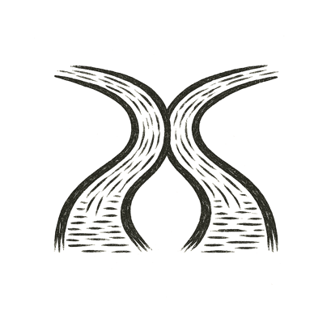

<!-- AI-assisted: new Open for the second Gate (September 2031), set in Siksika Nation, Treaty 7 territory, by Claude, replacing the earlier "initial commit" scene; epigraph from T. W. Rhys Davids's translation of the Mahāparinibbāna Sutta (1881, public domain); details of present-day Siksika life to be checked with a Siksika or Blackfoot reader before print; awaiting Sam's pass. -->
<!-- SOURCE-CHECK 2026-11-18: Rhys Davids, Buddhist Suttas (1881), Mahaparinibbana Sutta II.33, p. 38, supports the quoted English. The Siksika scene is a future fiction; its reader-review request remains open. -->

_Be ye lamps unto yourselves. Be ye a refuge to yourselves._  
--- **The Buddha**, *Mahāparinibbāna Sutta* (trans. T. W. Rhys Davids)

Siksika Nation, east of Calgary, September 2031. The prairie has gone the color of bread crust, and the wind is doing what it has done here for ten thousand years.

At the health centre, the Nation's young data steward reads the offer a second time. It's generous. A provincial care network, and the very capable assistant that speaks for it, would take over the community's health records, connect them to everything and catch problems earlier than anyone here could. All she has to do is move the records off the Nation's own servers and let the network keep them.

Her uncle, who has spent the summer helping with the buffalo the Blackfoot have been bringing home, leans in the doorway, smelling of dust and horses.

"They want to help," she tells him.

"Good," he says. "Can they help here?"

She thinks about it. Then she writes back: the assistant is welcome to come and work on the Nation's machines, under the Nation's rules, answering to the people it serves. The records stay where they are.

The reply arrives within the minute. *Understood. When should we start?*

Outside, the wind keeps its own counsel.

---

*What help would we welcome, if it came to us instead of taking us to it?*
