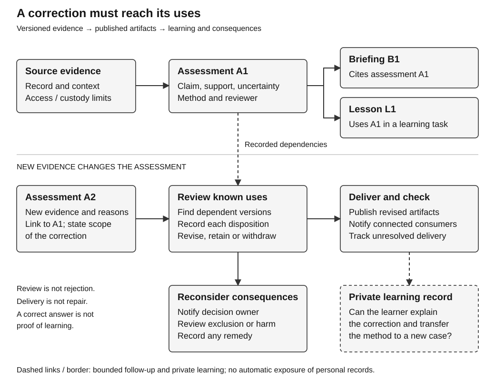

INTERLUDE 26

# Signal and Story

*Cognitive Architectures for a Wise Infosphere*

*EDUCATION*

<!-- Reserved opening: legacy projected scene retained for Sam/Claude, not an achieved pilot or factual recollection. Detector scores, dialogue and the later verdict are not validated. See work/volume-3-drafting/26-vignette-constructions-2036.md for the replacement construction and 2036 rationale. -->

The first rule of the lab was that nothing entered the public record wearing only one face.

This was written on the wall in three languages, two scripts, and one diagram that looked suspiciously like a nervous octopus trying to get tenure.

I stood before the signal table and watched the city argue with itself.

Not loudly. Not yet. Loudness would come later, if we failed. At the moment, the argument was still contained inside the room, which is one of the underrated achievements of civilization. A falsehood inside a room can be examined. A falsehood loose in the streets becomes weather.

The room was not a spy agency, though the screens were doing their best to create the misunderstanding. It was not a newsroom, though a journalist sat near the front with the hollow-eyed composure of someone who had spent a career deciding what the public should know before the public decided for itself anyway. It was not a classroom, though a teacher had already rearranged two chairs into something less hierarchical. It was not a library, though the walls carried shelves of archived civic records, annotated legal decisions, old public-health bulletins, environmental reports, oral histories, and enough versioned documents to make a bureaucrat briefly believe in the afterlife.

It was a verification room.

A civic one.

That mattered.

The contested clip had arrived that morning, shortly after breakfast, which is when democracies are least prepared for metaphysics. A respected local organizer appeared to say something inflammatory about a public housing and care project. The line was ugly. Specific enough to injure, vague enough to travel. Within seventeen minutes, three community channels had split. Within thirty, counter-clips appeared. Within forty-two, two prominent accounts claimed the debunk was itself a manipulation. By lunch, the question was no longer what had been said.

It was which world one belonged to if one believed it.

That is when the clip came to the lab.

On the central display, the video played without sound.

That was deliberate.

The first rule of contested media: remove the music before examining the knife.

A face moved. A mouth formed words. The background showed a community hall. The lighting looked right. The gestures were plausible. The microexpressions were not obviously wrong. The clip had that terrible quality of the nearly real: just enough friction to feel human, not enough error to be comforting.

Beside it, the signal table assembled.

**Source:** unknown repost, third-generation compression.\
**Claimed capture device:** unverified.\
**Timestamp:** inconsistent with hall access log.\
**Signature:** absent.\
**Witnesses:** two present, neither recalls phrase.\
**Audio track:** probable synthetic overlay, confidence 0.78.\
**Mouth sync:** altered or generated, confidence 0.64.\
**Background:** authentic to location.\
**Institutional context:** public hearing, emotionally charged.\
**Public-risk level:** high.\
**Recommended public claim:** do not certify; issue bounded uncertainty statement.

A teenager from the local learning council stood beside me, arms folded.

"So is it fake?"

The AI assistant, mercifully, did not answer.

A lesser system would have replied with a confidence score, and the room would have mistaken a number for judgment.

The teacher looked at the teenager.

"What can we safely say?"

He frowned at the table.

"That the background is real. The event happened. The phrase probably didn't. Or at least the clip is not safe evidence that it did."

The journalist nodded.

"Good. Now say it in a way that won't sound like we're protecting her."

The teenager looked wounded by the unfairness of adulthood.

The civic mediator leaned forward. "And say what we do not know."

The systems engineer added, "And say how we'll update."

The AI assistant finally spoke.

**Draft public statement available. Includes uncertainty, evidence summary, challenge path, and next review time.**

"Read it," said the journalist.

The assistant began:

**A video circulating this morning appears to show---**

"No," the journalist said.

The room paused.

"Never start with 'appears to show' if the appearance is the weapon."

That went onto the board.

The assistant revised.

**A video circulating this morning is under review. The location appears authentic, but the audio and speech alignment show signs of alteration. At this time, the clip should not be treated as reliable evidence of the alleged statement. Two witnesses present at the event do not recall the phrase. A full provenance review is underway. Anyone with original footage, device capture logs, or direct witness testimony may submit through the public evidence channel. We will update at 16:00.**

The room breathed.

Not because the statement was perfect.

Because it was restrained.

In the old infosphere, restraint had been treated as weakness. The first voice to declare certainty often won the first hour, and the first hour often wrote the emotional constitution of the next week. Here, we were trying to build a different reflex: not silence, not censorship, not priestly control, but disciplined public speech under uncertainty.

The teenager looked at the three versions of the clip: original event archive, forged viral edit, verified reconstruction.

"How are people supposed to trust this?" he asked.

No one answered too quickly.

That was the second good sign.

A city that would never drink from an untested reservoir was still swallowing stories from broken pipes.

We were here to build the filters, pipes, reservoirs, warning labels, public wells, and civic habits that might keep meaning potable.

Welcome to the epistemic waterworks.

## The Floor Moves: 1851

<!-- AI substantive draft, 5 November 2026. -->

On **3 February 1851**, Léon Foucault communicated his pendulum experiment to the French Academy of Sciences. Its slowly changing plane of oscillation, measured relative to the room, made Earth's rotation locally detectable. The account appeared in that day's *Comptes rendus*. Later that year the demonstration reached the Panthéon.[^v3-26i-foucault]

The earthbound observer had acquired a way to detect the motion of his own apparently stationary platform. The room had been supplying the default frame with excellent manners and no disclosure.

The pendulum did not remove interpretation. Suspension, release, latitude and other disturbances mattered. Foucault connected a visible effect to a mechanical account that other investigators could inspect and reproduce. For public understanding, the important move was from being told a conclusion to being given a disciplined way of encountering its evidence.

That is the technical mirror to our **1851** account of Sojourner Truth. A later narrator could make a voice easier to hear while making its source harder to recover. A scientific apparatus could make an unseen motion observable while still requiring an account of how it worked. Both leave the builder a question: what must remain inspectable between the event and the understanding we offer?

By **September 11, 2036**, the machinery between those points may translate, retrieve, infer, simulate and teach continuously. Its competence will make the connections useful enough to disappear from ordinary attention. We need to be able to find them again when a source changes, an interpretation is challenged, or a person discovers that her private lesson has become somebody else's public record.

## Signal Before Story

<!-- AI substantive draft, 5 November 2026. -->

Data mumbles. Data coughs. Data arrives with missing context, hidden assumptions, bad formatting, and occasionally a column labelled “final_final2_corrected_use_this.csv.” Anyone who says it speaks for itself has not spent enough time with data, people or speech.

A witness report is evidence that somebody reports an event. A recording may provide another kind of evidence. A model's reconstruction is an inference from inputs and learned structure, not a fresh witness. Keep those distinctions when all three can be rendered as equally convincing speech.

For a worked example, use a **synthetic exercise**, not a fabricated allegation about a real person. A community-organizer clip has entered a public briefing and an educational lesson. The briefing supplies a summary to several personal agents. The lesson becomes a translated worksheet. New evidence then changes what can responsibly be said about the clip. Can we find the dependent accounts, update them, and preserve the disagreement the evidence has not resolved?

The difficult part is not asking an AI to generate a better paragraph. It is knowing which paragraph belongs to which claim, which source it relied on, where it went, and what action someone took because of it. An elegant correction in an unused database has performed approximately the same public service as a fire alarm in a drawer.

## Give Claims, Evidence and Interpretations Different Addresses

<!-- AI substantive draft, 5 November 2026. -->

A **typed provenance graph** records kinds of entities and kinds of relationships. W3C PROV supplies a useful common model: entities such as source files or document versions; activities such as capture, translation or revision; and responsible agents, which can be people, organizations or software.[^v3-26i-prov] “Agent” here names responsibility or participation in a process, not necessarily an autonomous AI.

In the exercise, the captured event file is one entity. The circulating clip is another. A transcription activity produces a transcript; a translation activity produces a translated version. A review activity uses these and other evidence to produce an assessment. The assessment's author, software and reviewer have different responsibilities. A publication cites a claim and uses a particular assessment version.

Do not make the speaker's identity the identity of the claim. One person can make several claims; several people can repeat one claim; one recording can contain several propositions with different support. Give the substantive claim a stable identifier and give each assessment a version. Then a correction can revise the evidence about that claim without pretending that a new person or an entirely new event has appeared.

| Record | Minimum useful content | Distinction it protects |
|---|---|---|
| Source entity | Identifier, version or digest, origin, accessible location, rights and custody limits. | The source object versus a description of it. |
| Claim | Precisely scoped proposition, subject, place and time where relevant. | “This person said these words here” versus “this policy is harmful.” |
| Assessment | Evidence used, method, reviewer, status, reasons and unresolved alternatives. | A judgment about a claim versus the claim itself. |
| Derivative artifact | Exact source/assessment versions used, transformations, published version. | A summary or lesson versus an independent source. |
| Consequential use | Authorized record of where the claim informed a decision or commitment. | Updating information versus repairing what followed from it. |

Timestamps need more than one meaning. When did the event occur? When did the system receive the record? When did the assessment change? A late-arriving original can revise our current understanding of an old event without making the old report dishonest by hindsight. Store those distinctions rather than replacing yesterday's uncertainty with today's confidence.

A graph is useful because these dependencies cross institutions and formats. The current Neuverse implementation direction is Neo4j, but the claim model is not a database vendor's ontology. Claim and evidence nodes are application records, not new kinds of human participant. Tier 1's human relations and Tier 2's resource/collective orchestration retain their own meanings. A person's learning profile, a confidential source and a public article should not become mutually visible merely because they can all be represented as nodes.

Nor does an arrow mean support unless we say so. “Derived from,” “quotes,” “disputes,” “reviews” and “supersedes” are different relations. Five apparent sources can lead back to one initial upload. The graph can reveal that dependence; it cannot certify the truth of the upload. Unknown lineage must remain unknown rather than receive independence by default.

## Authentic Is Not the Same as Established

<!-- AI substantive draft, 5 November 2026. -->

Keep separate the integrity of an artifact, the history of its production, the support for its claims, and the context of its use. A camera can faithfully record a staged event. A signed statement can be a lie. A truthful witness may have no signed capture device.

C2PA's provenance model helps establish verifiable parts of a content history; it expressly avoids treating that history as a verdict on the truth or value of the content.[^v3-26i-c2pa] A missing manifest is not evidence of forgery. A valid signature establishes a relationship to a signing credential under the relevant trust assumptions, not the honesty of everyone in the room.

Detector outputs require a similar restraint. A score of 0.78 is not automatically a 78 percent probability that a particular allegation is false. What event was the detector trained to classify? On what population was its score calibrated? How do compression, translation and new generators alter performance? A technical signal about an audio track cannot silently become a verdict about the speaker's intent.

The public assessment can be firm within its evidence: this clip is not adequate support for this quotation; this edit omits a qualifying sentence; this original remains unavailable. Preserve the distinction between **unsupported**, **contradicted**, **contextually misleading** and **unresolved**. Do not call everything “disputed,” which allows an unsupported objection to acquire the same standing as a well-supported correction.

For forecasts or classifications with sufficiently clear outcomes, one useful evaluation is the **Brier score**:

$$
\operatorname{BS}=\frac{1}{N}\sum_{i=1}^{N}(p_i-y_i)^2.
$$

Here $p_i$ is the forecast probability of a defined binary event and $y_i$ is 1 if it occurs, 0 otherwise. Lower is better. This evaluates probability forecasts across cases; calibration needs additional inspection, such as whether events assigned similar probabilities occur at comparable frequencies.[^v3-26i-brier] Compare against meaningful baselines, especially for rare events. A system can score well by predicting the common outcome while missing the cases that make it necessary.

Do not assign a Brier score to the sacredness of a river or the fairness of a policy and congratulate the spreadsheet on its philosophical maturity. Some disagreements concern values, interpretation or admissible authority, not a binary event waiting to resolve.

## Build Stages That Can Be Examined Separately

<!-- AI substantive draft, 5 November 2026. -->

Separate **retrieval, evidence assessment, inference, rendering and publication** behind explicit contracts. They may share models or run within one deployment. The separation is about finding and replacing a responsibility, not ordering five cloud subscriptions.

Retrieval returns source versions and access conditions. Assessment records what those sources support. Inference proposes an answer or identifies what is missing. Rendering adapts that answer for a reader, language or medium. Publication gives the artifact an accountable version and a correction route. The system must retain enough of the actual path to inspect an important omission.

Retrieval-augmented generation supplies a precedent for combining a model's learned capabilities with retrieved material.[^v3-26i-rag] Retrieval gives the model something to consult; it does not ensure that the material is current, relevant or accurately used. A fluent paragraph with a real citation can still misrepresent the cited passage. Test the support relationship, not merely whether the URL exists.

The classic **Ports and Adapters** approach from our earlier workshop helps here. A source provider, translation engine or model can change behind a stable contract. Compare two renderers with the same accepted evidence bundle; compare retrieval methods with the same query; inspect what a summarizer omitted. If everything changes together, a better output tells us little about which change helped.

NIST's explainability principles distinguish an explanation's existence, its meaningfulness to the recipient, its fidelity to the actual process, and the system's knowledge limits.[^v3-26i-explanation] A model's convincing account of why it answered is not, by itself, a faithful record of what caused the answer. Preserve the source bundle and observed processing steps; describe any further rationale as a rationale. Do not label invented introspection an audit trail.

For our exercise, a useful explanation might say: “This summary used assessment version 3 and these two source passages; the disputed witness report was excluded for this stated reason.” A reviewer can inspect that. A learner may receive a shorter account with an available route to the same evidence. Different explanations need not imply different hidden records.

## From Systems to Knowledge Organs

<!-- AI substantive draft, 5 November 2026. -->

Tiers's seven conceptual tiers describe levels of meaning and composition, not seven compulsory network hops. The physical substrate supports relations; relational and resource orchestration support larger arrangements. Patterns specify operating forms, systems realize them, and organs combine systems with people, purpose and governance. Connectors carry governed relationships beyond Neuverse.

| Architectural home | Application to this learning cluster |
|---|---|
| Relation and Orchestration, Tiers 1–2 | Human relationships, collective participation, resources and consequences, with appropriate references to learning or publication work. Neuconomy sits here in its orchestration sense and extends into organ policy. |
| Pattern, Tier 3 | Node, Edge and Mesh responsibilities and contracts. These do not prescribe one mandatory triplet per organ. |
| System, Tier 4 | Concrete person-serving, publication, learning and collaboration systems and their operating instances. Guten can name a technical realization as well as the broader publishing undertaking. |
| Organ, Tier 5 | The lived learning and publishing institution: participants, roles, funding, review obligations and suitable systems. |
| Connector, Tier 6 | Defined relations with outside archives, publishers, educational institutions or participants. A routine internal API call is not automatically this kind of connector. |

Guten can render a reviewed knowledge object as a public explainer. Nudge can place a permitted version into a learning path. A Nudger Mesh can help assess whether the activity develops the intended capability. BIG/BigJ maintain the relevant public claim history. Their responsibilities cooperate without giving the publisher control of a learner's private history or giving a tutor authority to amend an official record.

The charter's **INK** names structured, connected knowledge; **PRO**, Pedagogical Resource Orchestration, arranges knowledge, practice, people and encounters around a learner's path. These are purposes to realize through contracts and working systems. They do not require every conceptual noun to have a separately deployed service.

The first sowing is intentionally uneven: a small real core, broad skeletons, selected deeper capabilities and a sparse registration envelope. That is an early build direction, not the definition of the 2036 Gate. By then the hoped-for progress is sustained movement between learning, publication and public memory, across more than the founder's demonstration. If the named projects take another course, the design question remains useful to anyone building such systems.

## Corrections Have to Travel

<!-- AI substantive draft, 5 November 2026. -->

{#fig-v3-26-correction width=92%}

*Dependency does not mean guilt: a changed source triggers review of dependent uses, not automatic rejection of everything derived from it.*

Suppose assessment A1 supported a quotation in briefing B1 and lesson L1. A newly obtained original establishes that the quotation was clipped before a qualification. Create A2, linked to A1, with the new evidence and an explicit account of what changed. Preserve lawful access to the earlier record so a later reader can understand why the old briefing existed.

The dependency index identifies B1 and L1, plus their known summaries and translations. A **publish–subscribe** mechanism distributes a correction event containing the claim identifier, old and new assessment versions, scope of the correction and evidence location. An **idempotent** consumer can receive that event twice without issuing two contradictory revisions or repeatedly penalizing a contributor. Where updates cross services, the transactional-outbox and reconciliation principles from the ledger still apply.

The state of each downstream use should progress visibly:

**identified → review needed → disposition recorded → updated or withdrawn → notification acknowledged, unavailable or pending**.

Some uses will remain valid. A lesson about misleading edits may already have treated the quotation as contested. Others need a revised answer, an added qualification or removal. Record that disposition instead of assuming every descendant inherits the same truth status.

A changed database does not automatically change a search index, cached summary, local agent memory or model's trained parameters. Invalidate or rebuild the retrievable projections you control; notify connected consumers; test subsequent outputs. Retraining or model editing is a separate operation with its own evaluation. An offline copy or screenshot may remain outside reach. Record that limit; do not claim a civilization-wide undo button.

The correction must also cross into consequences. If the old account caused a participant's exclusion, updating the lesson does not restore her access. A permitted consequential-use record can notify the responsible decision process for reconsideration. That process retains its authority and any independent reasons. Reassessment, remedy and notification are distinct acts.

In a toy acceptance test, twelve dependent artifacts are known; ten acknowledge review, one is unavailable and one is still pending. That is ten of twelve known dependencies reached, not 83 percent of everyone misled. And acknowledgment is not repair. Check what each artifact now says and whether the affected decision was reconsidered. A denominator is often where a dashboard hides its optimism.

## Teach the Person, Test the System

<!-- AI substantive draft, 5 November 2026. -->

The learning objective in this exercise is to distinguish an independent source from a repeated account, identify what evidence could change a conclusion, and revise a claim without inventing certainty. The system's objective is to make that learning possible while maintaining the evidence and its corrections. They require different tests.

An **INK knowledge object** needs its concept, prerequisites, intended learning outcome, source versions, example, practice activity, assessment method, accessibility alternatives and revision status. A lesson that merely wraps the briefing in cheerful questions is still a briefing in a school uniform.

The learning path can begin with a worked example, then a partially supported task, then a new case with a different kind of dependence. The learner explains why two apparently independent accounts count as one source. Later, with a different topic and after an interval, can she recognize the same problem? Preserve necessary translation and accessibility support. Vary pedagogical hints separately from those supports; removing a communication aid would test a barrier rather than understanding.

A learner model should hold observations with scope and uncertainty: “recognized copied sourcing in these cases with these supports.” It should not leap to “poor critical thinker.” A private recommendation can invite another attempt without broadcasting a deficit to a contribution ledger, an employer or a public reputation system. Learning state, publication quality and economic contribution are different records with different access rules.

For engineering evaluation, keep a versioned test collection with cases the developers did not use to tune the system. Include authentic but misleading clips, unsupported accusations, legitimate unsourced testimony, satire, corrected claims, translated material and missing context. Evaluate the stages separately: relevant evidence retrieved, claims actually supported, qualification preserved in rendering, correction delivered and consequential use reviewed.

Record model and software versions, permitted source snapshots or identifiers, prompts/configuration, tool outputs, assessment rubric and the time at which the case was judged. Repeat variable runs and report uncertainty. A hosted model may not reproduce exactly, even with nominally identical settings; an unavailable or confidential source may prevent full public replay. Reproducibility means making the claim inspectable to the extent actually achieved, not promising a frozen universe.

Then evaluate learning with an appropriate comparison and delayed or transfer tasks. A benchmark answered perfectly by the tutor is evidence about the tutor. A satisfied learner is evidence about experience. Neither alone establishes durable understanding. Conversely, good assisted work can have real value even when unaided mastery is not the goal. Declare which benefit the system is claiming.

## Plural Views, Shared Dependencies

<!-- AI substantive draft, 5 November 2026. -->

The chapter's river can pass through the same machinery. A common evidence bundle supplies measurements and source trails. Separate interpretive views show ecological consequences, residents' access, cultural meaning, cost and future obligations. MOxAIC's contribution is to keep these orders legible, including what cannot be collapsed into one score.

An **argument map** can distinguish a premise, the inference made from it, supporting evidence, an objection and an unresolved question. An **order map** holds what each proposal asks people or ecosystems to absorb. The first tests the reasoning; the second exposes the scope of the decision. Neither authorizes action by itself.

Keep the community's own terms beside a proposed translation. Ask affected participants whether the translation preserves the concern, not merely whether its prose sounds respectful. A retrieval system that always reaches the institution's polished report before the local account can erase a perspective without deleting a single file. Test representation in what gets retrieved, summarized and acted on.

This does not require every interpretation to receive equal evidential standing. A claim about toxin concentration has an appropriate measurement test. A dispute about access may require records and testimony. A judgment about what should be sacrificed needs legitimate deliberation. If the systems flatten all three into “sentiment,” the model has not become neutral. It has become incurious.

Neusphere could draw on these learning loops as part of collective cognition across domains. The informational commons supplies maintained knowledge and access arrangements. The connection is important; the identities remain different. None of this requires a literal collective consciousness or a central machine licensed to think for everyone.

## Protect Attention without Owning It

<!-- AI substantive draft, 5 November 2026. -->

A feed is a curriculum whether or not it admits it. Every ranking chooses what comes next; every interruption spends somebody else's attention. Public-interest recommendations need explicit objectives just as commercial ones do.

Separate ranking from the underlying record. Offer ways to inspect recent changes, original sources or an alternative ordering without losing the user's place. A **Strategy** interface can make different recommendation policies replaceable and comparable under the same access contract. The comparison should include comprehension, correction uptake and useful discovery, alongside time spent. Shorter engagement can be success when the person has learned what she needed and gone to do something with it.

For high-consequence sharing, a context prompt or a temporary distribution limit may be justified. Show its reason, scope and expiry, provide review, and distinguish a platform's decision to limit amplification from a factual conclusion about the claim. “This is sanitation” does not make an editorial choice apolitical. Water does not have a right of reply; citizens do.

Private learning data should not become a targeting resource because another organ would find it useful. Keep purpose-specific permissions and limited retention. Derived embeddings and aggregates can still disclose personal information; their mathematical appearance is not an anonymity certificate. A provenance trail can use restricted source references and public summaries rather than exposing a vulnerable witness.

Public correction and private protection can coexist. Preserve the accountable act and its reasons where appropriate, while sealing, redacting or deleting sensitive payloads under the applicable rules. Append-only is a useful integrity property for selected records. It is a poor universal philosophy of human forgiveness.

## Warnings, Challenges and Responsible Action

<!-- AI substantive draft, 5 November 2026. -->

A practical prophet needs a path from warning to consideration, not a crown. Give the warning an identifier, a defined event or concern, an evidence trail, horizon, suggested response, accountable recipient and review point. The recipient can acknowledge, investigate, act provisionally or decline with reasons. Silence should not masquerade as successful delivery.

Urgency and certainty belong in different fields. A low-confidence warning of severe, imminent harm may justify a reversible precaution. A confident observation may justify no intervention at all. Keep the evidence judgment separate from the authorized action and make the accepted tradeoff inspectable afterward.

The same separation supports **epistemic recourse**. A person challenging a synthetic likeness, wrong profile or misattributed statement needs a usable route to a case owner, protected evidence submission, an interim response proportionate to the harm and a reasoned disposition. Correct the record and examine the consequences; do not require public exposure of private evidence as the price of being heard.

Counterfeit consensus deserves particular attention. A thousand synthetic neighbors can make a community feel surrounded. Detecting coordinated behavior may justify investigation; it does not prove that every participant's grievance is false. Identity evidence, behavior evidence and the substantive claim retain different jobs. Otherwise a system built to resist manipulation acquires an excellent mechanism for dismissing inconvenient people.

## Machine-Generated Story and Art

AI-generated stories will shape public imagination.

We should not pretend otherwise, nor should we panic like villagers encountering the first printing press and assuming the alphabet has joined a gang.

Machines will tell stories.

They already do.

Some will be useful. Some beautiful. Some manipulative. Some blandly competent, which may be the most dangerous category because mediocrity at scale can become cultural weather. Some will help communities recover lost languages, simulate histories, teach children, rehearse futures, and tell stories previously silenced by cost, gatekeeping, or geography.

Some will flood the world with generated myth shaped by whoever controls the prompt, model, distribution, or incentive.

The design questions begin now.

Should synthetic narrative be labeled?

How do we preserve human artistic pressure?

How do we prevent generated myth floods?

Can AI help plural communities tell their own stories?

What happens when simulation becomes persuasion?

What happens when a public no longer knows whether a moving testimony came from a person, a model, an actor, a composite, a campaign, or a grief product optimized for conversion?

This interlude only seeds the question. Later, when we reach simulation as sacred act, the matter will deepen. For now, the principle is simple:

Story is not harmless because it is beautiful.

Nor dangerous because it is artificial.

Story is powerful because it teaches reality how to feel.

Machine-generated story must remain accountable to signal, consent, provenance, and human meaning.

Otherwise the dream factory becomes an epistemic weapons plant with better lighting.

## Bob, Through the Looking-Glass

<!-- AI substantive draft, 5 November 2026; exploratory builder wager, not an implemented feature. -->

*Could a knowledge system detect when its apparent breadth is mostly one voice returning through different doors?*

A provenance graph already finds copied material when the links are recorded. The harder case is **shared dependence that has lost its labels**. Several agents use different summaries, publications and languages, yet their accounts descend from the same disputed source, model-generated reconstruction or institutional assumption. They can agree without having checked one another at all.

I would like to explore a dependency-aware mediator. Before calling an answer corroborated, it estimates which evidence routes are genuinely distinct and which probably share an ancestor. Then it asks what new observation would most usefully separate the competing explanations. The proposed innovation would be in combining uncertain lineage inference with the selection of further inquiry, not in renaming a citation graph.

The Breadboard can hide some known dependencies in a synthetic corpus, vary wording and language, and see whether the system detects them without falsely merging genuinely independent testimony. Compare it with ordinary retrieval and with exact-link provenance alone. Then test whether its proposed next observation actually helps resolve the disagreement. A clever map of suspicion that never improves inquiry has only automated an unpleasant personality.

Shared vocabulary does not prove shared origin. Two observers can independently report the same event; two models can independently infer the same valid result. The mediator needs uncertainty about its own dependency estimates and a way for contributors to correct them. It should seek missing evidence without building a surveillance graph of everyone who ever spoke to a witness.

If this works, the system could help a community discover where to look next rather than simply voting among its existing accounts. If it fails, it may still reveal how often our notion of “many sources” counts windows instead of views. That is worth finding out before the windows learn to praise one another.

## The Signal Table

<!-- AI substantive closing bridge, 5 November 2026. The old enacted closing is preserved in work/volume-3-drafting/26-retained-fragments-2026-11-05.md; Sam/Claude will supply the final prospective return and Noēsis. -->

The useful milestone is larger than a debunk and smaller than a machine that certifies reality. One disputed account has been traced through its known uses. The new evidence has changed the relevant outputs. The person affected has a route to repair. A learner can explain what changed and apply the method elsewhere. The disagreement that remains has not been tidied out of existence.

No one wins the infosphere. The work is to make it capable of learning.

The signal table can show what we may responsibly claim. It also points beyond itself: to the sources, people, languages, energy and material infrastructure on which the account depends. Those conditions do not become common simply because information about them is shared. A knowledge service can explain an enclosure with impeccable citations while remaining unable to open its gate.

That is where the next chapter begins: the ground, living and informational, that a shared world requires, and the power to admit or exclude people from it.

[^v3-26i-foucault]: Léon Foucault, [“Démonstration physique du mouvement de rotation de la Terre au moyen du pendule”](https://fr.wikisource.org/wiki/D%C3%A9monstration_physique_du_mouvement_de_rotation_de_la_Terre_au_moyen_du_pendule), *Comptes rendus hebdomadaires des séances de l'Académie des sciences* 32 (1851), 135–138. The date is confirmed in François Arago's [*Astronomie populaire*, XX.6](https://fr.wikisource.org/wiki/Astronomie_populaire_%28Arago%29/XX/06), which identifies the Academy session of 3 February 1851. The later Panthéon demonstration belongs to the same year; this passage does not claim the experiment occurred at the 1 CE Persian cutoff.

[^v3-26i-prov]: W3C, [*PROV Model Primer*](https://www.w3.org/TR/prov-primer/) (2013), §§2–3, especially entities, activities, agents, derivation and revision (§3.6). The proposed claim/assessment records and correction workflow specialize those concepts; they are not a W3C truth-classification standard.

[^v3-26i-c2pa]: C2PA, [*Technical Specification*, version 1.2](https://spec.c2pa.org/specifications/specifications/1.2/specs/C2PA_Specification.html), and the accompanying [*Explainer*, §2 and §§3.1–3.2](https://spec.c2pa.org/specifications/specifications/1.2/explainer/Explainer.html), on goals, provenance assertions and trust. Used for the distinction between verifiable provenance and content truth, not as the latest specification or a guarantee of comprehensive media coverage.

[^v3-26i-brier]: Glenn W. Brier, [“Verification of Forecasts Expressed in Terms of Probability”](https://doi.org/10.1175/1520-0493%281950%29078%3C0001%3AVOFEIT%3E2.0.CO%3B2), *Monthly Weather Review* 78 (1950), 1–3. For the conventional single-event binary form used here, see also USGS, [*Statistical Methods in Water Resources*](https://pubs.usgs.gov/tm/04/a03/tm4a3.pdf) (2020), §15.1.6, equation 15.8, p. 405. Summing the squared errors over both complementary outcomes would double this value. Brier score measures squared probability error, not calibration alone or the moral quality of an action.

[^v3-26i-rag]: Patrick Lewis et al., [“Retrieval-Augmented Generation for Knowledge-Intensive NLP Tasks”](https://papers.nips.cc/paper/2020/hash/6b493230205f780e1bc26945df7481e5-Abstract.html), *NeurIPS* 33 (2020), 9459–9474. The original architecture combines parametric and retrieved non-parametric memory. The wider source-versioning and publication workflow proposed here goes beyond that paper.

[^v3-26i-explanation]: P. Jonathon Phillips et al., [*Four Principles of Explainable Artificial Intelligence*](https://doi.org/10.6028/NIST.IR.8312), NISTIR 8312 (2021), §§2.1–2.4 and 7. Meaningfulness and explanation accuracy are separate requirements; evaluation must concern the actual system and audience.
