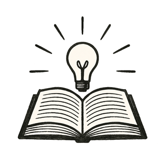

<!-- AI-assisted: new Open for the fourth Gate (September 2036), set in Meissen, Saxony, by Claude, replacing the earlier classroom-meadow scene; epigraph from Qur'an 49:13 in J. M. Rodwell's public-domain translation (1861); verify the exact wording against that edition before print; awaiting Sam's pass. -->
<!-- SOURCE-CHECK 2026-11-18: corrected the second clause to Rodwell's wording: "and we have divided you into peoples and tribes that ye might have knowledge one of another." Source: Qur'an 49:13, Rodwell translation. -->

_O men! verily, we have created you of a male and a female; and we have divided you into peoples and tribes that ye might have knowledge one of another._  
--- **Qur'an 49:13** (trans. J. M. Rodwell)

Meissen, September 2036. The Elbe is running high after a wet summer, and the Stammtisch at the corner inn is arguing about the dam upstream.

A video says it's cracking. Half the table has seen it; the other half has seen the video saying the first video is fake. Herr Vogt, who has sat in the same chair since reunification, says he doesn't need a video to know what the river does, and that 2002 taught him everything.

His granddaughter, home from university, puts her tablet in the middle of the table, between the beer glasses, and asks it a question no one at the table thought to ask: not *is it true*, but *where did it come from*. The answer takes a minute. The cracking dam is a real dam, filmed three years ago, in another country. The engineers' inspection from last Tuesday is public, and dull, and fine.

The table goes quiet, the way a table goes quiet when nobody has won.

Then the argument resumes, louder, about whether the town should build the higher wall anyway.

Herr Vogt raises his glass. "Good," he says. "At least now we're arguing about the same river."

---

*Can we know one another without first agreeing?*
