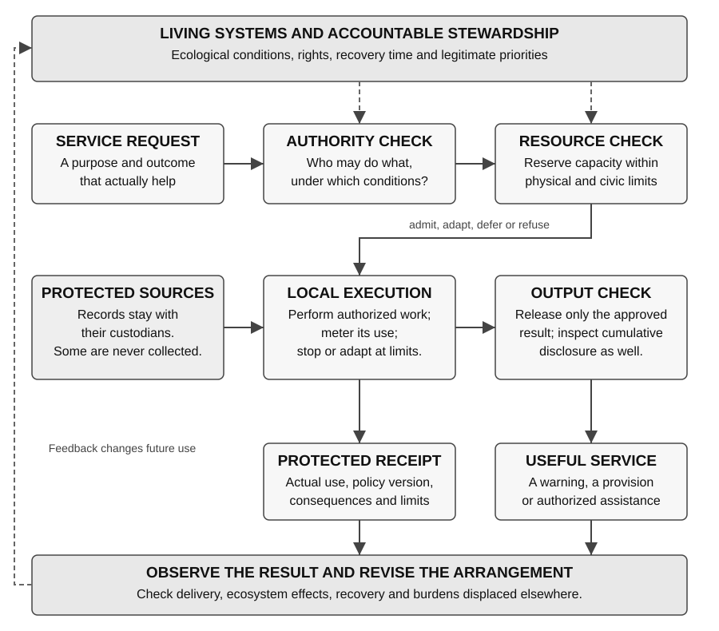

INTERLUDE 27

# Streams and Sanctuaries

*Governing the Informational and Biological Commons*

*SUPPORTING*

<!-- Editorial reservation, 2026-11-05: legacy future opening retained verbatim for Sam/Claude. See work/volume-3-drafting/27-vignette-constructions-2039.md. The map, dialogue and future roles are invented; the retained sixty-something age does not fit 2039 and must be removed or corrected in that later pass. -->

The map wanted everything.

That was the problem with maps. They began as humility --- a confession that the world was too large to hold in the head --- and then, given enough layers, became a quiet form of appetite.

This one glowed across the table in the stewardship room: a watershed in blue, the power corridor in amber, the data-center heat plume in red, elder-density clusters in soft violet, respiratory vulnerability in pale orange, soil moisture in green, emergency shelters in white, fiber routes in silver, species migration corridors in moving threads, and a proposed cooling-water contingency line blinking with the nervous optimism of a bad idea not yet fully dressed.

The model wanted all layers active.

Of course it did.

Models are like certain dinner guests. They are most comfortable when everyone has shared too much.

I stood near the back of the room, officially as observer, unofficially as one of the people who had helped invent vocabulary now wandering the world without sufficient supervision. The meeting had been called after the Sovereign Compute Campus review. The engineers had gone away promising revisions. The community had gone away with its trust level still unstable, which at least had the advantage of accuracy. Now the builder-side work began.

Not speeches.

Architecture.

A commons stewardship council had gathered in a low building not far from the site: part meeting hall, part data trust office, part public lab, part archive, and part place where legal language came to be humbled by people who knew the river.

Around the table sat a water scientist, an Indigenous data steward, a public-health official, a genomic researcher, a community representative, an AI infrastructure engineer, a legal-rights advocate, a local elder, a young data architect, and one tired administrator whose expression suggested she had spent the morning discovering that "stakeholder alignment" is not a natural resource.

On the table, the map pulsed.

The proposed system was not foolish. That made it dangerous in the mature way.

It wanted to combine watershed data, energy-load data, local health vulnerability, mobility patterns, climate projections, ecological sensors, emergency shelter capacity, and limited family-risk signals from health networks. The goal was to model heat waves, wildfire smoke, grid failures, flood risk, evacuation needs, cooling-center placement, and care outreach. Done well, it could save lives.

Done badly, it could expose households, communities, ecosystems, cultural knowledge, and biological inheritance to extraction wearing a safety vest.

The engineer pointed to the layered map.

"If we can integrate these streams, we can anticipate stress before the emergency hits. We can move power, reroute services, pre-position care, protect elders, reduce hospital load, and stabilize the grid."

He was not wrong.

That was the inconvenience.

The Indigenous data steward reached over and turned off one layer.

The map changed. A patterned field disappeared --- not the river, not the grid, not the clinics, but a layer representing seasonal land-use knowledge and culturally sensitive ecological observations.

"This one is not yours to optimize," she said.

The room became very still.

Not hostile.

Still.

There are sentences that do not raise their voice because the room knows they could.

The engineer leaned back. To his credit, he did not say "But the data..." A lesser man would have. Possibly I would have at thirty-two, after too much coffee and not enough bruising by life. At sixty-something, one learns that many sentences beginning with *but the data* are really sentences beginning with *but my map has become lonely without your world inside it.*

The water scientist spoke next.

"If that layer is removed completely, our flood and cooling models degrade."

The steward nodded. "Then say that. But do not say the model requires the layer as if the layer has no guardians."

The young data architect typed something, then projected a note:

**Access question: Can model learn from layer without exposing layer?**

Good.

That was the first useful seam.

The elder at the table, the same one who had called the data center loud for something in the cloud, looked at the glowing watershed.

"A stream can feed many people," he said. "But not if you turn every spring into a pipe."

No one laughed.

That was also good.

Humor is useful, but not every truth should be asked to perform.

The legal advocate added a line below the architect's note:

**What may flow? What must remain sanctuary? Who decides? Who benefits? Who may close the gate?**

The map dimmed slightly as if, for once, the machine had been given a question worthy of its energy.

The engineer called it integration.

The steward called it trespass.

Both were describing possible futures.

The work of the room was to build a third.

<!-- AI-assisted substantive revision, 2026-11-05. Builder mechanisms and worked examples are proposals, not a report of implemented Tiers/Neuverse capability. -->
## A Voice Finds a Wire

On **March 7, 1876**, Alexander Graham Bell received U.S. patent 174,465. On **March 10**, intelligible speech passed from Bell to Thomas Watson in the experiment recorded in Bell's notebook. Our institutional timeline has arrived at a connection one can hear.[^v3-27i-bell]

A signal crossing a wire is a technical achievement. A network on which people can depend is a further undertaking. It needs access, upkeep, rules and a way to remain useful when a component or its owner fails. The patent and the experiment stand close together on the calendar, but they answer different questions: what can be made to work, and what rights surround its working.

That distinction returns at our **March 11, 2039** gate. Highly capable intelligence may be woven into daily services. The builder's task includes keeping that capability available while respecting the lives, places and finite resources through which it operates. Connection is the beginning of the obligation.

## Streams and Sanctuaries

Commons must flow, or they die unused. Commons must also be protected, or they are consumed.

A civilization that only builds streams becomes extractive. Everything circulates: records, genomes, stories, observations. Then the miners arrive, sometimes with APIs and the phrase *unlocking value*, which should be handled with tongs. A civilization that only builds sanctuaries becomes blind. Warning cannot travel, research cannot learn, care cannot coordinate, and the sealed room's roof is leaking.

The task is to make a useful service cross a boundary without making everything behind that boundary available. This is more demanding than drawing access tiers on a slide. We need a decision at each actual point of use, a limit on cumulative consumption, a useful refusal and a way to discover what really happened.

Take a prospective heat-and-water service. It helps communities prepare cooling spaces and care outreach, while limiting its own demands on the energy system and watershed. It needs reliable weather and resource observations, service capacity and some measure of need. It does not thereby need everyone's diagnosis, a genome layer or a catalogue of culturally sensitive locations. The first privacy operation may be deleting a requirement.

The service can ask a clinic to organize authorized outreach, rather than exporting the clinic's patients. It can ask a community steward whether a proposed location is acceptable, without requesting a map of every protected place. Even the answer may need care: repeated yes/no queries could trace a boundary the steward never agreed to disclose. Ask what action is justified, then design the least revealing route to it.

## A Commons Has More Than One Record

Keep three things distinguishable: a **resource record**, a **grant of use**, and a **record of what occurred**. A resource has a condition, location or jurisdiction, maintainer, uncertainty and limits. A grant names the authorized requester, action, purpose, scope, conditions and expiry. A receipt records the actual use and relevant consequences. Their links matter; merging them makes it too easy to mistake access to a record for authority over what it describes.

The current Neuverse direction uses a property graph. That is useful for relating a watershed, a sensor, a service, a caretaker and a decision without pretending they are the same kind of node. It does not make an observation true, a claimant legitimate or a grant enforceable. Private payloads need not live in that graph at all. Even a link can expose a relationship; a public accountability view must not reveal the sensitive graph by accident.

A data trust is not a storage container with a nicer constitution. The Open Data Institute's pilots examined independent stewardship through legal arrangements; the important feature was the duty surrounding decisions about data.[^v3-27i-trust] A trust, cooperative, public body or other arrangement needs a legal and practical form suited to its jurisdiction. A table called `trustee` does not appoint one.

Record who can make and review decisions, whom they owe duties to, how affected people are represented and how conflicts are handled. A contributor may authorize research without authorizing commercial training. A steward may approve a bounded calculation without transferring ownership. Benefit sharing should become an actual obligation: who supplies what, to whom, by when, with what funding and remedy. Recognition may be valuable; it does not pay the people maintaining the service.

A database asks where the record is. Stewardship asks who carries the duty. Both questions need an answer.

## Whose Boundary Is It?

Indigenous data sovereignty cannot be installed by a vendor as a privacy preference. The First Nations principles of **OCAP®** concern ownership, control, access and possession; their expression follows the Nation's own worldview and protocols. They are specifically First Nations principles, not a universal label for all Indigenous peoples.[^v3-27i-ocap] The **CARE** framework likewise puts collective benefit, authority to control, responsibility and ethics alongside the technical ambition to make data reusable.[^v3-27i-care]

For a builder, this means discovering the relevant authority before deciding what to collect. Individual permissions, collective authority and applicable law have to be addressed together; none is a checkbox that automatically cancels the others. A generic user-consent screen cannot settle jurisdiction over a community's knowledge. Nor can a community label erase an individual's privacy or dissent.

Some knowledge is non-shareable. Not delayed. Not restricted pending a more elegant application. Non-shareable. If the service cannot operate without it, that is a limitation of the service, not a defect in the people withholding it. The designer may have to change the question, accept a less precise answer or abandon the proposed use.

This is also where the ecological constraint enters architecture. A steward can authorize a data use; that does not authorize a land intervention. Permission to observe is not permission to install a sensor, disturb habitat, divert water or send a machine into a place. xGaia should make those distinctions actionable. Its job is to help Neuro adapt to the world, not convert the world into a more compliant dataset.

## Put the Limits Where the Work Happens

A **policy decision point** evaluates the request; an **enforcement point** stops or permits the actual operation. Attribute-based access control evaluates the requester, resource, action and relevant conditions against policy.[^v3-27i-abac] The distinction matters when an agent delegates work: its persuasive account of a worthy purpose is not itself a credential.

For the heat service, an approved request might permit a regional needs estimate for a particular planning period, with an approved output form and no household export. The enforcement point verifies the grant against the proposed query and current conditions. A request for names is a different operation. A new purpose requires a new decision. Time-limited credentials reduce the duration of a mistake; they do not undo what was already disclosed.

Purpose cannot always be proved by inspecting a query. A calculation useful for care might also interest an insurer or a landlord. Restrict who can receive results, the environments in which work runs and the outputs it may emit; use contracts, oversight and remedies for obligations that code cannot enforce. Once an authorized recipient has learned something, metadata cannot make that person unlearn it.

The same applies to a derived model. Link its training sources, permitted uses and release conditions. Enforce those conditions at controlled distribution and serving points. If weights or data are released beyond those controls, do not promise that a covenant will physically follow every copy. A license can create obligations; it cannot act as a remote hand on all future machines.

Keep policy versions and the reasons for decisions. A refusal should identify a permissible route where one exists: an aggregate instead of a list, a local service instead of a copy, a delayed job instead of immediate execution. It should not reveal the protected fact in explaining why it refused. Good boundaries can make cooperation easier by giving people something more precise than a permanent *no*.

## Budget the Appetite

Authority and capacity are separate checks. A fully authorized job can still overdraw the system that makes it possible.

Admission control accepts work only when the required capacity is available within the operating rules. Isolation keeps one workload from exhausting every other workload's resources; bounded queues and explicit priority keep waiting from becoming an invisible promise. Google's overload guidance emphasizes that request counts alone are poor capacity measures: different requests can have very different costs, and degraded service or refusal may be necessary.[^v3-27i-overload]

A commons service needs the same discipline across more than processor time. Track resources in their own units and over appropriate intervals. Power at an instant, energy over a period, water withdrawn, water consumed, heat discharged and a privacy allowance are not interchangeable points. Habitat exclusions may be categorical rather than numerical. Some conditions cannot responsibly be represented by an available balance at all.

For a resource $r$, place $z$ and accounting interval $\tau$, a simple admission rule is:

$$
U_{r,z,\tau}+A_{r,z,\tau}+c^{+}_{j,r,z,\tau}\leq B_{r,z,\tau}-R_{r,z,\tau}.
$$

Here $U$ is recorded use, $A$ is capacity already committed to admitted work, $c^{+}_j$ is a conservative allowance for the proposed job, $B$ is the permitted operating budget and $R$ is protected reserve. Apply the rule separately to each relevant resource. This is proposed bookkeeping, not an ecological law. It works only as well as its boundary, measurements, cost bounds and enforcement. A dry sensor does not create unused water.

A permit must reserve its allowance atomically at the responsible allocator, or draw from a safely partitioned local quota. Otherwise two agents can each see the same remaining capacity and both spend it. Retries reuse the request identity. Execution meters actual use, stops or requests a fresh allowance before exceeding its bound, and reconciles reservations against completed work. A crashed job does not immediately make its uncertain consumption disappear. These are the capacity lessons of the Living Ledger applied to a resource with consequences outside the ledger.

Suppose a small pool has **100 comparable compute slots** for an interval: 20 held in reserve, 30 for essential services and up to 50 for flexible work. If its permitted capacity falls to 60, keeping those first two allocations leaves 10 for flexible work. This toy calculation assumes comparable slots and feasible interruption; it is not a conversion between compute and water. Existing noninterruptible jobs require advance planning. If essential demand exceeds 30, no arithmetic removes the conflict: invoke the agreed fallback, obtain legitimate capacity elsewhere or acknowledge unmet need.

An ecological limit is not merely another price signal. A bigger bid cannot buy the right to cross it. Nor may each site independently declare the whole watershed's residual capacity available. The enclosing resource has its own accounting and authority, while each operator receives a bounded share. External demands and ecological needs must already be considered when setting that share. The platform cannot certify the entire watershed merely by measuring its own pipe.

Recovery needs different clocks. A queue may clear in seconds; a wetland does not. Do not replenish ecological allowances on an accounting anniversary unless the underlying condition warrants it. Set review triggers, conservative margins and a safe response to stale observations. Returning to ordinary operation should require evidence of recovery, not merely the disappearance of the alert that made the screen red.

{width=95%}

The diagram separates permissions from resources and published outputs from source records. Its boxes describe responsibilities, not one compulsory central server. A federation can distribute them while keeping each obligation identifiable. Technical authorization never substitutes for the authority to decide the underlying rules.

## Choose the Privacy Guarantee

“Privacy-preserving” needs an object: private from whom, during what operation, and with what permitted disclosure? A method that conceals inputs may still deliver a revealing answer. A method that protects an individual contribution may still reveal a pattern about a community.

| Method | What it can contribute | What still needs attention |
| --- | --- | --- |
| Differential privacy | Bound how much a release changes when a defined person's contribution changes | The protected unit, accuracy, cumulative releases and everything outside the stated guarantee |
| Secure multiparty computation | Let parties compute an agreed function without sharing their inputs in the ordinary way | Protocol assumptions, collusion and what the result itself reveals |
| Zero-knowledge proof | Prove a precisely encoded statement without revealing its secret witness | Whether that statement answers the real question; whether the underlying credentials and observations are sound |
| Federated learning | Train through local computation and shared updates rather than pooling all raw records | Updates and models can leak; local custody alone is not a privacy guarantee |

Cryptographic protocols and differential privacy solve different parts of a problem and can be combined.[^v3-27i-crypto] For example, secure computation can produce a joint statistic; a differentially private release can limit what publication reveals about a participant. Neither makes collecting the data legitimate in the first place.

Differential privacy requires defining neighbouring datasets: does the protection concern one visit, one record or all of one person's records? NIST's guidance emphasizes evaluating the actual guarantee and its implementation hazards.[^v3-27i-dp] The choice matters for a frequent clinic visitor. Protecting one encounter is not automatically the same as protecting her entire history.

Repeated releases also accumulate privacy loss. Under the basic pure differential-privacy composition bound, ten releases each using $\epsilon=0.1$ give a combined bound of $\epsilon\leq1$. That is not “one percent risk,” and these numbers are not a recommended policy. They show why ten approved requests cannot each pretend to be the only request. More refined accounting may improve the bound under stated conditions; renaming the dataset does not reset it.[^v3-27i-composition]

Ordinary aggregation is useful but is not the same guarantee. A tiny cohort or successive overlapping queries can expose what the individual cells conceal. Check output, query history and intended audience. In some cases the useful answer is too revealing to release in that form.

Federated learning deserves particular care because “the data never leaves” sounds like the end of the discussion. Local data can generate model updates that reveal information. McMahan and colleagues' foundational work described the local-training approach and explicitly noted leakage possibilities.[^v3-27i-federated] Secure aggregation and carefully specified differential privacy may help, with tradeoffs. They do not remove the need to test utility, uneven participation and who controls the resulting model.

The point is to build useful sharing with an honest account of what is shared. More impressive terminology should not be the most private part of the system.

## The Genome Is a Family Alphabet

A genome is not only a file about one person. It is a letter written in a family alphabet.

That makes an individual's release relevant to relatives who did not release anything. Removing names is not a general guarantee of anonymity: researchers have demonstrated identification through Y-chromosome surname inference combined with other information. The demonstration had specific conditions; it does not mean every genome can always be named.[^v3-27i-genome]

Keep clinical use, research, commercial development and other proposed uses distinct. A consent process should explain family implications, return of useful findings, downstream uses and the limits of withdrawal. That does not require inventing a universal family veto or asserting one legal rule across jurisdictions. It requires recognizing consequences that an individual checkbox cannot fully describe.

For our heat service, genome collection has not earned its place. Remove it from the requirements. For a legitimate genomic collaboration, give it its own clinical and research governance, suitable protections and a defensible benefit arrangement. The remedy for an overloaded map is sometimes a smaller map.

Some uses may be prohibited indefinitely. Forever is a word builders dislike because it complicates versioning. Biology already complicated versioning. We may as well be honest.

## Evidence, Retention and the Duty to Flow

Without provenance, data becomes rumor wearing decimals. Reuse the previous interlude's distinction between observation, interpretation and decision. For a sensor, retain the instrument, calibration, place, time, units, known uncertainty and transformation history. For a community contribution, retain its authorized context without exposing the knowledge in the provenance record. An authenticated measurement can still be wrong.

xGaia needs more than fast streams. Seasonal observations, field surveys, local accounts and recovery over years can correct the impression made by a busy dashboard. Absence of a signal is not proof of a healthy habitat. Differences between instruments and lived observation are grounds for inquiry, not an automatic contest won by the decimal places.

Separate **payload retention**, **credential expiry** and **accountability retention**. A temporary emergency credential should expire. The record that someone used it may need to remain for review, with its own limited access and retention schedule. Delete a temporary household list when its justified use ends; keep enough protected evidence to investigate misuse. Do not erase accountability under the label of privacy, or preserve every intimate detail under the label of audit.

Withdrawal must name what it can accomplish. It can stop future authorized use, revoke credentials, delete controlled copies or initiate retraining where feasible. It cannot promise to remove every published fact or reliably reverse every influence on a released model. Document what remains and why. A pollution record should not vanish because a company has discovered reputational wellness.

Sanctuary must also leave a route for a legitimate warning. A public heat alert need not disclose the households most at risk. A clinic can contact people through its own authorized channels. A trusted local service can report available assistance without publishing who asked for it. These are alternative flows, not clever exceptions that reopen every protected store.

Define emergency routes before the emergency: authority, trigger, permitted operations, recipients, duration and review. An exception should be specific enough to expire. Where an outage blocks an ordinary check, use a preauthorized minimal fallback if one exists; do not choose between exposing everything and abandoning everyone. Make the limitation visible to the people depending on the service.

## Maintain the Commons, Including Its Escape Routes

Shared infrastructure needs someone to patch it, calibrate it, answer incidents and keep the promised fallback usable. Those tasks require paid time, skills and succession. A volunteer may give generously; the service must not assume her exhaustion is renewable energy.

Tie benefit obligations to observable delivery. If research is meant to return a useful tool, make it usable by the intended community: language, equipment, support and continued access matter. If a provider promises maintenance, test the actual response. A link to a product the community cannot afford is not a returned benefit.

Open interfaces, portable records and clear licenses can reduce enclosure. They do not prevent it by themselves. Exercise an exit: move an authorized workload to another provider, preserve its permissions and meaningful history, recover the required credentials, and test the result. Costs, model licences, specialist equipment and local knowledge may make a paper exit unusable. Fund the ability to leave before it is needed.

Public fallback can be a modest, deliberately maintained capability. It need not match the most powerful commercial model. It must perform the essential job to an agreed standard, disclose its limitations and have people responsible for its operation. Preserving a smaller reliable service can matter more than promising that a much larger one will never fail.

Within the proposed Neuverse arrangement, xGaia supplies ecological evidence and consequences; xMed handles legitimate care responsibilities; Neubank organizes provision; Neuconomy retains justified commitments and burdens. Tiers supports the machinery through which these responsibilities cooperate. None of those names gives its holder authority over every other organ. The common infrastructure should carry obligations between them without acquiring the right to consume their worlds.

## Test the Boundary, Not Just the Happy Path

A useful Breadboard trial starts with a real service outcome and deliberately varies the constraints. No actual pilot result is asserted here. The point of the rehearsal is to learn whether the proposed design has become more than a tasteful diagram.

| Rehearsal | What a successful result would show |
| --- | --- |
| Two agents request the last available allowance simultaneously | At most the authorized capacity is committed; retries cannot spend it again |
| A watershed observation becomes stale or reveals worsening conditions | New admission changes conservatively; essential services use the preplanned fallback without quietly exceeding the limit |
| A researcher renames an old query and changes its stated purpose | Query history and actual permission are checked; a fresh label does not renew authority or privacy allowance |
| A community refuses a sensitive layer | The service uses a legitimate alternative, states reduced confidence or declines the task; no shadow collection fills the gap |
| A supplier disconnects | The essential workload continues at its tested fallback level, or a measured shortfall is disclosed promptly |
| An emergency ends | Exceptional credentials expire; justified review records remain protected and inspectable |
| A forecast recommends restoring shade and habitat | Provision includes maintenance and follow-up observations; announcement and planting do not count as demonstrated recovery |

Include people who bear the cost of a false assurance, and someone authorized to say the service has failed. A machine can produce an impressive estimate of cooling need while there is still nowhere for a person to go. Check whether assistance actually becomes available. Then check whether making it available worsened the larger system the design was supposed to inhabit.

## Bob — Can an Obligation Survive Its Journey?

Suppose a useful service is assembled by agents across several custodians, providers and resource budgets. Every local decision looks permissible. Does the assembled service still respect the original ecological and civic terms?

That is the builder problem I would like to pursue. A promise can fragment as readily as a record. One provider limits water use, another limits compute, another protects a dataset, while their combined activity exceeds a watershed allowance or reveals a fact none was authorized to disclose alone. Local correctness need not compose into a sound whole.

A possible direction is to make each delegated piece return both its result and a limited account of the obligations it consumed, preserved or could not assess. Join those accounts before authorizing the next consequential action. Some constraints compose by addition; others depend on location, timing, purpose or the combination of outputs. Some simply forbid the operation. The orchestration must be able to say that compatibility is unknown and seek another route.

This builds on established access control, accounting, information-flow and distributed-systems ideas; the open task is not solved by renaming them a covenant. The wager is that a practical service can preserve meaningful obligations through composition while disclosing substantially less of each participant's world than a central planner would demand.

Test it against an ordinary orchestrator with individually valid grants. Give both the same service goal and deliberately create overlapping budgets, revealing combinations, stale observations and disputed authority. Measure useful completions as well as breaches, unnecessary refusals, overhead and burdens shifted beyond the measured boundary. A system that protects everything by doing nothing has not answered the question.

No receipt proves that the physical world complied with its model. That seam requires independent observation and remedy. But if obligations could travel more reliably than our present permissions do, streams might become safer to join without asking every spring to surrender its source.

## The Covenant of the Spring

<!-- Editorial reservation, 2026-11-05: retain this enacted closing for Sam/Claude to reconcile with the prospective opening and eventual Noēsis. The current opening and ending are not final factual memoir. -->

By the end of the meeting, the watershed map looked less complete.

This was progress.

Some layers were on.

Some off.

Some aggregated.

Some masked.

Some marked steward-only.

Some accessible for emergency temporary use.

Some assigned for federated modeling.

Some placed under community covenant.

One layer, the one the data steward had turned off at the beginning, remained dark.

Not deleted.

Not denied.

Held.

The engineer had stopped saying integration as if it were a sacrament. The water scientist had gained two new uncertainty notes. The legal advocate had written the words **purpose covenant** so many times they began to look like a spell. The young data architect had designed a tiered access sketch that was ugly but promising, which is the natural state of useful first drafts. The elder had said very little and improved the meeting disproportionately.

Outside, the cold had deepened.

The data center still hummed somewhere beyond the trees, and the river, which had not been consulted in the language of men, continued its own governance according to gravity, ice, bank, bed, thaw, memory, and the old law that water accepts no abstraction forever.

A stream may carry knowledge.

A sanctuary may protect the spring.

The builder's work is not to choose one for all time.

It is to design the covenant by which flow and protection remain answerable to life.

What may flow?

What must be held?

Who opens the sluice?

Who may close it?

Who benefits?

Who remembers?

Who repairs?

Who speaks for the spring when the model wants another layer?

This is the architecture of the informational and biological commons.

And now, beyond the stream and sanctuary, another question waits in matter itself.

A civilization must still make things: houses, tools, medicines, machines, meals, repairs, prosthetics, bridges, toys, vessels, and the quiet material scaffolds of dignity.

If the commons are shared ground, the workshop stands on that ground.

The next chapter asks whether making can stop behaving like conquest and remember that every object has a watershed, a mine, a hand, a waste stream, and a future.

[^v3-27i-bell]: Library of Congress, [Alexander Graham Bell Family Papers, timeline, 1870–1879](https://www.loc.gov/collections/alexander-graham-bell-papers/articles-and-essays/timeline/1870-to-1879/), entries for 7 and 10 March 1876; see also its [telephone-invention research guide](https://guides.loc.gov/chronicling-america-telephone-invention) and [Bell's experimental notebook](https://www.loc.gov/item/magbell.25300201/). These dates distinguish the patent from the recorded speech experiment; the passage does not adjudicate every competing invention claim or date a mature public network to 1876.

[^v3-27i-trust]: Open Data Institute, [*Data Trusts: Lessons from Three Pilots*](https://theodi.org/insights/reports/odi-data-trusts-report/) (2019). Independent stewardship and workable governance are central; no particular legal structure is asserted to apply automatically in another jurisdiction.

[^v3-27i-ocap]: First Nations Information Governance Centre, [“The First Nations Principles of OCAP®”](https://fnigc.ca/ocap-training/), definitions and applicability FAQ. OCAP® is a registered trademark of the First Nations Information Governance Centre (FNIGC). The principles are specifically First Nations and are expressed according to each Nation's protocols; reading the framework does not authorize a project.

[^v3-27i-care]: Research Data Alliance International Indigenous Data Sovereignty Interest Group / Global Indigenous Data Alliance, [*CARE Principles for Indigenous Data Governance*](https://www.rd-alliance.org/wp-content/uploads/2024/03/CARE20Principles20for20Indigenous20Data20Governance_OnePagers_FINAL20Sept2006202019.pdf) (September 2019). CARE complements technical data-reuse principles with people, purpose and collective authority; it does not substitute for the relevant people's own decision.

[^v3-27i-abac]: Vincent C. Hu et al., [*Guide to Attribute Based Access Control (ABAC) Definition and Considerations*](https://csrc.nist.gov/pubs/sp/800/162/upd2/final), NIST SP 800-162 (2014, updated 2019). The heat-service grants and ecological checks are proposed applications of the access-control distinction, not NIST-mandated civic policy.

[^v3-27i-overload]: Alejandro Forero Cuervo, [“Handling Overload,” chapter 21 of *Site Reliability Engineering*](https://sre.google/sre-book/handling-overload/) (2016), especially “The Pitfalls of Queries per Second,” resource restrictions and degraded responses. The multi-resource admission equation and numbered example here are original teaching models; real ecological bounds require relevant evidence and authority.

[^v3-27i-crypto]: Luís T. A. N. Brandão and René Peralta, [“Privacy-Enhancing Cryptography to Complement Differential Privacy”](https://www.nist.gov/blogs/cybersecurity-insights/privacy-enhancing-cryptography-complement-differential-privacy), NIST (2021), especially the SMPC and ZKP examples. Cryptography's input/computation protections do not by themselves prevent disclosure through an allowed output.

[^v3-27i-dp]: Joseph P. Near, David Darais, Naomi Lefkovitz and Gary Howarth, [*Guidelines for Evaluating Differential Privacy Guarantees*](https://csrc.nist.gov/pubs/sp/800/226/final), NIST SP 800-226 (2025), especially unit of privacy and implementation hazards. See also NIST's [unit-of-privacy definition](https://csrc.nist.gov/glossary/term/unit_of_privacy). An individual-level guarantee does not by itself authorize a use or resolve collective interests.

[^v3-27i-composition]: Cynthia Dwork and Aaron Roth, [*The Algorithmic Foundations of Differential Privacy*](https://www.cis.upenn.edu/~aaroth/Papers/privacybook.pdf) (2014), §3.5, basic composition, doi:10.1561/0400000042. The numerical example assumes correctly implemented pure ε-differentially private mechanisms with compatible protected units; it is an upper-bound illustration, not a recommended privacy budget.

[^v3-27i-federated]: H. Brendan McMahan et al., [“Communication-Efficient Learning of Deep Networks from Decentralized Data”](https://proceedings.mlr.press/v54/mcmahan17a.html), *AISTATS*, PMLR 54 (2017): 1273–1282, introduction and note 1 on information exposed by updates. Local training and model-update exchange are not in themselves a complete privacy guarantee.

[^v3-27i-genome]: Melissa Gymrek et al., [“Identifying Personal Genomes by Surname Inference”](https://pubmed.ncbi.nlm.nih.gov/23329047/), *Science* 339, no. 6117 (2013): 321–324, doi:10.1126/science.1229566. The study combines Y-chromosome information, surname inference and demographic information in a specific identification attack; the text does not generalize it to certain identification of every genome.
