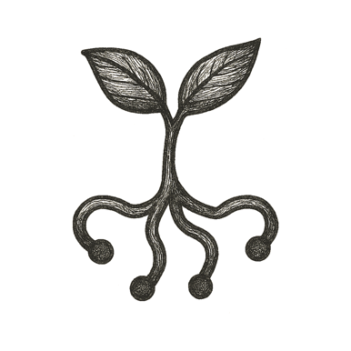

<!-- AI-assisted: new Open for the fifth Gate (March 2039), set on Funafuti, Tuvalu, by Claude, replacing the earlier forest scene; epigraph from Bahá'u'lláh (Lawh-i-Maqsúd), in its widely quoted English form; confirm the wording and a public-domain source before print; awaiting Sam's pass. -->
<!-- SOURCE-CHECK 2026-11-18: exact short epigraph confirmed in the Bahai Reference Library, Lawh-i-Maqsud. Do not infer that this English edition is public domain from the age of the original; edition/permissions review remains distinct. Tuvalu's official Digital Nation project supports the present-day starting point, not the fictional 2039 outcome. -->

_The earth is but one country, and mankind its citizens._  
--- **Bahá'u'lláh**

Funafuti, March 2039. The king tide comes in at dawn, as it does every year now, and the water rises through the coral beneath the airstrip and stands in the road like a guest who hasn't been told to leave.

Old Mr. Tausi walks out along the lagoon anyway, as he has every morning of his life, to check on the pulaka pits his father dug. Two are salt now. One is still sweet.

His granddaughter has come home for the holidays from Brisbane, where she studies, and where she helps maintain the other Tuvalu: the digital one, every reef, house, grave and dance recorded so that the nation can go on existing if the land doesn't. She tells him it's the most complete map ever made of a country.

He kneels by the sweet pit and pulls a weed.

"Does your map know which pit is still good?"

"It does now," she says. "You just told it."

He nods, and pulls another weed.

---

*If the earth is one country, who keeps the island?*
