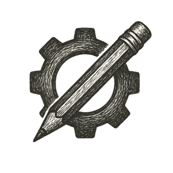

<!-- AI-assisted: new Open for the sixth Gate (September 2041), set in Santa Clara del Cobre, Michoacán, Mexico, by Claude, replacing the earlier printer-and-prosthetic scene; epigraph from Sir Edwin Arnold's public-domain rendering of the Bhagavad Gita, *The Song Celestial* (1885), 2:47; verify the exact wording against that edition before print; awaiting Sam's pass. -->
<!-- SOURCE-CHECK 2026-11-18: the epigraph matches Edwin Arnold, The Song Celestial (1885), chapter II, with verse line breaks collapsed. The scene and future price are fictional. -->

_Let right deeds be thy motive, not the fruit which comes from them._  
--- **Bhagavad Gita** (trans. Edwin Arnold)

Santa Clara del Cobre, Michoacán, September 2041. In the city, machines stamp out copper fittings by the million, faster than anyone can count them. Here, in the hills, the town still sounds the way it has for centuries: hammers.

Don Aurelio is raising a bowl from a disc of copper melted down from old wire, pots and plumbing, the way his grandfather did. He turns it on the stake and strikes, turns and strikes, a few thousand times before lunch. His granddaughter's assistant has already found him a buyer in Kyoto and another in Montreal, and quoted a price for the bowl that would have bought his first house.

"It'll take me three weeks," he tells her.

"The buyers don't mind waiting."

"Good," he says. "Neither does the copper."

She watches him for a while. The machines in the city make better fittings than he ever could, and he knows it; he'd be the first to install one. But no machine has ever made his bowl, or will, because the bowl isn't the only thing he's making. Every strike thins the metal a little and remembers the last one. Every strike is also how he spends his morning.

He holds the bowl up to the window, finds a flaw in the light and goes back to the stake.

---

*What would we make, if the making itself were part of the reward?*
