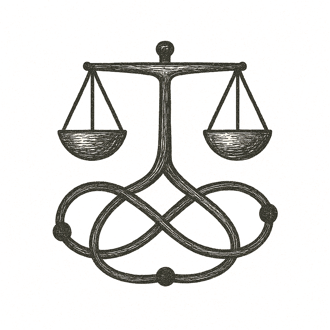

<!-- AI-assisted: new Open for the seventh Gate (March 2044), set at a Vermont town meeting, by Claude, replacing the earlier riverside-bench scene; epigraph the Zoroastrian triad (Humata, Hūkhta, Hvarshta), traditional and in the public domain; awaiting Sam's pass. -->
<!-- SOURCE-CHECK 2026-11-18: the traditional Zoroastrian triad is retained; it is not presented as a quotation from a named modern translation. The March 2044 meeting is a fictional near-Gate scene, not a claim that Town Meeting Day falls on March 11. -->

_Good thoughts, good words, good deeds._  
--- **Zoroastrian creed** (*Humata, Hūkhta, Hvarshta*)

Peacham, Vermont, March 2044. Town Meeting Day, as it has been on the first Tuesday of March for more than two centuries: folding chairs in the school gym, a moderator with a gavel, pie in the back and mud season just beginning outside.

Article 9 on the warrant is the culvert on the Danville road. The town's assistant has done the homework for everyone: three options, the engineering, the costs over thirty years, the flood maps, a summary anyone can hear in their own words before the meeting opens. Most people have. The recommended option is sensible, and the voting should take ten minutes.

Then Ruth Hale, who has farmed below that culvert for fifty years, stands up and asks to amend. The sensible option, she says, sends the spring melt straight onto the Wheelers' lower field. She knows, because it went there in '29, and in '37, and the flood maps were drawn by people who weren't standing in it.

The assistant checks while she's still talking. She's right. The maps missed it.

The moderator asks whether there's a second. There are about forty.

The amended article passes. It costs a little more. Nobody minds.

On the way out, a girl voting for the first time asks her father why they didn't just let the machine decide.

"It did fine," he says. "It just hadn't met Ruth."

---

*What would we build, if every rule had a floor where anyone could stand?*
