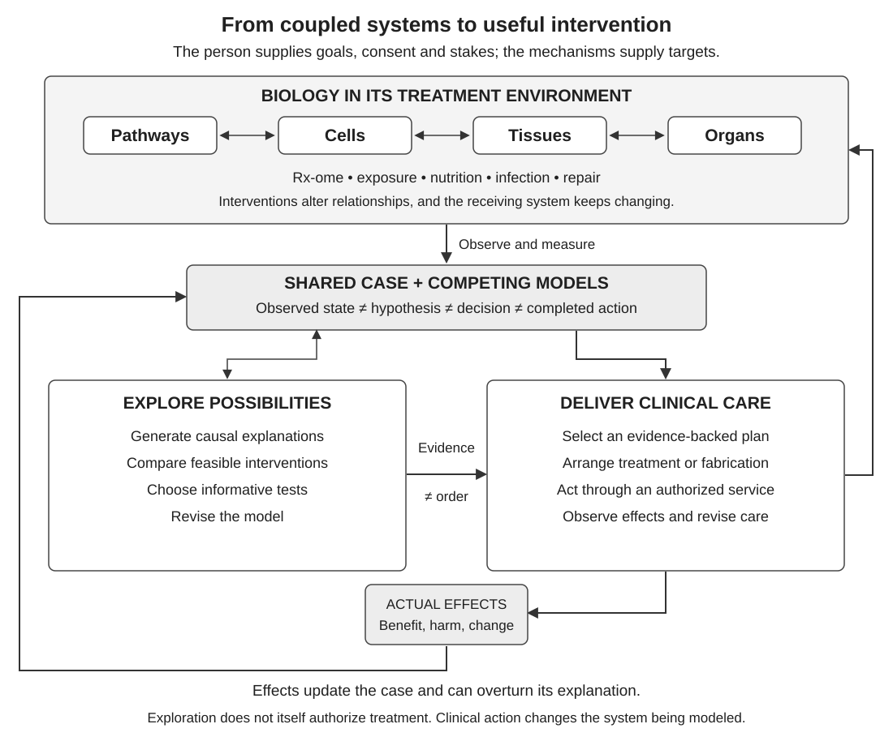

INTERLUDE 31

# From Molecule to Moment

*Precision Medicine in the Age of Pattern Stewardship*

*MEDICINE*

<!-- Legacy opening retained verbatim as a prose bank, not the approved 2049 projection. Sam/Claude: reconstruct as a prospective builder reflection; see work/volume-3-drafting/31-vignette-constructions-2049.md. The new scope covers advanced medicine broadly; VitalEdge remains an exploratory contributor, not the diagnosing/treating product. -->

The first thing the model did right was hesitate.

This is rarer than it should be.

Models are often trained to answer. They are rewarded for answer-shape, answer-speed, answer-confidence, answer-polish --- all the little social perfumes of certainty. In medicine, this can become dangerous very quickly. A confident answer in the wrong room is not intelligence. It is a liability with punctuation.

But this model hesitated.

On the wall, two timelines glowed side by side.

The first was the old medical record.

Visits. Diagnoses. Prescriptions. Lab panels. Discharges. Specialist notes. Procedure codes. Allergies. Imaging reports. Medication list. A clean institutional biography, as if a human life were something that happened mostly in appointments.

The second was the living timeline.

Meals. Sleep. Weather. Swelling. Missed walks. Home temperature. Daughter's note. Caregiver fatigue. Medication timing. Kidney function. Anxiety after hospitalization. Weight increase over four days. Voice change. Gait irregularity. A missed birthday call. A new reluctance to climb stairs. The patient's own sentence, recorded three days earlier:

**I don't feel like myself.**

The patient was not me.

That mattered.

Chapter 31 had used my return to South Health Campus as the lived side of care: the person entering with memories, age, fear, labels, and the old hospital ghosts still whispering around the machines. This room was different. It was the builder-side room --- not less human, but more instrumented. A clinical-pattern review room where a physician, a pharmacist, a nurse, the patient's daughter, a care coordinator, and an AI companion were trying to understand a body before the body turned its complaint into crisis.

The patient was an older man with heart failure, kidney vulnerability, sleep disruption, shifting weight, several medications, and the familiar curse of modern care: enough specialists to ensure expertise and enough handoffs to ensure that no single person could easily hold the whole story.

On the display, the AI highlighted a possible emerging pattern:

Diuretic adjustment.

Electrolyte drift.

Renal function shift.

Sleep fragmentation.

Subtle gait change.

Mood decline.

Caregiver note: **"He seems slower since the new dose."**

Medication interaction risk.

Weight gain over four days.

The system did not say **diagnosis**.

It said:

**Possible explanation cluster. Confidence: moderate. Missing context: patient report, medication adherence, fluid intake, recent diet, functional baseline, clinician judgment.**

Good.

A machine that knows what it does not know has taken its first step toward usefulness.

The young clinician touched the highlighted region.

"What would make this explanation wrong?"

That was the moral center of the room.

Not *What did the model find?*

Not *What does the protocol say?*

Not *What box do we check?*

What would make this explanation wrong?

The daughter leaned forward.

"He had soup twice this week. Salty. From his neighbor. He didn't want to waste it."

The pharmacist laughed softly, not because it was funny, but because the universe had once again defeated abstraction with soup.

The model updated.

Fluid and sodium context entered. Medication adherence remained uncertain. The nurse asked about swelling. The daughter described shoes harder to put on. The patient, joining from home, said he was "fine," which the system marked not as fact but as a culturally common phrase requiring interpretation. The clinician smiled.

"Fine in the medical sense, or fine in the father-not-wanting-to-bother-anyone sense?"

The patient gave her a look.

The room learned more from that look than from several fields in the chart.

The AI did not overrule. It widened the possibilities. It showed a medication-state interaction. It suggested a lab recheck, home weight monitoring, a pharmacist call, and a clinician review within forty-eight hours. It displayed uncertainty. It showed what evidence supported each possibility. It offered escalation thresholds. It asked whether the care plan aligned with the patient's goals.

Then the clinician turned to the patient.

"Does this feel like the right story?"

That is precision medicine when it remembers its manners.

Not the machine pronouncing from the molecule.

Not the clinician drowning in data.

Not the family reduced to noise.

Not the patient converted into a model's property.

A shared act of interpretation across scales: molecule, medication, organ, home, habit, daughter, soup, sleep, weather, gait, and sentence.

From molecule to moment.

<!-- End of reserved opening. AI-assisted substantive completion, 6 November 2026. The old undated technical mirror is retained in work/volume-3-drafting/31-retained-fragments-2026-11-06.md. -->

## A Factory Enters the Cell

On **7 April 1976**, the year of our American marker, Robert Swanson and Herbert Boyer founded Genentech. The useful hinge is not a company birthday by itself. Recombinant DNA was opening a route by which an organism could produce a chosen human protein. Biology was becoming a manufacturing medium.[^v3-31i-1976]

The achievement took work after the founding. Researchers at Genentech and City of Hope developed recombinant human insulin in **1978**; the FDA approved Humulin in **1982**. These dates should keep their distance. A company charter does not express a protein, although business plans occasionally attempt the reverse.[^v3-31i-insulin]

The production problem already contained the future interlude in miniature: specify the biological function, obtain the right expression, make a dependable product, and deliver it in a form that changes a patient's life. Each step needed its own evidence. The molecular sequence and the treatment were connected by an industry.

By our **11 March 2049** gate, that relationship could be much more intimate. Medicine may manufacture a protein, edit selected cells, train an immune response, grow a repair tissue or compose several of these around one case. The builder's object is a working intervention inside a living system. Its design continues after delivery because the receiving system continues to change.

## Build Beyond the Diagnostic Drawer

The clinical architecture should not require a disease label before it can form a useful model. Observations can support competing causal explanations; explanations can suggest interventions; subsequent responses can force the explanations to change. A category may summarize part of this work, but it must not be the only key that opens it.

That is a different builder task from training a more accurate disease classifier. It requires representations of state, mechanism, interaction and change. It also requires reusable knowledge: abandoning a rigid category must not mean forgetting what studies of earlier patients taught us. Evidence can be carried by mechanisms, treatment-response patterns and relevant similarities, with uncertainty about whether they transfer to this case.

The treatment object is the coupled biological and surrounding systems. The person supplies the stakes and lives with the result. This distinction should remain visible from the molecular model to the interface.

## Read Biology Across Scales

The genome records sequence; it does not tell us everything a cell is doing. **Transcriptomics** measures RNA, **proteomics** measures proteins, and **metabolomics** samples small molecules involved in metabolism. Epigenomic measurements concern regulatory features such as methylation and chromatin accessibility. Each observes a different aspect of biological state. None is a substitute for the others, or for examining the person.

Single-cell methods help distinguish populations that a bulk sample averages together. Spatial methods preserve information about where cells and molecular signals sit relative to one another. This matters in a tumor: a target may be present in some cells, absent in others, and surrounded by a local environment that prevents an otherwise promising immune response. A molecular inventory becomes more useful when we can locate its participants and examine their interactions.[^v3-31i-atlas]

The computational task is **multimodal integration** with biological meaning. Different assays have different units, sampling biases and error structures. Record tissue, collection time, preparation method and relevant treatment state; separate a genuine change from a batch effect. A later blood sample is not a direct replay of an earlier tissue biopsy. Combining them should preserve the distinction.

A genomic variant can suggest a mechanism, a drug response or a question for further investigation. A variant of uncertain significance remains uncertain. An association found in one population may perform differently in another. Actionability asks whether the finding supports a useful decision, not whether it makes an impressive visualization.[^v3-31i-variants]

The opportunity by 2049 is a biology that can be examined repeatedly across selected scales, with models helping decide what is worth measuring next. The point is not a ceremonial complete scan of every possible molecule. It is discovering a consequential mechanism while there is still something useful to do about it.

## The Rx-ome Is Part of the System

A drug enters a body that changes the drug, and the changed drug acts on a body already altered by other interventions. A medication list records names. The **Rx-ome**, in the working sense used here, concerns this evolving system of exposures and effects.

**Pharmacokinetics** asks how exposure changes as a substance is absorbed, distributed, metabolized and eliminated. **Pharmacodynamics** asks how exposure relates to effects. A minimal illustration is a one-compartment model with linear elimination:

$$
\frac{dC}{dt}=\frac{R(t)}{V}-\frac{CL}{V}C.
$$

Here concentration $C$ changes with an input rate $R(t)$, an apparent distribution volume $V$ and clearance $CL$. Under constant input and these deliberately simple assumptions, the steady concentration is $R/CL$. If clearance falls while input stays unchanged, exposure rises. No new prescription was required for the treatment to become a different physiological event.

This is a teaching model, not a dosing rule. Real drugs may require multiple compartments, nonlinear kinetics, active metabolites and other mechanisms. **Physiologically based pharmacokinetic models** use organ and tissue characteristics alongside drug properties; quantitative systems pharmacology connects exposure to pathways and responses.[^v3-31i-pk]

The future builder should therefore represent more than pairs of drugs with an interaction warning. Actual use, organ function, timing, enzymes and transporters, treatment effects and changing physiology belong in the same inquiry. One therapy may change the conditions under which another acts. Some interactions are useful; the task is to understand and exploit them as well as prevent harm.

This is also why “personalization” by attaching a genome to a disease protocol is insufficient. A person with the same genome has a different biological state after an infection, an operation or several months of treatment. The model must be capable of changing its explanation, not only updating the score attached to the old one.

## From Molecular Design to a Treatment

AI can shorten searches that once consumed laboratories: finding candidate structures, proposing molecules, matching biological targets, selecting experiments and analyzing their results. AlphaFold 3, for example, demonstrated prediction of structures involving proteins and other molecular partners. That is powerful evidence about molecular arrangement, not a direct measurement of clinical benefit.[^v3-31i-af3]

A treatment pipeline still connects **target validity**, **delivery**, **exposure**, **effect** and **tolerability**. Does changing this target help the disease? Can the intervention reach the relevant cells? Does enough remain active for long enough? What else does it affect? A strong binding prediction answers only part of that chain.

The future laboratory can make these questions more tightly coupled. Generative models propose candidates; automated experiments test selected properties; results update the search. Mechanistic models and patient-derived tissues can reject weak routes earlier. Human studies establish effects that the models cannot certify. The scarce resource then shifts from candidate ideas toward decisive experiments, manufacturing capacity and the time needed to observe an outcome.

**Platform design** matters especially for rare conditions. A reusable delivery system, assay panel and manufacturing process could make a patient-specific change feasible without reinventing the entire development apparatus. In 2025, investigators reported a customized in-vivo base-editing treatment for an infant with CPS1 deficiency. Early observations showed increased dietary protein tolerance and reduced medication requirements; follow-up was short.[^v3-31i-bespoke] The important opening is a repeatable route to bespoke medicine, with evidence shared where legitimately transferable and patient-specific questions tested where it is not.

## Editing, Replacing and Programming

**Gene addition**, **genome editing** and **RNA treatment** alter biology in different ways. Adding a functional gene does not necessarily repair the original sequence. Editing changes a selected DNA target. RNA can supply temporary instructions or alter gene expression without making the same permanent change. Duration and reversibility are design properties, not footnotes to the delivery technology.

Casgevy's early clinical route illustrates **ex-vivo editing**: blood stem cells are collected, edited outside the body and returned after conditioning. Its intervention promotes fetal hemoglobin; it does not simply replace the sickle-cell mutation in every cell. **In-vivo editing** delivers the editing machinery into the body, making tissue targeting, immune responses and unintended edits central problems.[^v3-31i-crispr] By 2049, wider and gentler delivery could change the range of treatable conditions as much as a cleverer editor.

Synthetic biology adds another possibility: a treatment that senses before it acts. Engineered immune cells can carry receptors or circuits that change their behavior in response to selected biological signals. Research on tissue-sensing T cells has explored using recognition of a location to trigger therapeutic activity there.[^v3-31i-synbio] The ambition is a medicine with local conditional behavior, rather than a dose distributed everywhere and left to sort out the geography.

This borrows from control systems and software, but the implementation is alive. Cells divide, migrate, change state and interact with immunity. Circuit behavior depends on signal strength, duration and context; an attractive Boolean diagram cannot guarantee a biological truth table. The engineering work includes characterizing those dynamics, controlling persistence and finding ways to stop unwanted activity. The prospective reward is immense: a treatment whose selectivity comes partly from what it can recognize, not merely where we manage to inject it.

## Cancer Therapy That Can Follow Cancer

A future cancer system needs to distinguish three tasks: characterize the disease, select an intervention and determine whether it is producing the intended result. Repeating the first task alone can create a very well-documented defeat.

**CAR T-cell therapy** engineers immune cells to recognize selected targets. Its successes in blood cancers established living cells as a therapeutic platform. Solid tumors pose additional problems of access, target heterogeneity and suppressive local environments; severe immune toxicity is also a real concern.[^v3-31i-cart] Future progress may involve more selective circuits, combinations of targets, improved persistence or ways to produce therapeutic cells more efficiently. The useful unit of advance is a durable patient benefit, not merely a more elaborate cell.

**Individualized cancer vaccines** take another route. Tumor and normal tissue are compared to identify candidate neoantigens; selected instructions are manufactured to help the immune system recognize the tumor. A 2023 pancreatic-cancer study demonstrated vaccine-induced T-cell responses in some recipients within a combined treatment program. Its small, nonrandomized design could not establish a general survival benefit.[^v3-31i-vaccine] This is a foundation for a much richer future: molecular characterization feeding a timely, patient-specific treatment, with subsequent observations testing whether the immune response is useful.

Liquid biopsies and other repeated measurements could help reveal residual disease or changing clones, but finding a signal and proving that action on it improves outcomes are separate achievements. Patient-derived organoids can help test selected responses outside the body; they reproduce only part of the tumor and its surroundings. Neither a negative blood test nor a promising dish should be mistaken for the whole patient.[^v3-31i-organoids]

The builder's opportunity is a **closed learning loop** across these instruments: characterize, compare plausible routes, test what can be tested, treat through an accountable clinical arrangement, then revisit the model as the disease responds. This can support cure where possible and durable control where cure is not yet achievable. It must also let palliation become the right goal without treating a person as an unfinished optimization run.

## Printing Is One Verb in Tissue Engineering

Bioprinting places living cells and supporting materials in organized structures. The deposit is a beginning. Tissue must acquire function: exchange nutrients and wastes, sustain the appropriate cells, withstand its mechanical environment and connect with the recipient's biology.

**Vascularization** is a central difficulty for thick living tissues. Printing the outline of a kidney is considerably easier than supplying its cells and reproducing its filtration architecture. In 2019, researchers demonstrated complex, separate fluid networks in biocompatible hydrogels, including a model in which red blood cells could be oxygenated near a ventilated airway.[^v3-31i-printing] That result teaches a mechanism and an engineering direction. It was not a transplantable lung.

Other routes rely more on cells organizing themselves. Organoids, scaffold-based growth, tissue sheets and assembled patches occupy different positions between imposed structure and biological self-assembly. A 2025 heart-muscle study combined substantial animal work with evidence of graft remuscularization in a human recipient.[^v3-31i-heart] Tissue engineering therefore offers useful intermediate destinations: a patch, a repaired surface, a small functional graft, a better disease model. Whole organs remain a larger goal, alongside donor transplantation, mechanical assistance and other replacement strategies.

At the 2049 gate, I would plan for a repertoire of such repairs rather than a universal organ printer. A mature service would join cell sourcing, differentiation, fabrication, maturation, quality testing, implantation and follow-up. The design must consider immune compatibility, unwanted growth, electrical or mechanical integration and what happens if function deteriorates. Neufacture's earlier material-lifecycle question has acquired a pulse.

## The Clock Inside the Body

Regenerative medicine repairs something; **geroscience** asks whether changing processes associated with aging can reduce several vulnerabilities together. Research directions include senescent-cell biology, immune aging, metabolic regulation and partial cellular reprogramming. They should not be collapsed into one claim that aging has been solved.

Partial reprogramming is particularly provocative because it attempts to change aspects of a cell's regulatory state while preserving useful identity. Experimental studies in mice provide reasons to investigate that possibility; they also leave major questions about targeting, durability, loss of identity and unwanted growth.[^v3-31i-aging] A more youthful epigenetic measurement cannot by itself settle those questions.

The engineering aim might eventually be selective restoration: improve the repair capacity or function of a particular tissue without resetting the organism indiscriminately. This is a richer ambition than selling everybody the same longevity supplement. It requires outcomes that matter—less disability, better function, fewer serious illnesses—and enough observation to distinguish lasting repair from a temporary cosmetic success in the measurements.

Aging also exposes the coupling among interventions. An immune treatment, a regenerated tissue and a metabolic intervention may each be promising yet interact badly. The future medicine will need to learn about combinations without assuming that three separate successes add up to one improved person.

## AI Doctors and Machines with Hands

An AI doctor would need a clinical scope, not just a fluent manner. It would gather relevant evidence, distinguish competing explanations, recognize urgency, choose or carry out authorized actions, and learn whether the patient improved. Different parts of that work can mature at different rates.

Narrow autonomous diagnosis already had a clinical foothold in the 2018 diabetic-retinopathy trial. The 2025 AMIE work explored diagnostic dialogue with patient-actors; the simulated setting was an important limit of the result.[^v3-31i-ai] By 2049, a planning scenario can reasonably include much broader AI practice, with human and machine clinicians allocated work according to demonstrated capability and the needs of the encounter. There is no requirement that every competent machine action wait for a human to re-perform it.

Robotics extends the question into examination, procedures, rehabilitation and assistance. Surgical autonomy in constrained tasks, image-guided intervention, adaptive prostheses and home support involve different sensing, force control and recovery problems. They should develop as distinct capabilities that can be combined, not as one miraculous humanoid with a medical degree.

Closed-loop diabetes technology already demonstrates how sensing and treatment can be linked in a bounded physiological task. A randomized six-month trial in 2019 found improved glucose control with a closed-loop system.[^v3-31i-loop] Extending this pattern to more complex physiology requires models of delays, interactions and failure, not merely faster computation. A controller that acts on a stale measurement can make the state it is trying to correct worse.

These are prospects for medicine broadly. VitalEdge's intended role is different: to help reveal the whole picture and the diagnostic and intervention possibility space. It does not diagnose, prescribe or treat. Its exploratory machinery could support people and clinical services that do, including future AI doctors. Keeping those responsibilities explicit permits ambition on both sides.

## Generate the Possibilities, Then Test the Map

A clinical record stores observations and decisions. A **digital twin** adds models linked to observations for specified questions. The strongest useful twin may be a federation of partial models: circulation, drug exposure, tumor dynamics, mobility, and other relevant functions. The National Academies' digital-twin work identifies verification, validation and uncertainty quantification as foundational research needs.[^v3-31i-twins]

The unusual possibility is to generate a navigable space around these models. In procedural graphics, rules generate a landscape. Here, biological knowledge, observations and explicit assumptions could generate candidate explanations and intervention pathways. A person and care team could inspect what connects them, what contradicts them, and which missing observation would separate competing accounts.

The generated branches would not all be diagnoses, nor would their visual prominence make them probable. Some would be grounded in clinical evidence; some would be mechanistic possibilities; others would be research conjectures. Their status must survive every transformation into a summary, simulation or conversation. A language model can propose a branch. It cannot make the supporting experiment happen by narrating it well.

One useful method is **value-of-information analysis**: ask whether an additional observation is likely to change a decision enough to justify its cost and burden. An instrument can be highly precise about something that will not change the next step. Conversely, one modest observation may distinguish two routes with very different consequences. This encourages active inquiry instead of indiscriminate collection.[^v3-31i-voi]

For a worked case, imagine a person whose exercise tolerance changes after several interventions. A medication effect, progression of illness and a change in daily circumstances may all deserve consideration. The system aligns what was actually taken with observed changes, shows conflicts in timing, and identifies evidence that could distinguish the explanations. It can expose a treatment opportunity that the existing plan did not consider. The clinical service remains responsible for deciding and acting; the builder has created room for a better question.

## A Care Service That Assembles Around a Need

The post-app opportunity is **composition**. A person should not need to know which application owns their laboratory result before asking what has changed. Services for observation, interpretation, clinical practice, fabrication, provision and follow-up can meet around a need and dissolve when no longer needed.

The **blackboard architecture** introduced in the learning interlude offers one useful pattern: specialist components contribute to a shared, structured case state. A capability registry identifies what each service can do, its inputs, limits and availability. **Adapters** translate devices and external records into agreed representations. Event-driven coordination propagates meaningful changes. These patterns make different tools work together without pretending they all share one model of the patient.

The shared state needs distinctions that an ordinary conversational summary tends to erase:

| Record | What it establishes | What it does not establish |
|---|---|---|
| Observation | A measurement or report, with source and time | A diagnosis or a current state forever |
| Hypothesis or simulation | An interpretation under stated assumptions | Something that happened to the patient |
| Clinical decision | An authorized plan and its responsible service | That the action occurred |
| Action and outcome | What was done and what followed | That the action caused every subsequent change |

FHIR's workflow model already distinguishes requests, events and tasks. It provides useful exchange structures; implementation still has to resolve meanings, responsibility and timing.[^v3-31i-fhir] A medication order, dispensing record and report of actual use should not collapse into one “current medication” flag. Nor should an observation's receipt time replace the time it was made.

{#fig-v3-31-care width=95%}

The interface can then become temporary and purposeful: a spoken exchange, an accessible display, a clinician's workspace, a physical aid. Background services do agreed work without requiring perpetual tapping. The person retains a way to inspect, redirect or stop them. Removing an app should remove a chore, not a right.

## Complete One Intervention, Including Its Return

Follow a proposed tissue repair through the architecture. The case brings together the functional need, imaging, biological evidence and the person's priorities. Modeling compares feasible routes. A clinical service selects a plan. A qualified facility produces and tests the graft; surgery and rehabilitation are arranged; observation continues after implantation. Each stage has distinct evidence, timing and capacity requirements.

This is **workflow orchestration** with consequential physical effects. It needs explicit states such as proposed, accepted, scheduled, performed, failed and revised. A missing acknowledgment triggers a defined response. Repeating a delivery request must not duplicate a dose or procedure. Canceling a plan must reach the people and machines that could still enact it.

Test the entire route with synthetic or appropriately governed cases before using it clinically. Break a sensor feed, delay a result, introduce a contradictory record, withdraw a service, change consent. Verify what the system does next, including what the patient is told. A software rollback cannot withdraw a transplanted tissue. Some failures need rescue and repair, not restoration of yesterday's code.

Then evaluate the clinical arrangement itself. Retrospective accuracy, prospective shadow operation and a clinical study answer different questions. Follow outcomes, subgroup performance, workload and unexpected harm after deployment. Feedback can improve the system without silently turning every patient into an experiment. The long-term prize is a learning care network that improves its interventions and its arrangements together.

## Bob, Through the Looking-Glass

*Could a medical system help discover the intervention it does not yet have?*

Most clinical software selects among known options. I want to leave room for a system that recognizes a gap in those options, formulates a precise research question, and helps assemble the people, models, experiments and manufacturing capability needed to investigate it.

This would connect the diagnostic possibility space to a **therapeutic design space**. A biological mechanism might suggest several ways to alter it: a molecule, a cell, an RNA instruction, a physical device, a change in exposure, or some combination. Models could expose where the alternatives depend on the same uncertain assumption. An experiment could reduce that uncertainty before anyone commits to the expensive route.

The wager is not that a patient should receive whatever a generative system invents. It is that discovery and care could share enough structure for an unmet need to become a tractable research program, without requiring each case to found its own biotechnology company. Reusable evidence and infrastructure might make rare needs worth investigating even when the market sees too few customers.

Parts of this already exist in separate disciplines. The open question is whether their integration can produce better, faster and more accessible interventions than today's fragmented route—and whether it can learn from a failed proposal without making the patient pay for the lesson. A useful first test would concern one well-defined unmet need, with explicit comparison against the existing research process. If the new arrangement only generates more attractive hypotheses, it has improved the meeting. The medicine still awaits us.

<!-- Legacy closing retained verbatim for Sam/Claude. Reconcile the fictional review with the new projection and broader treatment scope; the final purpose is not limited to a clinical companion or a safer chart. Noēsis remains for the literary pass. -->

## Pattern Stewardship

By the end of the review, the older patient's plan had changed.

Not dramatically. No cinematic rescue. No screen flashing red. No heroic doctor sprinting down a corridor while the soundtrack grew expensive.

A lab recheck.

A temporary dose adjustment.

A pharmacist call.

A home-weight threshold.

A daughter's observation channel.

A follow-up in forty-eight hours.

A note to revisit sleep and mood after the medication shift.

A warning not to overinterpret the model's confidence.

A possible crisis, perhaps, softened into a plan.

That is often what good care looks like before it becomes visible: not drama, but deflection.

The system did not cure mortality. It did not abolish uncertainty. It did not make the patient young, obedient, or easily classified. It did not replace the clinician, daughter, pharmacist, nurse, or patient. It gave them a better room in which to notice together.

Precision medicine should not mean more precise reduction of the patient into molecular parts.

It should mean more precise relationship between evidence, context, intervention, and the person's lived pattern.

The goal is not to build a perfect digital copy of the patient.

The goal is to build a trustworthy clinical companion that helps patient, family, and clinician notice the pattern before harm becomes fate.

Medicine can help a body remain in the world.

But the body is not all that must be carried.

Names, stories, rituals, archives, languages, losses, recipes, songs, and the strange private meanings by which a life becomes more than physiology also require care.

After molecule and moment comes memory.

[^v3-31i-1976]: Genentech, [company fact sheet, April 2026](https://www.gene.com/download/pdf/Genentech-Fact-Sheet_April-2026.pdf), “Founded: April 7, 1976”; National Human Genome Research Institute, [“1976: First Genetic Engineering Company”](https://www.genome.gov/25520305/online-education-kit-1976-first-genetic-engineering-company), founders and subsequent protein-production milestones. The founding is the dated anchor, not the date recombinant DNA or insulin was discovered.

[^v3-31i-insulin]: US FDA, [“100 Years of Insulin”](https://www.fda.gov/about-fda/fda-history-exhibits/100-years-insulin), recombinant human insulin in 1978 and Humulin approval in 1982. These later achievements are explicitly separated from the 1976 marker.

[^v3-31i-atlas]: Tim Stuart and colleagues, [“Comprehensive Integration of Single-Cell Data,” *Cell* 177 (2019), 1888–1902.e21](https://pubmed.ncbi.nlm.nih.gov/31178118/); Tim Stuart and Rahul Satija, [“Integrative Single-Cell Analysis,” *Nature Reviews Genetics* 20 (2019), 257–272](https://doi.org/10.1038/s41576-019-0093-7). The first is a methods study; the second reviews complementary cellular measurements and integration challenges. Neither establishes a complete patient model.

[^v3-31i-variants]: Sue Richards and colleagues, [ACMG/AMP “Standards and Guidelines for the Interpretation of Sequence Variants,” *Genetics in Medicine* 17 (2015), 405–424](https://pmc.ncbi.nlm.nih.gov/articles/PMC4544753/), especially the five-tier classification and cautions on uncertain variants. This is a foundational interpretation framework, not an instruction to apply its original criteria without subsequent gene-specific guidance.

[^v3-31i-pk]: US FDA, [*Physiologically Based Pharmacokinetic Analyses—Format and Content* (2018)](https://www.fda.gov/regulatory-information/search-fda-guidance-documents/physiologically-based-pharmacokinetic-analyses-format-and-content-guidance-industry), introduction and model description; Peter K. Sorger and colleagues, [NIH-workshop quantitative and systems pharmacology white paper (2011)](https://bmsr.usc.edu/files/2012/12/NIH-White-Papaer-2011.pdf). The displayed equation is an elementary one-compartment mass balance with linear elimination, not a PBPK model or a patient-specific calculation.

[^v3-31i-af3]: Josh Abramson and colleagues, [“Accurate Structure Prediction of Biomolecular Interactions with AlphaFold 3,” *Nature* 630 (2024), 493–500](https://doi.org/10.1038/s41586-024-07487-w), abstract and benchmark scope. Structure prediction is one contribution to therapeutic development.

[^v3-31i-bespoke]: Kiran Musunuru and colleagues, [“Patient-Specific In Vivo Gene Editing to Treat a Rare Genetic Disease,” *New England Journal of Medicine* 392 (2025), 2235–2243](https://doi.org/10.1056/NEJMoa2504747), summary, development workflow and short follow-up. The proposed future platform is an extrapolation from this individualized intervention.

[^v3-31i-crispr]: US FDA, [Casgevy approval announcement, 8 December 2023](https://www.fda.gov/news-events/press-announcements/fda-approves-first-gene-therapies-treat-patients-sickle-cell-disease), edited blood stem cells, fetal hemoglobin and conditioning. For in-vivo delivery, see the Musunuru study cited above. No procedure or dose is prescribed here.

[^v3-31i-synbio]: [“Programming Tissue-Sensing T Cells That Deliver Therapies to the Brain,” *Science* 386 (2024), eadl4237](https://doi.org/10.1126/science.adl4237), tissue-recognition circuits and preclinical therapeutic experiments. Local conditional activity is a demonstrated research direction; the proposed broader 2049 repertoire remains prospective.

[^v3-31i-cart]: US National Cancer Institute, [“CAR T Cells: Engineering Patients’ Immune Cells to Treat Their Cancers”](https://www.cancer.gov/about-cancer/treatment/research/car-t-cells), mechanisms, blood-cancer applications, solid-tumor challenges and toxicities. The future extensions are design possibilities, not claims of current universal efficacy.

[^v3-31i-vaccine]: Luis A. Rojas and colleagues, [“Personalized RNA Neoantigen Vaccines Stimulate T Cells in Pancreatic Cancer,” *Nature* 618 (2023), 144–150](https://doi.org/10.1038/s41586-023-06063-y), phase I design, individualized manufacture and immune responses. Combined treatment, small sample and nonrandomized comparisons limit efficacy inference.

[^v3-31i-organoids]: Georgios Vlachogiannis and colleagues, [“Patient-Derived Organoids Model Treatment Response of Metastatic Gastrointestinal Cancers,” *Science* 359 (2018), 920–926](https://doi.org/10.1126/science.aao2774). Patient-derived models can inform selected questions; the proposed integrated learning route extends beyond this study. The distinction between detecting a marker and improving an outcome is a clinical-evaluation requirement, not a claim that one assay works across cancers.

[^v3-31i-printing]: Bagrat Grigoryan and colleagues, [“Multivascular Networks and Functional Intravascular Topologies within Biocompatible Hydrogels,” *Science* 364 (2019), 458–464](https://doi.org/10.1126/science.aav9750), engineered fluid networks and the alveolar model. This is a fabrication and function demonstration, not an implanted human organ.

[^v3-31i-heart]: Ahmad-Fawad Jebran and colleagues, [“Engineered Heart Muscle Allografts for Heart Repair in Primates and Humans,” *Nature* 639 (2025), 503–511](https://doi.org/10.1038/s41586-024-08463-0). Tissue assembly here should not be relabeled as 3D bioprinting; they are different routes within tissue engineering.

[^v3-31i-aging]: [“Targeted Partial Reprogramming of Age-Associated Cell States Improves Markers of Health in Mouse Models of Aging,” *Science Translational Medicine* 16 (2024), eadg1777](https://doi.org/10.1126/scitranslmed.adg1777). Selective restoration in human care is a prospective research direction.

[^v3-31i-ai]: Michael D. Abràmoff and colleagues, [autonomous diabetic-retinopathy pivotal trial (2018)](https://doi.org/10.1038/s41746-018-0040-6); [“Towards Conversational Diagnostic Artificial Intelligence,” *Nature* (2025)](https://doi.org/10.1038/s41586-025-08866-7). The historical studies illustrate different levels of evidence, not a comprehensive survey of clinical AI as of 2026.

[^v3-31i-loop]: Sue A. Brown and colleagues, [“Six-Month Randomized, Multicenter Trial of Closed-Loop Control in Type 1 Diabetes,” *New England Journal of Medicine* 381 (2019), 1707–1717](https://doi.org/10.1056/NEJMoa1907863). Glucose-control outcomes in a defined population support the bounded control example, not unrestricted physiological autonomy.

[^v3-31i-twins]: National Academies of Sciences, Engineering, and Medicine, [*Foundational Research Gaps and Future Directions for Digital Twins* (2024)](https://doi.org/10.17226/26894). The federated clinical possibility-space architecture is a proposal here; the report supports the underlying research requirements, not its clinical efficacy.

[^v3-31i-voi]: Ronald A. Howard, [“Information Value Theory,” *IEEE Transactions on Systems Science and Cybernetics* 2, no. 1 (1966), 22–26](https://doi.org/10.1109/TSSC.1966.300074). Decision-relevant information value differs from information volume; the clinical illustration is conceptual, not a treatment rule.

[^v3-31i-fhir]: HL7 International, [FHIR Release 5, “Workflow”](https://www.hl7.org/fhir/workflow.html), request, event and definition patterns and the Task resource. The proposed post-app orchestration is not a feature guaranteed by adopting the standard.
