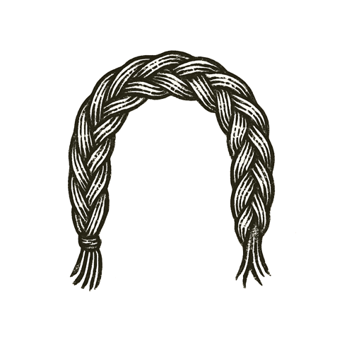

<!-- AI-assisted: new Open for the tenth Gate (September 2051), set at the tomb of Hafez in Shiraz, Iran, by Claude, replacing the earlier fireside-and-stars scene; epigraph from James Legge's public-domain translation of the Analects (1861), 7:1; verify the exact wording against that edition before print; awaiting Sam's pass. -->
<!-- SOURCE-CHECK 2026-11-18: Legge, Analects VII.1, supports this opening clause, with the remainder of the sentence omitted. The 2051 scene and family are fictional. -->

_A transmitter and not a maker, believing in and loving the ancients._  
--- **Confucius**, *Analects* 7:1 (trans. James Legge)

Shiraz, September 2051. Mehregan is a few weeks off, the heat has finally broken, and the garden around the tomb of Hafez is full in the evening, as it has been for centuries.

Shirin has brought her grandfather, because he asked, and because he can no longer manage the steps alone. Her assistant could recite every ghazal Hafez ever wrote, in any of forty languages, with six centuries of commentary on each line. She tells him so, gently, on the way in.

"Good," he says. "Then it won't mind waiting."

At the tomb, he takes out the old Divan he has carried since before she was born, its spine held together with tape, and does what Iranians have done here for generations: he closes his eyes, holds a question in his mind and opens the book at random.

He reads the verse aloud, slowly. It's about a friend's return after a long absence.

Shirin doesn't know what his question was. She notices that he's smiling, and that the people at the next bench have stopped talking to listen. Then her assistant, unasked, very quietly, offers her a translation of one word she didn't know. She lets it.

Her grandfather closes the book and hands it to her.

"Now you," he says.

---

*What will we carry forward, if not the habit of asking the old words a new question?*
