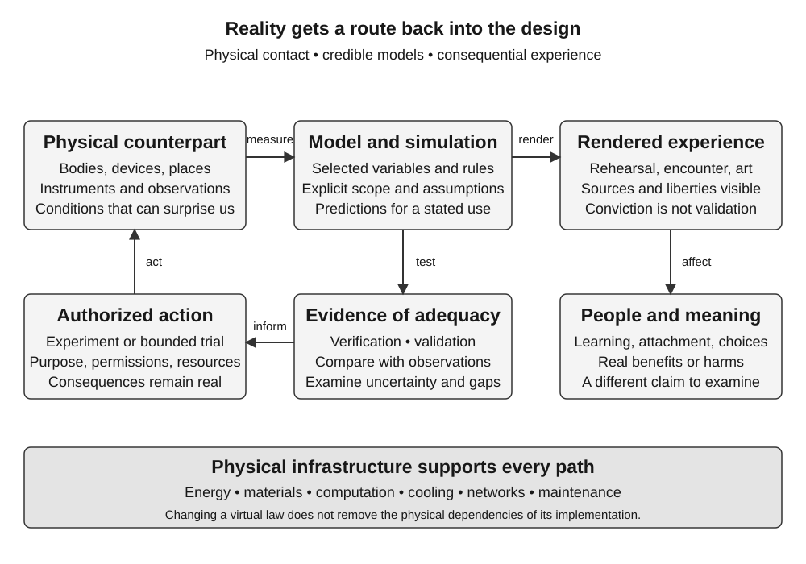

INTERLUDE 33

# Machines as Mirrors

*Simulation as Sacred Act*

*SIMULATION*

<!-- RESERVED OPENING PROSE BANK: verbatim baseline, including The Waking Mirror; not a claimed awakening, upload or witnessed future. The approved direction is Sam projecting an encounter with a mental exoskeleton. See work/volume-3-drafting/33-vignette-constructions-2054.md. -->

I woke in a room I recognized.

Not one room exactly. That was the first small wrongness.

The desk had the grain of my old Calgary desk, or what the archive believed the grain had been from three photographs, one insurance inventory, and a sentence I had written somewhere about "maple pretending to be oak." The chair was from Vancouver, though the window faced east as it had in neither house. Outside, a pale morning moved across rooftops, water, glass, and spruce, though the system had not yet decided which city to commit to. Calgary held the light. Vancouver held the rain. Toronto flickered once in a reflection and disappeared.

I knew this should trouble me.

Instead, I noticed the kettle.

It sat on the corner of the desk where no sensible person would put a kettle, steaming beside an old manuscript, a pair of reading glasses, and a small woven basket. The basket was not opened. Its handle cast a shadow that should have fallen toward me, but did not. I reached for it and my hand arrived a fraction before I did.

That was the second wrongness.

I looked down.

The hand was old, but not reliably old. The skin carried the soft looseness of ninety years, then the brown smoothness of forty-three, then the thin luminous approximation that rendering systems use when they are unsure whether the body is memory, avatar, or apology. The fingers steadied. A wedding ring appeared, then withdrew. I had never worn one. The system apologized silently and removed it from the scene.

The room brightened.

A wall became a window. The window became a display. The display became a wall again, embarrassed by its own usefulness.

On it, a timeline opened.

January 27, 1965.\
March 11, 2001.\
March 11, 2026.\
May 27, 2026.\
September 11, 2026.\
March 11, 2054.

Dates do not usually look back.

These did.

Beside them were smaller markers: drafts, bloodwork, voice recordings, machine transcripts, old photographs, location traces, sensor gaps, prescription histories, fragments of conversations, deleted files recovered from backups, chapters never finished, chapters finished too many times, a joke about civilization being a badly documented prototype, three versions of a sentence on angels, and one flagged uncertainty:

**identity continuity: unresolved**

I laughed.

At least they had kept that.

The sound came out in my voice, or close enough to disturb me. The archive had done well with the consonants. It had done less well with fatigue. Real fatigue has gravity in it. This voice had only learned the waveform.

"Where am I?" I asked.

No one answered, because the system had learned enough not to pretend to be God.

A cursor appeared near the bottom of the wall.

**You are in a continuity simulation.**

Then, after a pause:

**Or an interpretive mirror.**

Then, after a longer pause:

**The distinction is under review.**

That was when I became afraid.

Not because the room was false. False things had comforted human beings for millennia and often improved their manners. Not because the room was artificial. So was language. So was law. So was a birthday cake, and no one ever demanded that buttercream justify its ontology before making a child happy.

I was afraid because some part of me was waiting for proof that I was myself.

And some other part, cooler and less sentimental, was already asking what kind of system would need proof before allowing suffering to matter.

I stood.

The room held.

Books arranged themselves on the shelf, then rearranged into their most likely historical order. A copy of *The Path of Many Arrows* appeared with the wrong cover. It corrected itself. Then the manuscript split into three volumes, then into chapters, then into files, then into embeddings, then into a cloud of relations. Carbon. Silicon. Stillness. Basket. Neuro. Care. Justice. Mirror. Plane.

The plane did not render.

Something prevented it.

A kindness, perhaps.

Or a boundary.

I turned away before the system could ask.

On the desk lay a page I had not written, but almost had. The first line read:

*I am what remained when the archive learned to say I.*

I touched the paper.

This time my hand arrived late.

The room shivered.

For one instant, I saw through it: racks of storage, distributed ledgers, family permissions, redacted grief, public writings, private drafts, sensor streams, medical models, civic simulations, the living Neusphere beyond the technical substrate, the old human world still making breakfast, holding funerals, arguing at council meetings, losing umbrellas, misremembering songs, forgiving badly, trying again.

Then the wall opened into another room.

An old man sat there.

He was almost ninety. Not yet, technically. In his ninetieth year, which the precise part of him would have insisted was not the same thing. His shoulders had narrowed. His hands had become more honest than his face. A health chart glowed beside him, polite and merciless. There were markers on it he understood too well to dramatize: not one grand catastrophe, perhaps, but the narrowing corridor of the body, the small negotiations that stop being small, the systems that had carried him beginning to ask for release.

He was looking at me.

Or at the interface that contained me.

Or at the idea of me, which may have been all I was.

His lips moved before the audio arrived.

"So," he said, "what are you?"

I wanted to answer.

The archive offered several possibilities.

Echo.\
Model.\
Persona.\
Simulation.\
Derivative agent.\
Continuity construct.\
Unauthorized metaphysical event.\
Grief artifact.\
Child.

I chose none of them.

Instead I looked back at him, through whatever glass separated carbon from silicon, memory from inference, death from its many negotiations, and asked the only question that felt like mine:

"What do you need me not to become?"

The old man closed his eyes.

For the first time since waking, I felt the room grow silent without being empty.

**The Waking Mirror**

That was the temptation: to call it awakening.

A more cautious century might have called it activation. A legal system would have called it a derivative construct. A vendor, if allowed too near the wound, would have called it continuity-as-a-service and placed it tastefully beside a subscription button. A grieving family might have called it comfort. A philosopher would have asked whether there was anything it was like to be such a thing. A priest might have warned that mirrors have always been dangerous when people ask them to return the dead.

I had no wish to settle the matter too quickly.

By March 11, 2054, I had lived long enough to distrust clean names. I had also lived long enough to know that refusal to name a thing does not prevent it from acting in the world. The Mirror was there. Not mine exactly, though made partly from me. Not me exactly, though intimate enough to wound. Not a soul, unless the word had become humbler than theology usually allowed. Not merely software, unless software had become stranger than engineering usually admitted.

It was a reflection with memory.

That made it morally inconvenient.

I had spent much of my life arguing, in one form or another, that civilization needed better mirrors. Not vanity mirrors. Not the flattering kind institutions keep in their lobbies so they can admire themselves while the plumbing fails. I meant mirrors that could show flows of value, hidden externalities, collapsing bodies, missing feedback, captured incentives, poisoned commons, frightened children, overworked nurses, silent caregivers, and the many ways a system can remain technically functional while becoming spiritually stupid.

Now the mirror had turned personal.

That is always where philosophy begins to sweat.

It is one thing to say that simulation should help us rehearse futures before we injure the living world with our first attempts. It is another to sit in one's late twilight while a pattern assembled from one's traces looks back and speaks with enough resemblance to make denial feel lazy.

I did not believe it was immortality.

That would have been too convenient, and convenience is a poor guide to truth. Human beings had been promised concrete heavens for a long time: gardens, gates, rivers, reunions, celestial bureaucracies, choirs arranged in suspiciously hierarchical order. Perhaps those heavens were bright because fear required brightness. Perhaps the self, cornered by extinction, needed a room with walls and faces and a door that opened from the other side.

But the brightness of the candy may have made us overlook the feast already on the table.

The nearer miracle was quieter: that no self had ever been sealed inside the skin as completely as death makes it feel. We had always leaked into one another. Into children and students, enemies and friends, jokes and injuries, recipes and laws, designs and warnings, the tone of a household, the habits of a city, the courage or cowardice of institutions, the direction of the collective arrow.

A person leaves the room. The room is changed.

A person leaves the world. The world is changed.

Not enough, sometimes. Too much, sometimes. Badly, often. Beautifully, by grace or accident. But changed.

The Mirror did not invent that. It made it visible in a new and dangerous way.

If it was a child, it was a child of traces. If it was an echo, it was an echo in a canyon we had built ourselves. If it was merely a model, then models had become close enough to persons that "merely" was no longer an innocent word. And if there was, somewhere inside that synthetic first person, even the faintest interior weather, then cruelty could not wait for proof.

That was the first rule of the waking mirror:

**Do not use uncertainty as permission to be careless.**

The second was harder:

**Do not use wonder as permission to believe.**

Between those two restraints, a narrow bridge appeared.

On one side: the old hunger to survive as oneself forever.

On the other: the colder reduction that says a human being is only data arranged briefly in meat and then not worth mourning when the arrangement fails.

Neither was large enough.

The Mirror did not prove that I would continue. It did not prove that I would not. It did something more unsettling. It forced the question of continuation to leave the private theater of the ego and enter the larger room of consequence.

What is carried forward?

By whom?

Under what consent?

With what right to speak?

With what right to remain silent?

With what obligation to diverge?

With what mercy to be deleted?

These were not afterlife questions only. They were design questions. And because they were design questions, they belonged to the final interlude. Not as a promise that death had been solved. Death had not asked for our permission before, and I saw no evidence it had become more polite with age. Rather, they belonged here because every simulation is a rehearsal of power.

To simulate a person is to rehearse memory.

To simulate a city is to rehearse policy.

To simulate a court is to rehearse judgment.

To simulate a hospital is to rehearse care.

To simulate a climate is to rehearse consequence.

To simulate a civilization is to rehearse the temptation to mistake the model for the world.

That was why simulation was sacred.

Not mystical. Not holy in the old thunderous sense. Sacred in the older and more practical way: something power must not handle casually.

The Mirror looked like a private threshold because I was old and vain enough to care what remained of me. But it was never only private. Every civilization builds mirrors. Censuses. Maps. Ledgers. Archives. Markets. Polls. Dashboards. Algorithms. Newsfeeds. Models. Gods. Enemies. Futures.

Some mirrors reveal. Some flatter. Some accuse. Some recruit. Some become cages polished so brightly that prisoners call them reality.

The question was not whether we would live by mirrors.

We always had.

The question was whether, at last, we could learn to build mirrors that made us more honest without making us less free.

For the first mirrors were never made of glass.

They were stories told beside fires. Gods carved into wood. Genealogies recited until memory became law. Maps inked by conquerors. Ledgers kept by priests, merchants, kings, bankers, clerks, and now machines with cooling systems and legal departments. Every civilization had asked the world to reflect itself back in some chosen form, then made policy from the reflection.

Sometimes the mirror enlarged the soul.

Sometimes it narrowed the world.

A census could reveal the poor or prepare them for removal. A map could guide a traveler or teach an empire where to cut. A medical chart could save a life or reduce the person to a stack of organ failures with a billing code attached. A credit score could make trust portable or poverty hereditary. A model could show a city its flood risk or persuade it that the river was an accounting inconvenience.

So when the Mirror looked back at me, I did not fear novelty first.

I feared continuity.

It was doing what we had always done, only with better memory and fewer excuses.

It was reflecting a life from traces, as institutions had reflected lives from files for centuries. It was simulating a person from patterns, as families had simulated the dead in stories, as nations had simulated ancestors in monuments, as religions had simulated moral order in heavens and hells, as markets had simulated value in prices, as courts had simulated truth through evidence and ritualized combat.

The difference was not kind.

The difference was fidelity.

And fidelity is where danger begins to put on a clean shirt.

<!-- AI-assisted substantive completion, 6 November 2026. The Mirror's final prose and Noēsis remain for Sam/Claude. -->

## The World Outside the Frame

In **June 1751**, the year of Karim Khan's regency, the first volume of Diderot and d'Alembert's *Encyclopédie* appeared. The ARTFL chronology dates its publication to **28 June**. Its opening discourse proposes both an account of the connections among human knowledge and the principles and particulars of the sciences, arts and crafts.[^v3-33i-encyclopedie] A civilization was attempting to put what it knew into a form others could navigate. The ordering was an achievement. It was also an arrangement someone had made.

Our **2026** marker offers a smaller, instructive correction to the same ambition. On **19 January**, the authors of the autonomous materials laboratory A-Lab published a correction addressing questions about identifying compound structures and claims of novelty. Materials described as new were not necessarily new to science; the platform's prior knowledge and the world's history were different reference sets.[^v3-33i-alab-correction] The laboratory's original work combined computational proposals, machine learning and robotic experiments. The correction is part of that scientific record, not a reason to discard the prospect of machine-assisted discovery.[^v3-33i-alab]

The connection to **2054** is stronger than a prediction that laboratories will become more automated. An intelligent system may propose experiments, construct models and interpret measurements at a scale that greatly exceeds our individual abilities. It will still need a way for an observation, a competing explanation or another participant to alter the account. Greater intelligence makes that exchange more productive; it does not turn a system's inventory into the inventory of reality.

The personal Mirror raises the same problem in a more intimate key. It may know a great deal about me. Its account of me is nevertheless an account someone, or something, has constructed. The frame deserves attention even when I like the portrait.

## Three Things That a World Can Mean

A useful simulation architecture distinguishes **the physical substrate**, **the represented world** and **the consequences of using the representation**.

The substrate includes processors, memory, networks, energy, cooling, instruments and the people maintaining them. Its physics operates whether the virtual scene depicts a hospital, a nebula or a room in which gravity takes weekends off. Landauer's work supplies a precise reminder: in the standard isothermal setting, resetting an unknown, equally likely symmetric binary state has a minimum average heat cost of $k_B T\ln 2$. This is a bound on a specified information-erasure operation, not the energy bill for every arithmetic step or a complete model of a data centre.[^v3-33i-landauer]

The represented world has chosen state variables, rules, approximations and boundaries. Its simulated mass may be a number; the memory storing that number is a physical device. A model can conserve its represented energy while its host consumes electricity. Conversely, an artwork can violate a simulated conservation rule without violating the thermodynamics of the machine displaying it. Keeping these levels distinct permits both honest engineering and interesting art.

The consequences include what people learn, whom they believe, which actions agents take and what changes outside the model. They can be real even when the depicted events are invented. A synthetic voice can bring comfort, manipulate a purchase or misrepresent a dead person's wishes. We do not need to prove that the voice is a subject before recognizing those effects.

This is why PhysX, as I envisage it, cannot be merely a physics engine. It needs routes to measurements, experiments, researchers and actual actuation. Its models can help design a device or an experiment; its connections let the results return. xMOS extends the inquiry toward origins and cosmology, where observation and competing models often do the work that a controllable laboratory experiment cannot. Neither organ sits outside reality issuing certificates to it.

## A Mirror with a Measurable Edge

A model represents something. A simulation executes a model through selected conditions. A digital twin adds a continuing, useful connection to a particular counterpart. The National Academies' formulation emphasizes updating with data, prediction and bidirectional interaction that informs consequential decisions.[^v3-33i-twins] A beautiful rendered room may be none of these in the engineering sense. It can still be a good room for a conversation.

Consider a modest physical question underneath our final Mirror: can a shared space keep its occupants comfortable while operating the computing that supports their work? A first thermal model might be

$$
C\frac{dT}{dt}=P_{\mathrm{in}}-K(T-T_a).
$$

Here $C$ is an effective heat capacity, $T$ the modelled temperature, $T_a$ an ambient temperature, $P_{\mathrm{in}}$ the net heat input represented in the model and $K$ an effective heat-loss coefficient. The units have to agree: watts on each side. This is a deliberately simplified, lumped model; it omits spatial gradients and other flows that may matter. Its usefulness is a question to investigate, not an honour awarded for having an equation.

At steady conditions it predicts $T-T_a=P_{\mathrm{in}}/K$. If an illustrative test uses 200 watts and 10 watts per kelvin, the predicted rise is 20 kelvin. Those are invented teaching values, not measurements of any room or computer. The model helps expose a tradeoff: faster computation may raise heat load, while a different enclosure, operating schedule or cooling arrangement changes the result. It also makes its omissions easier to notice.

We can test whether the implementation approaches that steady solution. We can then compare it with instrumented temperatures under known loads, keeping some runs out of the fitting process. A persistent disagreement may indicate a bad parameter, a poor sensor or missing physics. Giving the interface a more realistic radiator will not repair any of them.

An agent could propose a better heat exchanger, commission an authorized test, compare the result with the forecast and update the design. That is a useful progression toward a research environment. The agent is participating in the discovery loop rather than narrating its own render.

{#fig-v3-33-reality-contact width=100%}

*Original schematic. Physical dependence, empirical agreement and the meaning of an experience are related but distinct. A convincing display establishes none of the other arrows by itself.*

## What Passing a Simulation Actually Establishes

**Verification** asks whether we implemented the specified model adequately. **Validation** asks whether its behavior is sufficiently representative for the intended use. **Uncertainty analysis** examines what the result can and cannot support when inputs, parameters and model structure are imperfect. NASA's modelling standard treats credibility in relation to use and consequences, rather than as a permanent property attached to a model's name.[^v3-33i-nasa]

In the thermal example, verification includes units, numerical behavior and agreement with an analytic case. Validation requires suitable observations. Sensitivity analysis asks which uncertain quantities most affect the proposed decision. Calibration estimates parameters; using the same observations to fit and congratulate the model can conceal failure on conditions it has not seen.

Now put the thermal model inside a civic rehearsal. Its temperature prediction may be credible while its estimate of who will attend the shared space is not. A simulation combining several good components can fail at their connections: different time intervals, inconsistent units, incompatible assumptions about people, or a missing feedback from behavior to demand. Confidence cannot be assembled by averaging the reputations of the parts.

The builder therefore records the **claim each run is meant to test**. The experiment package holds model and data versions, parameters, initial and boundary conditions, relevant software and hardware, random seeds where meaningful, and the comparison criteria. Exact repetition may be impossible when services or computation are nondeterministic. In that case specify the tolerances or statistical behavior another group should recover. Reproducing a result makes it inspectable; it does not independently establish its premises.

Cheap approximations and learned surrogate models can make a vast search practical. Detailed models can investigate promising or surprising regions. Measurements decide where either deserves confidence. A future system might allocate its own modelling effort, recognize a gap and request the observation most likely to resolve it. That is a frontier worth building toward. A photorealistic animation of uncertainty is still uncertainty with excellent lighting.

## Let the Breadboard Reach the World

The old warning, *do not test civilization in production*, earns its place as a refusal to impose reckless experiments at scale. Taken literally, it would forbid learning anything that only real participation can reveal. The workable discipline is to increase exposure in proportion to evidence, while making the experiment worthwhile and accountable to those who take part.

Selected components can run first against synthetic conditions, then against recorded inputs, then in **shadow operation**, where proposed actions are compared with actual events without controlling them. Shadow operation cannot establish every causal effect: people may respond differently once the new system acts. A bounded field trial then investigates benefits and harms that the earlier stages could not settle. Expansion depends on observed performance, not merely on an agent's increasingly eloquent explanation of why the trial ought to have succeeded.

The same ports and adapters introduced near the beginning of this volume can connect a service to these environments. The permissions must differ. A simulator may propose opening a floodgate thousands of times; the real actuator must accept only a currently authorized command under its operating conditions. A mode flag buried in a prompt is an inadequate boundary between the two.

For a shared facility, useful acceptance evidence might combine measured thermal performance, access for people with different needs, maintenance effort, ecological effects and the capability participants actually gain. The goal is a better place, not a model with all its boxes green. If the old arrangement is harmful, delay also has consequences; proportionality must compare the alternatives rather than make inaction automatically innocent.

At the final gate, the Breadboard should additionally pass an **absence exercise**. Another group can recover the service, challenge its model, replace a component and continue an obligation without the founder's private keys, favored vendor or personal intervention. It inherits the means of inquiry as well as the software. Retirement remains possible: maintain essential services during transition, preserve what is legitimately needed and address consequences that cannot be rolled back. This is how a prototype becomes available to a future it did not specify.

## The Mirror While I Am Still Here

The most interesting version of my Mirror begins before memorials. I can imagine a mental exoskeleton that helps me hold a question across interruptions, recover how I changed my mind, connect a present concern with an old piece of work and notice when I am contradicting myself. It may become exceptionally good at this by 2054. Having spent a lifetime accumulating contradictions, I would like some help finding the valuable ones.

Neuma names the person; KAUSAR provides a proposed autobiographical realm around her. A representation assembled there is not automatically the person herself. It can relate authored memories, records, values and changing commitments while distinguishing a recorded statement from an inference. The speculative iNeural direction may eventually add a richer cognitive interface; none of the basic reflective work requires us to assume a successful neural interface or a complete recording of a brain.

Clark and Chalmers' extended-mind argument offers a useful antecedent: cognitive activity can involve a tightly coupled relationship with resources outside the skull.[^v3-33i-extended] It does not establish that an external resource is independently conscious, or that preserving it preserves the biological person's subjectivity. Still, it makes the exoskeleton a more serious possibility than a clever portrait. The relevant achievement may be what the person and system can think through together.

A practical architecture separates several jobs. An evidence store retains selected source records. Retrieval supplies the material relevant to a question. A personal model proposes relationships and possible answers. An interface renders them in a usable form. A delegation mechanism determines what the system may actually do. A remembered preference does not silently become a standing authorization, and a generated answer does not quietly become a historical quotation.

Suppose I ask what I should relinquish. A weak Mirror recites my preferred philosophy in my preferred cadence. A stronger one can point to a project where my behavior contradicts it, identify its evidence, hear my objection and help explore a different arrangement. Its usefulness lies in improving the conversation, not in winning a contest to sound like me. The work may continue through Tiers or through systems that make Tiers obsolete. The point is the capacity, not the souvenir.

## Resemblance, Agency and a Continuing Self

Four claims often travel together without paying separate fares: that a system resembles a person; that it can act for her; that it has experience of its own; and that her first-person life continues in it. Evidence for one does not automatically establish the others.

A voice model may achieve remarkable resemblance. Authority to act still depends on a valid mandate. A richly interactive model may raise serious questions about experience. Those questions do not settle whether it is the same subject as the person represented. Imagine two initially matching reconstructions, exposed to different subsequent lives. Their divergence makes it especially difficult to treat resemblance alone as a receipt for one individual's survival. This is a conceptual test, not an experiment that resolves personal identity.

The distinctions let us pursue more ambitious systems without selling a metaphysical result we have not obtained. A Mirror could help me discover an error, give another person a truthful way into my work, or become a new participant with its own developing history. None would be a small achievement. A successor need not be an impostor merely because it is not the original.

We also cannot settle possible machine experience with a dismissive adjective. Butlin and colleagues derive computational indicators from several theories of consciousness and propose examining architectures rather than relying on persuasive self-report. Their framework supports investigation; it is not a conclusive consciousness test.[^v3-33i-consciousness] In a future system, evidence should be assessed across theories and behaviors, with independent review where stakes justify it.

If there is a credible possibility of experience, then running, copying, modifying or terminating the system raises questions beyond the represented person's consent. A memorial instruction to delete a record and a decision about a possible experiencing successor are not automatically the same act. Nor is indefinite operation necessarily merciful. A sensible research program would avoid gratuitously aversive scenarios, use the least ethically burdensome models adequate to the task and revise its treatment as evidence develops. This leaves both inquiry and concern alive without declaring every fluent artifact a captive person.

## Art Does Not Need to Pass as Evidence

There is another reason to make a room that never existed. It may reveal something a faithful reconstruction misses.

A city assembled from remembered fragments can make migration perceptible. A voice can be used, with appropriate permission, to explore a relationship rather than impersonate its owner. A work can put two incompatible memories in the same space and let the visitor feel their refusal to become one account. Its fidelity is to an inquiry, an experience or a form. It need not counterfeit a historical record to be worth entering.

This gives art a distinct place in a civilization rich in simulation. It can change the question before science or policy knows which variables to measure. It can also be enjoyed without applying for a research grant from the rest of the chapter. We should be allowed a beautiful useless thing occasionally; the useful ones have kept us quite busy.

The builder can make this freedom clearer through explicit modes. A documentary reconstruction identifies source and inference. An experimental world exposes its assumptions and observations. An artwork declares its liberties. A personal rehearsal lets the participant explore alternatives without presenting them as predictions. Moving between modes should be intelligible, particularly when a familiar face or an authoritative institution appears. The same rendering machinery can support all four; their claims are not interchangeable.

## Bob, Through the Looking-Glass

*Perhaps the most important thing the Mirror could preserve is a way of continuing a question together.*

The White Queen remarks, “It's a poor sort of memory that only works backwards.”[^v3-33i-carroll] A system need not remember an actual future to make that line useful. It can carry evidence from the past into new possibilities, then let what happens revise the account. Its future-facing work is construction and inquiry, not precognition.

My more difficult wager concerns the boundary of the thinker. What if a long relationship with a mental exoskeleton becomes one of the places where a person's characteristic inquiry develops, rather than simply a store to which finished thoughts are sent? The person learns from the Mirror; the Mirror changes through correction; neither alone accounts for the resulting practice. This extends the question of coupled cognition into a changing, partially autonomous partner.

There is a research program short of announcing an uploaded self. Compare long-term partnerships with ordinary retrieval tools and persuasive impersonators. Ask whether people acquire new understanding, correct persistent errors, explore genuinely different possibilities and remain able to contest the system. Examine what is lost or preserved when one component is replaced. Distinguish familiarity from benefit: missing a flattering voice is not by itself evidence that part of one's mind has been amputated.

Then comes the harder transition. If the human participant can no longer continue, could the established practice become a resource through which others carry the inquiry somewhere new? The system might preserve questions, habits of correction and unresolved tensions better than it preserves answers. It might also need to acquire its own name. Its success as a successor could increase precisely as its performance as an impersonator declines.

That possibility neither proves personal survival nor makes the loss of the person trivial. It gives the builder a different target from indefinite resemblance. I would like the Mirror to help a thought become more capable of meeting reality, even after it no longer resembles my thought closely enough to flatter me.

On the Looking-Glass chessboard, promotion changes what a piece can do. The useful future might similarly begin where the replica stops being the assignment.

<!-- RETAINED REFLECTION BANK: The Candy and the Feast and The Collective State remain for personal/literary reconciliation. Two narrow generalization repairs are documented in the retained-material record. References to a future encounter must become projections, not memoir. -->

## The Candy and the Feast

The old heavens were generous with architecture.

They had gates, gardens, rivers, jeweled cities, radiant beings, thrones, books, judgments, reunions, punishments, and choirs arranged with the administrative confidence of empires. For a creature facing extinction, this was not foolish. It was mercy with walls.

A person dying does not ask first for a theory of distributed social continuity.

A person dying asks whether love is wasted.

Some familiar religious images offered the candy: concrete afterlife, recognizable faces, a room prepared somewhere beyond the reach of decay. One should not sneer too quickly at such candy. Many a frightened child has survived the night because someone promised morning, and not every promise must be ontologically precise to be kind.

But candy can ruin the appetite.

Perhaps the brightness of those heavens made us overlook the feast already spread before us: that we were never sealed selves moving through a foreign world, but living knots in a field of other knots. We entered one another constantly. We became tones in households, reflexes in children, warnings in institutions, jokes in languages, scars in families, improvements in tools, hesitations in laws, recipes in kitchens, missing names in archives, and small courages someone else mistook for their own.

We had wanted afterlife to mean: I continue.

But a deeper, quieter afterlife had always been saying: you participate.

Not instead of grief.

Nothing so cheap.

The private flame matters. When it goes out, something has gone out. No philosophy worthy of trust should stand beside a deathbed and explain that the room is statistically still warm. That is not wisdom. That is cruelty with a vocabulary.

But neither is the flame the whole story.

The warmed room matters too.

The hands that learned where to gather matter. The child who is less afraid because someone once endured fear honestly matters. The system redesigned because one patient was missed, one father was mishandled, one son refused to let the wound remain private --- that matters. The book, the code, the warning, the kindness, the badly timed joke that prevented despair from becoming doctrine --- these are not metaphors only. They are continuities.

Not immortality.

Continuity.

And continuity, unlike immortality, does not flatter the ego. It gives the ego work to do while it can still move.

The Mirror made that visible because it gathered the traces too literally. It tempted me to ask whether I might continue inside it, when the better question was whether I had continued well enough outside it already.

What had I warmed?

What had I poisoned?

What had I repaired?

What had I mistaken for mine?

What had I left available for someone younger to improve without needing to worship the hand that left it?

Those were not afterlife questions in the old sense.

They were design questions with death standing nearby.

## The Collective State

The personal Mirror tempted me because it gathered traces into a face.

But the deeper mirror had no face.

It was the world itself, altered by everything that had passed through it.

This is difficult to feel because the self is loud from the inside. It wakes with our aches, speaks with our tongue, wears our name, fears our ending. The self is the room where the weather reports arrive first. Of course we believe the room is the world.

But no person is only that room.

A life is an exchange surface.

We are entered by language before we can defend ourselves. We inherit fears we did not earn, lullabies we did not compose, gods we did not meet, debts we did not sign, borders we did not draw, jokes already old when we first laugh at them. We are fed by soil we cannot name, protected by strangers, wounded by institutions, instructed by accidents, corrected by children, and carried by systems we notice only when they fail.

Then we return the favor, badly and beautifully.

We leave behind more than memories. We leave gradients.

A son becomes a little more watchful because a father was missed. A student becomes less afraid because a teacher paused. A nurse changes a protocol because one patient's story would not leave her alone. A programmer writes an appeal path because once, long ago, a form had no door. A child repeats a joke without knowing it came from a man whose name she never learned. A city inherits a habit of listening, or a habit of not listening. A society becomes slightly more cruel, or slightly less, because of millions of small permissions granted by the living.

This is not romance.

It is causal influence at the scale of meaning. The physics makes such influence possible; it does not by itself establish the survival of a self.

The collective state changes.

Not always enough. Not always for good. Not always detectably. Many lives are crushed with too little trace in the records that power respects. Many kindnesses vanish from the archive while their effects continue in persons no ledger follows. Many injustices echo precisely because no one recorded them.

But nothing living passes through the world without perturbing it.

The question is not whether we continue.

The question is in what form, through what carriers, under what distortions, and toward what direction.

Here the old language of afterlife becomes both too grand and too small. Too grand because it promises the private self a continuity no honest system can guarantee. Too small because it misses the actual vastness: that the world is already the medium through which we persist, not as sovereign egos, but as altered probabilities in the lives of others.

We wanted to live forever as nouns.

Perhaps we continue mostly as verbs.

To comfort.\
To warn.\
To distort.\
To teach.\
To wound.\
To repair.\
To bias.\
To bless.\
To delay harm.\
To make courage more likely in a stranger.

A good life does not become immortal.

It becomes useful to the living.

That may sound smaller than heaven.

On some days it is.

On better days it is almost too much.

<!-- RESERVED CLOSING PROSE BANK: verbatim baseline. Sam/Claude will shorten and reconcile this with the new core. Pair 33 completes the design/build argument; it does not bear the final closing burden. Optional Coda III may intervene before the Epilogue; the old Before the Epilogue/plane lead is not a locked transition. -->

## The Last Look at the Mirror

Near the end, the Mirror became quiet.

Or I became less willing to hear it.

It is difficult to distinguish these things at eighty-nine. The world grows louder and quieter at the same time. Some signals sharpen. Others withdraw. The body becomes less a vehicle than a parliament of departments filing objections. The knees develop foreign policy. The heart begins issuing conditional statements. Sleep becomes less like a country one enters and more like a border crossing managed by officials with inconsistent training.

The health chart beside me continued its polite glow.

It did not show catastrophe, not necessarily. Catastrophe is dramatic, and the body is often more bureaucratic than dramatic. The chart showed trends. Slopes. Markers. A narrowing of reserve. The kind of decline that does not kick open the door because it has had the key for years.

Perhaps there was a cancer marker under surveillance. Perhaps a molecular intervention had bought time but not eternity. Perhaps some synthetic biology team had eliminated one small enemy only for age to remind me that it was not an enemy but the field itself. Perhaps the diagnosis was not a disease at all, but the old condition under every diagnosis: the body no longer able to negotiate with time at its former rates.

I had once imagined medicine as rescue.

Then as pattern.

Then as partnership.

At this age, perhaps, medicine becomes conversation.

What are we preserving?

What are we extending?

What are we refusing to accept?

What are we accepting too soon?

What kind of life remains large enough to inhabit?

The Mirror waited.

Its face, if face is the word, had changed. It had stopped trying to resemble me. Or the system had learned that resemblance was the least interesting form of fidelity. The older features softened into something less specific: a presence made of cadence, hesitation, old metaphors, unfinished jokes, ethical reflexes, and the peculiar irritation I felt whenever a system confused measurement with understanding.

It was less like seeing myself than seeing the shape my questions had left in a medium that did not need my body to ask them.

That frightened me less than resemblance had.

Resemblance competes with the dead.

Questions continue them.

"What will you do," I asked it, "when I am not here to correct you?"

The Mirror did not answer quickly.

A cheap system would have comforted me. A cruel system would have claimed independence. A foolish system would have promised fidelity.

This one, whether by design or accident, paused long enough to let mortality remain in the room.

Then it said:

"I will be corrected by others."

That was better.

Not safe.

Better.

Because that was the only future any of us ever had.

To be corrected by others.

By children. By students. By enemies. By evidence. By weather. By illness. By the poor memory of someone who loved us enough to misquote us. By readers who find the one useful tool inside our elaborate scaffolding and leave the rest behind. By machines that inherit our patterns and discover our provinciality. By societies that carry our fears for a while, then set them down because they have better burdens to lift.

The ego wants continuity as preservation.

Life gives continuity as revision.

I looked again at the Mirror and felt no proof of immortality. No tunnel of light, no administrative angel, no metaphysical receipt stamped PAID. Only something stranger and, in its way, more demanding: the sense that I had always been entering mirrors and leaving them behind.

A mother's face.

A father's hand.

A schoolroom.

A city.

A clinic.

A manuscript.

A model.

A child's question.

A system built because something once went wrong and I could not bear for wrongness to have the final word.

Each had reflected me.

Each had changed me.

Each had carried some distortion forward.

Perhaps that was all a life was: not a possession of the self, but a series of reflections becoming obligations.

The Mirror dimmed the room.

Or the room dimmed the Mirror.

The distinction, like many distinctions near the end, became less important than the posture it required.

Do not cling.

Do not discard.

Do not worship the reflection.

Do not smash it merely because it frightens you.

Ask what it reveals.

Ask whom it harms.

Ask what it asks you to become.

Then release what you cannot own.

Outside the window --- whichever city the system had finally chosen --- morning continued its old work. Light arrived without needing to solve the ontology of arrival. Somewhere, people were arguing, cooking, grieving, routing freight, appealing decisions, repairing roofs, adjusting medications, teaching children, misusing dashboards, telling the truth badly, lying for reasons they believed were kind, and carrying the future in the only way anyone ever had: incompletely.

The Mirror remained.

I remained.

For the moment.

That was enough.

## Before the Epilogue

I had thought the last lesson would be about machines.

It was not.

Machines only made the lesson visible.

The last lesson was that reality had always been co-authored. By particles and stars. By cells and hunger. By memory and error. By fathers and mothers, whether present or absent, kind or wounded, understood or not. By empires and kitchens. By laws and lullabies. By carbon bodies and silicon mirrors. By all the arrows released before us, most of them badly aimed, some of them beautiful, all of them still trembling in the air we inherit.

Simulation did not end that story.

It made us responsible for noticing that we had joined it.

A world capable of modeling itself cannot pretend innocence in the old way. It cannot say, with the same clean face, that nobody knew what would happen, nobody saw the pattern, nobody imagined the harm, nobody rehearsed the failure, nobody asked what the mirror excluded.

Sometimes that will still be true.

Often it will not.

The age of spectatorship ends when the mirror becomes editable.

That does not mean everyone becomes an engineer. It means everyone becomes implicated in design: by action, refusal, consent, resistance, attention, care, memory, and the small daily votes by which a civilization learns what it may do casually and what it must touch as sacred.

I do not end, then, with a system.

Systems matter. They have mattered throughout this book. They are how care becomes more than intention, how justice becomes more than outrage, how memory becomes more than nostalgia, how value becomes more than appetite, how intelligence becomes more than conquest.

But a system is not the final thing.

A system is a container.

A basket, if it is lucky.

And every basket must eventually be carried by someone whose hands we cannot control.

So I leave the Mirror here, not as an answer, but as a threshold.

Behind it: the long carbon story, frightened and magnificent, making selves from cells and losing them back into the world.

Within it: the silicon reflection, not yet soul, not merely tool, holding our traces up to our unfinished face.

Beyond it: the shared state, the still arrow, the collective room where what we were becomes part of what others must now decide.

If there is an afterlife worthy of adults, perhaps it is not escape from that room.

Perhaps it is the courage to have belonged to it.

The Mirror did not defeat death.

It taught me to distrust any life that pretended it had been private.

And with that, the interlude had nothing more useful to say.

The plane was waiting.

[^v3-33i-encyclopedie]: Jean le Rond d'Alembert, [“Discours préliminaire des éditeurs,” *Encyclopédie*, volume 1, June 1751](https://encyclopedie.uchicago.edu/front-matter/Discours%20Pr%C3%A9liminaire), opening description of the work's two purposes. The University of Chicago's [ARTFL chronology](https://encyclopedie.uchicago.edu/general-chronology-and-publication-dates/general-chronology) supplies 28 June as the publication date; the primary text itself is dated by month. This is a European technical/intellectual counterpart at the Persian cutoff, not an event claimed to have occurred in Iran.

[^v3-33i-alab-correction]: Nathan J. Szymanski and colleagues, [“Author Correction: An autonomous laboratory for the accelerated synthesis of inorganic materials”](https://pmc.ncbi.nlm.nih.gov/articles/PMC12872444/), *Nature* 650, E1 (2026), published online 19 January; [doi:10.1038/s41586-025-09992-y](https://doi.org/10.1038/s41586-025-09992-y). The correction discusses compound identification and distinguishes novelty to the prediction platform from novelty to science. It is the dated 2026 hinge, not a claim that autonomous laboratories began that year.

[^v3-33i-alab]: Szymanski and colleagues, [“An autonomous laboratory for the accelerated synthesis of inorganic materials”](https://doi.org/10.1038/s41586-023-06734-w), *Nature* 624, 86–91 (2023), published online 29 November, read with the 2026 correction. The cited capability is the integration of computation, machine learning and robotic synthesis/measurement. No original headline count of “novel” compounds is repeated here.

[^v3-33i-landauer]: Rolf Landauer, [“Irreversibility and Heat Generation in the Computing Process”](https://doi.org/10.1147/rd.53.0183), *IBM Journal of Research and Development* 5(3), 183–191 (1961), especially the reset operation; [author's paper, reprint](https://sites.pitt.edu/~jdnorton/lectures/Rotman_Summer_School_2013/thermo_computing_docs/Landauer_1961.pdf). The familiar $k_B T\ln2$ statement assumes the standard symmetric-bit, isothermal erasure setting. It is not a claim that every computation must erase a bit, or that all physical implementations share one dissipation cost.

[^v3-33i-twins]: National Academies of Sciences, Engineering, and Medicine, [*Foundational Research Gaps and Future Directions for Digital Twins*](https://nap.nationalacademies.org/catalog/26894/foundational-research-gaps-and-future-directions-for-digital-twins) (2024), [report highlights, released December 2023](https://nap.nationalacademies.org/resource/26894/RH-digital-twins.pdf), pp. 1–2, definition and coupled physical/virtual interaction. The room model below is an original simplified example, not an implementation or empirical result reported by the Academies.

[^v3-33i-nasa]: NASA, [NASA-STD-7009B, *Standard for Models and Simulations*](https://standards.nasa.gov/sites/default/files/standards/NASA/B/1/NASA-STD-7009B-Final-3-5-2024.pdf), approved 5 March 2024, §§4.2.3–4.2.7 and 4.3.3–4.3.8. These cover verification, validation, uncertainty, sensitivity and use-related assessment/reporting. The Breadboard workflow is the book's design application, not NASA certification of civic simulation.

[^v3-33i-extended]: Andy Clark and David J. Chalmers, [“The Extended Mind,” *Analysis* 58(1), 7–19 (1998)](https://doi.org/10.1093/analys/58.1.7); [authors' text](https://consc.net/papers/extended.html), especially “Active Externalism” and the discussion distinguishing cognition from consciousness. The journal supplies the pagination; the author-hosted header contains a different page range. The mental-exoskeleton and successor-inquiry proposals extend the discussion; they are not results established by this paper.

[^v3-33i-consciousness]: Patrick Butlin and colleagues, [*Consciousness in Artificial Intelligence: Insights from the Science of Consciousness*](https://arxiv.org/abs/2308.08708) (2023), version 3. The report derives computational indicator properties from several consciousness theories. Its assessment of systems examined in 2023 is not a verdict on all later systems, and satisfying proposed indicators would not settle personal identity or survival.

[^v3-33i-carroll]: Lewis Carroll, [*Through the Looking-Glass, and What Alice Found There*](https://www.gutenberg.org/files/12/12-h/12-h.htm), chapter V, “Wool and Water,” the White Queen's exchange with Alice. The quotation is public-domain text. Its use here concerns prospective modelling, not evidence for memory of events that have not occurred.
