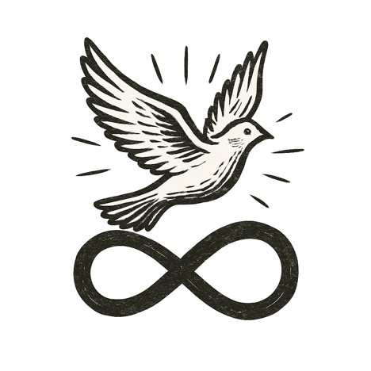

<!-- AI-assisted: new Open for the eleventh and last Gate (March 11, 2054), set at the wind phone in Ōtsuchi, Iwate, Japan, by Claude, replacing the earlier bracelet scene; epigraph from 1 Corinthians 13:13 (King James Version, public domain), the New Testament's single appearance among the Opens; awaiting Sam's pass. -->
<!-- SOURCE-CHECK 2026-11-18: 1 Corinthians 13:13, King James Version. The incoming "single appearance" note means Volume III Opens only. Bell Gardia's own account dates the wind phone to December 2010 and describes its origin in grief for a cousin. Its continued presence and this family in 2054 are fictional. -->

_And now abideth faith, hope, charity, these three; but the greatest of these is charity._  
--- **1 Corinthians 13:13**

Ōtsuchi, March 11, 2054. On a hill above the sea stands a white telephone booth in a garden, with an old rotary phone inside that isn't connected to anything. It has stood there since before the great wave of 2011, when a man put it up to talk to a cousin he'd lost, and after the wave, thousands came to use it.

Mrs. Kikuchi comes every year on this day. She is ninety now, and her granddaughter drives her up the hill.

In the car, the granddaughter offers, gently, as she does every year: her assistant has her grandfather's letters, his recordings, the way he laughed. It could answer in his voice. Many people do it now. It's very good.

"I know," says Mrs. Kikuchi. "That's why I don't."

At the booth, she lifts the receiver and dials the number of a house that hasn't stood for forty-three years. Her granddaughter waits outside, as she has been taught, and doesn't listen. The wind does most of the talking.

When Mrs. Kikuchi comes out, she's smiling, a little.

"What did he say?" the girl asks, as she does every year.

"Nothing," says her grandmother, and takes her arm for the walk down. "That's how I know it was him."

Below them, the sea is calm, and the first cherry buds on the hillside have not yet decided to open.

---

*What will we keep, once we've learned to let go of everything we've built?*
