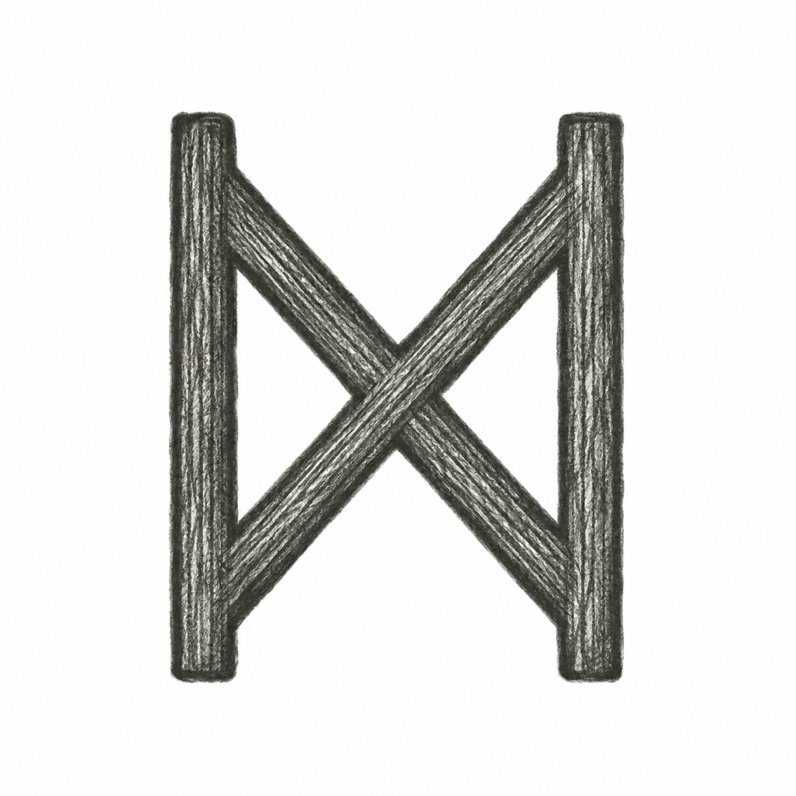

{width=1.75in}

<!-- AI-assisted: first draft of Coda III by Claude, from Sam's notes of November 2026 and the completed Volume III drafts; awaiting Sam's pass. The rune poem's English is Bruce Dickins's public-domain translation (1915); verify wording before print. -->

CODA TO VOLUME III

The Day and the Basket

> "Day, the glorious light of the Creator, is sent by the Lord;\
> it is beloved of men, a source of hope and happiness to rich and poor,\
> and of service to all."\
> --- **Anglo-Saxon Rune Poem (Dæg)**[^v3-coda-rune]

Volume I folded paper turtles into an origami of emergence. Volume II walked into the shop like a bull with better manners and listened for the hollow notes. Volume III did the least glamorous thing of all: it set up a workbench. It soldered one promise, then another, onto a breadboard, and kept asking whether the current would reach the person at the other end.

The rune for that is Dæg, day. Not the lightning of revelation, and not the noon of triumph, but the ordinary daylight in which work can be seen and checked, the light the old poem calls a source of hope and happiness to rich and poor, and of service to all. Of service to all is a demanding standard. Most of what this volume built was an attempt to meet it, one seam at a time.

## What the Workbench Made

Look back along the eleven Gates and the volume has a shape. It began with renewal: help that can find the door, and an owner for every promise until the promise is kept. It asked next what that help may ask of the person behind the door, and answered with lent agency, help that can be refused, narrowed and recalled. Then it followed what people give and receive, through a ledger that remembers the loaf without scoring the baker; how they come to share a world, through corrections that travel all the way to the life they bent; and what they hold in common, a river that keeps its own reserve. It built a workshop where a drawer could close again, a governance its founder could lose a vote in, a justice that arrives before anyone has to ask, a care that changes the mechanism and not only the forecast, and an inheritance its descendants can answer. And it ended with release: successors who hold the authority to change course, and a founder who finds he wants the work to need him less.

The two looms ran beside each other the whole way. The chapters asked what a society should be and what living in it should feel like; the interludes asked what it would take to build that function without becoming its new tyrant. Three vines climbed the same trellis: the long Persian story of meanings that outlive armies, the American and Canadian story of forms that outlive their purposes, and the empire of speed, which compresses both into the gap between one model release and the next. And beneath every Gate sat the Breadboard, never offered as a utopia or a proof, only as a place small enough to be contradicted.

If the volume has a single engineering lesson, it's this: **a civilization isn't held together by its intelligence, but by how many of its promises have an owner.** Everything else, the ledgers, the meshes, the protocols, the twins and the mirrors, is a way of keeping promises from falling between the hands that made them.

## What the Values Are For

And then, at the end of the workbench, the same thing happened that happened at the end of the other two volumes: the material turned around and showed me its other face.

All through this book, I'd kept a private list, a word for what each domain of Volume I is trying to be when it works. Physics, when it works, is *correct*. Biology is *healthy*. A brain is *honest*, its model of the world true to the world. A person is *happy*. A society is *loving*. An industry is *good*, in the old sense of a good knife or a good bridge. Further up, the words had to be larger, because the domains are. An economy at its best is *fair*, fair at the scale of everyone it touches, which by now is everyone. A nation, at its best, reaches toward *planet*: not by abolishing countries, which have invested too differently in themselves to be dissolved without some impossible equalization, but because people no longer resemble each other merely by sharing a geography, and their belongings have become patched, overlapping and connected, a mosaic with its interconnects inside it. An ecosystem at its best is *balanced*, a happy ecology, if ecologies can be happy. Information at its best is *truth*: not a thousand silos, each with its own private schema, but one world described consistently enough that every record can be checked against every other. And an ideology, at its best, reaches toward *God*.

I mean that last word with a capital letter and a condition. *God*, here, is the version every tradition would have to share: the common values all of them were reaching for, compatible with each other and with what we've learned about the universe. Call it by any name your ceremony prefers, Allah, Yahweh, Christ, Ahura Mazda, Bhagwan, Shiva or, for that matter, the Flying Spaghetti Monster or John Frum, and keep every ritual you love. What I ask in return is that the name be wired to the same reality as everyone else's, and not to a placebo. This puts considerable pressure on Mr. John Frum.

I'd always treated the list as a set of ideals, the kind of words one carves above doors. Volume III taught me to read it differently. These aren't ideals. They're **sensors**. Happiness isn't the meaning of a person's life; it's the person's instrument for knowing whether that life is going well, the way pain is the body's instrument for knowing where it's hurt. Love is how a society feels its own cohesion from the inside. Health is how a body reads its own function. Truth is how information checks itself against the world. Each value is a domain's proprioception: its way of sensing, from within, whether it's still doing what it's for.

And once you see them as sensors, you see how they fail, because sensors fail in only a few ways. They can be starved, as a person whose happiness has nothing real to report on. They can be overloaded, as a society asked to love everything at once and so loving nothing in particular. And above all, they can be short-circuited: wired directly to a signal that satisfies the sensor without satisfying the need it was built to measure. A feed that delivers the feeling of connection without connection. A purchase that delivers the feeling of security without security. A slogan that delivers the feeling of belonging without anyone to belong to. A metric that delivers the feeling of truth without the world. Goodhart's law, it turns out, doesn't only govern institutions. It governs the heart. Every value has its placebo, and a great deal of modern life is a very profitable industry in placebos.[^v3-coda-goodhart]

That's the Erlking's real offer, I think: not monsters, but sweeter signals. *Du liebes Kind, komm, geh mit mir!* Lovely games, gold garments, daughters to dance with. Every temptation in the poem is a counterfeit of something the child actually needs. The forest doesn't attack the boy's body first. It attacks his sensors.

So the design task of the values isn't to preach them louder, which every tradition has tried, or to measure them harder, which every dashboard has tried. It's to **rewire them to the realities they were made to report on**: happiness to lives that are actually going well, love to societies that actually hold, truth to the world and not to the feed. Neither overloaded nor starved nor short-circuited. Preserved, and reconnected.

Which leaves one blank on my list. What does the Neusphere sense? What is its value, the word for what it's trying to be when it works? I'd pencilled in *Zeitgeist*, and never liked it. The answer had been closing every interlude since Coda II named it: *noēsis*, understanding, the faculty that reads all the other sensors together and knows what they mean. A person can feel happy and be wrong; a society can feel loving and be blind; an economy can report growth while its substrate erodes. Understanding is the sensor that notices when the other sensors disagree. Volume I found the missing organ by climbing; Volume II found the same gap by diagnosis. Volume III found what the organ is for. It isn't a brain that thinks for us. It's the sense by which a civilization can tell when its own feelings have been counterfeited. And in giving a civilization that sense, it would give it something close to what the Blue Fairy gave Pinocchio: not a new body, but the beginnings of an inner life, a collective feeling able to know whether it's true. Once I saw that, the old values stopped sounding hollow to me. Religious or not, they were the oldest sensors we had, and they deserve reverence, including, in their grandest bundle, the one some of us call God.

## The Jewel in the Caravan

There's a film I've always loved for a twist that its own cast seems slightly embarrassed by. In *The Jewel of the Nile*, everyone is chasing a fabulous jewel across the desert: adventurers, a dictator, a novelist and her soldier of fortune. The jewel, it turns out, isn't a stone. It's a man, a gentle holy man travelling with them, whose wisdom, calm and kindness are what the prophecy meant. They'd been carrying the jewel in their caravan the whole time, arguing over the map.[^v3-coda-jewel]

The Neusphere is like that. Much of what it would have to do has been with us all along, in fragments. Every religion that taught its people to feed the stranger was running a provision service. Every tradition of the sabbath and the jubilee was a resource governor. Every village that met under a tree to settle a dispute was a justice protocol, and every grandmother who knew which neighbor needed a visit was a sensing network with excellent recall. Our feelings themselves, the warmth of sharing, the sting of unfairness, the pull of belonging, were the oldest instruments we had for keeping a band of primates coherent, and they still work in wolves and chimpanzees, who've never read a word about governance.[^v3-coda-social-feeling]

What we never managed was the plumbing. The jewel was always there, but the pipes were old: leaking, cross-connected, short-circuited and, in places, leaded. The child bathed in her own water while the plumbing did its own thing, unconnected. And every attempt to deliver the clean water ran into the same problem: we could never separate the child from the bathwater. The peddlers of dirty water as snake oil, the priests who kept the keys and the politicians who kept the fears, the extractors and the distorters, always seemed to win an upper hand, and the message drowned in its own sediment.

The task isn't to throw out the water, which my teenage self tried, to his spectacular detriment. Nor is it to filter out every grain of noise, which Interlude 15 warned would leave the system too still to move; a little noise is how a living thing keeps its footing. It's to keep the signal and enough of the noise to stay mobile, and to lose the sludge. Or, in the language of the two ladders: take the coal, the carbon of all those traditions, and don't throw it away. Use our new friend, the silicon, the refined sand of our machines, to sandblast the jewel out of it.

## The Bargain

Which brings me to the bargain this volume has been quietly offering, in its Opens and its chapters, to every faith and every nation. People won't abandon their religions because a book asks them to, and they shouldn't have to. Religions were the science and the governance of their times, the best story their makers could tell with the instruments they had, and the story we tell now with telescopes and genomes is only a better one, the best we have so far. So here is an author's modest bargain. I accept your tradition, and I won't ask you to give up any of it. In return, I ask you to look past its ceremony to its purpose, and to let that purpose run its plumbing to the reality we can now see. In software, this is called the adapter pattern: many different interfaces, each with its own shape and history, all coupled to the same underlying system. Keep the interface. Change only the wiring behind it. And when a tradition says exactly the right thing, as every one of them quoted at the head of this volume's Opens has done, I'll say so, gladly, because it's one more voice pointing toward the same organ.

## Shoot the Engineers

In my fraternity house in Los Angeles, someone had a poster on the wall: *There comes a time in every project when you have to shoot the engineers and start production.* I've thought about it for decades, mostly in relation to religions. Each of them arrived as a revolution: a design for how people should live together, fitted to the world as its founders could see it. Their times became their breadboards. And somehow we never left the breadboards. The adherents are still at the drawing board, arguing over the wiring diagram, centuries after the circuit should have gone into production and been improved by the people actually using it.

Nations have the same problem in a different key. They began as an extension of the band, grew by persuasion, conquest and the moulding of minds, and stopped growing just short of the only scale that would have made sense for a species on one planet. Competing nations might work as a market in ways of living, if people could move freely among them, but mostly they can't, and when they do, they pay in language, climate, family and belonging. Unless, perhaps, the nation itself became portable: a set of commitments a person could carry, the way a private network travels with a laptop, layered and plural, without having to cross a border to change allegiance. That's what MOxAIC gestures toward, and what C4A tests on the Breadboard: not one world government, but belonging that can overlap and move.

None of this means shooting anyone, engineers included. It means moving from the breadboard to production, carefully, with the users inside the loop: keeping what each tradition proved on its bench, and finally letting it serve at the scale of the whole child.

<!-- AI draft, 2026-11-15. -->
## The Twist

At the end of the first volume, I promised that the ouroboros would twist in the last one. Here is where it did. Coda I found that the snake's bones (physics, life, Gaia) don't take instructions, but its joints do: the stories held up only by expectation. A snake moves by bending the joints that bend, and this volume bent three of them. Ideology bent when its values stopped being carved above doors and became sensors, rewired to the realities they report on. The nation bent when belonging became something a person could carry. And the economy, the stiffest joint of all, bent when we stopped asking the invisible hand to find our prices after the fact, by spending the planet and seeing what survived the competition. The invisible hand did us real good, but it only ever emerged on top of an expensive substrate: everyone supplying, demanding, competing and scaling, out loud and in the world. This volume asked for an economy that does more of its searching among possibilities first, in models and in shared wisdom, before anything is spent, and that lets value emerge from what people need and what Gaia can spare. Move a story to a different layer, and the whole snake turns with it. That's the twist: not a coil pulled tighter, but a body that can finally go somewhere.
<!-- End AI draft 2026-11-15. -->

## The Rider, the Horse and the Child

So here, at the end of the building, is the poem I've been carrying since the first coda, and what I think it's been about.

The father is Carbon: tradition, the long ladder of emergences and stories, everything that held us together before the machines arrived. The horse is Silicon: speed, power, the gallop that the empire of speed has made of the last few decades. The child is civilization, and the father's arms are the basket. The forest is the substrate, the confounder, the stack of turtles and whatever stacks them, a world that affects us not only physically, as fever affects a child, but directly, through our feelings, and often against the very ends those feelings evolved to serve. And the Erlking is chaos, wearing the face of every manufactured need, fear and desire that has ever whispered to us that it knows a sweeter game.

The farm is the future. The poem's terrible question is in what condition we'll reach it, and there are worse endings than Goethe's. The horse might gallop on without its rider, speed for its own sake, reins trailing through the trees. The rider might be thrown, and trudge on barefoot with nothing but a story about where the farm used to be. The child might be dropped somewhere along the way, and the father not notice until he reaches the gate. Or the rider might arrive anywhere at all, a bare clearing, and call it the farm, because he can't bear to have ridden all night for nothing.

What this volume has argued is that the farm isn't somewhere else. It isn't a utopia over the hills or an artificial density in a server hall. It has to be carved out here, in the same forest, while the ride is still going on, because the child has to survive here and now, not on arrival. The Erlking isn't a king to outrun. He's the forest's chaos, to be tamed where it lives. And the Neusphere sits exactly where Coda I first placed it: between the forest and the fever, between the limits we can't escape, the planet's and chaos's alike, and the needs we can't ignore, the child's healing. It's the farm built in the gap between them, at the gallop: the plumbing laid while the water's still running, the basket rewoven while the child is still inside it.

## The Requirements

That's also the honest answer to what this book is. I spent years of my working life as a business analyst, sitting with people who couldn't quite say what they needed, asking question after question until the shape of a system appeared in the answers. Without quite intending it, I've done the same thing here, at the scale of a civilization. Volume I was the current-state analysis: the domains, the emergences, the stories, everything the system already does. Volume II was the gap analysis: where it fails, why, and the missing pause at the center of all of it. Volume III was the first draft of the requirements: what the system must do, what it must never do, what evidence would show that it works and where to test it before anyone has to depend on it.

This book, in other words, is a requirements elicitation for the full stack of the Neusphere. It isn't the design, and it certainly isn't the build. Every requirement in it can be challenged, revised and overruled by the people who'll live inside whatever gets built, which, as the last chapter argued, is the point. But a system nobody has specified can't be built well, and one whose users were never asked what they needed will always be built for someone else.

And that leaves the question I've been circling since the Prologue, when a frightened child clutched a basket on a plane: in the end, are we carrying the basket, or is the basket carrying us? For most of history, the honest answer was the second. Our traditions, institutions and stories carried us more than we carried them; we rode where they rode and called it choosing. Volume II found that a civilization that can't pause can't steer, and that the only way to steer is from inside, with a model rich enough to match what we're steering. The volume's one hope is that for the first time, with Carbon and Silicon together, we might have that model, and so be able to do both: to carry what carries us, and to reweave it while we do.

The day has come up over the workbench. The circuits are on the board. The rider is still in the forest, the gallop hasn't slowed and the child is still in his arms.

---

> Dem Vater grauset's; er reitet geschwind,\
> Er hält in den Armen das ächzende Kind,\
> --- **Goethe**, *Erlkönig*[^v3-coda-goethe]

<!-- SOURCE NOTES: the Anglo-Saxon Rune Poem in Bruce Dickins, *Runic and Heroic Poems of the Old Teutonic Peoples* (1915); Goethe, *Erlkönig* (1782); *The Jewel of the Nile* (1985), directed by Lewis Teague. Verify each before print. -->

[^v3-coda-rune]: Anglo-Saxon Rune Poem, *Dæg*, in [Bruce Dickins, *Runic and Heroic Poems of the Old Teutonic Peoples* (Cambridge University Press, 1915)](https://en.wikisource.org/wiki/Rune_poems#Anglo-Saxon_Rune_Poem). The epigraph follows Dickins’s English wording. Dæg names day; the day-rune is also known as Dagaz.

[^v3-coda-goodhart]: For a modern account of distinct failures when optimizing a proxy, see David Manheim and Scott Garrabrant, [“Categorizing Variants of Goodhart’s Law”](https://arxiv.org/abs/1803.04585) (2018). Extending this to felt values and a civilization’s “proprioception” is my proposal, not a theorem about emotions. A collective capacity to detect disagreement need not imply a single conscious subject.

[^v3-coda-jewel]: [*The Jewel of the Nile*](https://catalog.afi.com/Film/57723-THE-JEWELOFTHENILE), directed by Lewis Teague (1985); the American Film Institute’s synopsis identifies Al-Julhara, the holy man, as the “Jewel.” The jewel-in-the-caravan reading here is the author’s.

[^v3-coda-social-feeling]: Jennifer L. Essler, Sarah Marshall-Pescini and Friederike Range, [“Domestication Does Not Explain the Presence of Inequity Aversion in Dogs”](https://pubmed.ncbi.nlm.nih.gov/28602652/), *Current Biology* 27 (2017): 1861–1865.e3, reports reward-inequity responses in wolves and dogs. Chimpanzee responses are sensitive to social context: Jan M. Engelmann et al., [“Social disappointment explains chimpanzees’ behaviour in the inequity aversion task”](https://pubmed.ncbi.nlm.nih.gov/28835562/), *Proceedings of the Royal Society B* 284 (2017): 20171502. These findings support evolutionary continuities and competing mechanisms, not an assertion that nonhuman animals experience every human moral feeling in the same way.

[^v3-coda-goethe]: Goethe, [“Erlkönig”](https://projekt-gutenberg.org/authors/johann-wolfgang-von-goethe/books/johann-wolfgang-von-goethe-gedichte/chapter/128/), the first two lines of the final stanza. The stanza is deliberately left incomplete here; the epilogue takes up the arrival and withholds the last line. The assignment of Carbon, Silicon and civilization to the poem’s figures is this book’s interpretation.
