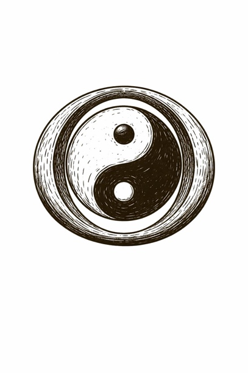

<!-- AI-assisted: cleaned up from Sam's original Open Θ; awaiting Sam's pass -->
<!-- Volume III Opens draw on the world's wisdom traditions, one virtue each. The epigraph is from James Legge's public-domain translation of the Tao Te Ching (1891), chapter 64; verify wording against that edition before print. -->
<!-- SOURCE-CHECK 2026-11-18: Legge, Tao Te Ching 64, reads "commenced", not "commences". Corrected the epigraph verb; capitalization is adapted to its standalone placement. -->

_The journey of a thousand li commenced with a single step._  
--- **Laozi**, *Tao Te Ching* 64

In the beginning, the Chinese storytellers say, there was only an egg.

Not a fragile breakfast egg, but an absolute one: a sealed whole in which sky and earth, light and dark, order and chaos were mixed in a single, undifferentiated sleep.

Then Pangu woke.

He didn't *discover* a world. He *made* one, by splitting it. With every breath he took, the light rose and the heavy sank; with every day that passed, the distance between them grew. The universe became navigable only because someone did the violent, careful work of separation: yin from yang, above from below, what is from what could be.

Diagnosis is noticing that the egg is cracking.

Design is deciding where the seam should go, and

---

*what kind of world you'll be responsible for once it opens.*
